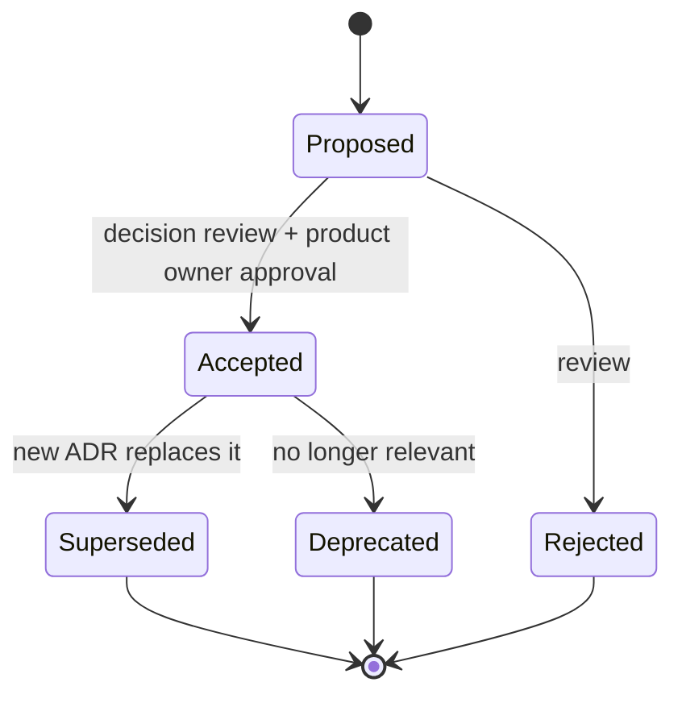

# ADR-0001: ثبت تصمیم‌های معماری (Record Architecture Decisions)

| ID | Title | Status | Confidence | Date | Deciders |
|---|---|---|---|---|---|
| ADR-0001 | record-architecture-decisions | **Accepted** | Firm | 2026-10-11 (۱۴۰۵/۰۷/۱۹) | Architecture (pending product owner approval) |

Version: `0.1`

Related documents: [ADR index](README.md)، [technology-evaluation.md](../technology-evaluation.md)، [open-questions-and-assumptions.md](../open-questions-and-assumptions.md)

## Context (زمینه)

- [واقعیت F-01] مخزن در شروع Phase 0 خالی بود؛ هیچ تصمیم ثبت‌شده‌ای وجود ندارد.
- [واقعیت F-02] مالک محصول خواسته است مستندات به فارسی با شناسه‌های انگلیسی باشد، معماری سازمانی با تحویل تدریجی و بدون پیچیدگی غیرضروری دنبال شود، و پیش از تأیید صریح هیچ پیاده‌سازی انجام نشود.
- بسیاری از تصمیم‌های Phase 0 به پرسش‌های باز (Q-xx) و بنچمارک‌ها (BM-xx) وابسته‌اند. بدون سازوکار ثبت، دلیل تصمیم‌ها و شرط بازبینی آن‌ها گم می‌شود و تیم ۴ تا ۸ نفره ([فرض A-03]) در طول هفت فاز نمی‌تواند سازگاری را حفظ کند.

## Decision (تصمیم)

[توصیه] همه تصمیم‌های معماری که (۱) اثر بین‌ماژولی دارند، (۲) برگشت آن‌ها پرهزینه است، یا (۳) به فرض/پرسش باز وابسته‌اند، به‌صورت ADR در مسیر `docs/architecture/architecture-decision-records/` با نام `ADR-00NN-<kebab-title>.md` ثبت می‌شوند. ADRها بخشی از کد مخزن‌اند (documentation as code — NFR-MNT-003) و از طریق Pull Request بازبینی می‌شوند.

### الگوی ADR (Template)

```markdown
# ADR-00NN: <عنوان فارسی> (<English Title>)

| ID | Title | Status | Confidence | Date | Deciders |
|---|---|---|---|---|---|
| ADR-00NN | <kebab-title> | Proposed | Firm / Provisional / Blocked (Q-xx) | YYYY-MM-DD (Jalali) | <role/team> |

Related documents: <relative links>

## Context (زمینه)
نیروها، محدودیت‌ها و واقعیت‌ها با برچسب [واقعیت]/[فرض A-xx]/[فرضیه]/[باز Q-xx].

## Decision (تصمیم)
تصمیم به‌صورت جمله‌های قطعی و قابل آزمون.

## Alternatives considered (گزینه‌های بررسی‌شده)
| گزینه | مزایا | معایب | دلیل رد/پذیرش |

## Rationale (استدلال)
چرا این گزینه، با ارجاع به ارزیابی/بنچمارک.

## Consequences (پیامدها)
مثبت، منفی، هزینه عملیاتی، کارهای لازم.

## Evidence that would change this decision (شرایط بازبینی)
شواهد مشخص و قابل اندازه‌گیری که تصمیم را تغییر می‌دهد.

## Related requirements
FR-xxx-nnn، NFR-xxx-nnn

## Related questions
Q-xx، BM-xx، EXP-xx، R-xx
```

### چرخه عمر (Lifecycle)



توضیح نمودار: هر ADR با وضعیت `Proposed` ایجاد می‌شود. پذیرش (`Accepted`) فقط پس از جلسه بازبینی تصمیم و تأیید مالک محصول است. ADR پذیرفته‌شده **ویرایش محتوایی نمی‌شود**؛ تغییر تصمیم با ADR جدید انجام می‌شود که ADR قبلی را `Superseded by ADR-00MM` علامت می‌زند. اصلاحات نگارشی و افزودن پیوند مجاز است.

**Confidence (قطعیت)** مستقل از Status است:

| Confidence | معنا | شرط ارتقا به Accepted |
|---|---|---|
| `Firm` | به پرسش باز یا بنچمارک وابسته نیست | تأیید در جلسه بازبینی |
| `Provisional` | جهت‌گیری مشخص، ولی وابسته به BM-xx یا EXP-xx | نتیجه بنچمارک/آزمایش + بازبینی |
| `Blocked` | تا پاسخ Q-xx قابل تصمیم نیست | پاسخ پرسش + بازبینی؛ ممکن است گزینه تغییر کند |

قواعد تکمیلی:
- شماره‌ها ترتیبی و یکتا هستند و هرگز بازاستفاده نمی‌شوند.
- هر ADR باید بخش «Evidence that would change this decision» داشته باشد — ADR بدون شرط بازبینی پذیرفته نمی‌شود.
- [README.md](README.md) نمایه رسمی است و در همان PR به‌روز می‌شود.
- ADRهای Provisional/Blocked در هر milestone (M1..M6) مرور می‌شوند.

## Alternatives considered

| گزینه | مزایا | معایب | نتیجه |
|---|---|---|---|
| ADR در مخزن (Markdown) | نسخه‌دار، کنار کد، بازبینی PR، آفلاین | نیاز به انضباط | **پذیرفته** |
| Wiki/Confluence | ویرایش آسان | جدا از کد، نسخه‌گذاری ضعیف، دسترسی آفلاین نامعلوم | رد |
| بدون ثبت رسمی | سرعت اولیه | گم شدن دلیل تصمیم، تکرار بحث | رد |
| قالب MADR کامل | ساختار غنی | سنگین برای تیم کوچک | الهام گرفته، ساده‌شده |

## Rationale

ثبت سبک ADR (الگوی رایج Michael Nygard / MADR) کم‌هزینه‌ترین راه حفظ دلیل تصمیم‌ها است و با الزام مستندسازی فارسی و آفلاین بودن سازگار است. افزودن «Confidence» به دلیل وابستگی گسترده تصمیم‌های Phase 0 به پرسش‌های باز لازم است.

## Consequences

- مثبت: ردیابی‌پذیری تصمیم → نیازمندی → پرسش باز؛ آموزش اعضای جدید تیم.
- منفی/هزینه: هر تصمیم مهم حدود ۱ تا ۳ ساعت نگارش و بازبینی.
- لازم: جلسه بازبینی تصمیم پس از M0 برای ADRهای Blocked (Q-01، Q-02، Q-04، Q-05).

## Evidence that would change this decision

اگر بانک ابزار مدیریت تصمیم معماری سازمانی اجباری داشته باشد، ADRها می‌توانند در آن نیز منعکس شوند (منبع حقیقت همچنان مخزن، مگر سیاست بانک خلاف آن باشد).

## Related requirements

NFR-MNT-003

## Related questions

Q-12 (نام مخزن/محصول، مؤثر بر مسیرها)
