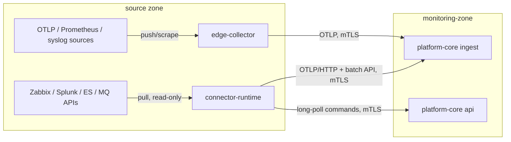

# ADR-0004: معماری Collector و Connector (Collector and Connector Architecture)

| ID | Title | Status | Confidence | Date | Deciders |
|---|---|---|---|---|---|
| ADR-0004 | collector-and-connector-architecture | Proposed | **Provisional** (BM-07، EXP-02) | 2026-10-11 (۱۴۰۵/۰۷/۱۹) | Architecture (pending product owner approval) |

Related documents: [ingestion-and-connectors.md](../ingestion-and-connectors.md)، [technology-evaluation.md](../technology-evaluation.md)، [ADR-0020](ADR-0020-existing-platform-integration-read-only-pull.md)، [ADR-0018](ADR-0018-data-retention-privacy-capacity-controls.md)

## Context

- [واقعیت F-02] شروع با SolarWinds، Zabbix، Splunk و Elasticsearch موجود؛ instrumentation مستقیم برنامه‌ها به فازهای بعد موکول است.
- دو نوع منبع وجود دارد: (۱) پروتکل‌های استاندارد push/scrape (OTLP، Prometheus، syslog، فایل، SNMP بعداً)؛ (۲) APIهای اختصاصی فروشنده که pull می‌شوند (Zabbix JSON-RPC، SolarWinds SWIS، Splunk REST، ES `_search`، IBM MQ PCF، RabbitMQ management، F5 iControl، HAProxy stats).
- شبکه بانک به Zoneهای امنیتی تقسیم است؛ اتصال از monitoring-zone به داخل Zoneها پذیرفتنی نیست (NFR-SEC-010).
- داده حساس باید پیش از خروج از Zone redact شود (ADR-0018).

## Decision

1. **`edge-collector`**: توزیع سفارشی و حداقلی OpenTelemetry Collector (بر پایه contrib) که به‌صورت آفلاین با OpenTelemetry Collector Builder (OCB) ساخته و امضا می‌شود؛ فقط receiver/processor/exporterهای لازم. صف پایدار دیسکی (`file_storage`)، processor redaction، ارسال OTLP/gRPC یا OTLP/HTTP روی mTLS به نقش `ingest`.
2. **`connector-runtime`**: فرایند Java که connectorهای pull را بر اساس **Connector SDK** میزبانی می‌کند. پیکربندی را از `platform-core` با REST/mTLS می‌گیرد، داده را با OTLP/HTTP و API داخلی `/internal/v1/ingest/events` ارسال می‌کند، و فرمان‌های evidence query را با long-poll از `/internal/v1/commands` دریافت می‌کند.
3. هر دو **به ازای هر Zone** مستقر می‌شوند و **همه اتصال‌ها را خودشان آغاز می‌کنند** (zone → monitoring-zone و zone-local → منبع). `platform-core` هرگز به داخل Zone اتصال برقرار نمی‌کند.
4. هر connector قابلیت‌های خود را اعلام (`Capability`) و در هر نصب راستی‌آزمایی می‌کند؛ rate limit و query budget هر منبع در connector اعمال می‌شود (NFR-IMP-001).
5. Redaction در لبه **و** در ingest (دفاع در عمق).

توضیح نمودار: جهت همه پیکان‌ها از Zone به monitoring-zone است؛ فرمان‌های evidence query نیز با long-poll توسط connector-runtime کشیده می‌شوند.

## Alternatives considered

| گزینه | امتیاز (ارزیابی) | دلیل |
|---|---|---|
| ترکیب OTel Collector + Java connector-runtime (انتخاب) | K1 و K2 هر دو بیشینه | پروتکل استاندارد با ابزار استاندارد، API فروشنده با کد قابل کنترل |
| فقط OTel Collector (با receiverهای سفارشی Go) | 4.15 | نوشتن receiver برای Zabbix/SWIS/PCF به Go = زبان دوم توسعه |
| Telegraf | 3.50 | plugin زیاد ولی بافر دیسکی و هم‌راستایی استاندارد ضعیف‌تر |
| Fluent Bit / Vector | 3.70 / 3.65 | قوی برای لاگ، ضعیف برای APIهای فروشنده و متریک |
| فقط Custom Java | 2.90 | بازنویسی پروتکل‌های استاندارد |
| جمع‌آوری مرکزی (بدون لبه) | — | نیاز به اتصال ورودی به Zoneها |

## Rationale

هیچ ابزار آماده‌ای APIهای Zabbix/SolarWinds/Splunk/MQ PCF را با کیفیت، کنترل بار و redaction لازم پوشش نمی‌دهد؛ در مقابل، بازنویسی گیرنده‌های OTLP/Prometheus/syslog اتلاف است. OTLP قرارداد داخلی واحد است (ADR-0005) و تعویض جمع‌آورنده لبه را محلی نگه می‌دارد.

## Consequences

- مثبت: firewall ساده (فقط خروجی)، ایزوله‌سازی credentialهای منبع درون Zone، تحمل قطعی با صف دیسکی.
- منفی: دو runtime متفاوت در لبه (Go باینری + JVM)؛ دو نوع پیکربندی.
- هزینه عملیاتی: به ازای هر Zone ۱ تا ۲ گره (برآورد در [capacity-planning.md](../capacity-planning.md))؛ ساخت و امضای توزیع OTel Collector در هر ارتقا؛ مدیریت گواهی mTLS به ازای گره لبه.
- credentialهای منبع در connector-runtime نگهداری می‌شوند → هدف با ارزش (R-06)؛ SecretProvider (NFR-SEC-004).

## Evidence that would change this decision

- BM-07: persistent queue OTel Collector در قطع ۴ ساعته داده از دست بدهد → جایگزینی مسیر مربوط با Vector/Fluent Bit.
- EXP-02/Q-08: یک منبع فقط push (webhook) ارائه دهد → receiver webhook (FR-INT-005).
- سیاست شبکه بانک اجازه استقرار گره در برخی Zoneها را ندهد → connector در Zone مجاور با قانون firewall مشخص (بازنگری موردی).

## Related requirements

FR-ING-001، FR-ING-002، FR-ING-003، FR-ING-004، FR-ING-009، FR-ING-010، FR-ING-011، FR-INT-001..FR-INT-004، FR-TXN-010، NFR-SEC-003، NFR-SEC-004، NFR-SEC-010، NFR-PRV-002، NFR-REL-003، NFR-IMP-001، NFR-IMP-002، NFR-MNT-004

## Related questions

Q-06، Q-08، Q-09، Q-22، BM-05، BM-06، BM-07، EXP-02، EXP-04، R-06، R-12
