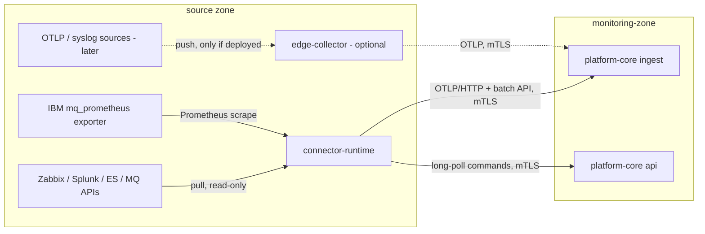

# ADR-0004: معماری Collector و Connector (Collector and Connector Architecture)

| ID | Title | Status | Confidence | Date | Deciders |
|---|---|---|---|---|---|
| ADR-0004 | collector-and-connector-architecture | Proposed | **Provisional** (BM-07، EXP-02، PoC-3) | 2026-10-11 (۱۴۰۵/۰۷/۱۹)؛ بازنگری 2026-10-12 | Architecture (pending product owner approval) |

Version: `0.2` — تاریخچه تغییر در انتهای سند.

Related documents: [ingestion-and-connectors.md](../ingestion-and-connectors.md)، [technology-evaluation.md](../technology-evaluation.md)، [ADR-0020](ADR-0020-existing-platform-integration-read-only-pull.md)، [ADR-0018](ADR-0018-data-retention-privacy-capacity-controls.md)، [ADR-0021](ADR-0021-build-buy-reuse-strategy.md)، [build-buy-reuse-analysis.md](../../benchmark/build-buy-reuse-analysis.md)

## Context

- [واقعیت F-02] شروع با SolarWinds، Zabbix، Splunk و Elasticsearch موجود؛ instrumentation مستقیم برنامه‌ها به فازهای بعد موکول است.
- دو نوع منبع وجود دارد: (۱) پروتکل‌های استاندارد push/scrape (OTLP، Prometheus، syslog، فایل، SNMP بعداً)؛ (۲) APIهای اختصاصی فروشنده که pull می‌شوند (Zabbix JSON-RPC، SolarWinds SWIS، Splunk REST، ES `_search`، IBM MQ PCF، RabbitMQ management، F5 iControl، HAProxy stats).
- شبکه بانک به Zoneهای امنیتی تقسیم است؛ اتصال از monitoring-zone به داخل Zoneها پذیرفتنی نیست (NFR-SEC-010).
- داده حساس باید پیش از خروج از Zone redact شود (ADR-0018).
- **یافته‌های Product Benchmark (0.2):**
  - در OpenTelemetry Collector contrib **receiver برای IBM MQ وجود ندارد**؛ همه یکپارچه‌سازی‌های OTel برای MQ (Elastic، New Relic) از exporter رسمی IBM یعنی `mq_prometheus` (مخزن `ibm-messaging/mq-metric-samples`، مجوز Apache-2.0) استفاده می‌کنند که با Prometheus scrape خوانده می‌شود (https://github.com/ibm-messaging/mq-metric-samples، https://www.elastic.co/docs/reference/integrations/ibmmq_otel، High).
  - این exporter عمق صف، max depth و **سن قدیمی‌ترین پیام** را می‌دهد؛ نرخ و زمان‌بندی MQPUT/MQGET به **فعال‌سازی MQI statistics** روی Queue Manager نیاز دارد (https://docs.newrelic.com/docs/opentelemetry/integrations/ibm-mq/overview.md، Medium-High) — این تغییر پیکربندی است و با NFR-IMP-002 در تعارض است مگر بانک تأیید کند ([باز Q-27]). `RESET QSTATS` مجاز نیست (فقط یک پایشگر در هر QMgr می‌تواند به‌طور قابل اتکا از آن استفاده کند).
  - برای Zabbix قالب رسمی IBM MQ وجود ندارد (https://www.zabbix.com/integrations/ibm_mq، High)؛ ولی قالب‌های رسمی RabbitMQ، HAProxy، F5 BIG-IP (SNMP) و MSSQL وجود دارد → این منابع ترجیحاً از طریق connector Zabbix خوانده می‌شوند و API مستقیم فقط در صورت شکاف (B4).
  - با راهبرد Reuse-first ([ADR-0021](ADR-0021-build-buy-reuse-strategy.md)) منابع push/OTLP در فازهای اولیه وجود ندارند؛ بنابراین `edge-collector` در Low/Medium ضروری نیست.

## Decision

1. **`edge-collector` (اختیاری از 0.2)**: فقط در یکی از این حالت‌ها مستقر می‌شود: (الف) endpointهای Prometheus/OTLP باید در Zoneای scrape/دریافت شوند که `connector-runtime` به آن دسترسی ندارد یا استقرار JVM در آن مجاز نیست؛ (ب) instrumentation آینده (Phase 7) یا منابع syslog/SNMP (FR-ING-004). در صورت استقرار: توزیع سفارشی و حداقلی OpenTelemetry Collector (بر پایه contrib) که به‌صورت آفلاین با OpenTelemetry Collector Builder (OCB) ساخته و امضا می‌شود؛ فقط receiver/processor/exporterهای لازم. صف پایدار دیسکی (`file_storage`)، processor redaction، ارسال OTLP/gRPC یا OTLP/HTTP روی mTLS به نقش `ingest`.
2. **`connector-runtime`**: فرایند Java که connectorهای pull را بر اساس **Connector SDK** میزبانی می‌کند. از 0.2 یک connector عمومی **Prometheus scrape** (خواندن فرمت text exposition از endpointهای مشخص و فهرست سفید متریک‌ها) نیز دارد تا exporter `mq_prometheus` و endpointهای مشابه بدون `edge-collector` خوانده شوند. پیکربندی را از `platform-core` با REST/mTLS می‌گیرد، داده را با OTLP/HTTP و API داخلی `/internal/v1/ingest/events` ارسال می‌کند، و فرمان‌های evidence query را با long-poll از `/internal/v1/commands` دریافت می‌کند.
3. هر دو **به ازای هر Zone** مستقر می‌شوند و **همه اتصال‌ها را خودشان آغاز می‌کنند** (zone → monitoring-zone و zone-local → منبع). `platform-core` هرگز به داخل Zone اتصال برقرار نمی‌کند.
4. هر connector قابلیت‌های خود را اعلام (`Capability`) و در هر نصب راستی‌آزمایی می‌کند؛ rate limit و query budget هر منبع در connector اعمال می‌شود (NFR-IMP-001).
5. Redaction در لبه **و** در ingest (دفاع در عمق).
6. **IBM MQ:** منبع ترجیحی exporter رسمی IBM `mq_prometheus` (نصب در Zone میانه‌افزار با حساب MQ حداقلی، فقط خواندنی، scrape توسط `connector-runtime` یا `edge-collector`)، یا itemهای موجود Zabbix اگر از قبل پیکربندی شده باشند (PoC-3). کلاینت PCF مستقیم در connector-runtime فقط در صورت شکاف اثبات‌شده. فعال‌سازی MQI statistics فقط با تأیید صریح بانک (Q-27)؛ بدون آن FR-MQ-004 از depth و سن پیام کار می‌کند.

توضیح نمودار: جهت همه پیکان‌ها از Zone به monitoring-zone است؛ فرمان‌های evidence query نیز با long-poll توسط connector-runtime کشیده می‌شوند. خط‌چین یعنی جزء اختیاری (`edge-collector` فقط در صورت نیاز).

## Alternatives considered

| گزینه | امتیاز (ارزیابی) | دلیل |
|---|---|---|
| `connector-runtime` (با Prometheus scrape) + `edge-collector` اختیاری (انتخاب 0.2) | — | یک runtime در Low/Medium؛ OTel Collector فقط جایی که لازم است |
| ترکیب همیشگی OTel Collector + Java connector-runtime (انتخاب 0.1) | K1 و K2 هر دو بیشینه | در سناریوی Reuse منبع push ندارد؛ دو runtime در هر Zone بدون مزیت → به حالت اختیاری تغییر یافت |
| connector اختصاصی PCF برای MQ به‌جای `mq_prometheus` | — | بازنویسی کاری که exporter رسمی IBM (Apache-2.0) انجام می‌دهد؛ فقط در صورت شکاف |
| فقط OTel Collector (با receiverهای سفارشی Go) | 4.15 | نوشتن receiver برای Zabbix/SWIS/PCF به Go = زبان دوم توسعه |
| Telegraf | 3.50 | plugin زیاد ولی بافر دیسکی و هم‌راستایی استاندارد ضعیف‌تر |
| Fluent Bit / Vector | 3.70 / 3.65 | قوی برای لاگ، ضعیف برای APIهای فروشنده و متریک |
| فقط Custom Java | 2.90 | بازنویسی پروتکل‌های استاندارد |
| جمع‌آوری مرکزی (بدون لبه) | — | نیاز به اتصال ورودی به Zoneها |

## Rationale

هیچ ابزار آماده‌ای APIهای Zabbix/SolarWinds/Splunk/MQ PCF را با کیفیت، کنترل بار و redaction لازم پوشش نمی‌دهد؛ در مقابل، بازنویسی گیرنده‌های OTLP/Prometheus/syslog اتلاف است. OTLP قرارداد داخلی واحد است (ADR-0005) و تعویض جمع‌آورنده لبه را محلی نگه می‌دارد.

## Consequences

- مثبت: firewall ساده (فقط خروجی)، ایزوله‌سازی credentialهای منبع درون Zone، تحمل قطعی با صف دیسکی.
- منفی: در صورت استقرار `edge-collector`، دو runtime متفاوت در لبه (Go باینری + JVM)؛ exporter `mq_prometheus` یک جزء اضافی (باینری Go از IBM) در Zone میانه‌افزار است که باید بسته‌بندی آفلاین، امضا و به‌روز شود (R-09).
- هزینه عملیاتی: به ازای هر Zone ۱ تا ۲ گره (برآورد در [capacity-planning.md](../capacity-planning.md))؛ ساخت و امضای توزیع OTel Collector در هر ارتقا؛ مدیریت گواهی mTLS به ازای گره لبه.
- credentialهای منبع در connector-runtime نگهداری می‌شوند → هدف با ارزش (R-06)؛ SecretProvider (NFR-SEC-004).

## Evidence that would change this decision

- BM-07: persistent queue OTel Collector در قطع ۴ ساعته داده از دست بدهد → جایگزینی مسیر مربوط با Vector/Fluent Bit.
- EXP-02/Q-08: یک منبع فقط push (webhook) ارائه دهد → receiver webhook (FR-INT-005).
- سیاست شبکه بانک اجازه استقرار گره در برخی Zoneها را ندهد → connector در Zone مجاور با قانون firewall مشخص (بازنگری موردی).
- PoC-3: `mq_prometheus` با حساب حداقلی قابل اجرا نباشد یا بانک نصب آن را نپذیرد → itemهای Zabbix یا connector PCF مستقیم.
- نیاز گسترده به OTLP/syslog (مثلاً Phase 7) → `edge-collector` از اختیاری به استاندارد هر Zone.

## Related requirements

FR-ING-001، FR-ING-002، FR-ING-003، FR-ING-004، FR-ING-009، FR-ING-010، FR-ING-011، FR-INT-001..FR-INT-004، FR-TXN-010، NFR-SEC-003، NFR-SEC-004، NFR-SEC-010، NFR-PRV-002، NFR-REL-003، NFR-IMP-001، NFR-IMP-002، NFR-MNT-004

## Related questions

Q-06، Q-08، Q-09، Q-22، Q-26، Q-27، PoC-3، BM-05، BM-06، BM-07، EXP-02، EXP-04، R-06، R-12

## تاریخچه تغییر

| Version | Date | تغییر |
|---|---|---|
| 0.1 | 2026-10-11 | نسخه اولیه. |
| 0.2 | 2026-10-12 | تغییر پس از Product Benchmark: `edge-collector` اختیاری؛ exporter رسمی IBM `mq_prometheus` برای MQ؛ `connector-runtime` می‌تواند endpointهای Prometheus را scrape کند. |
