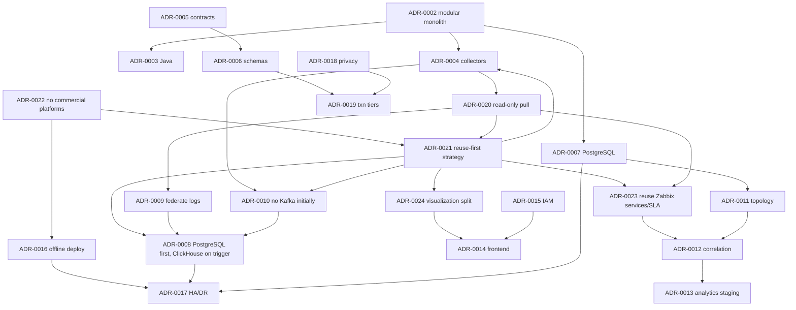

# نمایه تصمیم‌های معماری (Architecture Decision Records Index)

| فیلد | مقدار |
|---|---|
| Document ID | `ARC-ADR-INDEX` |
| Version | `0.2` |
| Status | `Draft – Phase 0 – awaiting approval` |
| Date | `2026-10-11` (۱۴۰۵/۰۷/۱۹) |
| Owner | `Architecture` |
| Related documents | [technology-evaluation.md](../technology-evaluation.md)، [capacity-planning.md](../capacity-planning.md)، [container-architecture.md](../container-architecture.md)، [open-questions-and-assumptions.md](../open-questions-and-assumptions.md)، [product-benchmark.md](../../benchmark/product-benchmark.md)، [build-buy-reuse-analysis.md](../../benchmark/build-buy-reuse-analysis.md) |

قالب، چرخه عمر و معنای Status/Confidence در [ADR-0001](ADR-0001-record-architecture-decisions.md) تعریف شده است. خلاصه:
- **Status:** `Proposed` → `Accepted` | `Rejected`؛ `Accepted` → `Superseded` | `Deprecated`. در Phase 0 فقط ADR-0001 پذیرفته شده و بقیه `Proposed` هستند تا جلسه بازبینی تصمیم پس از M0.
- **Confidence:** `Firm` (مستقل از پرسش باز/بنچمارک)، `Provisional` (وابسته به BM/EXP)، `Blocked` (وابسته به پاسخ Q-xx).

## فهرست

| ID | عنوان | Status | Confidence | وابستگی | خلاصه تصمیم |
|---|---|---|---|---|---|
| [ADR-0001](ADR-0001-record-architecture-decisions.md) | record-architecture-decisions | **Accepted** | Firm | — | ثبت تصمیم‌ها به‌صورت ADR در مخزن؛ قالب و چرخه عمر |
| [ADR-0002](ADR-0002-modular-monolith-with-edge-collectors.md) | modular-monolith-with-edge-collectors | Proposed | Firm | — | `platform-core` monolith ماژولار با نقش‌های `api`/`ingest`/`analytics` + `connector-runtime` به ازای Zone؛ `edge-collector` اختیاری (0.2) |
| [ADR-0003](ADR-0003-backend-language-java-spring-boot.md) | backend-language-java-spring-boot | Proposed | **Blocked** | Q-01 | Java 21 LTS + Spring Boot 3.x؛ گزینه .NET یعنی .NET 10 (0.2) |
| [ADR-0004](ADR-0004-collector-and-connector-architecture.md) | collector-and-connector-architecture | Proposed | Provisional | BM-07، EXP-02، PoC-3 | Java `connector-runtime` (با Prometheus scrape) برای APIهای فروشنده و exporter `mq_prometheus`؛ `edge-collector` اختیاری (0.2)؛ فقط خروجی |
| [ADR-0005](ADR-0005-api-and-event-contracts.md) | api-and-event-contracts | Proposed | Firm | — | OpenAPI 3.1، OTLP، CloudEvents + JSON Schema، semver، contract test |
| [ADR-0006](ADR-0006-canonical-schemas-otel-plus-bank-namespace.md) | canonical-schemas-otel-plus-bank-namespace | Proposed | Firm | — | OTel semantic conventions + فضای نام `bank.*` |
| [ADR-0007](ADR-0007-metadata-store-postgresql.md) | metadata-store-postgresql | Proposed | Firm | — | PostgreSQL؛ Topology با adjacency + CTE بازگشتی؛ بدون Graph DB |
| [ADR-0008](ADR-0008-telemetry-store-postgresql-first-clickhouse-on-trigger.md) | telemetry-store-postgresql-first-clickhouse-on-trigger | Proposed | Provisional | PoC-5، BM-02، BM-03 | PostgreSQL نخست برای سری‌های KPI مشتق (partition زمانی)؛ ClickHouse فقط با Trigger؛ بدون ingest wholesale متریک خام (0.2) |
| [ADR-0009](ADR-0009-no-own-raw-log-store-federate-existing.md) | no-own-raw-log-store-federate-existing | Proposed | Firm (P1–P5) | Q-22، BM-04 | بدون Store لاگ خام؛ query فدرال روی Splunk/ES |
| [ADR-0010](ADR-0010-buffering-without-kafka-initially.md) | buffering-without-kafka-initially | Proposed | Provisional | Q-06، Q-09، BM-07 | Kafka فعلاً رد (شواهد Benchmark)؛ صف دیسکی + batching + outbox؛ Trigger با میانگین متحرک ۱۵ دقیقه‌ای |
| [ADR-0011](ADR-0011-topology-model-and-dependency-discovery.md) | topology-model-and-dependency-discovery | Proposed | Provisional | EXP-01، EXP-02 | Topology دستی سپس کشف با provenance/confidence/approval |
| [ADR-0012](ADR-0012-correlation-engine-design.md) | correlation-engine-design | Proposed | Firm | — | همبستگی قطعی، توضیح‌پذیر و توپولوژی‌آگاه؛ بدون ML در شروع |
| [ADR-0013](ADR-0013-analytics-staging-rules-statistics-ml.md) | analytics-staging-rules-statistics-ml | Proposed | Firm | — | آستانه → baseline فصلی → آمار مقاوم → چندمتغیره → پیش‌بینی → ML با دروازه ارزیابی |
| [ADR-0014](ADR-0014-frontend-react-echarts-cytoscape.md) | frontend-react-echarts-cytoscape | Proposed | Provisional | BM-10، Q-01، Q-21، Q-23 | React + TypeScript، ECharts، Cytoscape.js؛ RTL/جلالی؛ فقط صفحات اپراتور (ADR-0024) |
| [ADR-0015](ADR-0015-authentication-authorization-audit.md) | authentication-authorization-audit | Proposed | **Blocked** | Q-04 | OIDC (IdP بانک یا Keycloak + AD)، RBAC با scope، audit append-only |
| [ADR-0016](ADR-0016-offline-deployment-and-artifacts.md) | offline-deployment-and-artifacts | Proposed | **Blocked** | Q-02، Q-03، Q-24 | OCI روی VM با Podman/Compose؛ بسته آفلاین امضاشده با SBOM؛ معیار تحریم/دسترسی بسته (0.2) |
| [ADR-0017](ADR-0017-ha-dr-architecture.md) | ha-dr-architecture | Proposed | **Blocked** | Q-05 | active-active درون سایت، active-passive DR، Patroni؛ ClickHouse RF=2 + Keeper فقط در صورت trigger ADR-0008 (0.2) |
| [ADR-0018](ADR-0018-data-retention-privacy-capacity-controls.md) | data-retention-privacy-capacity-controls | Proposed | Firm (حریم خصوصی) / Provisional (retention) | Q-16، Q-10 | ممنوعیت داده حساس، HMAC، redaction دولایه، retention به ازای کلاس |
| [ADR-0019](ADR-0019-transaction-correlation-tiers.md) | transaction-correlation-tiers | Proposed | Firm | — | سطوح L0..L3 با ثبت tier روی هر متریک |
| [ADR-0020](ADR-0020-existing-platform-integration-read-only-pull.md) | existing-platform-integration-read-only-pull | Proposed | Firm | — | API فقط‌خواندنی و pull با Query budget؛ webhook اختیاری؛ saved search را مدیر منبع نصب می‌کند (Q-28)؛ نوشتن تقویم در Zabbix فقط اختیاری (0.2) |
| [ADR-0021](ADR-0021-build-buy-reuse-strategy.md) | build-buy-reuse-strategy | Proposed | Provisional | PoC-1..PoC-5 (G-PoC) | گزینه E: لایه نازک هوشمندی بانکی با اولویت بازاستفاده؛ جدول تخصیص مسئولیت |
| [ADR-0022](ADR-0022-commercial-platforms-not-adopted.md) | commercial-platforms-not-adopted | Proposed | Firm (مگر مجوز حقوقی Q-24) | Q-24، Q-25 | پلتفرم تجاری APM/AIOps اتخاذ نمی‌شود (تحریم + شکاف تقویم/معنای بانکی + lock-in) |
| [ADR-0023](ADR-0023-reuse-zabbix-services-and-sla.md) | reuse-zabbix-services-and-sla | Proposed | **Blocked** | PoC-1، Q-26 | خواندن سرویس/SLA Zabbix به‌عنوان شاهد؛ همگام‌سازی تقویم به Zabbix اختیاری و پیش‌فرض خاموش |
| [ADR-0024](ADR-0024-visualization-split-custom-operator-ui-optional-grafana.md) | visualization-split-custom-operator-ui-optional-grafana | Proposed | Provisional | Q-23، Q-21 | UI سفارشی فقط برای اپراتور؛ نمای مهندسی با deep link یا Grafana OSS اختیاری |

## جمع‌بندی وضعیت

| Confidence | تعداد | ADRها |
|---|---|---|
| Firm | 11 (+ بخش حریم خصوصی ADR-0018) | 0001، 0002، 0005، 0006، 0007، 0009، 0012، 0013، 0019، 0020، 0022 و حریم خصوصی 0018 |
| Provisional | 7 (+ بخش retention ADR-0018) | 0004، 0008، 0010، 0011، 0014، 0021، 0024 |
| Blocked | 5 | 0003 (Q-01)، 0015 (Q-04)، 0016 (Q-02/Q-03)، 0017 (Q-05)، 0023 (PoC-1/Q-26) |

**پیش‌نیاز اولین کار پیاده‌سازی (T-01-01):** رفع انسداد ADR-0003 (Q-01) و عبور از دروازه G-PoC (Phase 0.5) که ADR-0021، ADR-0023 و آستانه‌های ADR-0008 را تثبیت می‌کند. ADRهای Blocked دیگر در جلسه بازبینی تصمیم پس از M0 بررسی می‌شوند.

## نمودار وابستگی تصمیم‌ها

توضیح: پیکان یعنی «تصمیم مقصد بر فرض تصمیم مبدأ بنا شده است»؛ تغییر یک ADR باید ADRهای پایین‌دست آن را بازبینی کند.

## تاریخچه تغییر

| Version | Date | تغییر |
|---|---|---|
| 0.1 | 2026-10-11 | نسخه اولیه. |
| 0.2 | 2026-10-12 | تغییر پس از Product Benchmark: ADR-0021..ADR-0024 اضافه شد؛ ADR-0008 بازنویسی و تغییر نام یافت؛ ADR-0002، 0003، 0004، 0010، 0014، 0016، 0017، 0020 به‌روز شد؛ نمودار وابستگی به‌روز شد. |
