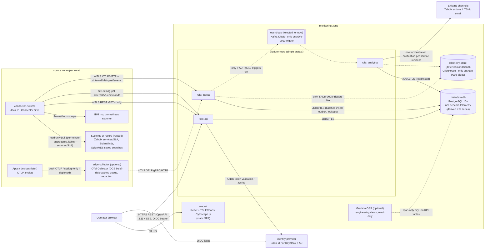
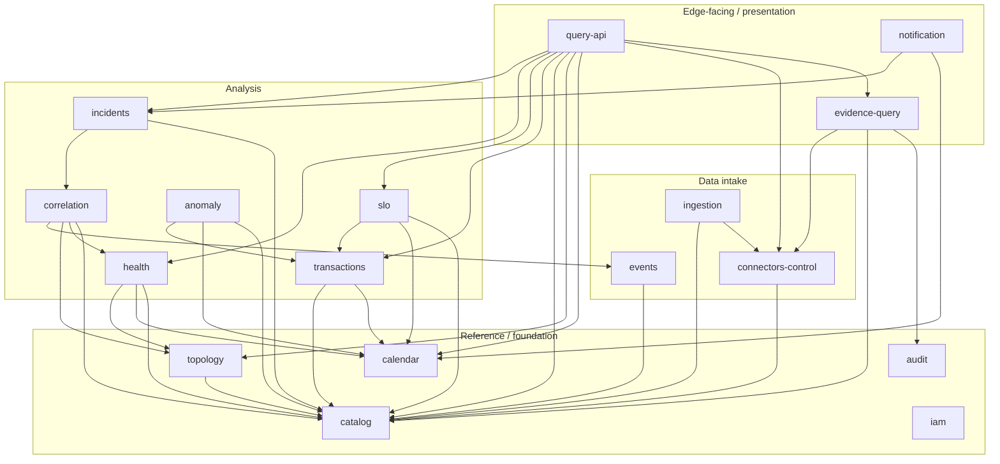

# معماری کانتینرها (Container Architecture – C4 Level 2)

| فیلد | مقدار |
|---|---|
| Document ID | `ARC-CNT-001` |
| Version | `0.2` |
| Status | `Draft – Phase 0 – awaiting approval` |
| Date | `2026-10-11` (۱۴۰۵/۰۷/۱۹) |
| Owner | `Architecture` |
| Related documents | [system-context.md](system-context.md)، [data-architecture.md](data-architecture.md)، [ADR-0002](architecture-decision-records/ADR-0002-modular-monolith-with-edge-collectors.md)، [ADR-0003](architecture-decision-records/ADR-0003-backend-language-java-spring-boot.md)، [ADR-0004](architecture-decision-records/ADR-0004-collector-and-connector-architecture.md)، [ADR-0005](architecture-decision-records/ADR-0005-api-and-event-contracts.md)، [ADR-0007](architecture-decision-records/ADR-0007-metadata-store-postgresql.md)، [ADR-0008](architecture-decision-records/ADR-0008-telemetry-store-postgresql-first-clickhouse-on-trigger.md)، [ADR-0010](architecture-decision-records/ADR-0010-buffering-without-kafka-initially.md)، [ADR-0012](architecture-decision-records/ADR-0012-correlation-engine-design.md)، [ADR-0016](architecture-decision-records/ADR-0016-offline-deployment-and-artifacts.md)، [ADR-0017](architecture-decision-records/ADR-0017-ha-dr-architecture.md)، [ADR-0021](architecture-decision-records/ADR-0021-build-buy-reuse-strategy.md)، [ADR-0023](architecture-decision-records/ADR-0023-reuse-zabbix-services-and-sla.md)، [ADR-0024](architecture-decision-records/ADR-0024-visualization-split-custom-operator-ui-optional-grafana.md)، [build-buy-reuse-analysis.md](../benchmark/build-buy-reuse-analysis.md) |

> **قرارداد برچسب‌گذاری:** [واقعیت]، [فرض A-xx]، [فرضیه]، [توصیه]، [باز Q-xx] — مطابق spine §1.

## ۱. خلاصه

[توصیه] سبک معماری، **modular monolith** به نام `platform-core` به‌همراه اجزای جمع‌آوری لبه که جداگانه و به‌ازای هر zone مستقر می‌شوند ([ADR-0002](architecture-decision-records/ADR-0002-modular-monolith-with-edge-collectors.md)، Confidence: Firm). هسته یک artifact واحد است که با پیکربندی در سه نقش `api`، `ingest` و `analytics` اجرا می‌شود. هیچ message broker در شروع وجود ندارد؛ `event-bus` (Kafka) فقط با تحقق triggerهای [ADR-0010](architecture-decision-records/ADR-0010-buffering-without-kafka-initially.md) اضافه می‌شود.

**تغییر پس از Product Benchmark (0.2):** راهبرد «لایه نازک هوشمندی بانکی با اولویت بازاستفاده» ([ADR-0021](architecture-decision-records/ADR-0021-build-buy-reuse-strategy.md)) پذیرفته شد. پیامد برای کانتینرها: `telemetry-store` (ClickHouse) **deferred/conditional** است و فقط با Triggerهای [ADR-0008](architecture-decision-records/ADR-0008-telemetry-store-postgresql-first-clickhouse-on-trigger.md) اضافه می‌شود؛ تا آن زمان داده زمانی مشتق در `metadata-db` (PostgreSQL، schema `telemetry`) نگهداری می‌شود. `edge-collector` **اختیاری** است ([ADR-0004](architecture-decision-records/ADR-0004-collector-and-connector-architecture.md)). مالکیت هر مسئولیت در §۳.۱ آمده است.

[باز Q-01] زبان و چارچوب (Java 21 LTS + Spring Boot 3.x) تا روشن شدن مهارت تیم Blocked است ([ADR-0003](architecture-decision-records/ADR-0003-backend-language-java-spring-boot.md)). ساختار ماژولی این سند مستقل از زبان معتبر است.

## ۲. نمودار کانتینرها

*توضیح:* خط‌چین یعنی جزء اختیاری یا مشروط (`edge-collector`، `telemetry-store`، `event-bus`، Grafana). در ترکیب پایه فقط `web-ui`، `platform-core`، `metadata-db` و `connector-runtime` (+ exporter MQ) وجود دارند. همهٔ اتصال‌ها از zone منبع به سمت `monitoring-zone` آغاز می‌شوند. `platform-core` هیچ اتصالی به داخل zoneها باز نمی‌کند؛ فرمان‌ها (مثلاً evidence query) را `connector-runtime` با long-poll دریافت می‌کند.

## ۳. کانتینرها و مسئولیت‌ها

| Container | مسئولیت | فناوری (موقت) | حالت | استقرار |
|---|---|---|---|---|
| `web-ui` | SPA فارسی RTL با تقویم جلالی؛ داشبورد سلامت، نقشهٔ توپولوژی، جزئیات سرویس، پنل شواهد، مدیریت کاتالوگ و connectorها | React + TypeScript، Apache ECharts، Cytoscape.js ([ADR-0014](architecture-decision-records/ADR-0014-frontend-react-echarts-cytoscape.md)) | بدون حالت (فایل ایستا) | سرو شده از reverse proxy داخلی یا خود `platform-core(api)` در `monitoring-zone` |
| `platform-core` | منطق دامنه، API، دریافت و نرمال‌سازی داده، تحلیل، Incident | Java 21 LTS + Spring Boot 3.x (Blocked Q-01) | بدون حالت (حالت در DBها) | `monitoring-zone`؛ ≥ ۲ نمونه در هر نقش از فاز ۶ |
| `connector-runtime` | میزبان connectorهای pull: Zabbix (problemها، itemهای مرتبط با KPI، سرویس/SLA)، SolarWinds، Splunk و Elasticsearch/OpenSearch (اجرای saved search/aggregation تعریف‌شده پلتفرم در خود منبع و کشیدن تجمیع دقیقه‌ای)، **Prometheus scrape** (exporter `mq_prometheus`)، و فقط در صورت شکاف: RabbitMQ، F5، HAProxy، NGINX، DB فقط‌خواندنی؛ زمان‌بندی poll، اعمال query budget، redaction لبه، بافر محلی، اجرای evidence query | Java 21، Connector SDK | checkpoint محلی + بافر دیسکی کوچک [توصیه] | یک نمونه (یا دو برای HA) در هر zone منبع |
| `edge-collector` (**اختیاری**) | دریافت پروتکل‌های استاندارد: OTLP، Prometheus scrape، syslog، filelog، SNMP (بعداً)؛ صف پایدار دیسکی؛ processor برای redaction | OpenTelemetry Collector (contrib، توزیع سفارشی با OCB، ساخت آفلاین) | صف دیسکی | فقط در zoneای که endpoint Prometheus/OTLP دارد و `connector-runtime` به آن دسترسی ندارد، یا برای instrumentation آینده (Phase 7) |
| `metadata-db` | کاتالوگ، توپولوژی، تقویم، SLO، پیکربندی connector، Incident، نگاشت IAM، audit، outbox؛ **و از 0.2** schema `telemetry`: سری‌های KPI مشتق، `txn_summary_1m`، سری‌های مرتبط با KPI، رویدادهای نرمال‌شده، `health_states`، `anomalies` در جدول‌های partition‌شده زمانی | PostgreSQL 16+ ([ADR-0007](architecture-decision-records/ADR-0007-metadata-store-postgresql.md)، [ADR-0008](architecture-decision-records/ADR-0008-telemetry-store-postgresql-first-clickhouse-on-trigger.md)) | حالت‌دار | `monitoring-zone`؛ Patroni + streaming replication در فاز ۶ |
| `telemetry-store` (**deferred/conditional**) | فقط پس از Trigger: رویداد تراکنش توکنی (L2)، خلاصهٔ تراکنش و سری‌های KPI پرحجم، تاریخچهٔ سلامت/ناهنجاری | ClickHouse LTS؛ ClickHouse Keeper در حالت replicated ([ADR-0008](architecture-decision-records/ADR-0008-telemetry-store-postgresql-first-clickhouse-on-trigger.md)) | حالت‌دار | فقط پس از Trigger؛ `monitoring-zone`؛ ReplicatedMergeTree + Keeper سه‌نودی در Medium+ |
| `identity-provider` | احراز هویت OIDC/SAML؛ federation به AD/LDAP | IdP بانک یا Keycloak ([ADR-0015](architecture-decision-records/ADR-0015-authentication-authorization-audit.md)، Blocked Q-04) | خارجی یا حالت‌دار (Keycloak با PostgreSQL جدا) | `shared-services-zone` یا `monitoring-zone` |
| `event-bus` (rejected for now) | بافر و replay چندمصرف‌کننده | Kafka (KRaft) ([ADR-0010](architecture-decision-records/ADR-0010-buffering-without-kafka-initially.md)) | حالت‌دار | فقط پس از تحقق trigger |
| Grafana OSS (**اختیاری**) | نمای مهندسی فقط‌خواندنی روی جدول‌های KPI و Zabbix؛ بدون Alerting سرویس بانکی | Grafana OSS بدون تغییر ([ADR-0024](architecture-decision-records/ADR-0024-visualization-split-custom-operator-ui-optional-grafana.md)، AGPL — Q-21) | حالت‌دار کوچک | `monitoring-zone`، در صورت درخواست مهندسان |
| exporter `mq_prometheus` | انتشار متریک IBM MQ (عمق، max depth، سن قدیمی‌ترین پیام) با فرمت Prometheus | IBM `mq-metric-samples` (Apache-2.0) | بدون حالت | در zone میانه‌افزار با حساب MQ حداقلی (PoC-3، Q-27) |

### ۳.۱ مالکیت مؤلفه‌ها (Component ownership)

[توصیه] جدول زیر (مرجع: [ADR-0021](architecture-decision-records/ADR-0021-build-buy-reuse-strategy.md)، spine-benchmark B4) تعیین می‌کند هر مسئولیت را کدام سامانه انجام می‌دهد. «Reuse» یعنی ابزار موجود بانک سامانه مرجع است و پلتفرم فقط می‌خواند؛ «Custom» یعنی ماژول `platform-core`.

| مسئولیت | مالک | جزء/ماژول پلتفرم درگیر |
|---|---|---|
| متریک میزبان/شبکه/دستگاه، دسترس‌پذیری، هشدار زیرساخت | Reuse: Zabbix، SolarWinds | `connector-runtime` (خواندن problem/alert به‌عنوان رویداد) |
| متریک LB (F5/HAProxy)، RabbitMQ، MSSQL | Reuse: قالب‌های Zabbix (نصب تأیید شود)؛ API مستقیم فقط‌خواندنی فقط در صورت شکاف | connector Zabbix؛ connector مستقیم فقط با شکاف اثبات‌شده |
| متریک IBM MQ | OSS استاندارد: exporter `mq_prometheus` (scrape توسط `connector-runtime` یا `edge-collector`)، یا itemهای موجود Zabbix | connector Prometheus scrape |
| لاگ خام، جستجو، نگهداری لاگ | Reuse: Splunk، Elasticsearch (بدون کپی) | `evidence-query` (کوئری درخواستی) |
| محاسبه KPI تراکنش | Reuse موتور جستجو: saved search/aggregation زمان‌بندی‌شده درون Splunk/ES؛ لایه سفارشی تعریف را تولید می‌کند (TransactionType، OutcomeMapping)، مدیر Splunk/ES آن را نصب و مالکیت می‌کند (Q-28) و پلتفرم فقط تجمیع دقیقه‌ای را می‌کشد | `transactions` (تولید تعریف)، connector Splunk/ES (اجرا و کشیدن نتیجه) |
| درخت سرویس و SLA سطح زیرساخت | نامزد Reuse: سرویس/SLA در Zabbix (PoC-1، [ADR-0023](architecture-decision-records/ADR-0023-reuse-zabbix-services-and-sla.md)) | connector Zabbix (`service.get`، `sla.getsli`) → شاهد در `correlation` |
| کاتالوگ سرویس بانکی، توپولوژی با provenance/confidence | Custom (تمایز اصلی) | `catalog`، `topology` |
| تقویم کسب‌وکار (جلالی، تعطیلات، پنجره‌های سرویس) | Custom؛ همگام‌سازی به maintenance/SLA schedule در Zabbix (اختیاری، پیش‌فرض خاموش) | `calendar` |
| سلامت آگاه از کسب‌وکار، expected-inactive، موفقیت فنی در برابر کسب‌وکار | Custom | `health`، `transactions`، `slo` |
| همبستگی شواهد بین‌منبعی و رتبه‌بندی علت محتمل با اطمینان | Custom (کوچک، قطعی) | `events`، `correlation`، `incidents` |
| آشکارسازی ناهنجاری روی KPIهای مشتق | Custom سبک آماری (Phase 5) روی PostgreSQL | `anomaly` |
| تحویل هشدار/اعلان | Reuse کانال‌های موجود (Zabbix actions/ITSM/email)؛ پلتفرم حداکثر یک اعلان در سطح Incident به ازای هر Incident سرویس | `notification` |
| داشبوردهای مهندسی | Grafana OSS اختیاری (AGPL، Q-21) یا deep link به ابزارهای موجود | — (deep link از `query-api`) |
| UI اپراتور (سلامت سرویس، Incident، شواهد، کاتالوگ، تقویم) | Custom نازک؛ فارسی RTL/جلالی اگر Q-23 الزامی بودن را تأیید کند | `web-ui` |
| ذخیره فراداده + KPI مشتق | PostgreSQL (Store واحد) در Low؛ ClickHouse فقط با Trigger | `metadata-db` |
| Streaming | ندارد (Kafka فعلاً رد) | — |
| APM/AIOps تجاری | ندارد (مسدود — [ADR-0022](architecture-decision-records/ADR-0022-commercial-platforms-not-adopted.md)) | — |

### ۳.۲ جلوگیری از هشدار تکراری

[توصیه] هشدارهای زیرساختی در Zabbix/SolarWinds باقی می‌مانند و پلتفرم آن‌ها را دوباره ارسال نمی‌کند. ماژول `notification` فقط **اعلان سطح Incident سرویس بانکی** تولید می‌کند — حداکثر یک اعلان هنگام باز شدن Incident و یک اعلان هنگام تغییر شدت یا بسته شدن — و آن را از طریق **کانال‌های موجود** (ITSM، email، یا Zabbix action در صورت تصمیم بانک — Q-14) تحویل می‌دهد. سرکوب در maintenance و expected-inactive از تقویم پلتفرم اعمال می‌شود؛ اگر همگام‌سازی تقویم به Zabbix فعال باشد (FR-CAL-008)، Zabbix همان پنجره‌ها را برای هشدارهای خودش اعمال می‌کند، بنابراین منطق سرکوب دو جا تعریف نمی‌شود.

## ۴. نقش‌های زمان‌اجرای `platform-core`

یک artifact واحد؛ نقش با پیکربندی (مثلاً `bsoip.roles=api,ingest`) انتخاب می‌شود. در Low هر سه نقش می‌توانند در یک فرایند اجرا شوند.

| نقش | ماژول‌های فعال (غالب) | بار کاری | مقیاس‌پذیری |
|---|---|---|---|
| `api` | `query-api`، `catalog`، `topology`، `calendar`، `slo`، `incidents` (خواندن/ویرایش)، `connectors-control`، `evidence-query` (ایجاد فرمان و دریافت نتیجه)، `iam`، `audit` | درخواست‌های REST، SSE، endpointهای داخلی پیکربندی و فرمان برای `connector-runtime` | افقی پشت Load Balancer؛ بدون حالت |
| `ingest` | `ingestion`، `connectors-control` (دریافت heartbeat و lag) | دریافت OTLP و batch API، نرمال‌سازی، redaction دوم، dedup، batching و نوشتن در schema `telemetry` PostgreSQL (یا ClickHouse پس از Trigger)؛ نوشتن outbox برای رویدادهای مهم | افقی؛ هر نمونه مستقل batch می‌نویسد |
| `analytics` | `health`، `transactions`، `events`، `correlation`، `anomaly`، `slo` (محاسبهٔ budget)، `incidents` (ایجاد/به‌روزرسانی)، `notification` | micro-batch هر ۳۰–۶۰ ثانیه (موقت) روی PostgreSQL (و ClickHouse پس از Trigger)؛ مصرف outbox | افقی با تقسیم کار بر اساس partition سرویس‌ها و قفل مشورتی (advisory lock) در PostgreSQL [توصیه] |

[توصیه] ماژول `audit` در همهٔ نقش‌ها فعال است چون هر عملیات حساس باید در همان تراکنش audit شود. [فرضیه] چرخهٔ ≤ ۶۰ ثانیه (NFR-PRF-004) در اندازهٔ Medium برقرار است؛ با BM-08 آزموده می‌شود.

## ۵. نقشهٔ ماژول‌ها و وابستگی‌های مجاز

قواعد:

1. هر ماژول API عمومی (`api` package) و پیاده‌سازی داخلی (`internal`) دارد؛ ماژول‌های دیگر فقط به `api` دسترسی دارند.
2. وابستگی‌ها یک‌طرفه و بدون چرخه‌اند؛ برای جهت معکوس از domain event درون‌فرایندی استفاده می‌شود.
3. هیچ ماژولی به جداول schema ماژول دیگر در PostgreSQL مستقیم دسترسی ندارد (هر ماژول مالک schema خود است؛ نگاه کنید به [data-architecture.md](data-architecture.md)).
4. این قواعد با ArchUnit در CI اعمال می‌شوند (NFR-MNT-001).

*توضیح:* پیکان یعنی «وابسته است به (فراخوانی API همگام)». `iam` و `audit` به‌عنوان cross-cutting توسط همهٔ ماژول‌ها قابل استفاده‌اند و برای خوانایی رسم نشده‌اند؛ خود `iam` و `audit` به هیچ ماژول دامنه‌ای وابسته نیستند. جهت معکوس (مثلاً `ingestion` → `health` برای «داده رسید») فقط از طریق رویداد است.

| ماژول | مسئولیت | مالک schema در PostgreSQL | جداول تله‌متری که می‌نویسد (schema `telemetry` در PostgreSQL؛ ClickHouse پس از Trigger) |
|---|---|---|---|
| `catalog` | BusinessService، TechnicalService، Component و زیرنوع‌ها، ServiceType، ExternalRef، Environment، Site، Zone | `catalog` | — |
| `topology` | Dependency، TransactionFlow، پیمایش اثر (recursive CTE)، پیشنهادهای کشف‌شده با تأیید | `topology` | — |
| `calendar` | BusinessCalendar، DayType، ServiceWindow، MaintenanceWindow؛ همگام‌سازی اختیاری به Zabbix (FR-CAL-008) | `calendar` | — |
| `slo` | تعریف SLO، ErrorBudget، burn rate | `slo` | — (نتایج در `health_states` یا جدول rollup) |
| `ingestion` | دریافت OTLP و batch، نرمال‌سازی، redaction، dedup، نوشتن | — | `metric_samples` (فقط سری‌های مرتبط با KPI)، `events`، `txn_summary_1m`، `txn_events` (فقط پس از Trigger) |
| `connectors-control` | ConnectorInstance، Capability، زمان‌بندی، health و lag connectorها، صدور گواهی/ثبت نود [توصیه] | `connectors` | — |
| `events` | مدل رویداد مشترک، dedup و grouping اولیه | (از `outbox` استفاده می‌کند) | `events` (به‌روزرسانی وضعیت با نسخهٔ جدید) |
| `health` | محاسبهٔ `HealthState` با توضیح، propagation به‌عنوان اثر | — | `health_states` |
| `transactions` | TransactionType، OutcomeMapping، محاسبهٔ KPIها، مقایسهٔ upstream/downstream | `catalog` (تعاریف؛ نگاه کنید به نکتهٔ زیر جدول) | خواندن `txn_summary_1m` |
| `correlation` | امتیازدهی شواهد توپولوژی‌محور، رتبه‌بندی CauseHypothesis | — | — |
| `anomaly` | آستانه، baseline فصلی، آشکارسازهای آماری (فاز ۵) | — | `anomalies` |
| `incidents` | Incident، Evidence، CauseHypothesis، OperatorFeedback، timeline | `incidents` | — |
| `notification` | اعلان سطح Incident از طریق کانال‌های موجود (§۳.۲)، سرکوب در maintenance و expected-inactive | `incidents` (جدول ارسال‌ها) | — |
| `evidence-query` | هماهنگی federated query به Splunk/ES از طریق `connector-runtime`، اعمال redaction و budget | `connectors` (جدول فرمان‌ها) | — |
| `iam` | نگاشت گروه AD/IdP به نقش و scope؛ ارزیابی RBAC | `iam` | — |
| `audit` | ثبت append-only و ارسال به SIEM | `audit` | — |
| `query-api` | OpenAPI عمومی `/api/v1/...`، SSE | — | خواندن |

«نکته برای بازبینی»: spine schema جداگانه‌ای برای `transactions` تعریف نکرده است؛ پیشنهاد این سند نگهداری TransactionType و OutcomeMapping در schema `catalog` با مالکیت ماژول `transactions` است، یا افزودن schema `transactions`. باید در [data-architecture.md](data-architecture.md) و ADR-0007 هم‌راستا شود.

## ۶. پروتکل‌های ارتباطی

| از | به | پروتکل | الگو | امنیت | یادداشت |
|---|---|---|---|---|---|
| مرورگر | `web-ui` | HTTPS | دریافت فایل ایستا | TLS 1.2+ | — |
| مرورگر / `web-ui` | `platform-core(api)` | HTTPS REST (OpenAPI 3.1)، SSE | request/response؛ push زنده با SSE | OIDC bearer token، RBAC | `/api/v1/...` |
| `edge-collector` | `platform-core(ingest)` | OTLP/gRPC یا OTLP/HTTP | push | mTLS | فقط zone → `monitoring-zone` |
| `connector-runtime` | `platform-core(api)` | HTTPS REST | pull پیکربندی | mTLS | `/internal/v1/connectors/{id}/config` |
| `connector-runtime` | `platform-core(api)` | HTTPS long-poll | pull فرمان | mTLS | `/internal/v1/commands` |
| `connector-runtime` | `platform-core(ingest)` | OTLP/HTTP + HTTPS batch | push داده | mTLS | `/internal/v1/ingest/events` |
| `connector-runtime` | سامانهٔ منبع | API بومی هر منبع | pull فقط‌خواندنی | TLS، حساب حداقلی | [ADR-0020](architecture-decision-records/ADR-0020-existing-platform-integration-read-only-pull.md) |
| `platform-core` | `metadata-db` | JDBC | — | TLS، حساب جدا به‌ازای نقش [توصیه] | — |
| `platform-core` | `telemetry-store` | ClickHouse HTTP یا native | insert دسته‌ای، query | TLS | فقط پس از Trigger ADR-0008 |
| `connector-runtime` | exporter `mq_prometheus` | HTTP(S) Prometheus text exposition | scrape | TLS در صورت امکان؛ فهرست سفید متریک | جایگزین `edge-collector` برای MQ |
| `connector-runtime` | Zabbix (نوشتن maintenance) | Zabbix JSON-RPC | نوشتن محدود | حساب جدا با حداقل دسترسی نوشتن، audit | **اختیاری، پیش‌فرض خاموش**؛ فقط با تأیید بانک (FR-CAL-008، [ADR-0023](architecture-decision-records/ADR-0023-reuse-zabbix-services-and-sla.md)) |
| `platform-core(analytics)` | کانال‌های اعلان موجود (ITSM/email) | webhook/SMTP | push اعلان سطح Incident | TLS | §۳.۲ |
| `platform-core` | `identity-provider` | OIDC (JWKS، token introspection در صورت نیاز) | — | TLS | — |
| ماژول ↔ ماژول | (درون‌فرایند) | فراخوانی Java interface، domain event | همگام / ناهمگام درون‌فرایند | — | outbox برای رویدادهای پایدار |

## ۷. APIهای داخلی و عمومی

### ۷.۱ API عمومی `/api/v1/...`

[توصیه] قرارداد OpenAPI 3.1، نسخه‌دهی semver، تست قرارداد ([ADR-0005](architecture-decision-records/ADR-0005-api-and-event-contracts.md)). گروه‌های اصلی (نمونه، نهایی نیست):

| مسیر | کاربرد |
|---|---|
| `/api/v1/catalog/business-services`، `/technical-services`، `/components`، `/service-types` | CRUD کاتالوگ + import/export (FR-CAT-001..012) |
| `/api/v1/topology/dependencies`، `/topology/graph?root=...&depth=...` | توپولوژی و پیمایش اثر |
| `/api/v1/calendars`، `/maintenance-windows` | تقویم و پنجره‌ها |
| `/api/v1/health/services/{id}` | وضعیت سلامت و توضیح |
| `/api/v1/transactions/{serviceId}/summary?from=&to=` | KPI تراکنش با tier همبستگی |
| `/api/v1/slos`، `/slos/{id}/budget` | SLO و error budget |
| `/api/v1/incidents`، `/incidents/{id}/evidence`، `/incidents/{id}/feedback` | Incident و شواهد |
| `/api/v1/evidence-queries` | ایجاد federated query و دریافت نتیجهٔ redact‌شده (P4) |
| `/api/v1/connectors`، `/connectors/{id}/health` | مدیریت و تشخیص connector |
| `/api/v1/stream` | SSE برای به‌روزرسانی زنده |

### ۷.۲ API داخلی `/internal/v1/...`

فقط از طریق mTLS و با گواهی صادرشده برای نودهای `connector-runtime`/`edge-collector` قابل دسترسی است؛ روی listener جداگانه از API عمومی [توصیه].

| مسیر | فراخوان | کاربرد |
|---|---|---|
| `GET /internal/v1/connectors/{instanceId}/config` | `connector-runtime` | دریافت پیکربندی نسخه‌دار (بدون secret؛ ارجاع به secret در SecretProvider محلی) |
| `POST /internal/v1/connectors/{instanceId}/heartbeat` | `connector-runtime` | گزارش سلامت، lag، capability تأییدشده |
| `GET /internal/v1/commands?runtime={id}&wait=30s` | `connector-runtime` | long-poll فرمان‌ها (evidence query، اجرای آزمایشی اتصال، backfill) |
| `POST /internal/v1/commands/{commandId}/result` | `connector-runtime` | بازگرداندن نتیجهٔ redact‌شده |
| `POST /internal/v1/ingest/events` | `connector-runtime` | ارسال دسته‌ای Event نرمال‌شده، TransactionSummary، TransactionEvent با کلید idempotency |
| OTLP `/v1/metrics`، `/v1/logs` (و gRPC) | `edge-collector`، `connector-runtime` | متریک و لاگ مشتق‌شده |

«نکته برای بازبینی»: spine فقط `/internal/v1/ingest/events` و `/internal/v1/commands` را نام برده است؛ مسیرهای config/heartbeat/result بالا پیشنهاد این سند هستند.

## ۸. رویدادهای درون‌فرایندی و outbox

- [توصیه] رویدادهای غیرحیاتی (مثلاً `CatalogEntityChanged` برای invalidation کش) از event publisher درون‌فرایندی و پس از commit تراکنش منتشر می‌شوند.
- رویدادهایی که از دست رفتنشان حالت نادرست ایجاد می‌کند (مثلاً `MaintenanceWindowStarted`، `IncidentOpened`، `DependencyApproved`، `NotificationRequested`) در جدول `outbox.events` در همان تراکنش PostgreSQL نوشته می‌شوند و توسط نقش `analytics` (یا هر مصرف‌کننده) با `SELECT ... FOR UPDATE SKIP LOCKED` مصرف می‌شوند؛ تحویل at-least-once و مصرف‌کننده idempotent است (NFR-REL-001).
- چون نقش‌ها ممکن است در فرایندهای جدا باشند، outbox راه ارتباط ناهمگام بین‌نقشی است؛ ingest → analytics عمدتاً از طریق خواندن جدول‌های تله‌متری (PostgreSQL؛ ClickHouse پس از Trigger) در micro-batch است، نه رویداد.
- در صورت معرفی `event-bus`، outbox به Kafka relay می‌شود و مصرف‌کننده‌ها بدون تغییر قرارداد رویداد مهاجرت می‌کنند.

## ۹. حالت‌های خرابی و تنزل تدریجی

| جزء از کار افتاده | اثر | رفتار تنزل‌یافته [توصیه] | نشانهٔ قابل‌مشاهده |
|---|---|---|---|
| یک سامانهٔ منبع (مثلاً Splunk) | توقف دادهٔ مشتق از آن منبع | connector با backoff تلاش می‌کند؛ داده‌های وابسته پس از آستانهٔ تازگی `UNKNOWN` می‌شوند، نه `OK` یا `CRITICAL` (FR-HLT-003)؛ سایر منابع ادامه دارند | نشان «منبع در دسترس نیست» و lag در صفحهٔ connector |
| `connector-runtime` در یک zone | توقف pull آن zone | پس از بازگشت، backfill از checkpoint تا حد مجاز منبع؛ شکاف داده علامت‌گذاری می‌شود (NFR-REL-002) | heartbeat گم‌شده → هشدار self-monitoring |
| `edge-collector` (در صورت استقرار) | توقف دریافت push | فرستنده‌ها بسته به قابلیت خود بافر می‌کنند؛ داده از دست‌رفته به‌صورت gap نمایش داده می‌شود | — |
| `platform-core(ingest)` | نرسیدن داده به Store تله‌متری | `edge-collector` در صف دیسکی (هدف ≥ ۴ ساعت در Medium، NFR-REL-003) و `connector-runtime` در بافر محلی نگه می‌دارند؛ پس از بازگشت با کلید idempotency بازنویسی | رشد صف در متریک self-telemetry |
| `platform-core(analytics)` | توقف محاسبهٔ سلامت/Incident | UI آخرین وضعیت را با برچسب «قدیمی از زمان X» نشان می‌دهد؛ dashboardهای خام همچنان کار می‌کنند | سن آخرین چرخه در صفحهٔ سلامت پلتفرم |
| `platform-core(api)` | عدم دسترسی UI | ingest و analytics مستقل ادامه می‌دهند؛ اعلان‌ها ارسال می‌شوند | — |
| `telemetry-store` (فقط پس از Trigger) | ingest نمی‌تواند بنویسد؛ کوئری‌ها شکست می‌خورند | ingest backpressure اعمال می‌کند (پاسخ 429/`RESOURCE_EXHAUSTED` OTLP) تا بافرهای لبه نگه دارند؛ کاتالوگ و Incidentها از PostgreSQL قابل مشاهده‌اند | — |
| `metadata-db` | از دست رفتن کاتالوگ/پیکربندی/RBAC | [توصیه] چون RBAC و audit به PostgreSQL وابسته‌اند، API درخواست‌های نوشتنی را رد می‌کند (عملیات بدون audit مجاز نیست) و ingest با کش نگاشت ExternalRef تا مدت محدود ادامه می‌دهد؛ تا HA در فاز ۶ این نقطهٔ تک‌خرابی است | — |
| `identity-provider` | ورود جدید ممکن نیست | نشست‌های جاری تا انقضای token ادامه دارند؛ حساب اضطراری محلی (break-glass) با audit ویژه [توصیه، باز Q-04] | — |
| Elasticsearch/Splunk بانک در حین Incident (R-15) | evidence query و دادهٔ لاگ‌محور ناقص | پلتفرم مستقل از آن‌ها کار می‌کند (NFR-AVL-002)؛ شواهد از منابع دیگر رتبه‌بندی می‌شود و عدم‌قطعیت افزایش می‌یابد | — |

## ۱۰. مقایسهٔ خلاصه: modular monolith در برابر microservices

جزئیات در [ADR-0002](architecture-decision-records/ADR-0002-modular-monolith-with-edge-collectors.md).

| معیار | Modular monolith + edge collectors | Microservices |
|---|---|---|
| هزینهٔ عملیاتی on-prem و آفلاین | پایین: یک artifact هسته + دو نوع جزء لبه | بالا: ده‌ها سرویس، service discovery، tracing داخلی، احتمالاً K8s |
| تناسب با تیم ۴–۸ نفره [فرض A-03] | مناسب | سربار هماهنگی زیاد |
| تراکنش‌پذیری بین ماژول‌ها | تراکنش محلی PostgreSQL + outbox | saga و eventual consistency |
| مقیاس مستقل | با نقش‌های `api`/`ingest`/`analytics` | ریزدانه |
| جداسازی خرابی | در سطح نقش و جزء لبه | ریزدانه |
| خطر فرسایش مرزها | با ArchUnit کنترل می‌شود | ذاتاً جدا |
| مسیر آینده | استخراج ماژول هنگام تحقق trigger | — |

## ۱۱. مرزهای استقرار به‌ازای zone

| Zone | اجزا | ورودی مجاز (فایروال) | خروجی مجاز |
|---|---|---|---|
| `monitoring-zone` | `web-ui`، `platform-core` (همهٔ نقش‌ها)، `metadata-db`، (`telemetry-store` فقط پس از Trigger)، (Grafana اختیاری)، (Keycloak در صورت نیاز) | از user-zone به Load Balancer داخلی پلتفرم (HTTPS)؛ از zoneهای منبع به listener داخلی (mTLS) | به IdP، SMTP/ITSM، SIEM، NTP |
| هر zone منبع (`dmz`، `card-zone`، `core-banking-zone`، `middleware-zone`، ...) | `connector-runtime`؛ exporter `mq_prometheus` (zone میانه‌افزار)؛ `edge-collector` فقط در صورت نیاز | از برنامه‌های همان zone به `edge-collector` (OTLP/syslog) — فقط اگر مستقر باشد | به سامانه‌های منبع همان zone؛ به `monitoring-zone` روی پورت‌های ingest/internal |
| `shared-services-zone` | (خارج از پلتفرم) IdP، SMTP، SIEM، NTP | از `monitoring-zone` | — |

[فرض A-02] استقرار روی Linux VM (RHEL-compatible) با Podman/Docker Compose ([ADR-0016](architecture-decision-records/ADR-0016-offline-deployment-and-artifacts.md)، Blocked Q-02/Q-03).

## ۱۲. مسیر مقیاس Low → Medium → High

اعداد سناریوها همه فرض‌اند ([فرض A-11]، spine §10) و با BM-01..BM-10 و PoC-5 جایگزین می‌شوند. از 0.2 مبنای اندازه‌گیری **سناریوی Reuse** است (فقط KPI مشتق + سری‌های مرتبط با KPI + رویداد نرمال‌شده — [capacity-planning.md](capacity-planning.md)).

| سناریو | توپولوژی پیشنهادی [توصیه] |
|---|---|
| Low (Reuse: ≈ 33 sample/s + 20 txn row/s + 5 event/s) | **ترکیب پایه:** یک VM برای `platform-core` با هر سه نقش؛ PostgreSQL تک‌نود (فراداده + schema `telemetry`)؛ یک `connector-runtime` در هر zone منبع؛ exporter `mq_prometheus` در zone میانه‌افزار. **بدون** ClickHouse، `edge-collector`، Kafka |
| Medium (Reuse: ≈ 670 sample/s + 200 txn row/s + 50 event/s) | `api` ×2، `ingest` ×1–2، `analytics` ×2 (یا ×1 + standby)؛ PostgreSQL primary + replica با Patroni؛ connector-runtime دوگانه در zoneهای پرحجم؛ **ClickHouse فقط اگر Trigger T2 فعال شود** (محتمل برای retention ۱۳ ماهه خلاصه دقیقه‌ای، مگر سیاست P2 — [capacity-planning.md](capacity-planning.md)) |
| High (≈ 200k sample/s، peak 5× ≈ 1M/s، 5k txn event/s) | `ingest` ×N افقی؛ ClickHouse sharded + replicated؛ ارزیابی Kafka بر اساس triggerهای ADR-0010 (مثلاً > ~50k event/s پایدار یا fan-in چندسایتی)؛ احتمالاً جداسازی `ingestion` |

[فرضیه] در سناریوی Reuse، peak Medium (حدود ۴× ≈ ۳٫۷k رکورد/ثانیه) با یک یا دو نمونه `ingest` و PostgreSQL قابل جذب است؛ PoC-5 و BM-07 آن را می‌آزمایند. ارقام سناریوی own-ingestion (۱۳۲k sample/s در peak Medium) فقط در صورت بازگشت به گزینه B ([ADR-0021](architecture-decision-records/ADR-0021-build-buy-reuse-strategy.md)) معتبرند.

## ۱۳. محرک‌های جداسازی یک ماژول به سرویس مستقل

یک ماژول فقط زمانی از `platform-core` جدا می‌شود که حداقل یکی از شرایط زیر با شواهد اندازه‌گیری‌شده برقرار باشد:

1. **نیاز مقیاس ناهمگون**: نقش موجود نمی‌تواند بار آن ماژول را بدون مقیاس‌دادن بی‌مورد سایر ماژول‌ها جذب کند (مثلاً `ingestion` در High).
2. **چرخهٔ انتشار متفاوت**: ماژول باید با آهنگی بسیار متفاوت منتشر شود (مثلاً مدل‌های `anomaly` در فاز ۵).
3. **runtime یا زبان متفاوت**: مثلاً تحلیل آزمایشی با Python در فاز ۵ که فقط در صورت توجیه مجاز است ([ADR-0003](architecture-decision-records/ADR-0003-backend-language-java-spring-boot.md)).
4. **جداسازی امنیتی**: مثلاً `evidence-query` اگر ارزیابی امنیتی نیاز به مرز فرایندی برای دسترسی به نتایج لاگ را نشان دهد.
5. **دامنهٔ خرابی**: اگر خرابی یک ماژول به‌طور مکرر نقش میزبان را مختل کند.
6. **تحقق triggerهای Kafka** در ADR-0010 که استخراج مصرف‌کننده‌ها را آسان می‌کند.

پیش‌شرط استخراج: ماژول از قبل فقط از طریق API عمومی و رویداد outbox تعامل داشته باشد (که ArchUnit تضمین می‌کند)، و schema خود را در PostgreSQL مالک باشد.

## ۱۴. نکته برای بازبینی

- مسیرهای داخلی پیشنهادی (`config`، `heartbeat`، `commands/{id}/result`) و listener جداگانه برای `/internal/v1` باید در ADR-0005 تثبیت شوند.
- مالکیت schema برای TransactionType/OutcomeMapping (بخش ۵).
- رفتار `api` هنگام از دست رفتن `metadata-db` (رد نوشتن، کش محدود) به تصمیم HA در [ADR-0017](architecture-decision-records/ADR-0017-ha-dr-architecture.md) (Blocked Q-05) وابسته است.
- با ادغام داده زمانی در `metadata-db`، خرابی PostgreSQL اکنون هم فراداده و هم KPIها را متوقف می‌کند؛ HA PostgreSQL (Patroni) اهمیت بیشتری یافته است. ADR-0017 هنوز ClickHouse RF=2 را برای Medium+ فرض می‌کند و باید با ADR-0008 جدید هم‌راستا شود.
- نام کانتینر Grafana اختیاری در spine تعریف نشده است؛ این سند آن را «Grafana OSS (اختیاری)» نامیده است.

## ۱۵. تاریخچه تغییر

| Version | Date | تغییر |
|---|---|---|
| 0.1 | 2026-10-11 | نسخه اولیه. |
| 0.2 | 2026-10-12 | تغییر پس از Product Benchmark: بخش مالکیت مؤلفه‌ها (§۳.۱)؛ `telemetry-store` deferred/conditional؛ `edge-collector` اختیاری؛ exporter `mq_prometheus` و Grafana اختیاری؛ جلوگیری از هشدار تکراری (§۳.۲)؛ ترکیب استقرار Low. |
