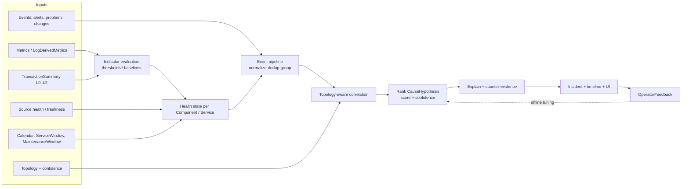
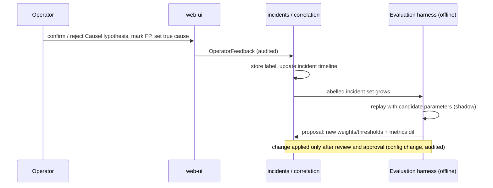

# معماری سلامت سرویس، همبستگی و هوش عملیاتی (Correlation & Intelligence)

| فیلد | مقدار |
|---|---|
| Document ID | `ARC-COR-001` |
| Version | `0.1` |
| Status | `Draft – Phase 0 – awaiting approval` |
| Date | `2026-10-11` (`1405/07/19`) |
| Owner | `Architecture` |
| Related documents | [ingestion-and-connectors.md](ingestion-and-connectors.md)، [security-and-threat-model.md](security-and-threat-model.md)، [ADR-0011](architecture-decision-records/ADR-0011-topology-model-and-dependency-discovery.md)، [ADR-0012](architecture-decision-records/ADR-0012-correlation-engine-design.md)، [ADR-0013](architecture-decision-records/ADR-0013-analytics-staging-rules-statistics-ml.md)، [ADR-0019](architecture-decision-records/ADR-0019-transaction-correlation-tiers.md)، [docs/requirements/](../requirements/)، [docs/testing/](../testing/)، [docs/roadmap/](../roadmap/) |

**راهنمای برچسب‌ها:** [واقعیت] فقط F-01..F-03؛ [فرض A-xx]؛ [فرضیه] نیازمند EXP/BM؛ [توصیه]؛ [باز Q-xx].

> **اصل بنیادین:** پلتفرم «علت» را اثبات نمی‌کند. خروجی موتور همبستگی **فرضیه‌های علت محتمل** (`CauseHypothesis`) است که با شواهد، امتیاز، اطمینان، عدم‌قطعیت و شواهد نقض همراه‌اند. هیچ وعده‌ای برای «پیش‌بینی بحران» پیش از اعتبارسنجی با دادهٔ برچسب‌خوردهٔ بانک (فاز ۵، M5) داده نمی‌شود.

---

## ۱. دامنه و جایگاه در معماری

- ماژول‌های درگیر در `platform-core`: `health`، `events`، `correlation`، `anomaly`، `transactions`، `slo`، `incidents`، با استفاده از `catalog`، `topology`، `calendar`.
- اجرا در نقش `analytics` به صورت micro-batch هر 30–60 s (موقت) با خواندن از ClickHouse و PostgreSQL؛ پردازش جریانی زیرثانیه‌ای هدف نیست (`NFR-PRF-004`: چرخهٔ ارزیابی ≤ 60 s).
- [توصیه] موتور قطعی (deterministic) و قابل توضیح؛ بدون ML در ابتدا ([ADR-0012](architecture-decision-records/ADR-0012-correlation-engine-design.md)). هر عدد در این سند که با «پارامتر» مشخص شده، **مقدار اولیهٔ موقت** است، در پیکربندی قرار می‌گیرد (نه در کد) و با مجموعهٔ حوادث برچسب‌خورده تنظیم می‌شود (بخش ۹).

*توضیح:* ورودی‌ها از ingestion و metadata می‌آیند؛ بازخورد اپراتور فقط به صورت آفلاین و پس از ارزیابی، پارامترها را تغییر می‌دهد.

## ۲. مدل سلامت سرویس (`FR-HLT-001..003`)

### ۲.۱ واحدها

- **Indicator:** یک سیگنال + قاعده (مثلاً «نرخ موفقیت فنی کارت‌به‌کارت»، «عمق صف X»، «availability virtual server Y»). هر indicator دارای وضعیت `OK | DEGRADED | CRITICAL | UNKNOWN`، وزن، نقش (`PRIMARY` = KPI مستقیم سرویس، `SUPPORTING` = اجزا) و نیاز freshness است.
- **Component health:** از indicatorهای همان component.
- **BusinessService health:** در درجهٔ اول از KPIهای خود سرویس (تراکنش، latency، حجم در برابر baseline) — چون محصول سرویس‌محور است — و در درجهٔ دوم از اثر وابستگی‌ها.

### ۲.۲ ترتیب محاسبهٔ `HealthState` برای یک BusinessService

| گام | شرط | نتیجه |
|---|---|---|
| 1 | `MaintenanceWindow` فعال برای سرویس (یا همهٔ اجزای ضروری آن) | `MAINTENANCE`؛ وضعیت زیرین محاسبه و در جزئیات نمایش داده می‌شود؛ اعلان سرکوب می‌شود (`FR-NTF-002`, `FR-CAL-003`) |
| 2 | خارج از `ServiceWindow` طبق `BusinessCalendar` و `DayType` | `EXPECTED_INACTIVE`؛ اگر ترافیک غیرمنتظره دیده شود، یادداشت اطلاعاتی «فعالیت خارج از پنجره» (نه خطا) |
| 3 | پوشش freshness کمتر از `coverage_min` (پارامتر، پیش‌فرض 0.6 وزنی) برای indicatorهای `PRIMARY` | `UNKNOWN` با فهرست منابع کهنه (`FR-HLT-003`) |
| 4 | داخل پنجرهٔ سرویس، ترافیک ≈ صفر در حالی که baseline حجم انتظار بیش از `min_expected_volume` دارد | «غیرفعال غیرعادی» (`FR-CAL-004`) → `CRITICAL` یا `DEGRADED` طبق شدت |
| 5 | ارزیابی indicatorهای `PRIMARY` تازه | بدترین وضعیت در میان indicatorهای `PRIMARY` (با hysteresis) |
| 6 | اگر سرویس هیچ indicator `PRIMARY` تازه ندارد ولی وابستگی سخت (`criticality=HARD`) در `CRITICAL` است | وضعیت **استنتاجی** حداکثر `DEGRADED` با برچسب «inferred from dependency»؛ در غیر این صورت `UNKNOWN` |
| 7 | اثر وابستگی وقتی سرویس KPI تازه دارد | وضعیت سرویس را تغییر نمی‌دهد؛ فقط حاشیهٔ «اجزای در معرض خطر» (impact annotation) اضافه می‌شود (`FR-HLT-002`) |

### ۲.۳ Freshness → `UNKNOWN`

- `fresh(indicator) ⇔ now − last_observed_at ≤ freshness_limit`، که `freshness_limit = 2 × poll_interval + settle_delay + max(0, skew_estimate)` (پارامتر؛ برای منابع push: `3 × expected_interval`).
- `coverage = Σ w_i [fresh_i] / Σ w_i` روی indicatorهای `PRIMARY`.
- اگر منبع در وضعیت `SourceUnavailable` باشد، همهٔ indicatorهای وابسته به آن فوراً unfresh تلقی می‌شوند. **دادهٔ کهنه هرگز به `OK` منجر نمی‌شود** (`NFR-REL-002`).

### ۲.۴ Hysteresis و ضد نوسان

- ورود به وضعیت بدتر: شرط در `n_enter` ارزیابی متوالی (پارامتر، پیش‌فرض 2)؛ خروج: `n_exit` (پیش‌فرض 3) و آستانهٔ خروج با حاشیه (مثلاً 10٪ بهتر از آستانهٔ ورود).
- استثنا: `CRITICAL` حاصل از availability صریح (مثلاً virtual server down) با یک ارزیابی وارد می‌شود.

### ۲.۵ توضیح‌پذیری (`NFR-USA-002`)

هر وضعیت با یک «explanation record» ذخیره می‌شود: indicatorهای مؤثر، مقدار مشاهده‌شده، آستانه یا baseline، پنجرهٔ زمانی، پوشش، منابع کهنه، اثر calendar. UI جمله‌ای مانند «DEGRADED: نرخ موفقیت فنی 91.2٪ در 5 دقیقهٔ اخیر، زیر آستانهٔ 97٪؛ پوشش داده 100٪؛ منبع: Elasticsearch (L0)» نمایش می‌دهد.

## ۳. خط لولهٔ رویداد (`FR-COR-001..003`, `FR-COR-007`)

**normalize → dedup → group → correlate → rank → explain**

| مرحله | ورودی/خروجی | قواعد [توصیه] |
|---|---|---|
| normalize | رویداد بومی → canonical `Event` (envelope سبک CloudEvents، [ADR-0005](architecture-decision-records/ADR-0005-api-and-event-contracts.md)) | فیلدها: `event_type` (ALERT, PROBLEM, STATE_CHANGE, CHANGE, SOURCE_HEALTH, ANOMALY)، `severity` canonical، `entity` (پس از ExternalRef)، `observed_at`، `source`، `fingerprint` |
| dedup | حذف تکرار ingestion و تکرار منطقی | کلید ingestion از [ingestion-and-connectors.md](ingestion-and-connectors.md) §8؛ dedup منطقی: همان `fingerprint` در پنجرهٔ `dedup_window` (پیش‌فرض 10 min) → افزایش شمارنده و `last_seen` |
| group | رویدادها → گروه‌های کاندید | ترکیب (الف) پنجرهٔ زمانی لغزان `group_window` (پیش‌فرض 5 min، به اندازهٔ skew منابع گسترش می‌یابد) و (ب) همبندی توپولوژیک: هر دو entity در فاصلهٔ ≤ `k_hops` (پیش‌فرض 3) در گراف وابستگی یا عضو بستهٔ وابستگی یک BusinessService مشترک |
| correlate | گروه → Incident | یک Incident وقتی باز می‌شود که حداقل یک BusinessService به `DEGRADED`/`CRITICAL` برود یا رویداد `CRITICAL` روی component با وابستگی سخت رخ دهد؛ گروه‌های مرتبط به Incident باز موجود ضمیمه می‌شوند |
| rank | Incident → فهرست مرتب `CauseHypothesis` | فرمول بخش ۴.۴ |
| explain | توضیح + شواهد نقض + نقاط کور | بخش ۴.۶ |

- **Change awareness (`FR-COR-005`):** رویدادهای `Change` (Deployment، ConfigChange) از منابع موجود (در صورت وجود) یا ثبت دستی، به عنوان نوعی شاهد در رتبه‌بندی استفاده می‌شوند.
- **Incident timeline (`FR-COR-007`):** همهٔ تغییرات وضعیت، شواهد افزوده‌شده، اصلاح ناشی از دادهٔ دیررس، و بازخورد اپراتور با زمان ثبت می‌شوند.

## ۴. همبستگی توپولوژی‌آگاه

### ۴.۱ انتشار اثر در برابر علت محتمل

- **Impact propagation (رو به بالا):** اگر component `c` مختل باشد، سرویس‌هایی که (مستقیم یا غیرمستقیم) به `c` وابسته‌اند «در معرض اثر» علامت می‌خورند. این فقط پاسخ «چه چیزی ممکن است متأثر باشد؟» است (`FR-HLT-002`).
- **Probable-cause (رو به پایین):** از سرویس متأثر در جهت وابستگی‌ها به سمت اجزای پایین‌دستی حرکت می‌کنیم و کاندیدها را رتبه می‌دهیم. این پاسخ «کجا را اول بررسی کنیم؟» است.
- دو مسیر هرگز در UI ادغام نمی‌شوند: نمایش اثر با رنگ/نماد متفاوت از نمایش کاندید علت.

### ۴.۲ مجموعهٔ کاندید

`Candidates(S) = { c ∈ DependencyClosure(S) | c has ≥ 1 evidence in [t0 − lookback, now] } ∪ UnobservedCriticalComponents(S)`

- `t0` = زمان شروع علائم سرویس (اولین ارزیابی نامطلوب).
- `lookback` = پارامتر (پیش‌فرض 15 min؛ برای شاهد `Change` پیش‌فرض 2 h).
- `DependencyClosure` با recursive CTE روی جداول topology ([ADR-0007](architecture-decision-records/ADR-0007-metadata-store-postgresql.md)) و فقط یال‌های `APPROVED` یا `PROPOSED` با `confidence ≥ edge_conf_min` (پیش‌فرض 0.5).
- اجزای حیاتی بدون telemetry («نقاط کور») حذف نمی‌شوند؛ به عنوان «کاندید مشاهده‌نشده» بدون امتیاز فهرست می‌شوند.

### ۴.۳ انواع شاهد و وزن‌های اولیه

| نوع شاهد | مثال | `w_type` اولیه | پیش‌نیاز telemetry |
|---|---|---|---|
| `AVAILABILITY_DOWN` | node unreachable، VS down، pool member down، channel stopped | 0.9 | Zabbix/SolarWinds/F5/HAProxy/MQ capability VERIFIED |
| `ERROR_RATE_ANOMALY` | افزایش 5xx یا `TECHNICAL_FAILURE`/`TIMEOUT` در همان hop | 0.8 | logها با کد خروجی (L0+) — [باز Q-07] |
| `EDGE_DISCREPANCY` | ورودی upstream ثابت، ورودی downstream افت (§۷.۳) | 0.8 | شمارش در هر دو سوی یال |
| `QUEUE_BACKLOG` | `SUSTAINED_BACKLOG` یا `CONSUMER_STALLED` (§۶) | 0.75 | depth (+ نرخ‌ها در صورت وجود) |
| `LATENCY_ANOMALY` | P95 بالاتر از baseline | 0.6 | latency در log یا متریک |
| `SATURATION` | CPU/حافظه/connection pool/thread pool/دیسک نزدیک سقف | 0.5 | Zabbix/SolarWinds/JMX/DMV |
| `CHANGE` | Deployment/ConfigChange روی کاندید در lookback | 0.6 | ثبت change (دستی یا منبع) |
| `SOURCE_ALERT` | alert فعال در Zabbix/SolarWinds روی کاندید | 0.5 | Zabbix/SolarWinds |
| `LOG_PATTERN` | رشد الگوی خطای مشخص (مثلاً connection refused به downstream) | 0.5 | query template مصوب |
| `NETWORK_ERRORS` | خطا/discard interface، packet loss | 0.6 | SolarWinds/Zabbix + نگاشت component به segment |

وزن‌ها **موقت** هستند و فقط از طریق فرایند ارزیابی (بخش ۹) تغییر می‌کنند.

### ۴.۴ فرمول امتیازدهی

برای هر کاندید `c` و هر شاهد `e` روی `c` (یا روی یال خروجی `c`):

1. **قدرت شاهد** `s_e ∈ [0,1]`: برای آستانه‌ها `DEGRADED → 0.6`، `CRITICAL → 1.0`؛ برای ناهنجاری آماری `s_e = min(1, |z_robust| / z_max)` با `z_max = 6`.
2. **کیفیت داده** `q_e ∈ [0,1]`: `q_e = q_fresh · q_tier · q_cap`، که `q_fresh ∈ {1, 0.5}` (تازه/نزدیک به مرز)، `q_tier`: L3 = 1.0، L2 = 0.9، L1 = 0.6، L0 = 0.7 برای شمارش‌های تجمیعی مستقیم (L0 برای شواهد شمارشی دقیق است ولی پیوند تراکنش ندارد)، غیرتراکنشی = 1.0؛ `q_cap = 1` اگر capability `VERIFIED` باشد وگرنه 0.5.
3. **عامل زمانی** `f_t(e)`: با `Δ = onset(e) − t0` و تحمل `τ_skew = max(|skew_src(e)|, |skew_src(symptom)|) + 30 s`:
   - اگر `Δ ≤ τ_skew` (هم‌زمان یا پیش از علائم): `f_t = 1`
   - اگر `Δ > τ_skew`: `f_t = exp(−(Δ − τ_skew) / τ_decay)` با `τ_decay = 120 s`
   - اگر شاهد بسیار قدیمی و پایدار باشد (مزمن، شروع پیش از `t0 − chronic_age`، پیش‌فرض 24 h): `f_t = 0.3`
4. **ترکیب شواهد (noisy-OR):** `E(c) = 1 − Π_e (1 − w_type(e) · s_e · q_e · f_t(e))`
5. **عامل توپولوژی** `f_topo(c) = Π_{edges on best path S→c} conf(edge)` (یال `APPROVED` دستی: 1.0؛ کشف‌شده: مقدار `confidence`).
6. **جریمهٔ «توضیح‌داده‌شده توسط پایین‌دست»:** اگر کاندید `d ∈ Downstream(c)` با `E(d) ≥ 0.5` و `onset(d) ≤ onset(c) + τ_skew` وجود داشته باشد، اختلال `c` احتمالاً اثر است نه علت: `P_down(c) = 1 − λ · max_d E(d) · f_topo(c→d)` با `λ = 0.5`.
7. **شواهد نقض** `κ_k ∈ [0,1]` (بخش ۴.۶): `P_counter(c) = Π_k (1 − κ_k)`.

**امتیاز نهایی:**

`Score(c) = f_topo(c) · E(c) · P_down(c) · P_counter(c)`   (در بازهٔ [0,1])

کاندیدها بر اساس `Score` مرتب می‌شوند؛ کاندیدهای با `Score < score_min` (پیش‌فرض 0.2) در فهرست اصلی نمایش داده نمی‌شوند ولی در «سایر کاندیدها» قابل مشاهده‌اند.

> [فرضیه] این فرمول در VS-1 معیار «hop مختل واقعی در top-3 شواهد برای ≥ 2 از 3 حادثهٔ replay‌شده» را برآورده می‌کند. این فرضیه با replay حوادث تاریخی (M3) آزموده می‌شود و BM-08 هزینهٔ محاسباتی آن را در برابر اندازهٔ topology می‌سنجد.

### ۴.۵ اطمینان (Confidence) و عدم‌قطعیت

اطمینان از امتیاز جداست: امتیاز می‌گوید «کدام کاندید قوی‌تر است»، اطمینان می‌گوید «چقدر به خود رتبه‌بندی اعتماد داریم».

- `coverage_obs` = نسبت اجزای حیاتی بستهٔ وابستگی که telemetry تازه دارند.
- `margin` = `(Score_1 − Score_2) / Score_1` (اگر فقط یک کاندید: 1).
- `independence` = `min(1, n_sources(top1) / 2)` (تعداد منابع مستقل شواهد برای کاندید اول؛ مثلاً Zabbix + Elasticsearch = 2).
- `topo_conf` = `f_topo(top1)`.

`Confidence = coverage_obs · topo_conf · (0.5 + 0.5 · margin) · (0.5 + 0.5 · independence)`

| باند | شرط | نمایش |
|---|---|---|
| `HIGH` | ≥ 0.7 | «اطمینان بالا» |
| `MEDIUM` | 0.4 – 0.7 | «اطمینان متوسط» |
| `LOW` | < 0.4 | «اطمینان پایین — شواهد ناکافی یا نقاط کور» |

**عدم‌قطعیت** همیشه نمایش داده می‌شود: فهرست نقاط کور (اجزای بدون telemetry در مسیر)، منابع کهنه، یال‌های با confidence پایین، skew ساعت بالا و tier همبستگی تراکنش.

### ۴.۶ شواهد نقض (Counter-evidence)

| شاهد نقض | `κ` اولیه | توضیح |
|---|---|---|
| همهٔ indicatorهای کاندید تازه و `OK` در پنجره | 0.6 | کاندید سالم دیده می‌شود |
| ترافیک از کاندید به پایین‌دست بدون افت (L0) | 0.5 | داده عبور می‌کند |
| همان ناهنجاری در دوره‌های مشابه بدون حادثه رخ داده (نرخ پایهٔ بالا) | 0.4 | شاهد «پرنویز» است |
| شاهد پس از `t0 + 10 min` آغاز شده | 0.3 | احتمالاً پیامد است |
| کاندید فقط با یال `PROPOSED` به سرویس وصل است | 0.2 | ارتباط تأییدنشده |

شواهد نقض در UI کنار شواهد تأییدکننده نمایش داده می‌شوند.

### ۴.۷ قاعدهٔ UI: «همبستگی ≠ علیت»

- [توصیه] عنوان پنل: «شواهد همبسته و کاندیدهای علت محتمل»، نه «علت ریشه‌ای».
- متن ثابت در پنل: «این فهرست بر اساس هم‌زمانی و ارتباط توپولوژیک سیگنال‌ها رتبه‌بندی شده است. همبستگی به معنای علیت نیست؛ تأیید علت با کارشناس است.»
- هر `CauseHypothesis` شامل: رتبه، امتیاز، باند اطمینان، شواهد (با لینک بازگشت به Zabbix/Splunk/ES — `FR-INT-006`)، شواهد نقض، نقاط کور، tier همبستگی، و دکمه‌های بازخورد.

## ۵. طبقه‌بندی failure domain (`FR-LB-006`, `FR-LB-007`)

قواعد زیر روی یک زنجیرهٔ ورودی (مثلاً VS-1: Mobile app → WAF → Load Balancer → API gateway → card-transfer service → ESB → IBM MQ → switch) اعمال می‌شوند. **هر قاعده فقط وقتی اجرا می‌شود که telemetry پیش‌نیاز آن `VERIFIED` باشد**؛ در غیر این صورت خروجی «قابل تفکیک نیست: telemetry X موجود نیست» است.

| Domain | امضای شواهد (همه در پنجرهٔ مشترک) | Telemetry پیش‌نیاز | اگر پیش‌نیاز نباشد |
|---|---|---|---|
| **WAF** | افزایش `REJECTED` یا block/challenge در WAF؛ ورودی LB یا WAF ثابت؛ ورودی app افت؛ بدون افزایش خطای app | شمارش block/challenge از log یا stats WAF (مثلاً log ASM به Splunk/ES) — `FR-LB-005` | «رد درخواست پیش از app؛ تفکیک WAF از LB ممکن نیست» |
| **Load Balancer** | VS down یا pool members down؛ یا پاسخ‌های تولیدشده توسط خود LB (مثلاً 503 بدون member سالم)؛ یا ورودی LB ثابت و ورودی backendها افت/توزیع نامتوازن (`FR-LB-003`) | stats VS/pool/member (F5 iControl، HAProxy stats، NGINX Plus) یا itemهای Zabbix/SolarWinds معادل | فقط از availability LB (اگر در Zabbix موجود است)؛ وگرنه نامشخص |
| **Network** | چند component نامرتبط در یک segment/zone هم‌زمان خطای اتصال/timeout دارند؛ خطا/discard interface یا packet loss؛ node unreachable در SolarWinds/Zabbix | metrics شبکه (SolarWinds/Zabbix) + نگاشت component به segment/zone در catalog | «احتمال شبکه» فقط با الگوی هم‌زمانی چندگانه و اطمینان `LOW` |
| **Application** | ورودی app ثابت (یا upstream ثابت) و `TECHNICAL_FAILURE`/5xx/latency در app افزایش؛ پایین‌دستی‌ها سالم؛ اغلب با `CHANGE` یا `SATURATION` (JVM/pool) | شمارش ورودی و خروجی app از log (L0) + سلامت پایین‌دست | اگر سلامت پایین‌دست نامعلوم: «app یا downstream» |
| **Downstream** | خطاهای app از نوع timeout/کد خطای وابسته به downstream؛ backlog در صف به سمت downstream؛ کاهش نرخ consumer؛ افزایش کدهای «issuer/switch unavailable» در `OutcomeMapping` | الگوی خطای مصوب در log، داده‌های MQ، نگاشت کد پاسخ (داده) | «خطا پس از app؛ downstream مشخص نیست» |

[توصیه] خروجی طبقه‌بندی یک شاهد از نوع `FAILURE_DOMAIN` با برچسب domain و اطمینان است، نه حکم. برای ExternalParty (مثلاً اتصال Shetab-related where applicable) پلتفرم فقط سمت بانک را می‌بیند؛ «مشکل در طرف خارجی» همیشه با اطمینان حداکثر `MEDIUM` و عبارت «بر اساس شواهد سمت بانک» نمایش داده می‌شود.

## ۶. طبقه‌بندی backlog صف (`FR-MQ-004`, `FR-MQ-006`)

### ۶.۱ متغیرها

- `D(t)`: عمق فعلی صف؛ `D_max`: max depth صف.
- `λ_in`: نرخ ورود (msg/s)، `μ_out`: نرخ خروج (msg/s) — در صورت وجود capability.
- `g`: شیب رشد عمق، برآورد مقاوم با Theil–Sen روی پنجرهٔ `W` (پیش‌فرض 10 min). اگر نرخ‌ها موجود باشد: `g ≈ λ_in − μ_out`.
- `A`: عمر قدیمی‌ترین پیام (اگر capability موجود؛ رجوع به نکتهٔ بازبینی در [ingestion-and-connectors.md](ingestion-and-connectors.md) §15).
- `C_open`: تعداد handleهای ورودی باز (consumers).
- `μ_base`، `D_band`: baseline نرخ خروج و باند عمق به ازای time-of-week و `DayType`.

### ۶.۲ فرمول‌ها

- **زمان تخلیه:** `T_drain = D / (μ_out − λ_in)` اگر `μ_out > λ_in`؛ در غیر این صورت `∞`.
  (اگر نرخ‌ها نیست: `T_drain ≈ D / (−g)` برای `g < 0`، وگرنه `∞`.)
- **زمان تا پر شدن:** `T_full = (D_max − D) / g` اگر `g > 0`؛ وگرنه `∞`.
- **کاهش ظرفیت مصرف:** `ρ = μ_out / μ_base` (اگر `μ_base` آماری کافی دارد).

### ۶.۳ کلاس‌ها (پارامترها موقت)

| کلاس | شرط |
|---|---|
| `NORMAL` | `D` داخل `D_band` |
| `TRANSIENT_BURST` | `D` بالای باند اما `T_drain ≤ T_drain_ok` (پیش‌فرض 5 min) **و** `ρ ≥ 0.8` **و** `C_open > 0` **و** مدت بالای باند < `T_sustain` (پیش‌فرض 10 min) |
| `SUSTAINED_BACKLOG` | `D` بالای باند به مدت ≥ `T_sustain` **یا** `T_drain > T_drain_ok` برای ≥ 3 ارزیابی متوالی |
| `CONSUMER_STALLED` | `D > 0` و (`μ_out ≈ 0` یا `C_open = 0`) به مدت ≥ 2 ارزیابی؛ یا `A` تقریباً هم‌پای زمان ساعت رشد می‌کند |
| `PRODUCER_SURGE` (زیرنوع) | `λ_in > p95(λ_in baseline)` و `ρ ≥ 0.8` — ورود غیرعادی، نه کندی مصرف |
| `CONSUMER_DEGRADED` (زیرنوع) | `ρ < 0.6` با `λ_in` عادی (`FR-MQ-006`) |
| `CAPACITY_RISK` (پوشش) | `T_full < H_full` (پیش‌فرض 30 min) — مستقل از کلاس اصلی هشدار پیش‌بینی |

- [توصیه] اگر نرخ‌ها در دسترس نباشند، طبقه‌بندی فقط با `D`، `g`، `C_open` انجام و اطمینان آن `LOW/MEDIUM` اعلام می‌شود.
- الگوهای batch برنامه‌ریزی‌شده (مثلاً پنجره‌های پردازشی تقویم بانک) از طریق baseline وابسته به time-of-week و `ServiceWindow` جذب می‌شوند تا backlog مورد انتظار هشدار تولید نکند.
- صف‌های DLQ/backout: هر `D > 0` تازه یا رشد = شاهد `FR-MQ-005`.

## ۷. تحلیل تراکنش

### ۷.۱ Tierهای همبستگی (ADR-0019)

| Tier | روش | دقت | پیش‌فرض در شروع |
|---|---|---|---|
| L3 Trace | W3C `traceparent` / OTel trace id | دقیق | فاز ۷ |
| L2 Business key | join قطعی روی کلیدهای پیکربندی‌شدهٔ بانک (مثلاً STAN+RRN+terminal+date در ISO 8583، شمارهٔ پیگیری SATNA/PAYA)، توکنیزه با HMAC-SHA256 | قطعی روی توکن | جایی که کلید در log وجود دارد ([باز Q-07]) |
| L1 Heuristic | کلید جزئی + پنجرهٔ زمانی + bucket مبلغ | احتمالی، با confidence | اختیاری |
| L0 Aggregate | شمارش/خروجی per-minute به ازای hop و یال؛ مقایسهٔ upstream/downstream | تجمیعی | **پیش‌فرض و باید به‌تنهایی کاملاً مفید باشد** |

هر متریک تراکنشی `bank.txn.correlation_tier` را ثبت می‌کند و UI آن را نمایش می‌دهد (`FR-TXN-008`).

### ۷.۲ موفقیت فنی در برابر موفقیت کسب‌وکاری (`FR-TXN-005`)

با `n(o)` = تعداد تراکنش با خروجی `o ∈ TxnOutcome` در پنجره:

- `N_known = Σ n(o)` برای `o ≠ UNKNOWN`؛ `coverage_outcome = N_known / N_total` (اگر کمتر از 0.9 → هشدار کیفیت داده).
- **نرخ موفقیت فنی:** `TSR = (n(SUCCESS) + n(BUSINESS_DECLINE)) / (N_known − n(REJECTED)·[rejected_excluded])`
- **نرخ موفقیت کسب‌وکاری:** `BSR = n(SUCCESS) / N_known`
- `INDETERMINATE` و `TIMEOUT` جزو موفقیت فنی نیستند و جداگانه نمایش داده می‌شوند. `REVERSED` به صورت پیش‌فرض جدا گزارش می‌شود؛ شمول آن در TSR پیکربندی‌پذیر است.
- `rejected_excluded` (پیش‌فرض true): ردهای اعتبارسنجی/امنیتی/rate-limit رفتار مورد انتظار سیستم‌اند و نرخ آن‌ها جداگانه پایش می‌شود؛ جهش آن شاهد WAF/LB است (§۵).
- [توصیه] افت BSR با TSR ثابت معمولاً به معنای مشکل کسب‌وکاری یا طرف خارجی (مثلاً افزایش decline صادرکننده) است، نه خرابی فنی؛ health فنی را `CRITICAL` نمی‌کند ولی indicator جداگانه دارد.
- نگاشت کد پاسخ (مثلاً جدول کدهای ISO 8583) **داده** در `OutcomeMapping` است (`FR-TXN-002`).

### ۷.۳ مقایسهٔ upstream و downstream (`FR-TXN-006`, `FR-LB-006`)

برای یال `A → B` و پنجرهٔ `w` (پیش‌فرض 2 min برای جذب تأخیر انتقال):

- `r(t) = in_B(t, w) / out_A→B(t, w)`؛ `r_base` = میانه در baseline هم‌زمان (fan-out، retry و فیلتر باعث می‌شود `r_base` لزوماً 1 نباشد).
- **شاهد `EDGE_DISCREPANCY`** وقتی `|r − r_base| > k · MAD(r)` (پیش‌فرض `k = 4`) و `out_A→B ≥ n_min` (پیش‌فرض 30 در پنجره، برای پرهیز از نویز حجم کم).
- تأخیر بین شمارش‌ها با cross-correlation روی تاریخچه برآورد می‌شود (lag ثابت) و skew ساعت به عنوان تحمل اضافه می‌شود.

### ۷.۴ قاعدهٔ VS-1: «افت نرخ موفقیت با ترافیک ورودی پایدار» (`FR-ANO-004`)

- شرط: `TSR` (یا `BSR`، پیکربندی) زیر baseline time-of-week به اندازهٔ `> k_s · MAD` و حداقل `Δ_abs` (پیش‌فرض 2 واحد درصد)، **و** حجم ورودی در باند `[0.8, 1.2] × baseline` برای ≥ 3 دقیقهٔ متوالی.
- تفسیر: حجم پایدار یعنی افت ناشی از کاهش تقاضا یا تعطیلی نیست؛ احتمال خرابی در زنجیره بالا است. خروجی به عنوان شاهد `ERROR_RATE_ANOMALY` روی سرویس و آغازگر جست‌وجوی کاندید در §۴.

## ۸. تحلیل مرحله‌ای (ADR-0013)

| مرحله | تکنیک | فاز | پیش‌نیاز ورود |
|---|---|---|---|
| 1. Thresholds | آستانهٔ ثابت با hysteresis (`FR-ANO-001`) | ۲ | — |
| 2. Seasonal baselines | میانه/چندک به ازای time-of-week × `DayType` (`FR-ANO-002`, `FR-CAL-007`) | ۳ (پایه) → ۵ | حداقل تاریخچه (§۹.۵) |
| 3. Robust statistics | robust z با MAD، EWMA، باقیماندهٔ STL (`FR-ANO-003`) | ۵ | baseline پایدار |
| 4. Multivariate / dependency-aware | قواعد ترکیبی چندسیگنالی روی topology (`FR-ANO-004`) — یک قاعده در VS-1 | ۳ (یک قاعده) → ۵ | KPIهای چند hop |
| 5. Forecasting | برون‌یابی خطی مقاوم/Holt برای time-to-full صف، burn rate SLO، saturation (`FR-ANO-005`) | ۵ | ارزیابی lead time |
| 6. ML | فقط پس از عبور از gate ارزیابی و ADR جدید | پس از ۵ | بهبود معنادار نسبت به مرحلهٔ 3–5 روی مجموعهٔ برچسب‌خورده |

### ۸.۱ نگاشت الگوهای نمونه به detectorها

الگوهای زیر از فهرست نیازمندی‌های منشور (F-03) و FRهای مرتبط استخراج شده‌اند:

| الگو | Detector | مرحله | FR |
|---|---|---|---|
| افت نرخ موفقیت با ورودی پایدار | قاعدهٔ ترکیبی §۷.۴ | 2+4 | `FR-ANO-004`, `FR-TXN-005` |
| حجم تراکنش غیرعادی نسبت به انتظار (با تقویم) | baseline time-of-week × DayType + robust z | 2→3 | `FR-TXN-011`, `FR-CAL-007` |
| غیرفعال مورد انتظار در برابر غیرفعال غیرعادی | ServiceWindow + baseline حجم | 1+2 | `FR-CAL-004` |
| backlog صف گذرا در برابر پایدار | طبقه‌بندی §۶ | 1+3 | `FR-MQ-004` |
| زمان تا پر شدن صف | `T_full` + پیش‌بینی خطی مقاوم | 5 | `FR-ANO-005` |
| کاهش throughput مصرف‌کننده | `ρ` نسبت به baseline | 2→3 | `FR-MQ-006` |
| از دست رفتن ظرفیت pool / توزیع نامتوازن | نسبت memberهای سالم؛ ضریب تغییرات توزیع درخواست بین memberها | 1+3 | `FR-LB-003` |
| اختلاف ورودی و پردازش‌شده | `EDGE_DISCREPANCY` §۷.۳ | 3 | `FR-LB-006`, `FR-TXN-006` |
| مصرف سریع error budget | multi-window burn rate (مثلاً 1 h و 6 h، پارامتر) | 2→5 | `FR-CAL-006` |
| انقضای گواهی TLS | آستانهٔ روز تا انقضا | 1 | `FR-LB-004` |
| افزایش latency | P95 در برابر baseline + robust z | 2→3 | `FR-TXN-004` |
| saturation منابع (JVM، DB، host) | آستانه + روند | 1→5 | `FR-RUN-001/003/004` |

## ۹. ارزیابی (`FR-ANO-006..008`)

### ۹.۱ مجموعهٔ حوادث برچسب‌خورده

- منابع: سوابق حادثه در ITSM بانک ([باز Q-14])، گزارش‌های پس از حادثه، و برچسب‌گذاری اپراتور از طریق `OperatorFeedback`.
- هر برچسب: سرویس متأثر، بازهٔ شروع/پایان (به تأیید عملیات)، component/hop علت تأییدشده (در صورت وجود)، domain، و یادداشت. دوره‌های «بدون حادثه» نیز صریحاً علامت می‌خورند تا FP قابل محاسبه باشد.
- [توصیه] حداقل برای VS-1: ≥ 3 حادثهٔ تاریخی مورد توافق؛ برای M5: مجموعهٔ بزرگ‌تری که اندازهٔ آن پس از EXP-01 و بررسی سوابق تعیین می‌شود (بدون عدد تعهدی در Phase 0).
- داده‌ی replay از مسیر import فایلی یا خواندن تاریخی از منابع (با budget) تأمین می‌شود ([ingestion-and-connectors.md](ingestion-and-connectors.md) §3.3).

### ۹.۲ معیارها

| معیار | تعریف |
|---|---|
| Precision | `TP_alerts / (TP_alerts + FP_alerts)`؛ هشدار TP اگر با بازهٔ حادثهٔ برچسب‌خورده (± `tol`, پیش‌فرض 10 min) هم‌پوشانی داشته باشد |
| Recall | `detected_incidents / labelled_incidents` |
| Time-to-detect | `t_first_alert − t_incident_start`؛ گزارش میانه و p90 |
| Lead time (پیش‌بینی) | `t_breach − t_forecast_alert` برای forecastها؛ فقط اگر forecast درست بوده |
| Top-k cause accuracy | نسبت حوادثی که علت تأییدشده در top-k (`k=3`) `CauseHypothesis` است |
| Alert budget | تعداد هشدارهای قابل اقدام به ازای تیم در هر شیفت؛ مقدار هدف با عملیات توافق می‌شود ([باز Q-19]) |
| Health agreement | توافق `HealthState` با قضاوت اپراتور در نمونه‌ای از پنجره‌های 5 دقیقه‌ای (هدف VS-1: ≥ 90٪) |

### ۹.۳ کنترل مثبت کاذب (R-05)

- hysteresis و حداقل مدت؛ سرکوب در `MAINTENANCE` و `EXPECTED_INACTIVE`؛ dedup و grouping؛ حداقل حجم (`n_min`) برای نرخ‌ها؛ آستانهٔ اطمینان برای اعلان (اعلان فقط برای `MEDIUM+` یا قاعدهٔ صریح).
- **بودجهٔ هشدار به ازای detector:** اگر detector در دورهٔ ارزیابی از سهم بودجهٔ خود عبور کند، خودکار به حالت `OBSERVE_ONLY` (نمایش در UI بدون اعلان) تنزل می‌یابد تا بازبینی شود.
- **Shadow mode:** هر detector یا تغییر پارامتر جدید ابتدا بدون اعلان اجرا و با مجموعهٔ برچسب‌خورده مقایسه می‌شود.

### ۹.۴ Gate ورود به تولید و ML

- detector آماری: precision و recall روی مجموعهٔ برچسب‌خورده گزارش‌شده و مورد تأیید عملیات؛ هیچ detectorی بدون اندازه‌گیری اعلان‌دهنده نمی‌شود (M5).
- ML: فقط اگر (۱) بهبود معنادار نسبت به بهترین روش آماری روی همان مجموعه، (۲) خروجی قابل توضیح در قالب §۹.۷، (۳) هزینهٔ منابع و نگهداری قابل قبول، (۴) ADR جداگانه. Python فقط برای آزمایش‌های جدا در فاز ۵ در صورت توجیه ([ADR-0003](architecture-decision-records/ADR-0003-backend-language-java-spring-boot.md)).

### ۹.۵ الزامات آموزش baseline

- حداقل تاریخچه: [توصیه] ≥ 4 هفته برای baseline time-of-week روزهای کاری و ترجیحاً ≥ 8 هفته؛ برای `DayType` کم‌تکرار (`HOLIDAY`, `HALF_DAY`, `SPECIAL`) حداقل `n_daytype` رخداد (پیش‌فرض 3) وگرنه fallback به نزدیک‌ترین DayType مشابه (مثلاً `HOLIDAY` → الگوی جمعه) با کاهش اطمینان.
- حذف بازه‌های حادثه و maintenance از دادهٔ آموزش.
- حداقل نمونه در هر bucket (پیش‌فرض 20)؛ در غیر این صورت ادغام bucketهای همسایه.
- تعطیلات قمری هر سال به‌عنوان داده بارگذاری می‌شود و محاسبه نمی‌شود ([باز Q-15])؛ اشتباه در تقویم مستقیماً به FP منجر می‌شود (R-14).
- [فرضیه] تاریخچهٔ کافی در Splunk/ES برای بازسازی baseline وجود دارد؛ وابسته به retention منابع (EXP-01، EXP-02).

### ۹.۶ تشخیص drift

- پایش توزیع باقیمانده‌ها (مثلاً PSI یا آزمون KS بین پنجرهٔ اخیر و پنجرهٔ آموزش) و روند نرخ FP به ازای detector.
- رویدادهای شناخته‌شدهٔ تغییر رژیم (مهاجرت سامانه، تغییر نسخه، کانال جدید) به صورت `Change` ثبت و موجب بازآموزی پیشنهادی می‌شوند.
- بازآموزی زمان‌بندی‌شده (مثلاً هفتگی) با بازبینی تغییر baseline؛ نسخهٔ baseline در explanation ثبت می‌شود (`FR-ANO-007`).

### ۹.۷ توضیح‌پذیری (`FR-ANO-008`)

هر ناهنجاری شامل: detector و نسخهٔ آن، مقدار مشاهده‌شده، مقدار مورد انتظار و باند، دورهٔ آموزش baseline و DayType مورد استفاده، سیگنال‌های مشارکت‌کننده (برای قواعد چندمتغیره)، tier همبستگی و کیفیت داده.

## ۱۰. حلقهٔ بازخورد اپراتور (`FR-COR-006`)

*توضیح:* بازخورد هرگز به صورت آنلاین و خودکار وزن‌ها را تغییر نمی‌دهد؛ تغییرات پیشنهادی با replay ارزیابی و پس از تأیید اعمال می‌شوند.

- انواع بازخورد: تأیید/رد فرضیه، تعیین علت واقعی (component، domain)، «هشدار کاذب» با دلیل (تقویم اشتباه، آستانهٔ نامناسب، دادهٔ کهنه، topology نادرست)، پیشنهاد یال وابستگی جدید (ورودی `PROPOSED` به [ADR-0011](architecture-decision-records/ADR-0011-topology-model-and-dependency-discovery.md)).
- بازخورد «topology نادرست» مستقیماً به صف بازبینی topology می‌رود (کاهش R-08).

## ۱۱. نکته برای بازبینی

- **«نکته برای بازبینی» (وضعیت استنتاجی):** گام 6 در §۲.۲ اجازه می‌دهد سرویس بدون KPI تازه از وابستگی سخت حداکثر `DEGRADED` استنتاجی بگیرد. این با `FR-HLT-002` («انتشار به عنوان اثر نه علت») سازگار است ولی در enum `HealthState` نشانگر جداگانه‌ای برای «inferred» وجود ندارد؛ پیشنهاد می‌شود ویژگی `derivation ∈ {DIRECT, INFERRED}` کنار `HealthState` به canonical schema افزوده شود.
- **«نکته برای بازبینی» (L0 در `q_tier`):** وزن 0.7 برای L0 بیشتر از L1 (0.6) انتخاب شده چون شمارش تجمیعی دقیق است اما پیوند تراکنش ندارد؛ این ترتیب با ترتیب دقت tierها در ADR-0019 برای *پیوند تراکنش* متفاوت است و باید در بازبینی تأیید شود.
- **«نکته برای بازبینی» (Document ID):** شناسهٔ `ARC-COR-001` توسط نویسنده انتخاب شده است.
