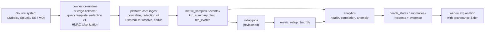

# معماری داده (Data Architecture)

| فیلد | مقدار |
|---|---|
| Document ID | `ARC-DAT-001` |
| Version | `0.1` |
| Status | `Draft – Phase 0 – awaiting approval` |
| Date | `2026-10-11` (۱۴۰۵/۰۷/۱۹) |
| Owner | `Architecture` |
| Related documents | [system-context.md](system-context.md)، [container-architecture.md](container-architecture.md)، [ADR-0005](architecture-decision-records/ADR-0005-api-and-event-contracts.md)، [ADR-0006](architecture-decision-records/ADR-0006-canonical-schemas-otel-plus-bank-namespace.md)، [ADR-0007](architecture-decision-records/ADR-0007-metadata-store-postgresql.md)، [ADR-0008](architecture-decision-records/ADR-0008-telemetry-store-clickhouse.md)، [ADR-0009](architecture-decision-records/ADR-0009-no-own-raw-log-store-federate-existing.md)، [ADR-0010](architecture-decision-records/ADR-0010-buffering-without-kafka-initially.md)، [ADR-0011](architecture-decision-records/ADR-0011-topology-model-and-dependency-discovery.md)، [ADR-0018](architecture-decision-records/ADR-0018-data-retention-privacy-capacity-controls.md)، [ADR-0019](architecture-decision-records/ADR-0019-transaction-correlation-tiers.md) |

> **قرارداد برچسب‌گذاری:** [واقعیت]، [فرض A-xx]، [فرضیه]، [توصیه]، [باز Q-xx] — مطابق spine §1.
>
> **یادآوری:** جدول‌های این سند **طرح توضیحی** هستند و DDL اجرایی یا migration نیستند. نوع‌ها نوع منطقی‌اند؛ نگاشت دقیق به نوع PostgreSQL/ClickHouse در فاز ۱ و ۲ و پس از BM-01..BM-03 نهایی می‌شود.

## ۱. اصول

1. **دو مخزن، بدون هم‌پوشانی** [توصیه]: دادهٔ مرجع، پیکربندی و حالت تراکنشی در `metadata-db` (PostgreSQL)؛ دادهٔ سری‌زمانی و رویدادی حجیم در `telemetry-store` (ClickHouse) ([ADR-0007](architecture-decision-records/ADR-0007-metadata-store-postgresql.md)، [ADR-0008](architecture-decision-records/ADR-0008-telemetry-store-clickhouse.md)).
2. **بدون لاگ خام** [توصیه]: فقط متریک و رویداد مشتق‌شده ذخیره می‌شود؛ لاگ‌ها در Splunk/Elasticsearch می‌مانند ([ADR-0009](architecture-decision-records/ADR-0009-no-own-raw-log-store-federate-existing.md)).
3. **OTel + فضای نام `bank.*`** [توصیه]: نام‌گذاری ویژگی‌ها از OTel semantic conventions پیروی می‌کند و مفاهیم بانکی در `bank.*` هستند ([ADR-0006](architecture-decision-records/ADR-0006-canonical-schemas-otel-plus-bank-namespace.md)).
4. **حریم خصوصی از طراحی** [توصیه]: هر فیلد ردهٔ حریم خصوصی دارد؛ دادهٔ ممنوع هرگز ذخیره نمی‌شود ([ADR-0018](architecture-decision-records/ADR-0018-data-retention-privacy-capacity-controls.md)).
5. **at-least-once + idempotent** (NFR-REL-001): هر رکورد کلید idempotency قطعی دارد.
6. **منشأ صریح**: هر داده نشان می‌دهد از کجا، با چه روشی و در کدام tier همبستگی به دست آمده است.

## ۲. قراردادهای مشترک

### ۲.۱ نوع‌های منطقی

| نوع | معنا |
|---|---|
| `uuid` | UUID نسخهٔ ۷ (مرتب بر اساس زمان) برای موجودیت‌های PostgreSQL [توصیه] |
| `id64` | هش ۶۴ بیتی قطعی (مثلاً `cityHash64`/`xxHash64` روی رشتهٔ canonical) برای شناسه‌های پرتعداد در ClickHouse |
| `ts` | زمان UTC با دقت میلی‌ثانیه (`DateTime64(3,'UTC')` / `timestamptz`) |
| `ts_min` | ابتدای دقیقهٔ UTC |
| `string` | UTF-8؛ برای مقادیر کم‌تنوع در ClickHouse `LowCardinality(String)` |
| `enum` | مقدار از مجموعهٔ بسته (مثلاً `TxnOutcome`، `HealthState`) |
| `map` | نگاشت کلید/مقدار رشته‌ای با کلیدهای allowlist‌شده |
| `json` | سند ساختاریافته با JSON Schema نسخه‌دار |

### ۲.۲ رده‌های حریم خصوصی (PII class)

| رده | معنا | نمونه | قاعده |
|---|---|---|---|
| `P0` | عملیاتی غیرشخصی | نام متریک، شمارش، شناسهٔ سرویس | آزاد در محدودهٔ RBAC |
| `P1` | شناسهٔ زیرساخت داخلی | hostname، IP، نام صف | RBAC؛ در اعلان بیرونی با احتیاط |
| `P2` | دادهٔ شخصی کارکنان | شناسهٔ کاربر اپراتور در audit، نام مالک سرویس | فقط نقش‌های مجاز؛ در audit نگهداری طولانی |
| `P3` | مشتق مستعارشدهٔ مشتری | HMAC token، BIN، amount bucket | فقط در جدول‌های مشخص، با TTL کوتاه، دسترسی محدود |
| `PROHIBITED` | ممنوع | PAN، CVV، PIN، PIN block، track data، گذرواژه، OTP، token/secret، payload کامل، کد ملی/شبا/موبایل/شماره حساب خام | redaction در لبه و ingest؛ کشف آن در ذخیره = Incident امنیتی |

[توصیه] کد ملی، IBAN/شبا، شمارهٔ موبایل و شمارهٔ حساب در صورت نیاز به همبستگی فقط به‌صورت HMAC token (رده `P3`) مجازند؛ پیش‌فرض حذف است.

## ۳. طرح‌های canonical

ستون «Req» یعنی الزامی (`Y`) یا اختیاری (`N`).

### ۳.۱ موجودیت‌های کاتالوگ (PostgreSQL، schema `catalog`)

**BusinessService**

| فیلد | نوع | Req | توضیح | PII |
|---|---|---|---|---|
| `id` | uuid | Y | شناسهٔ پایدار | P0 |
| `key` | string | Y | کلید خوانا و یکتا (مثلاً `card-to-card-mobile`)؛ در `bank.service.id` استفاده می‌شود | P0 |
| `name_fa` / `name_en` | string | Y / N | نام فارسی و انگلیسی | P0 |
| `service_type_id` | uuid | Y | ارجاع به ServiceType (قابل توسعه توسط بانک) | P0 |
| `criticality` | enum | Y | مثلاً `TIER_1..TIER_4` (قابل پیکربندی) | P0 |
| `lifecycle_status` | enum | Y | `PLANNED`، `ACTIVE`، `DEPRECATED`، `RETIRED` | P0 |
| `owner_group` | string | Y | گروه مالک (نگاشت به گروه AD) | P1 |
| `owner_contact_ids` | uuid[] | N | ارجاع به مخاطبان (اطلاعات شخص در `iam`) | P2 (غیرمستقیم) |
| `environment_ids` | uuid[] | Y | محیط‌های فعال (PROD، DR، UAT، ...) | P0 |
| `calendar_id` | uuid | N | تقویم کاری مرتبط | P0 |
| `custom_attributes` | json | N | ویژگی‌های سفارشی طبق schema نوع سرویس | بسته به schema؛ پیش‌فرض P0 |
| `version` | int | Y | نسخهٔ optimistic locking | P0 |
| `created_at`/`updated_at` | ts | Y | زمان ایجاد/تغییر | P0 |

**TechnicalService / Component** (جدول پایه + زیرنوع‌ها؛ وراثت با ستون `kind`)

| فیلد | نوع | Req | توضیح | PII |
|---|---|---|---|---|
| `id` | uuid | Y | شناسه | P0 |
| `kind` | enum | Y | `TECHNICAL_SERVICE`، `APPLICATION`، `APPLICATION_INSTANCE`، `HOST`، `CONTAINER`، `POD`، `CLUSTER`، `ENDPOINT`، `DATABASE`، `CACHE`، `MESSAGE_BROKER`، `QUEUE`، `CHANNEL`، `LOAD_BALANCER`، `VIRTUAL_SERVER`، `POOL`، `POOL_MEMBER`، `WAF_POLICY`، `IDENTITY_PROVIDER`، `EXTERNAL_PARTY` | P0 |
| `name` | string | Y | نام | P1 |
| `parent_id` | uuid | N | سلسله‌مراتب ساختاری (مثلاً Queue → MessageBroker، PoolMember → Pool) | P0 |
| `environment_id` / `site_id` / `zone_id` | uuid | Y / N / N | محیط، سایت، zone | P0 |
| `trust_boundary` | enum | N | `internal`، `external`، `trusted-partner`، `interbank` | P0 |
| `business_service_ids` | uuid[] | N | سرویس‌های کسب‌وکاری مرتبط (جدول رابط) | P0 |
| `attributes` | json | N | ویژگی‌های زیرنوع (مثلاً `max_depth` برای Queue، `qmgr` برای MessageBroker) | P1 |
| `status` | enum | Y | `ACTIVE`، `DECOMMISSIONED` | P0 |
| `provenance` | enum | Y | `MANUAL`، `DISCOVERED`، `IMPORTED` | P0 |

`EXTERNAL_PARTY` (مثلاً Shetab) فقط موجودیت مدل است و ExternalRef به منبع بیرونی ندارد؛ سلامت آن از شواهد سمت بانک استنتاج می‌شود.

**ServiceType**: `id`، `key`، `name_fa`، `applies_to` (BusinessService/TechnicalService/Component kind)، `attribute_schema` (JSON Schema)، `is_builtin`. **Environment/Site/Zone**: `id`، `key`، `name_fa`، `type`، `dr_pair_id` (برای نگاشت PROD↔DR، FR-CAT-005).

### ۳.۲ یال وابستگی (Dependency) — schema `topology`

| فیلد | نوع | Req | توضیح | PII |
|---|---|---|---|---|
| `id` | uuid | Y | شناسه | P0 |
| `from_id` / `to_id` | uuid | Y | مبدأ (مصرف‌کننده) و مقصد (فراهم‌کننده) | P0 |
| `direction` | enum | Y | `CALLS`، `SENDS_TO`، `READS_FROM`، `HOSTED_ON`، `ROUTES_TO`، `PROTECTED_BY` | P0 |
| `protocol` | string | N | مثلاً `HTTPS`، `ISO8583/TCP`، `MQ`، `JDBC` | P0 |
| `criticality` | enum | Y | `HARD` (خرابی مقصد = خرابی مبدأ)، `SOFT`، `OPTIONAL` | P0 |
| `trust_boundary` | enum | N | مرزی که یال از آن عبور می‌کند | P0 |
| `provenance` | enum | Y | `MANUAL`، `DISCOVERED`، `IMPORTED` | P0 |
| `source` | string | Y | سیستم/روش (مثلاً `user:<id>`، `f5-pool`، `mq-channel-def`، `zabbix-map`، `log-cooccurrence`) | P1 |
| `confidence` | decimal 0..1 | Y | برای MANUAL پیش‌فرض 1.0 | P0 |
| `first_seen` / `last_seen` | ts | Y | اولین/آخرین مشاهده | P0 |
| `approval_state` | enum | Y | `PROPOSED`، `APPROVED`، `REJECTED` | P0 |
| `approved_by` / `approved_at` | uuid / ts | N | تأییدکننده | P2 |
| `environment_id` | uuid | Y | محیط | P0 |

[توصیه] فقط یال‌های `APPROVED` در محاسبهٔ propagation سلامت و امتیازدهی همبستگی با وزن کامل شرکت می‌کنند؛ یال‌های `PROPOSED` با وزن `confidence` و برچسب «تأییدنشده» نمایش داده می‌شوند ([ADR-0011](architecture-decision-records/ADR-0011-topology-model-and-dependency-discovery.md)).

**TransactionFlow**: `id`، `transaction_type_id`، `hops` (فهرست مرتب: `seq`، `component_id`، `dependency_id`، `expected_outcome_source`).

### ۳.۳ ExternalRef — schema `catalog`

| فیلد | نوع | Req | توضیح | PII |
|---|---|---|---|---|
| `id` | uuid | Y | شناسه | P0 |
| `entity_id` | uuid | Y | موجودیت کاتالوگ | P0 |
| `source_system_id` | uuid | Y | نمونهٔ SourceSystem (مثلاً Zabbix-PROD) | P0 |
| `ref_type` | enum | Y | `ZABBIX_HOST`، `ZABBIX_ITEM`، `SOLARWINDS_NODE`، `SPLUNK_FILTER`، `ES_FILTER`، `MQ_QUEUE`، `MQ_CHANNEL`، `F5_VIRTUAL`، `F5_POOL`، `HAPROXY_BACKEND`، `OTEL_RESOURCE` | P0 |
| `ref_key` | json | Y | شناسهٔ منبع؛ مثلاً `{"hostid":"10084"}`، `{"index":"app-*","filter":{"service":"c2c"}}`، `{"qmgr":"QM1","queue":"C2C.REQ"}` | P1 |
| `deep_link_template` | string | N | الگوی پیوند بازگشت به منبع (FR-INT-006) | P1 |
| `mapping_provenance` | enum | Y | `MANUAL`، `DISCOVERED`، `IMPORTED` | P0 |
| `confidence` | decimal | Y | اطمینان نگاشت | P0 |
| `valid_from` / `valid_to` | ts | Y / N | دورهٔ اعتبار (تغییر hostid پس از نصب مجدد) | P0 |

[توصیه] `ref_key` برای Splunk/ES فقط فیلتر ساختاریافته است و رشتهٔ کوئری آزاد نیست؛ ساخت کوئری در connector با الگوی تأییدشده انجام می‌شود تا budget و redaction قابل کنترل باشد.

### ۳.۴ نمونهٔ متریک (Metric sample) — ClickHouse

سری متریک یک بار در `metric_series` ثبت و نمونه‌ها با `series_id` نوشته می‌شوند.

**metric_series**

| فیلد | نوع | Req | توضیح | PII |
|---|---|---|---|---|
| `series_id` | id64 | Y | هش canonical از `metric_name` + `entity_id` + ویژگی‌های مرتب‌شده | P0 |
| `metric_name` | string | Y | نام canonical (مثلاً `bank.mq.queue.depth`، `system.cpu.utilization`) | P0 |
| `unit` | string | Y | واحد UCUM (مثلاً `1`، `ms`، `By`) | P0 |
| `metric_type` | enum | Y | `GAUGE`، `COUNTER` (cumulative)، `DELTA`، `HISTOGRAM_SUMMARY` | P0 |
| `entity_id` | uuid | N | موجودیت کاتالوگ (پس از resolve ExternalRef)؛ خالی = نگاشت‌نشده | P0 |
| `bank.service.id` | string | N | سرویس کسب‌وکاری (denormalized برای کوئری) | P0 |
| `attributes` | map | N | ویژگی‌های allowlist‌شده (بخش ۵) | P1 |
| `source_system_id` | uuid | Y | منبع | P0 |
| `first_seen` / `last_seen` | ts | Y | — | P0 |

**metric_samples**

| فیلد | نوع | Req | توضیح | PII |
|---|---|---|---|---|
| `series_id` | id64 | Y | ارجاع به سری | P0 |
| `ts` | ts | Y | زمان مشاهده (`observed_at`) | P0 |
| `value` | float64 | Y | مقدار | P0 |
| `ingested_at` | ts | Y | زمان ورود | P0 |
| `batch_id` | id64 | Y | شناسهٔ دستهٔ ارسالی (برای dedup دسته‌ای) | P0 |
| `quality` | enum | N | `OK`، `LATE`، `ESTIMATED`، `INTERPOLATED_BY_SOURCE` | P0 |

### ۳.۵ متریک مشتق از لاگ (Log-derived metric)

همان ساختار متریک است با `metric_type = DELTA` و ویژگی‌های اضافی در `metric_series.attributes`:

| ویژگی | نوع | Req | توضیح | PII |
|---|---|---|---|---|
| `bank.derivation.query_id` | string | Y | شناسهٔ الگوی کوئری تأییدشده در connector | P0 |
| `bank.derivation.source` | enum | Y | `SPLUNK`، `ELASTICSEARCH`، `OPENSEARCH` | P0 |
| `bank.derivation.window` | string | Y | پنجرهٔ تجمیع (مثلاً `60s`) | P0 |
| `bank.derivation.completeness` | enum | Y | `COMPLETE` (پنجره پس از تأخیر ایندکس بسته شد)، `PARTIAL` | P0 |

[فرضیه] تأخیر ایندکس Splunk/ES ممکن است چند ثانیه تا چند دقیقه باشد؛ connector پنجره را فقط پس از «تأخیر تسویه» قابل‌پیکربندی `COMPLETE` اعلام می‌کند (EXP-02 مقدار را اندازه می‌گیرد).

### ۳.۶ رویداد نرمال‌شده (Normalized event)

پاکت به سبک CloudEvents 1.0؛ ویژگی‌های بانکی در `attributes`. [توصیه] چون نام extensionهای CloudEvents فقط حروف کوچک و عدد مجاز است، ویژگی‌های نقطه‌دار `bank.*` به‌صورت extension سطح‌بالا قرار نمی‌گیرند بلکه در شیء `attributes` حمل می‌شوند (سازگار با OTel).

| فیلد | نوع | Req | توضیح | PII |
|---|---|---|---|---|
| `specversion` | string | Y | `1.0` | P0 |
| `id` | string | Y | شناسهٔ قطعی = هش(`source` + `source_event_id` + `state_seq`)؛ کلید idempotency | P0 |
| `source` | string (URI-ref) | Y | مثلاً `/connectors/zabbix-prod/zabbix` | P0 |
| `type` | string | Y | مثلاً `bsoip.event.alert.v1`، `bsoip.event.problem.v1`، `bsoip.event.change.v1`، `bsoip.event.maintenance.v1`، `bsoip.event.connector_status.v1` | P0 |
| `subject` | string | N | شناسهٔ موجودیت (`entity_id`) در صورت resolve | P0 |
| `time` | ts | Y | `observed_at` (زمان منبع) | P0 |
| `dataschema` | string | Y | URI نسخه‌دار JSON Schema داده | P0 |
| `datacontenttype` | string | Y | `application/json` | P0 |
| `ingested_at` | ts | Y | زمان ورود به ingest | P0 |
| `attributes.bank.service.id` | string | N | سرویس کسب‌وکاری | P0 |
| `attributes.bank.entity.kind` | enum | N | نوع موجودیت | P0 |
| `attributes.bank.environment` | string | Y | محیط | P0 |
| `attributes.bank.source.system` | string | Y | `ZABBIX`، `SOLARWINDS`، `SPLUNK`، `ELASTICSEARCH`، `IBM_MQ`، ... | P0 |
| `attributes.bank.source.event_id` | string | Y | شناسهٔ رویداد در منبع (مثلاً eventid زبیکس) | P1 |
| `attributes.bank.source.clock_skew_ms` | int | N | تخمین انحراف ساعت منبع | P0 |
| `data.kind` | enum | Y | `ALERT`، `PROBLEM`، `RECOVERY`، `CHANGE`، `MAINTENANCE`، `CONNECTOR_STATUS` | P0 |
| `data.status` | enum | Y | `OPEN`، `ACKNOWLEDGED`، `RESOLVED`، `INFO` | P0 |
| `data.severity` | enum | Y | `INFO`، `WARNING`، `MINOR`، `MAJOR`، `CRITICAL` (نگاشت‌شده) | P0 |
| `data.source_severity` | string | Y | شدت خام منبع | P0 |
| `data.title` | string | Y | عنوان redact‌شده | P1 |
| `data.description` | string | N | متن کوتاه redact‌شده (حداکثر طول محدود، مثلاً ۲ KB) | P1 |
| `data.fingerprint` | string | Y | کلید dedup/grouping (مثلاً منبع + trigger + entity) | P0 |
| `data.state_seq` | int | Y | ترتیب تغییر حالت در منبع | P0 |
| `data.started_at` / `data.resolved_at` | ts | N | — | P0 |
| `data.change` | json | N | برای CHANGE: `change_type` (`DEPLOYMENT`، `CONFIG_CHANGE`)، `version`، `ticket_ref` | P1 |
| `data.deep_link` | string | N | پیوند به منبع | P1 |
| `data.redaction_applied` | bool | Y | آیا redaction چیزی را حذف کرده است | P0 |

### ۳.۷ خلاصهٔ تراکنش دقیقه‌ای (Transaction summary, per minute)

| فیلد | نوع | Req | توضیح | PII |
|---|---|---|---|---|
| `minute` | ts_min | Y | ابتدای دقیقه (UTC) بر اساس `observed_at` | P0 |
| `bank.service.id` | string | Y | سرویس کسب‌وکاری | P0 |
| `bank.txn.type` | string | Y | TransactionType (مثلاً `CARD_TRANSFER`) | P0 |
| `hop_entity_id` | uuid | Y | hop (Component) که شمارش در آن انجام شده | P0 |
| `edge_dependency_id` | uuid | N | یال مرتبط برای مقایسهٔ upstream/downstream (FR-TXN-006) | P0 |
| `bank.txn.outcome` | enum `TxnOutcome` | Y | `SUCCESS`، `BUSINESS_DECLINE`، `TECHNICAL_FAILURE`، `TIMEOUT`، `REJECTED`، `REVERSED`، `INDETERMINATE`، `UNKNOWN` | P0 |
| `outcome_code` | string | N | کد منبع پس از نگاشت (مثلاً کد پاسخ ISO 8583) — فقط مقادیر جدول OutcomeMapping | P0 |
| `count` | uint64 | Y | تعداد | P0 |
| `latency_ms_p50/p95/p99` | float32 | N | فقط اگر latency در منبع موجود باشد | P0 |
| `latency_ms_sum` / `latency_count` | float64 / uint64 | N | برای تجمیع مجدد میانگین | P0 |
| `latency_sketch` | binary | N | sketch قابل ادغام (مثلاً t-digest/DDSketch) برای تجمیع صحیح صدک‌ها [توصیه] | P0 |
| `amount_bucket` | enum | N | بازهٔ مبلغ (بدون مبلغ دقیق) | P3 |
| `bank.txn.correlation_tier` | enum | Y | `L0`، `L1`، `L2`، `L3` | P0 |
| `source_system_id` / `derivation_query_id` | uuid / string | Y | منشأ | P0 |
| `completeness` | enum | Y | `COMPLETE`، `PARTIAL` | P0 |
| `revision` | uint32 | Y | شمارهٔ بازنگری برای بازمحاسبهٔ دادهٔ دیررس | P0 |
| `ingested_at` | ts | Y | — | P0 |

[توصیه] صدک‌های دقیقه‌ای قابل جمع نیستند؛ برای بازه‌های بزرگ‌تر از `latency_sketch` یا نزدیک‌ترین تقریب مستند استفاده و در UI علامت‌گذاری می‌شود.

### ۳.۸ رویداد تراکنش توکنی (Tokenized transaction event) — فقط L1/L2

| فیلد | نوع | Req | توضیح | PII |
|---|---|---|---|---|
| `event_id` | id64 | Y | هش(`source` + `key_token` + `hop_entity_id` + `observed_at` + `stage`) | P0 |
| `observed_at` | ts | Y | زمان در hop | P0 |
| `bank.service.id` / `bank.txn.type` | string | Y | — | P0 |
| `hop_entity_id` | uuid | Y | hop | P0 |
| `stage` | enum | Y | `REQUEST`، `RESPONSE`، `FORWARD`، `REVERSAL` | P0 |
| `key_token` | fixed bytes(32) | Y | HMAC-SHA256 کلید کسب‌وکاری canonical (مثلاً STAN+RRN+terminal+date) با کلید محیط | P3 |
| `key_scheme` | string | Y | نام و نسخهٔ قالب کلید (مثلاً `iso8583-stan-rrn-tid-date:v1`) | P0 |
| `hmac_key_id` | string | Y | شناسهٔ نسخهٔ کلید HMAC (برای چرخش، NFR-PRV-003) | P0 |
| `pan_token` | fixed bytes(32) | N | HMAC توکن PAN فقط در صورت توجیه شمارش/همبستگی | P3 |
| `bin` | string(6–8) | N | فقط در صورت توجیه | P3 |
| `outcome` | enum `TxnOutcome` | N | — | P0 |
| `outcome_code` | string | N | — | P0 |
| `latency_ms` | float32 | N | — | P0 |
| `amount_bucket` | enum | N | — | P3 |
| `bank.txn.correlation_tier` | enum | Y | `L1` یا `L2` | P0 |
| `ingested_at` | ts | Y | — | P0 |

[توصیه] تولید `key_token` در `connector-runtime`/`edge-collector` انجام می‌شود تا کلید خام از zone منبع خارج نشود؛ ingest فقط تأیید می‌کند فیلد قالب توکن دارد و دوباره redaction اجرا می‌کند. چرخش کلید یعنی برای مدت هم‌پوشانی، همبستگی فقط بین رکوردهای هم‌`hmac_key_id` معتبر است.

### ۳.۹ خلاصهٔ trace (Trace summary) — فاز ۷

| فیلد | نوع | Req | توضیح | PII |
|---|---|---|---|---|
| `trace_id` | fixed bytes(16) | Y | W3C trace id | P0 |
| `root_service_id` / `bank.txn.type` | string | Y | — | P0 |
| `start_time` / `duration_ms` | ts / float32 | Y | — | P0 |
| `span_count` / `error_count` | uint16 | Y | — | P0 |
| `hops` | array(entity_id, duration_ms, status) | Y | مسیر خلاصه | P0 |
| `outcome` | enum `TxnOutcome` | N | — | P0 |
| `bank.txn.correlation_tier` | enum | Y | `L3` | P0 |
| `sampling_rate` | float32 | Y | نرخ نمونه‌برداری | P0 |

[توصیه] spanهای کامل ذخیره نمی‌شوند؛ تصمیم آن به فاز ۷ و نیاز اثبات‌شده موکول است.

### ۳.۱۰ Incident، Evidence، CauseHypothesis — schema `incidents`

**Incident**

| فیلد | نوع | Req | توضیح | PII |
|---|---|---|---|---|
| `id` | uuid | Y | — | P0 |
| `key` | string | Y | شمارهٔ خوانا (مثلاً `INC-1405-000123`) | P0 |
| `status` | enum | Y | `OPEN`، `ACKNOWLEDGED`، `MITIGATED`، `RESOLVED`، `CLOSED` | P0 |
| `severity` | enum | Y | مشابه رویداد | P0 |
| `affected_service_ids` | uuid[] | Y | سرویس‌های کسب‌وکاری متأثر | P0 |
| `opened_at` / `resolved_at` | ts | Y / N | — | P0 |
| `grouping_key` / `grouping_window` | string / interval | Y | کلید و پنجرهٔ گروه‌بندی | P0 |
| `calendar_context` | json | Y | DayType، پنجرهٔ سرویس، maintenance فعال | P0 |
| `assigned_group` | string | N | — | P1 |
| `external_ticket_ref` | string | N | شمارهٔ ITSM | P1 |
| `engine_version` | string | Y | نسخهٔ قواعد همبستگی (برای بازتولید) | P0 |

**Evidence**

| فیلد | نوع | Req | توضیح | PII |
|---|---|---|---|---|
| `id` | uuid | Y | — | P0 |
| `incident_id` | uuid | Y | — | P0 |
| `kind` | enum | Y | `EVENT`، `METRIC_DEVIATION`، `TXN_KPI_CHANGE`، `HEALTH_CHANGE`، `CHANGE_RECORD`، `LOG_QUERY_RESULT`، `TOPOLOGY_PATH`، `DATA_GAP` | P0 |
| `entity_id` | uuid | N | موجودیت مرتبط | P0 |
| `ref` | json | Y | ارجاع به داده (مثلاً `event.id`، `series_id`+بازه، شناسهٔ evidence query) — نه کپی داده | P1 |
| `observed_from` / `observed_to` | ts | Y | بازهٔ زمانی شاهد | P0 |
| `summary` | string | Y | خلاصهٔ redact‌شده | P1 |
| `weight` | decimal | Y | سهم در امتیاز | P0 |
| `supports_hypothesis_ids` / `contradicts_hypothesis_ids` | uuid[] | N | پشتیبان/نقض | P0 |
| `source_freshness_s` | int | Y | تازگی داده هنگام ارزیابی | P0 |

**CauseHypothesis**

| فیلد | نوع | Req | توضیح | PII |
|---|---|---|---|---|
| `id` | uuid | Y | — | P0 |
| `incident_id` | uuid | Y | — | P0 |
| `candidate_entity_id` | uuid | Y | hop/موجودیت محتمل | P0 |
| `failure_domain` | enum | N | `APPLICATION`، `NETWORK`، `LOAD_BALANCER`، `WAF`، `DOWNSTREAM`، `EXTERNAL_PARTY`، `DATABASE`، `MIDDLEWARE`، `UNKNOWN` | P0 |
| `rank` | int | Y | رتبه | P0 |
| `score` | decimal | Y | امتیاز خام | P0 |
| `confidence` | decimal 0..1 | Y | اطمینان | P0 |
| `uncertainty_notes` | json | Y | دلایل عدم‌قطعیت (داده ناقص، یال PROPOSED، skew ساعت، ...) | P0 |
| `explanation` | json | Y | استدلال ساختاریافته برای نمایش فارسی | P0 |
| `counter_evidence_ids` | uuid[] | N | شواهد نقض | P0 |
| `disclaimer_shown` | bool | Y | همیشه `true` — «همبستگی ≠ علیت» | P0 |

**OperatorFeedback**: `id`، `incident_id`، `hypothesis_id`، `verdict` (`CONFIRMED`، `REJECTED`، `PARTIAL`)، `actual_cause_entity_id`، `comment` (redact‌شده)، `user_id` (P2)، `at`.

### ۳.۱۱ رکورد وضعیت سلامت (Health state record) — ClickHouse `health_states`

| فیلد | نوع | Req | توضیح | PII |
|---|---|---|---|---|
| `entity_id` | uuid | Y | سرویس یا موجودیت | P0 |
| `entity_kind` | enum | Y | `BUSINESS_SERVICE`، `TECHNICAL_SERVICE`، kind کامپوننت | P0 |
| `ts` | ts | Y | زمان ارزیابی | P0 |
| `evaluation_cycle_id` | id64 | Y | شناسهٔ چرخهٔ micro-batch | P0 |
| `state` | enum `HealthState` | Y | `OK`، `DEGRADED`، `CRITICAL`، `UNKNOWN`، `EXPECTED_INACTIVE`، `MAINTENANCE` | P0 |
| `previous_state` | enum | Y | — | P0 |
| `reason_codes` | array(string) | Y | مثلاً `SUCCESS_RATE_DROP`، `STALE_DATA`، `OUTSIDE_SERVICE_WINDOW` | P0 |
| `explanation` | json | Y | ورودی‌ها، آستانه‌ها، baseline و قاعدهٔ فعال (NFR-USA-002) | P0 |
| `impact_from_entity_ids` | array(uuid) | N | اثر از طریق توپولوژی (impact، نه علت؛ FR-HLT-002) | P0 |
| `data_freshness_s` | int | Y | سن جدیدترین دادهٔ ورودی | P0 |
| `calendar_day_type` / `service_window_id` | enum / uuid | N | زمینهٔ تقویم | P0 |
| `rule_version` | string | Y | نسخهٔ مدل سلامت | P0 |

[توصیه] فقط تغییر حالت و یک snapshot دوره‌ای (مثلاً هر ۵ دقیقه) ذخیره می‌شود، نه هر چرخه، تا حجم کنترل شود.

### ۳.۱۲ رکورد audit — schema `audit` (PostgreSQL)

| فیلد | نوع | Req | توضیح | PII |
|---|---|---|---|---|
| `id` | uuid | Y | — | P0 |
| `seq` | bigint | Y | ترتیب یکنواخت | P0 |
| `occurred_at` | ts | Y | — | P0 |
| `actor_type` | enum | Y | `USER`، `SERVICE`، `SYSTEM` | P0 |
| `actor_id` | string | Y | شناسهٔ کاربر IdP یا گواهی سرویس | P2 |
| `actor_ip` | string | N | آدرس مبدأ | P2 |
| `action` | string | Y | مثلاً `catalog.service.update`، `evidence_query.execute`، `connector.secret.rotate`، `auth.login` | P0 |
| `object_type` / `object_id` | string | N | — | P0 |
| `scope` | json | N | محیط/گروه سرویس | P0 |
| `outcome` | enum | Y | `SUCCESS`، `DENIED`، `FAILED` | P0 |
| `change_diff` | json | N | تفاوت قبل/بعد پس از redaction؛ **هرگز secret** | P1 |
| `request_id` / `session_id` | string | N | — | P0 |
| `prev_hash` / `record_hash` | bytes(32) | Y | زنجیرهٔ هش برای آشکارسازی دست‌کاری (NFR-SEC-006) [توصیه] | P0 |

[توصیه] جدول append-only: کاربر پایگاه‌دادهٔ برنامه فقط مجوز `INSERT`/`SELECT` دارد؛ ارسال هم‌زمان به SIEM بانک ([ADR-0015](architecture-decision-records/ADR-0015-authentication-authorization-audit.md)).

## ۴. نگاشت ذخیره‌سازی

### ۴.۱ PostgreSQL (`metadata-db`) — schemaها

| Schema | ماژول مالک | جداول اصلی (طرح) | حجم تقریبی |
|---|---|---|---|
| `catalog` | `catalog` (+ `transactions` برای تعاریف تراکنش؛ «نکته برای بازبینی» در container-architecture) | `business_service`، `component`، `service_type`، `environment`، `site`، `zone`، `external_ref`، `source_system`، `transaction_type`، `outcome_mapping`، `*_history` | ده‌ها هزار ردیف |
| `topology` | `topology` | `dependency`، `dependency_history`، `transaction_flow`، `discovery_proposal` | تا صدها هزار |
| `calendar` | `calendar` | `business_calendar`، `calendar_day`، `service_window`، `maintenance_window` | کوچک |
| `slo` | `slo` | `slo_definition`، `error_budget_period` | کوچک |
| `connectors` | `connectors-control`، `evidence-query` | `connector_type`، `connector_instance`، `capability`، `runtime_node`، `checkpoint`، `command`، `command_result_meta` | کوچک؛ `command` با پاک‌سازی دوره‌ای |
| `incidents` | `incidents`، `notification` | `incident`، `evidence`، `cause_hypothesis`، `operator_feedback`، `incident_timeline`، `notification_delivery` | متوسط |
| `iam` | `iam` | `role`، `role_binding` (گروه → نقش + scope)، `user_profile` (حداقل) | کوچک |
| `audit` | `audit` | `audit_record` (پارتیشن ماهانه) | رشد پیوسته؛ ≥ ۵ سال |
| `outbox` | مشترک | `events` (`id`، `aggregate_type`، `aggregate_id`، `event_type`، `payload`، `created_at`، `published_at`) | گذرا؛ پاک‌سازی پس از مصرف |

[توصیه] تاریخچهٔ کاتالوگ (FR-CAT-012) با جداول `*_history` (نسخهٔ کامل ردیف + `changed_by` + `changed_at`) پیاده می‌شود؛ پیمایش توپولوژی با recursive CTE روی `dependency` ([ADR-0007](architecture-decision-records/ADR-0007-metadata-store-postgresql.md)). Secretها در PostgreSQL ذخیره نمی‌شوند؛ فقط ارجاع به SecretProvider (NFR-SEC-004).

### ۴.۲ ClickHouse (`telemetry-store`) — جداول

طرح‌های زیر توصیفی‌اند و باید با BM-01..BM-03 اعتبارسنجی شوند [فرضیه].

| جدول | Engine (پیشنهادی) | PARTITION BY | ORDER BY | TTL | یادداشت |
|---|---|---|---|---|---|
| `metric_series` | ReplacingMergeTree(`last_seen`) | — | (`series_id`) | حذف سری‌های بدون نمونه پس از ۳ سال | فهرست سری‌ها؛ برای resolve نام و ویژگی |
| `metric_samples` | MergeTree (Replicated در Medium+) | روز (`toYYYYMMDD(ts)`) | (`series_id`, `ts`) | `ts + 30 day` | دادهٔ خام؛ کدک Delta/DoubleDelta برای `ts` و Gorilla برای `value` [فرضیه BM-01] |
| `metric_rollup_1m` | ReplacingMergeTree(`revision`) | ماه | (`series_id`, `minute`) | ۱۳ ماه | ستون‌ها: `min`، `max`، `sum`، `count`، `last`؛ محاسبه توسط job (بخش ۶) |
| `metric_rollup_1h` | ReplacingMergeTree(`revision`) | سال | (`series_id`, `hour`) | ۳ سال | از `metric_rollup_1m` |
| `events` | ReplacingMergeTree(`ingested_at`) | ماه | (`bank_service_id`, `time`, `id`) | ۱۳ ماه | هر تغییر حالت یک ردیف؛ `id` قطعی تکرارها را حذف می‌کند |
| `txn_summary_1m` | ReplacingMergeTree(`revision`) | ماه | (`bank_service_id`, `txn_type`, `hop_entity_id`, `minute`, `outcome`, `source_system_id`) | ۱۳ ماه | بازمحاسبهٔ دیررس با `revision` بالاتر |
| `txn_events` | ReplacingMergeTree(`ingested_at`) | روز | (`txn_type`, `key_token`, `observed_at`, `event_id`) | ۳۰ روز | فقط L1/L2؛ ORDER BY برای join بر اساس توکن بهینه است |
| `health_states` | MergeTree | ماه | (`entity_id`, `ts`) | ۱۳ ماه [توصیه] | تغییر حالت + snapshot دوره‌ای |
| `anomalies` | ReplacingMergeTree(`revision`) | ماه | (`entity_id`, `detector`, `ts`) | ۱۳ ماه [توصیه] | امتیاز، baseline، توضیح |
| `ingest_gaps` | MergeTree | ماه | (`source_system_id`, `from_ts`) | ۱۳ ماه [توصیه] | ثبت صریح شکاف داده (NFR-REL-002) |

«نکته برای بازبینی»: spine نگهداری `health_states`، `anomalies` و `ingest_gaps` را تعیین نکرده است؛ ۱۳ ماه هم‌تراز با رویدادها پیشنهاد شده است (Q-16).

[توصیه] کوئری‌ها روی جداول Replacing باید یا با `FINAL` (بر partitionهای محدود) یا با `argMax(..., revision)` نوشته شوند؛ این الگو در لایهٔ `query-api` متمرکز می‌شود.

## ۵. کنترل cardinality

کنترل‌ها در دو نقطه اعمال می‌شوند: لبه (پیکربندی connector/collector) و ingest (اجباری).

| کنترل | قاعده [توصیه] |
|---|---|
| allowlist ویژگی‌ها | فقط کلیدهای ثبت‌شده در registry ویژگی‌ها (OTel + `bank.*`) در `attributes` پذیرفته می‌شوند؛ بقیه حذف و شمارش می‌شوند |
| ویژگی‌های ممنوع به‌عنوان dimension | شناسهٔ تراکنش، شناسهٔ کاربر/مشتری، URL کامل با query string، پیام خطای آزاد، IP مشتری |
| نرمال‌سازی مسیر | `http.route` قالبی (مثلاً `/cards/{id}/transfer`) به جای مسیر خام |
| سقف سری به‌ازای منبع | سقف قابل پیکربندی سری جدید در ساعت و کل سری فعال برای هر `ConnectorInstance`؛ عبور = نمونه‌های اضافه رد + رویداد `CONNECTOR_STATUS` |
| سقف مقادیر به‌ازای ویژگی | برای هر کلید (مثلاً `outcome_code` ≤ ۲۰۰ مقدار)؛ مقادیر بیشتر به `OTHER` نگاشت می‌شوند |
| LowCardinality | برای ستون‌های کم‌تنوع (`txn_type`، `outcome`، `source_system`) |
| مانیتورینگ | متریک self-telemetry: سری فعال، سری جدید/ساعت، ویژگی‌های حذف‌شده (NFR-OBS-001) |

[فرض A-11] سناریوی Medium با ۱M سری فعال؛ سقف‌ها با این بودجه تنظیم و پس از Q-06 بازنگری می‌شوند.

## ۶. کلیدهای idempotency و بازمحاسبه

| داده | کلید idempotency | سازوکار |
|---|---|---|
| Metric sample | (`series_id`, `ts`) + `batch_id` | dedup دسته‌ای هنگام insert با توکن deduplication مبتنی بر `batch_id` [نیازمند تأیید در نسخهٔ ClickHouse]؛ تکرارهای باقی‌مانده در rollup با گروه‌بندی بر (`series_id`, `ts`) خنثی می‌شوند |
| Rollupها | (`series_id`, `minute`/`hour`) + `revision` | [توصیه] به جای materialized view لحظه‌ای، job زمان‌بندی‌شده پنجره‌های بسته‌شده (پس از watermark) را از دادهٔ dedup‌شده محاسبه و با `revision` جدید بازنویسی می‌کند؛ اجرای مجدد ایمن است. [فرضیه] هزینهٔ این job در BM-01 سنجیده می‌شود؛ در صورت هزینهٔ بالا، MV + اصلاح دوره‌ای جایگزین است |
| Normalized event | `id` = هش(`source`, `source_event_id`, `state_seq`) | ReplacingMergeTree + dedup در حافظهٔ ingest برای پنجرهٔ کوتاه |
| Transaction summary | (`service`, `txn_type`, `hop`, `minute`, `outcome`, `source_system_id`) + `revision` | ارسال مجدد با همان `revision` بی‌اثر؛ بازمحاسبه با `revision` بزرگ‌تر |
| Transaction event | `event_id` | ReplacingMergeTree |
| رکوردهای PostgreSQL از ingest | کلید طبیعی + `ON CONFLICT DO NOTHING/UPDATE` | — |
| Outbox | `outbox.events.id`؛ مصرف‌کننده جدول «پردازش‌شده» یا کلید طبیعی | at-least-once |
| فرمان‌های `/internal/v1/commands` | `command_id` | نتیجهٔ تکراری نادیده گرفته می‌شود |

## ۷. مدل زمان

- [توصیه] همهٔ زمان‌ها UTC با دقت میلی‌ثانیه ذخیره می‌شوند؛ نمایش با `Asia/Tehran` از tzdata (بدون offset ثابت) [فرض A-10].
- فیلدهای زمانی: `observed_at` (زمان منبع؛ در ClickHouse به نام `ts`/`time`/`minute`)، `ingested_at` (زمان پذیرش در ingest)، و `source_clock_skew_estimate` (میلی‌ثانیه، در سطح منبع).
- **تخمین skew** [توصیه]: برای منابع push، میانهٔ متحرک (`ingested_at − observed_at`) منهای تأخیر انتقال مشاهده‌شده؛ برای منابع pull، مقایسهٔ زمان سرور منبع (در صورت ارائه در پاسخ API) با زمان `connector-runtime`. تخمین در `connectors.runtime_node`/`source_system` و متریک self-telemetry نگهداری می‌شود.
- [فرض A-08] skew چند ثانیه‌ای ممکن است؛ [باز Q-17] وضعیت NTP؛ EXP-05 آن را اندازه می‌گیرد. اگر skew تخمینی از آستانه (مثلاً ۵ ثانیه، موقت) بیشتر شود، شواهد آن منبع در همبستگی با برچسب عدم‌قطعیت زمانی و پنجرهٔ زمانی گشادتر وارد می‌شوند (R-11).
- [توصیه] `observed_at` اصلاح نمی‌شود (دادهٔ منبع حفظ می‌شود)؛ اصلاح skew فقط در زمان تحلیل اعمال می‌شود.
- منابعی که زمان ندارند (مثلاً PCF inquire در لحظه): `observed_at` = زمان نمونه‌برداری در `connector-runtime`.
- زمان‌های با بیش از حد مجاز در آینده (مثلاً > ۵ دقیقه) رد یا با `quality=ESTIMATED` و `observed_at = ingested_at` ثبت می‌شوند [توصیه].

## ۸. دادهٔ دیررس

| مفهوم | قاعده [توصیه، مقادیر موقت] |
|---|---|
| Watermark هر منبع | `max(observed_at) − allowed_lateness` |
| `allowed_lateness` | push: ۱۰ دقیقه؛ pull: بازهٔ poll + ۵ دقیقه؛ لاگ‌محور: تأخیر تسویهٔ ایندکس + ۵ دقیقه |
| داده در محدودهٔ lateness | پذیرش عادی؛ پنجره‌های rollup/summary هنوز باز هستند |
| دیرتر از lateness ولی ≤ افق بازمحاسبه (مثلاً ۴۸ ساعت) | پذیرش با `quality=LATE`؛ پنجره‌های متأثر برای بازمحاسبه با `revision` جدید صف می‌شوند |
| دیرتر از افق بازمحاسبه ولی در retention خام | فقط در جدول خام؛ rollupها تغییر نمی‌کنند؛ شمارش در متریک `late_dropped_from_rollup` |
| خارج از retention | رد و شمارش |
| حالت‌های سلامت و Incidentهای گذشته | **بازنویسی نمی‌شوند**؛ در صورت تفاوت معنادار، یادداشت «دادهٔ دیررس پس از ارزیابی رسید» به Evidence افزوده می‌شود (حفظ قابلیت بازتولید تصمیم) |
| backfill پس از قطعی connector | در حد افق بازمحاسبه و budget منبع؛ شکاف باقی‌مانده در `ingest_gaps` |

## ۹. سطوح نگهداری (retention)

مطابق spine §6؛ همه موقت (Q-16) و audit وابسته به Q-10.

| ردهٔ داده | مخزن | نگهداری | اعمال |
|---|---|---|---|
| Raw metric samples | ClickHouse `metric_samples` | ۳۰ روز | TTL + حذف partition روزانه |
| 1-min rollups | `metric_rollup_1m` | ۱۳ ماه | TTL |
| 1-h rollups | `metric_rollup_1h` | ۳ سال | TTL |
| Normalized events | `events` | ۱۳ ماه | TTL |
| Transaction summaries | `txn_summary_1m` | ۱۳ ماه | TTL |
| Tokenized transaction events | `txn_events` | ۳۰ روز | TTL + حذف partition روزانه |
| Audit log | PostgreSQL `audit` (+ SIEM) | ≥ ۵ سال (یا الزام قانونی) | پارتیشن ماهانه؛ آرشیو به ذخیره‌سازی سرد [باز Q-10] |
| Catalog/topology history | PostgreSQL | نامحدود (تا تصمیم بانک) | — |
| Incidents/evidence | PostgreSQL | پیشنهاد ≥ ۳ سال [توصیه] | — |
| `outbox.events` | PostgreSQL | پس از مصرف، ۷ روز [توصیه] | job پاک‌سازی |

### ۹.۱ برآورد حجم (سناریوی Medium؛ همه فرض، اعتبارسنجی با BM-01/BM-03)

فرض‌های این سند علاوه بر spine §10: ردیف rollup ≈ ۸–۲۰ بایت فشرده؛ ردیف txn summary ≈ ۵۰–۱۵۰ بایت فشرده. این دو عدد فرض همین سند هستند و باید در BM-01/BM-03 سنجیده شوند.

| داده | فرمول | حجم روزانه | حجم دورهٔ نگهداری (به‌ازای هر replica) |
|---|---|---|---|
| Raw metrics | 33k/s × 86,400 ≈ 2.85 B نمونه × 1.5–3 B | ≈ 4.3–8.6 GB | × 30 ≈ 130–260 GB |
| 1-min rollups | 1M سری × 1,440 ≈ 1.44 B ردیف × 8–20 B | ≈ 11.5–29 GB | × 395 ≈ 4.5–11.4 TB |
| 1-h rollups | 1M × 24 = 24 M ردیف × 8–20 B | ≈ 0.2–0.5 GB | × 1,095 ≈ 0.2–0.5 TB |
| Events | 50/s × 86,400 ≈ 4.32 M × 200–500 B | ≈ 0.9–2.2 GB | × 395 ≈ 0.34–0.85 TB |
| Txn summaries | 200/s × 86,400 ≈ 17.3 M × 50–150 B | ≈ 0.9–2.6 GB | × 395 ≈ 0.34–1.0 TB |
| Txn events | 500/s × 86,400 ≈ 43.2 M × 60–150 B | ≈ 2.6–6.5 GB | × 30 ≈ 78–194 GB |

«نکته برای بازبینی»: در Medium بازهٔ جمع‌آوری ۳۰ ثانیه است، پس rollup یک‌دقیقه‌ای فقط ۲ برابر فشرده‌سازی می‌دهد و با نگهداری ۱۳ ماهه بزرگ‌ترین مصرف‌کنندهٔ دیسک (چند ترابایت) می‌شود. پیشنهاد برای بازبینی Q-16: نگهداری ۱۳ ماههٔ rollup دقیقه‌ای فقط برای سری‌های متصل به سرویس‌ها/KPIها، و برای بقیه rollup پنج‌دقیقه‌ای یا ۹۰ روز. این پیشنهاد مقدار spine را تغییر نمی‌دهد تا تصمیم گرفته شود.

## ۱۰. منشأ و دودمان داده (lineage/provenance)

هر رکورد ذخیره‌شده دست‌کم این اطلاعات منشأ را دارد یا از طریق ارجاع به آن می‌رسد:

| سطح | فیلدها |
|---|---|
| منبع | `source_system_id`، `bank.source.system`، شناسهٔ منبع (`source_event_id`، `ref_key`) |
| روش استخراج | `connector_instance_id`، نسخهٔ connector، `derivation_query_id` (برای داده‌های لاگ‌محور)، نسخهٔ OutcomeMapping |
| زمان | `observed_at`، `ingested_at`، تخمین skew |
| کیفیت | `quality`، `completeness`، `bank.txn.correlation_tier`، `confidence` (برای یال/نگاشت) |
| پردازش | نسخهٔ قواعد redaction، `rule_version`/`engine_version` برای حالت‌ها و فرضیه‌ها |

*توضیح:* هر گام نسخهٔ قواعد خود را ثبت می‌کند تا یک وضعیت سلامت یا فرضیهٔ علت در UI تا دادهٔ منبع و پیوند عمیق آن قابل ردیابی باشد (NFR-USA-002).

## ۱۱. خلاصهٔ طبقه‌بندی حریم خصوصی

| محل | رده‌های مجاز | کنترل |
|---|---|---|
| `metric_samples`/rollups/`metric_series` | P0، P1 | allowlist ویژگی‌ها |
| `events` | P0، P1 (متن redact‌شده) | redaction لبه + ingest؛ سقف طول متن |
| `txn_summary_1m` | P0، P3 (`amount_bucket`) | — |
| `txn_events` | P0، P3 | TTL ۳۰ روز، RBAC محدود، توکن با کلید محیط |
| `incidents` (Evidence summary، feedback comment) | P0، P1، P2 | redaction متن آزاد |
| `audit` | P0، P1، P2 | append-only، دسترسی SOC |
| نتایج federated query | P1 پس از redaction؛ ذخیرهٔ دائم نمی‌شود [توصیه] | NFR-PRV-005 |
| هر جا | **PROHIBITED هرگز** | آشکارسازهای PAN (Luhn + الگو)، کد ملی، IBAN/شبا (`IR` + ۲۴ رقم)، موبایل، شمارهٔ حساب (الگوهای قابل پیکربندی)؛ اسکن دوره‌ای ذخیره‌ها (redaction audit در VS-1) |

## ۱۲. قواعد نسخه‌بندی schema

1. [توصیه] هر قرارداد canonical (رویداد، summary، txn event، batch API) یک JSON Schema با نسخهٔ semver و URI در `dataschema` دارد ([ADR-0005](architecture-decision-records/ADR-0005-api-and-event-contracts.md)).
2. **تغییر سازگار (minor)**: افزودن فیلد اختیاری، افزودن مقدار enum فقط در enumهای اعلام‌شده به‌عنوان «باز» (مثلاً `source_system`). مصرف‌کننده‌ها باید فیلد ناشناخته را نادیده بگیرند.
3. **تغییر ناسازگار (major)**: حذف/تغییر نام/تغییر نوع فیلد، افزودن مقدار به enumهای بسته (`TxnOutcome`، `HealthState`)، تغییر معنای فیلد. نسخهٔ major در `type` منعکس می‌شود (مثلاً `...alert.v2`) و ingest برای دورهٔ گذار هر دو نسخه را می‌پذیرد.
4. `connector-runtime` و `edge-collector` نسخهٔ قرارداد را در هر دسته اعلام می‌کنند؛ ingest حداقل N و N−1 major را پشتیبانی می‌کند تا ارتقای zoneها مستقل باشد.
5. تغییر schema در ClickHouse فقط افزایشی (`ADD COLUMN` با مقدار پیش‌فرض)؛ تغییر ORDER BY = جدول جدید + انتقال، با ADR.
6. migrationهای PostgreSQL نسخه‌دار و به‌ازای schema ماژول (ابزار در فاز ۱ انتخاب می‌شود)؛ بازگشت‌پذیری در پنجرهٔ نگهداری (NFR-DEP-003).
7. تست قرارداد (contract test) بین Connector SDK و ingest در CI اجباری است.
8. جداول OutcomeMapping و قالب‌های کلید (`key_scheme`) **داده** هستند و نسخه‌دار؛ تغییر آن‌ها کد را تغییر نمی‌دهد و در audit ثبت می‌شود.

## ۱۳. نکته برای بازبینی

- مالکیت schema برای TransactionType/OutcomeMapping (اینجا در `catalog`)؛ بدیل: schema جدید `transactions`.
- نگهداری `health_states`، `anomalies`، `ingest_gaps` و Incidentها در spine تعیین نشده است.
- حجم rollup یک‌دقیقه‌ای ۱۳ ماهه در Medium (بخش ۹.۱).
- استفاده از job بازمحاسبه به جای materialized view برای rollupها (بخش ۶) یک انتخاب طراحی است که به BM-01 وابسته است.
- CloudEvents اجازهٔ نام extension نقطه‌دار نمی‌دهد؛ `bank.*` در `attributes` حمل می‌شود. ADR-0005/ADR-0006 باید همین را بیان کنند.
