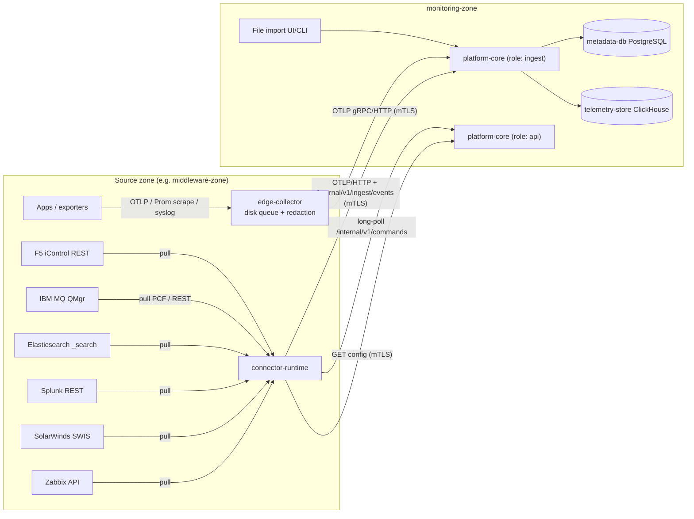
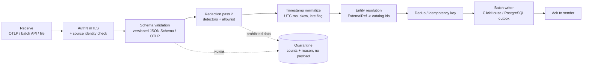
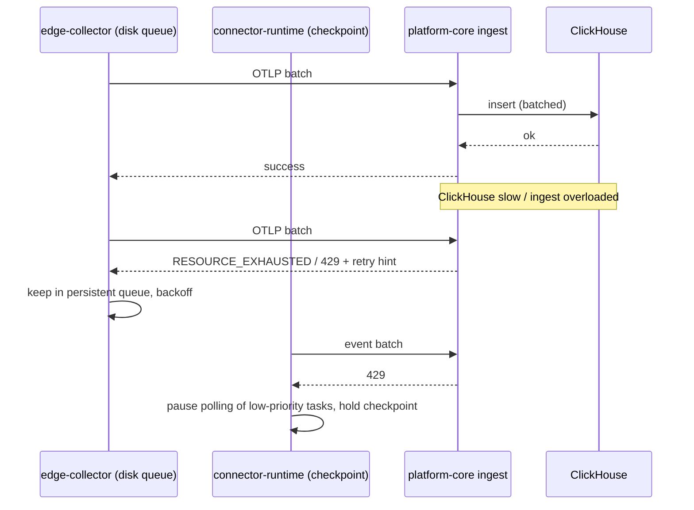
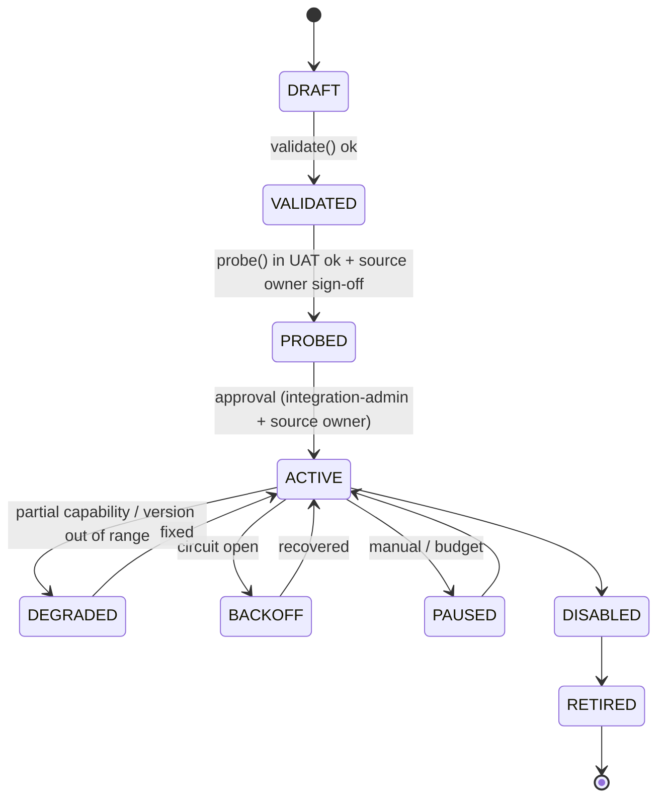

# معماری جمع‌آوری داده و Connectorها (Ingestion & Connectors)

| فیلد | مقدار |
|---|---|
| Document ID | `ARC-ING-001` |
| Version | `0.1` |
| Status | `Draft – Phase 0 – awaiting approval` |
| Date | `2026-10-11` (`1405/07/19`) |
| Owner | `Architecture` |
| Related documents | [correlation-and-intelligence.md](correlation-and-intelligence.md)، [security-and-threat-model.md](security-and-threat-model.md)، [ADR-0004](architecture-decision-records/ADR-0004-collector-and-connector-architecture.md)، [ADR-0005](architecture-decision-records/ADR-0005-api-and-event-contracts.md)، [ADR-0006](architecture-decision-records/ADR-0006-canonical-schemas-otel-plus-bank-namespace.md)، [ADR-0009](architecture-decision-records/ADR-0009-no-own-raw-log-store-federate-existing.md)، [ADR-0010](architecture-decision-records/ADR-0010-buffering-without-kafka-initially.md)، [ADR-0018](architecture-decision-records/ADR-0018-data-retention-privacy-capacity-controls.md)، [ADR-0020](architecture-decision-records/ADR-0020-existing-platform-integration-read-only-pull.md)، [docs/requirements/](../requirements/)، [docs/testing/](../testing/)، [docs/operations/](../operations/) |

**راهنمای برچسب‌ها:** [واقعیت] فقط F-01..F-03؛ [فرض A-xx] فرض موقت؛ [فرضیه] نیازمند آزمایش (EXP/BM)؛ [توصیه] پیشنهاد معماری؛ [باز Q-xx] وابسته به پرسش باز. هر دانش مربوط به API یا متریک فروشنده که از مستندات عمومی آمده با عبارت «نیازمند تأیید در نسخه نصب‌شده بانک» مشخص شده است.

---

## ۱. هدف و دامنه

این سند نحوهٔ ورود داده از سامانه‌های موجود بانک (Zabbix، SolarWinds، Splunk، Elasticsearch/OpenSearch) و منابع میان‌افزاری و زیرساختی (IBM MQ، RabbitMQ، F5، HAProxy، NGINX، Kubernetes، SQL Server، JMX) به `platform-core` را تعریف می‌کند؛ شامل:

- سه الگوی جمع‌آوری: pull از طریق `connector-runtime`، push از طریق `edge-collector` (OTLP و پروتکل‌های استاندارد) و import فایلی؛
- قرارداد Connector SDK (`FR-ING-001`)؛
- طراحی هر Connector به تفکیک منبع؛
- خط لولهٔ نرمال‌سازی، redaction، dedup، دادهٔ دیررس، buffering/backpressure و نرمال‌سازی زمان؛
- چرخهٔ عمر و نسخه‌بندی Connectorها و قواعد کم‌اثر بودن بر منابع (`NFR-IMP-001`, `NFR-IMP-002`).

[واقعیت] شروع کار باید با استفاده از SolarWinds، Zabbix، Splunk و Elasticsearch موجود باشد و instrumentation مستقیم برنامه‌ها به فازهای بعد موکول شده است (F-02). بنابراین این سند فرض می‌کند در فازهای ۲ تا ۵ تقریباً تمام داده از ابزارهای موجود و APIهای فقط‌خواندنی به‌دست می‌آید و ذخیرهٔ log خام انجام نمی‌شود ([ADR-0009](architecture-decision-records/ADR-0009-no-own-raw-log-store-federate-existing.md)).

## ۲. اصول طراحی

1. **[توصیه] فقط‌خواندنی و کم‌اثر:** هیچ Connector حق تغییر پیکربندی، وضعیت یا داده در منبع را ندارد (`NFR-SEC-003`, `NFR-IMP-002`, [ADR-0020](architecture-decision-records/ADR-0020-existing-platform-integration-read-only-pull.md)).
2. **[توصیه] اتصال خروجی از Zone:** همهٔ اتصال‌ها به سامانه‌های منبع فقط از `connector-runtime` همان zone آغاز می‌شود؛ `platform-core` هرگز به داخل zoneها اتصال برقرار نمی‌کند (`NFR-SEC-010`).
3. **[توصیه] Redaction دولایه:** در لبه (Connector/Collector) و دوباره در ingestion (`NFR-PRV-002`).
4. **[توصیه] At-least-once + idempotent:** هر رکورد ممکن است بیش از یک بار برسد؛ نوشتن باید idempotent باشد (`NFR-REL-001`).
5. **[توصیه] شکاف داده هرگز پنهان نمی‌شود:** نبود داده به `UNKNOWN` و نشانگر شکاف تبدیل می‌شود، نه به «سالم» (`NFR-REL-002`, `FR-HLT-003`).
6. **[توصیه] افزودن Connector بدون تغییر core** (`NFR-MNT-004`).
7. **[توصیه] Capability اعلام‌شده ≠ Capability تأییدشده:** هر Connector قابلیت‌های نظری خود را اعلام می‌کند، اما فقط قابلیت‌هایی که در نصب بانک probe و تأیید شده‌اند در health و correlation استفاده می‌شوند.

## ۳. نمای کلی الگوهای جمع‌آوری



*توضیح:* جهت همهٔ پیکان‌هایی که از مرز zone عبور می‌کنند از zone منبع به سمت `monitoring-zone` است. دستورات evidence query نیز با long-poll توسط خود `connector-runtime` دریافت می‌شوند ([ADR-0004](architecture-decision-records/ADR-0004-collector-and-connector-architecture.md)).

| الگو | کاربرد | جزء اجرایی | مزیت | محدودیت |
|---|---|---|---|---|
| Pull از API فروشنده | Zabbix، SolarWinds، Splunk، ES، IBM MQ، RabbitMQ، F5، HAProxy stats، NGINX، SQL Server، JMX | `connector-runtime` (Java، Connector SDK) | بدون نیاز به تغییر در منبع؛ کنترل دقیق query budget | تأخیر برابر با poll interval؛ بار روی منبع |
| Push / scrape استاندارد | OTLP (فاز ۷ برای برنامه‌ها)، Prometheus scrape، syslog، filelog، SNMP (فاز ۴) | `edge-collector` (توزیع سفارشی OpenTelemetry Collector) | پروتکل استاندارد؛ صف دیسکی؛ تأخیر کم | گاهی نیازمند فعال‌سازی exporter یا ارسال syslog در منبع است (تابع `NFR-IMP-002`) |
| Import فایلی | منابع غیرقابل‌دسترس شبکه‌ای، داده‌های تاریخی برای baseline و replay حادثه، خروجی‌های دستی | `platform-core` نقش `ingest` (UI/CLI) | امکان کار آفلاین؛ مناسب EXP-01 و replay حوادث VS-1 | غیربلادرنگ؛ نیازمند کنترل منشأ فایل |

### ۳.۱ Pull از طریق `connector-runtime`

- [توصیه] یک نمونه (یا جفت HA در فاز ۶) در هر zone منبع. `connector-runtime` پیکربندی `ConnectorInstance`ها را از `connectors-control` با REST/mTLS می‌گیرد، زمان‌بندی را محلی اجرا می‌کند و خروجی را با OTLP/HTTP (متریک) و `/internal/v1/ingest/events` (رویداد، `TransactionSummary`، `TransactionEvent` توکنیزه) ارسال می‌کند.
- [توصیه] `connector-runtime` بافر محلی دیسکی کوچکی برای batchهای ارسال‌نشده دارد، اما منبع اصلی بازیابی، **checkpoint** است: پس از قطعی، Connector از آخرین checkpoint تأییدشده دوباره از منبع می‌خواند (اگر منبع تاریخچه نگه می‌دارد، مانند Zabbix history یا index در ES/Splunk). برای منابعی که فقط وضعیت لحظه‌ای دارند (مانند عمق صف MQ) داده‌ی دوران قطعی قابل بازیابی نیست و باید به صورت شکاف علامت بخورد.

### ۳.۲ Push از طریق `edge-collector`

- [توصیه] توزیع سفارشی contrib-based که به‌صورت آفلاین با OCB ساخته می‌شود ([ADR-0016](architecture-decision-records/ADR-0016-offline-deployment-and-artifacts.md)). فقط componentهای لازم: receivers `otlp`، `prometheus`، `syslog`، `filelog`، (`snmp` در فاز ۴)؛ processors `memory_limiter`، `batch`، پردازندهٔ redaction (`transform`/`redaction` + قواعد بانکی)، `resource`؛ exporter `otlp`/`otlphttp` با `sending_queue` و extension `file_storage`. نام و رفتار دقیق componentها وابسته به نسخهٔ OTel Collector انتخاب‌شده است و در زمان build قفل می‌شود.
- [فرض A-13] تأخیر دقیقه‌ای برای منابع pull قابل قبول است؛ push برای سیگنال‌هایی که تأخیر کمتر لازم دارند (`NFR-PRF-001`: p95 ≤ 30 s).

### ۳.۳ Import فایلی (`FR-ING-005`)

- قالب‌ها: CSV، JSON، NDJSON با schema نسخه‌دار (همان canonical schema در [ADR-0006](architecture-decision-records/ADR-0006-canonical-schemas-otel-plus-bank-namespace.md))، و OTLP JSON.
- هر import: شناسهٔ `import_id`، checksum (SHA-256)، کاربر واردکننده، منبع اعلام‌شده، بازهٔ زمانی؛ ثبت در audit (`FR-ADM-003`).
- فایل از همان مسیر redaction ورودی عبور می‌کند؛ اگر detector دادهٔ ممنوعه بیابد، رکورد حذف و import با وضعیت «quarantined rows» گزارش می‌شود (`NFR-PRV-001`).
- [توصیه] کاربرد اولیه: بارگذاری خروجی‌های anonymised در EXP-01، داده‌ی تاریخی برای baseline و replay حوادث برای معیار موفقیت VS-1.

## ۴. قرارداد Connector SDK (`FR-ING-001`)

### ۴.۱ مفاهیم

- `ConnectorType`: پیاده‌سازی (مثلاً `zabbix-jsonrpc`) با نسخهٔ semver و نسخهٔ SDK مورد نیاز.
- `ConnectorInstance`: پیکربندی یک اتصال مشخص (مثلاً Zabbix سایت اصلی PROD) شامل endpoint، `secretRef`، zone، budget و نگاشت‌ها.
- `Capability`: یک سیگنال یا عمل مشخص (مثلاً `mq.queue.depth`، `evidence.query.spl`) با وضعیت `DECLARED` | `VERIFIED` | `UNAVAILABLE` | `DENIED` به ازای هر نصب.
- `Checkpoint`: موقعیت پایدار خواندن (timestamp، cursor، eventid، sid) که به `metadata-db` گزارش و در آن نگهداری می‌شود.

### ۴.۲ امضاهای نمونه (فقط مستندسازی، نه کد پیاده‌سازی)

```java
// Illustrative contract – documentation only. Final shape decided in EP-07 (and ADR-0003).
public interface Connector {
    ConnectorDescriptor describe();                       // type, semver, sdkVersion, declared capabilities, config JSON Schema
    ValidationResult validate(ConnectorConfig cfg);       // static validation: schema, ranges, budget sanity (no network)
    ProbeResult probe(ConnectorContext ctx);              // live: auth, version detection, capability verification (read-only)
    List<CollectionTask> plan(ConnectorContext ctx);      // derive tasks from config + ExternalRefs
    CollectResult collect(CollectionTask task, Checkpoint from, CollectContext ctx); // bounded, cancellable
    EvidenceResult query(EvidenceQuery q, QueryContext ctx);   // optional: federated evidence (templated only)
    HealthReport health();                                // self + source health, lag, budget usage
    void close();
}

public record ConnectorDescriptor(
    String type, SemVer version, SemVer sdkVersion,
    Set<CapabilityDecl> capabilities, JsonSchema configSchema,
    List<SourceVersionRange> supportedSourceVersions, ImpactProfile impact) {}

public interface SecretProvider {                        // NFR-SEC-004; implementations: file-vault, HashiCorp Vault, HSM-backed, ... (Q-09)
    SecretHandle resolve(SecretRef ref);                  // short-lived handle, never logged, never serialized
}

public record CollectContext(
    Instant deadline, QueryBudget budget, RateLimiter limiter,
    Redactor redactor, Normalizer normalizer, Clock clock, DiagnosticsSink diag) {}

public sealed interface CollectResult permits Ok, Partial, SourceUnavailable, BudgetExhausted, AuthFailed {}
```

### ۴.۳ اعلام Capability

- هر Connector فهرست capabilityها را با این مشخصات اعلام می‌کند: نام canonical سیگنال (مطابق [ADR-0006](architecture-decision-records/ADR-0006-canonical-schemas-otel-plus-bank-namespace.md))، واحد، granularity حداقل، نیاز دسترسی، پیش‌نیاز در منبع (مثلاً «queue monitoring فعال باشد»)، هزینهٔ تقریبی (`ImpactProfile`: کم/متوسط/زیاد).
- `probe()` هر capability را با یک فراخوانی فقط‌خواندنی کم‌هزینه بررسی و وضعیت آن را ثبت می‌کند. موتور health و correlation فقط از capabilityهای `VERIFIED` استفاده می‌کنند؛ UI برای capabilityهای ناموجود به صراحت «telemetry موجود نیست» نشان می‌دهد (مثلاً WAF block count — `FR-LB-005`).

### ۴.۴ Schema پیکربندی و اعتبارسنجی

- پیکربندی با JSON Schema (draft 2020-12) تعریف می‌شود؛ UI فرم را از schema می‌سازد.
- اعتبارسنجی دو مرحله‌ای: `validate()` ایستا (بدون شبکه) و `probe()` زنده در محیط امن (ابتدا UAT).
- [توصیه] هیچ فیلد secret در پیکربندی ذخیره نمی‌شود؛ فقط `secretRef` (مثلاً `vault:kv/bsoip/prod/zabbix-main#token`).
- قیدهای اجباری در schema: `pollInterval` ≥ حداقل تعیین‌شده برای نوع Connector، `maxConcurrency`، `queryBudget`، `timeout`، فهرست سفید host/index/queue.

### ۴.۵ احراز هویت و مدیریت secret

- `SecretProvider` تنها مسیر دسترسی به credential است (`NFR-SEC-004`, `FR-ADM-004`). پیاده‌سازی بسته به [باز Q-09] (vault موجود، HSM، یا vault محلی رمز‌شده).
- secret فقط در حافظه و برای مدت کوتاه نگهداری می‌شود؛ در log، exception، dump و diagnostics نمایش داده نمی‌شود (logger با فیلتر الگوهای secret).
- انواع احراز هویت: API token (Zabbix 5.4+، نیازمند تأیید در نسخه نصب‌شده بانک)، Basic over TLS، token session (F5)، mTLS client cert، Kerberos/Windows auth برای SQL Server (در صورت سیاست بانک).
- چرخش credential بدون restart: `SecretHandle` منقضی‌شونده و retry یک‌باره پس از `AuthFailed` با resolve مجدد.
- جزئیات تهدیدها: [security-and-threat-model.md](security-and-threat-model.md).

### ۴.۶ زمان‌بندی

- زمان‌بند محلی در `connector-runtime` با jitter تصادفی (مثلاً ±10٪ بازه) برای جلوگیری از هم‌زمانی درخواست‌ها.
- align به مرز بازه (مثلاً هر 60 s) برای سیگنال‌هایی که با هم مقایسه می‌شوند، اما با jitter شروع.
- [توصیه] بازه‌های پیش‌فرض (موقت، نهایی‌شده با BM-05/BM-06 و توافق با مالک منبع): Zabbix 60 s، SolarWinds 60–300 s، Splunk/ES per-minute summary 60 s با تأخیر settling، IBM MQ 30–60 s، RabbitMQ 30 s، F5/HAProxy/NGINX 30–60 s، SQL Server DMV 60 s، JMX 30–60 s. (همسو با [فرض A-04]: 10–60 s برای صف/LB.)
- یک task هرگز با خودش هم‌پوشان اجرا نمی‌شود؛ اگر اجرای قبلی تمام نشده، اجرای جدید skip و metric `connector_task_skipped_total` افزایش می‌یابد.

### ۴.۷ Timeout، retry، rate limiting و query budget

| کنترل | قاعده [توصیه] |
|---|---|
| Timeout | timeout اتصال (مثلاً 5 s) و timeout کل task (کمتر از poll interval، مثلاً 50٪ آن). برای Splunk/ES پارامتر timeout سمت سرور نیز تنظیم می‌شود (مثلاً `timeout` در `_search`؛ نیازمند تأیید در نسخه نصب‌شده بانک). |
| Retry | فقط برای خطاهای گذرا (اتصال، 5xx، 429)؛ exponential backoff با jitter، حداکثر 3 تلاش در هر چرخه؛ احترام به `Retry-After`. خطاهای 401/403 retry نمی‌شوند و capability را `DENIED` می‌کنند. |
| Rate limit | token bucket به ازای `ConnectorInstance` و به ازای host منبع (مشترک بین همهٔ Connectorهایی که به یک منبع وصل‌اند). |
| Concurrency | `maxConcurrency` پیش‌فرض 1–2 برای API مدیریتی (F5، SolarWinds)؛ بیشتر فقط با توافق مالک منبع. |
| Query budget | سقف قابل اندازه‌گیری در هر بازهٔ زمانی، مانند: تعداد درخواست در دقیقه، تعداد search jobهای هم‌زمان در Splunk، بازهٔ زمانی و تعداد shard/index در ES، تعداد item در هر `history.get`، حداکثر rows. مقدار با مالک منبع توافق و در `ConnectorInstance` ثبت می‌شود (`NFR-IMP-001`، [باز Q-22]، BM-04/BM-05). |
| Circuit breaker | پس از N خطای متوالی یا تأخیر بیش از آستانه، Connector وارد `BACKOFF` می‌شود و بار را قطع می‌کند؛ این خود یک رویداد source-health است. |

مصرف budget به صورت متریک (`connector_budget_used_ratio`) گزارش و در UI نمایش داده می‌شود (`NFR-OBS-002`). عبور از 80٪ هشدار و 100٪ توقف taskهای کم‌اولویت (ابتدا backfill، سپس evidence query، در آخر poll اصلی) را در پی دارد.

### ۴.۸ Checkpointing

- هر task پس از ارسال موفق batch و دریافت ack از ingest، checkpoint را پیش می‌برد (ack-then-advance). در نتیجه حالت خرابی موجب تکرار (نه از دست رفتن) می‌شود و dedup آن را جذب می‌کند.
- checkpoint شامل: `high_watermark` (زمان منبع)، cursor بومی (مثلاً `eventid` در Zabbix، `sid`/زمان در Splunk، `search_after` در ES)، و `overlap` (بازهٔ همپوشانی عمدی، مثلاً 2 دقیقه برای جذب دادهٔ دیررس منبع).
- [توصیه] حداکثر backfill پس از قطعی (مثلاً 24 h) و نرخ backfill محدود به 25–50٪ budget، تا catch-up خود موجب بار روی منبع نشود.

### ۴.۹ Health و diagnostics (`FR-ING-010`, `NFR-OBS-002`)

هر `ConnectorInstance` گزارش می‌دهد: وضعیت (`ACTIVE`/`DEGRADED`/`BACKOFF`/`PAUSED`/...)، آخرین موفقیت، lag (اکنون − high_watermark)، نرخ خطا به تفکیک نوع، مصرف budget، وضعیت capabilityها، زمان پاسخ منبع (p50/p95)، تعداد رکوردهای redact‌شده و حذف‌شده، تخمین clock skew. صفحهٔ UI «Connector Health» این‌ها را نشان می‌دهد و دکمهٔ «probe now» (با ثبت audit) دارد. **سلامت منبع** (مثلاً Splunk در دسترس نیست) از **سلامت سرویس بانکی** جدا نگهداری می‌شود و به `UNKNOWN` منجر می‌شود نه `CRITICAL` (رجوع به [correlation-and-intelligence.md](correlation-and-intelligence.md)).

### ۴.۱۰ نرمال‌سازی در Connector

Connector داده را به canonical model تبدیل می‌کند: `Metric`، `LogDerivedMetric`، `Event`، `TransactionSummary`، `TransactionEvent` (توکنیزه). ویژگی‌های اجباری: `bank.source.system`، `bank.connector.instance`، شناسهٔ بومی منبع، `observed_at` (UTC، ms)، و در صورت وجود نگاشت `ExternalRef`، `bank.service.id`/component id. نگاشت ExternalRef در ingest نیز تکرار/تکمیل می‌شود تا Connector مجبور به داشتن کل catalog نباشد.

### ۴.۱۱ ماتریس سازگاری نسخه

- هر Connector بازه‌های نسخهٔ منبع را اعلام می‌کند: `tested` (با fixture یا محیط واقعی آزموده‌شده)، `expected` (بر اساس مستندات عمومی؛ نیازمند تأیید در نسخه نصب‌شده بانک)، `unsupported`.
- `probe()` نسخهٔ واقعی را تشخیص می‌دهد (مثلاً `apiinfo.version` در Zabbix، `GET /` در ES، `/services/server/info` در Splunk؛ همگی نیازمند تأیید در نسخه نصب‌شده بانک) و در صورت خروج از بازه، Connector را در حالت `DEGRADED` با هشدار نگه می‌دارد.
- [باز Q-08] نسخه‌های نصب‌شده در بانک هنوز مشخص نیست؛ ماتریس واقعی پس از EXP-02 تکمیل می‌شود ([docs/testing/](../testing/)).

| Connector | API | بازهٔ نسخه | وضعیت در Phase 0 |
|---|---|---|---|
| `zabbix-jsonrpc` | JSON-RPC | باز | [باز Q-08] |
| `solarwinds-swis` | SWIS REST/SWQL | باز | [باز Q-08] |
| `splunk-rest` | REST search | باز | [باز Q-08] |
| `elastic-search` | `_search` (ES/OpenSearch) | باز | [باز Q-08] |
| `ibmmq-pcf` / `ibmmq-rest` | PCF / mqweb REST | باز | [باز Q-08] |
| سایر | — | باز | [باز Q-08] |

### ۴.۱۲ حالت شبیه‌سازی و آزمون (`FR-ING-011`)

- **Fixture replay:** پاسخ‌های ضبط‌شده و anonymised منبع (فایل‌های JSON) به‌عنوان transport جایگزین؛ برای unit/contract test و CI آفلاین.
- **Simulated source:** شبیه‌ساز قابل‌پیکربندی (مثلاً رشد صف، افت success rate، قطعی منبع، کندی، 429، تغییر نسخه API) برای آزمون رفتار شکست.
- **Dry-run:** اجرای واقعی روی منبع با خروجی فقط به diagnostics (بدون نوشتن در telemetry-store)؛ برای onboarding با حضور مالک منبع و اندازه‌گیری هزینه (BM-04/05/06).
- **Shadow mode:** نوشتن در فضای جداگانه برای مقایسه با Connector قبلی هنگام ارتقا.
- هر Connector باید مجموعهٔ آزمون قرارداد SDK را بگذراند (حالت‌های شکست، timeout، checkpoint، redaction). جزئیات در [docs/testing/](../testing/).

### ۴.۱۳ رفتار در زمان در دسترس نبودن منبع (`NFR-REL-004`)

| وضعیت منبع | رفتار Connector | اثر در platform |
|---|---|---|
| timeout/قطع شبکه | backoff + circuit breaker؛ checkpoint ثابت | رویداد `SourceUnavailable`؛ سیگنال‌های وابسته پس از عبور از freshness به `UNKNOWN` |
| 401/403 | توقف، بدون retry تهاجمی (جلوگیری از lock شدن حساب) | هشدار به `integration-admin` |
| 429/کندی | کاهش نرخ (AIMD)، حذف taskهای کم‌اولویت | lag بالا در UI |
| پاسخ ناقص/تغییر schema | `Partial`؛ ذخیرهٔ بخش معتبر، شمارش rows رد شده | هشدار drift در Connector |
| منبع سالم ولی دادهٔ صفر | ثبت صفر واقعی (نه شکاف) | تفکیک «صفر» از «نبود داده» در health |

[واقعیت مشتق از F-02] چون ابزارهای موجود منبع شواهدند، در خود حوادث ممکن است از دسترس خارج شوند (R-15). پلتفرم باید با داده‌ی ناقص کار کند و صراحتاً آن را اعلام نماید.

## ۵. طراحی Connector به تفکیک منبع

همهٔ جزئیات API و متریک در این بخش از مستندات عمومی فروشندگان است و **نیازمند تأیید در نسخه نصب‌شده بانک** ([باز Q-08]). «اثر» بیانگر بار تقریبی روی منبع است و با BM-04/05/06 اندازه‌گیری می‌شود.

| منبع | روش / API | سیگنال‌ها | دسترسی لازم (حداقل) | اثر بر منبع و کنترل | محدودیت‌ها و پیش‌نیازها | FR |
|---|---|---|---|---|---|---|
| **Zabbix** | JSON-RPC (`api_jsonrpc.php`): `host.get`, `item.get`, `history.get`, `trend.get`, `problem.get`, `event.get`, `trigger.get` | متریک‌های host/OS، itemهای LB/MQ/DB اگر از قبل تعریف شده‌اند، problems/events، maintenance | کاربر API با نقش فقط‌خواندنی روی host groupهای مشخص؛ در نسخه‌های دارای User Role محدودسازی متدهای API؛ API token به‌جای رمز | `history.get` روی بازه‌های بزرگ بار DB Zabbix را بالا می‌برد → فقط itemهای نگاشت‌شده، بازه‌های کوتاه افزایشی، `trend.get` برای backfill طولانی، batch محدود itemids | itemهای موجود تعیین می‌کنند چه چیزی در دسترس است؛ history housekeeping بازهٔ backfill را محدود می‌کند؛ `eventid` برای checkpoint | `FR-INT-001`, `FR-RUN-004` |
| **SolarWinds** | SWIS REST (SWQL query، پورت معمول 17778) روی entityهایی مانند `Orion.Nodes`, `Orion.NPM.Interfaces`, آمار ترافیک، alertهای فعال | وضعیت/پاسخ‌گویی node، ترافیک و خطای interface، CPU/حافظه، alertهای فعال، (در صورت ماژول) آمار LB/F5 | حساب Orion با دسترسی فقط‌خواندنی و limitation به گروه‌های مرتبط | SWQL روی DB Orion اجرا می‌شود؛ queryهای تاریخی سنگین ممنوع؛ فیلتر زمانی و `TOP` الزامی | نام entityها و ماژول‌ها (NPM/SAM/...) وابسته به لایسنس و نسخه | `FR-INT-004` |
| **Splunk** | REST: `search/jobs` (oneshot/export با `earliest`/`latest`)، اجرای saved search یا خواندن نتیجهٔ saved search زمان‌بندی‌شده | per-minute counts به تفکیک outcome/latency از logs (L0)، رویدادهای توکنیزه (L2) در صورت وجود کلید، evidence query | نقش اختصاصی با دسترسی به indexهای مشخص، quota جست‌وجوی هم‌زمان و دیسک محدود، بدون قابلیت‌های admin | جست‌وجو search slot مصرف می‌کند (R-03، [باز Q-22]) → ترجیح: saved search زمان‌بندی‌شده توسط تیم Splunk (یا summary index) و فقط واکشی نتیجه؛ query templateها با `earliest/latest` محدود، `stats`/`tstats` به‌جای raw events | اثر لایسنس/workload بر حسب مدل لایسنس بانک نامعلوم است؛ نیازمند هماهنگی با admin | `FR-INT-003`, `FR-TXN-003` |
| **Elasticsearch / OpenSearch** | `_search` با `size:0` و aggregations (`date_histogram`، `terms`، percentiles)، composite aggregation برای صفحه‌بندی، `search_after`/PIT برای رویدادها | per-minute counts/outcome/latency از logs، رویدادهای توکنیزه، evidence query | نقش با `read` و `view_index_metadata` روی index patternهای مشخص؛ در صورت لزوم `monitor` کلاستر برای تشخیص نسخه | aggregation با cardinality بالا و بازهٔ بزرگ پرهزینه است → سقف بازه، سقف buckets، `timeout` سمت سرور، استفاده از فیلد keyword | در برخی نسخه‌ها/لایسنس‌های قدیمی امنیت (احراز هویت/نقش) ممکن است فعال نباشد — ریسک امنیتی است و باید در EXP-02 بررسی شود؛ mapping فیلدها متفاوت است | `FR-INT-002`, `FR-TXN-003` |
| **IBM MQ** | PCF از طریق client channel (مثلاً `INQUIRE_Q`, `INQUIRE_Q_STATUS`, `INQUIRE_CHANNEL_STATUS`) یا mqweb administrative REST API؛ گزینهٔ دیگر: اشتراک در topicهای آماری `$SYS/MQ/INFO/QMGR/...` (MQ 9+) | current depth، max depth، open input/output count، oldest message age، last get/put time، uncommitted msgs، channel status، نرخ enq/deq | **حداقل:** کاربر اختصاصی، SVRCONN channel اختصاصی با TLS و CHLAUTH که MCAUSER را به کاربر کم‌دسترسی نگاشت کند؛ `setmqaut` با `+connect +inq` روی qmgr، `+inq +dsp` روی صف‌های مشخص، مجوزهای لازم برای command queue و reply queue؛ برای REST نقش فقط‌خواندنی mqweb (مثلاً `MQWebAdminRO`). **ممنوع:** `RESET QSTATS` (شمارنده‌ها را برای ابزارهای دیگر صفر می‌کند و مجوز تغییر لازم دارد)؛ هر مجوز `+chg`, `+put`/`+get` روی صف‌های کاری | PCF سبک است ولی polling پرتکرار روی صدها صف بار command server دارد → batch با wildcard فقط روی فهرست سفید، 30–60 s؛ BM-06 و EXP-04 | `oldest message age` و `last get/put` معمولاً نیازمند فعال بودن queue monitoring (`MONQ`) است که **تغییر پیکربندی** محسوب می‌شود و تابع `NFR-IMP-002` و تأیید مالک MQ است؛ بدون آن، طبقه‌بندی backlog فقط بر depth و نرخ تکیه می‌کند | `FR-MQ-002`, `FR-MQ-005` |
| **RabbitMQ** | management HTTP API (`/api/overview`, `/api/queues`, `/api/nodes`) یا Prometheus plugin (`/metrics`، endpoint با جزئیات per-object در نسخه‌های جدیدتر) از طریق `edge-collector` scrape | depth (ready/unacked)، publish/deliver/ack rates، consumers، memory/disk alarms، DLQ depth | کاربر با tag `monitoring` و دسترسی vhost محدود | `/api/queues` با تعداد صف زیاد سنگین است → پارامتر `columns`، صفحه‌بندی، یا ترجیح Prometheus endpoint | فعال‌سازی plugin در صورت نبود = تغییر پیکربندی | `FR-MQ-003` |
| **F5 BIG-IP** | iControl REST: `/mgmt/tm/ltm/virtual/stats`, `/mgmt/tm/ltm/pool/members/stats`, `/mgmt/tm/sys/...`, گواهی‌ها؛ token از `/mgmt/shared/authn/login` | وضعیت/availability virtual server و pool member، connections، requests، bytes، TLS cert expiry | کاربر محلی یا remote با نقش فقط‌خواندنی (مثلاً Guest/Auditor) روی partitionهای لازم | iControl REST روی management plane با منابع محدود اجرا می‌شود → concurrency=1، بازه ≥ 30–60 s، فقط objectهای فهرست سفید | status code HTTP در سطح virtual اغلب در stats پایه نیست؛ رویدادهای ASM/Advanced WAF از طریق stats در دسترس نیست و نیازمند logging profile به syslog/Splunk است → WAF فقط «جایی که telemetry وجود دارد» (`FR-LB-005`) | `FR-LB-001`, `FR-LB-002`, `FR-LB-004` |
| **HAProxy** | صفحهٔ stats (خروجی CSV) یا endpoint Prometheus داخلی (نسخه‌های جدیدتر، در صورت فعال بودن در پیکربندی)، scrape از `edge-collector` | frontend/backend/server: sessions، request rate، HTTP 1xx–5xx، queue، server status/check، retries/redispatch | دسترسی فقط‌خواندنی به stats (بدون `stats admin`)؛ محدودیت IP | بسیار سبک | اگر stats/exporter فعال نیست، فعال‌سازی تغییر پیکربندی است؛ Runtime API (socket) محلی است و استفاده نمی‌شود | `FR-LB-001`, `FR-LB-002` |
| **NGINX** | OSS: `stub_status`؛ NGINX Plus: API `/api/<version>/` (upstreams، server zones) | OSS: active connections، accepts/handled، requests، reading/writing/waiting — **بدون** تفکیک status code؛ Plus: per-upstream status و responses | دسترسی HTTP محدود به IP collector؛ API Plus در حالت read-only | سبک | تفکیک status code و latency در OSS فقط از access log (از طریق Splunk/ES) | `FR-LB-002` |
| **Kubernetes** | API server (list/watch) و/یا kube-state-metrics و metrics-server با scrape از `edge-collector` | وضعیت pod/deployment، restartها، رویدادها، مصرف منابع | ServiceAccount با ClusterRole فقط `get/list/watch` روی منابع لازم (بدون secrets) | watch به‌جای poll مکرر؛ محدودیت namespace | وجود K8s در بانک نامعلوم | `FR-RUN-005` |
| **SQL Server** | DMVها فقط‌خواندنی: مثلاً `sys.dm_os_wait_stats`, `sys.dm_exec_requests`, `sys.dm_os_performance_counters`, `sys.dm_io_virtual_file_stats`, وضعیت Availability Group | waits، blocking، batch requests/s، I/O latency، وضعیت replica | login اختصاصی با `VIEW SERVER STATE` (یا معادل دقیق‌تر در نسخه‌های جدید)؛ **بدون** دسترسی به جداول داده (`db_datareader` داده نمی‌شود) | queryهای DMV با plan cache بزرگ سنگین‌اند → عدم استفاده از query text، بازهٔ ≥ 60 s، `LOCK_TIMEOUT` و `READ UNCOMMITTED` روی DMV | متن query ممکن است دادهٔ حساس داشته باشد → جمع‌آوری نمی‌شود | `FR-RUN-003` |
| **JMX** | JMX remote (RMI) از `connector-runtime` (Java بومی) یا Jolokia در صورت وجود | heap/GC، threads، connection pool، MBeanهای برنامه | نقش readonly در JMX access file؛ TLS | سبک در صورت محدود بودن MBeanها؛ wildcard گسترده ممنوع | فعال‌سازی JMX remote روی JVM نیازمند تغییر flag و restart است → فقط جایی که از قبل فعال است یا با تصمیم مالک برنامه | `FR-RUN-001` |

### ۵.۱ نکات خاص Splunk و Elasticsearch برای دادهٔ تراکنش

- [توصیه] الگوی ترجیحی: تعریف **query template** نسخه‌دار به ازای `TransactionType` (مثلاً count به تفکیک کد پاسخ و percentileهای latency در بازهٔ یک‌دقیقه‌ای) که تیم Splunk/ES بازبینی و تأیید می‌کند. Connector فقط پارامترهای مجاز (بازهٔ زمانی، index از فهرست سفید) را جایگزین می‌کند؛ ساخت query آزاد از ورودی کاربر ممنوع است (رجوع به سناریوی query injection در [security-and-threat-model.md](security-and-threat-model.md)).
- **Settling delay:** چون indexing در Splunk/ES تأخیر دارد، بازهٔ دقیقهٔ `t` پس از `t + settle` (پیش‌فرض موقت 2 دقیقه) خوانده و پس از `t + 10 min` یک‌بار دیگر بازخوانی (re-read) می‌شود تا دادهٔ دیررس جذب شود. نسخهٔ جدید جایگزین نسخهٔ قبلی می‌شود (بخش ۸).
- نگاشت کد پاسخ به `TxnOutcome` در `OutcomeMapping` به صورت داده است، نه در Connector (`FR-TXN-002`).
- [باز Q-07] وجود کد پاسخ، latency و کلیدهای همبستگی در logها نامعلوم است (R-01، EXP-01).

## ۶. خط لولهٔ نرمال‌سازی در `ingestion`



*توضیح:* ack فقط پس از نوشتن پایدار ارسال می‌شود. رکوردهای رد شده با دلیل و شمارش ثبت می‌شوند؛ محتوای رکوردی که دادهٔ ممنوعه داشته ذخیره نمی‌شود، فقط metadata (منبع، detector، زمان).

مراحل:

1. **Receive و احراز منشأ:** گواهی mTLS هر `connector-runtime`/`edge-collector` به یک zone و مجموعه‌ای از `ConnectorInstance`ها گره خورده است؛ ingest رکوردی را که ادعای منبعی خارج از مجوز گواهی دارد رد می‌کند (کاهش اثر collector مخدوش).
2. **اعتبارسنجی schema:** نسخهٔ envelope (سبک CloudEvents، [ADR-0005](architecture-decision-records/ADR-0005-api-and-event-contracts.md)) و schema رکورد؛ سقف اندازهٔ رکورد و batch؛ سقف cardinality ویژگی‌ها (جلوگیری از انفجار series).
3. **Redaction مرحلهٔ دوم** (بخش ۷).
4. **نرمال‌سازی زمان** (بخش ۱۰).
5. **Entity resolution:** نگاشت شناسه‌های منبع به `Component`/`BusinessService` از طریق `ExternalRef` (`FR-CAT-009`)؛ نتیجهٔ نگاشت‌نشده با `bank.entity.unmapped=true` ذخیره و در UI برای نگاشت پیشنهاد می‌شود.
6. **نام‌گذاری canonical:** نگاشت نام متریک بومی به نام canonical بر اساس OTel semantic conventions + فضای `bank.*` ([ADR-0006](architecture-decision-records/ADR-0006-canonical-schemas-otel-plus-bank-namespace.md))؛ تبدیل واحد (مثلاً ms→s در صورت لزوم) و نوع (counter → rate در لایهٔ query، نه در ingest).
7. **Dedup و نوشتن idempotent** (بخش ۸).
8. **نوشتن batch** و انتشار domain event برای ماژول‌های `health`، `events`، `transactions` از طریق outbox.

## ۷. Redaction در لبه و ingest (`NFR-PRV-002`, ADR-0018)

| لایه | مکان | کار |
|---|---|---|
| لبه ۱ | `connector-runtime` | قبل از هر serialization: حذف فیلدهای غیرمجاز (allowlist فیلدی به ازای query template)، اجرای detectorها، HMAC-SHA256 توکنیزه کردن کلیدهای همبستگی (`FR-TXN-010`) با کلید محیط از `SecretProvider`، bucket کردن مبلغ |
| لبه ۲ | `edge-collector` | processor redaction برای attributes/body با الگوهای بانکی؛ حذف body کامل log در صورتی که مسیر فقط برای متریک مشتق از log است |
| ingest | `platform-core` ماژول `ingestion` | اجرای مجدد همهٔ detectorها روی هر رشته (defense in depth)؛ در صورت یافتن PAN/PIN block/track data: حذف رکورد، افزایش `redaction_violation_total{source}` و رویداد امنیتی به audit |
| evidence query | `evidence-query` + `connector-runtime` | نتایج federated query از Splunk/ES پیش از UI یا ذخیره از همان redaction عبور می‌کنند (`NFR-PRV-005`) |

Detectorها (جزئیات در [security-and-threat-model.md](security-and-threat-model.md)): PAN (الگو + Luhn)، کد ملی (۱۰ رقم + رقم کنترل)، Sheba/IBAN (`IR` + 24 رقم، با بررسی mod-97)، شمارهٔ موبایل ایران، شمارهٔ حساب (الگوی قابل‌پیکربندی بانک)، الگوهای token/password/OTP در key=value. [توصیه] **اصل allowlist بر denylist مقدم است:** Connector فقط فیلدهای صریحاً مجاز را استخراج می‌کند؛ detectorها لایهٔ دوم‌اند.

## ۸. Dedup و کلیدهای idempotency (`FR-ING-007`, `NFR-REL-001`)

| نوع داده | کلید idempotency [توصیه] | سازوکار ذخیره |
|---|---|---|
| Metric sample | `(series_id, observed_at_ms)` که `series_id = hash(metric_name, sorted canonical attributes)` | جدول با موتور جایگزین‌کننده (مثلاً `ReplacingMergeTree`) یا تحمل تکرار در aggregation؛ انتخاب نهایی با BM-01 |
| Event (alert/problem) | `(source_system, source_event_id, state)`؛ اگر منبع شناسه ندارد: `hash(source, entity, event_type, observed_at truncated to source resolution, message fingerprint)` | upsert منطقی؛ تغییر وضعیت (OPEN→RESOLVED) رکورد جدید با همان `source_event_id` |
| TransactionSummary (per-minute) | `(txn_type, hop/component, minute_bucket, source, query_template_version)` + `revision` | آخرین `revision` معتبر است (re-read پس از settling جایگزین می‌شود) |
| TransactionEvent (tokenized) | `(hmac_business_key, hop, observed_at_ms)` | تکرار به عنوان duplicate شمارش می‌شود (`FR-TXN-007`) |
| Batch | `batch_id = hash(connector_instance, task, checkpoint_from, checkpoint_to)` | ingest ردیف batchهای اخیر (مثلاً 24 h) را نگه می‌دارد؛ batch تکراری بدون نوشتن ack می‌شود. در ClickHouse می‌توان از توکن dedup درج استفاده کرد (نیازمند تأیید در نسخه ClickHouse انتخاب‌شده، BM-01) |

ingest هرگز به «exactly-once» تکیه نمی‌کند؛ تمام aggregationها باید در برابر تکرار ایمن باشند یا قبل از aggregation dedup شوند.

## ۹. دادهٔ دیررس (`FR-ING-008`)

- **Watermark به ازای منبع:** `watermark(source) = min(high_watermark of its active tasks) − overlap`. ماژول‌های `health` و `correlation` پنجره‌ای را «کامل» تلقی می‌کنند که پیش از watermark باشد؛ پنجره‌های جدیدتر با برچسب `provisional` نمایش داده می‌شوند.
- **پذیرش:** داده با تأخیر تا حد `late_accept_window` (پیش‌فرض موقت 24 h، همسو با بیشینهٔ backfill) پذیرفته و با `late=true` و `ingest_delay = ingested_at − observed_at` ذخیره می‌شود. دادهٔ قدیمی‌تر از آن فقط از مسیر import فایلی (با audit) پذیرفته می‌شود.
- **بازمحاسبه:** rollupها (مثلاً 1-min/1-h) باید با درج دیررس سازگار باشند (aggregationهای قابل جمع). health و SLO برای پنجره‌های بسته‌شده فقط در یک «lookback» محدود (پیش‌فرض موقت 15 min) بازمحاسبه می‌شوند؛ تغییر حالت گذشته در incident timeline با برچسب «اصلاح به‌دلیل دادهٔ دیررس» ثبت می‌شود و اعلان‌های ارسال‌شده پس گرفته نمی‌شوند.
- **SLO و error budget** گزارش‌های رسمی را پس از بستن دوره (مثلاً پس از settling روزانه) نهایی می‌کنند.

## ۱۰. نرمال‌سازی timestamp و clock skew (R-11، [فرض A-08]، [باز Q-17])

- ذخیرهٔ زمان در UTC با دقت ms؛ نمایش Asia/Tehran با tzdata، بدون offset سخت‌کد شده ([فرض A-10]).
- فیلدها: `observed_at` (زمان منبع)، `ingested_at`، `source_clock_skew_estimate` (ms).
- **منابع بدون timezone:** برخی logها زمان محلی بدون offset دارند؛ هر `ConnectorInstance` پارامتر `source_timezone` دارد (پیش‌فرض: صریحاً الزامی، بدون حدس). تبدیل با tzdata انجام می‌شود تا تغییرات تاریخی قواعد ساعت رسمی درست اعمال شود.
- **تخمین skew:** Connector زمان سرور منبع را از روش‌های کم‌هزینه برآورد می‌کند (مثلاً header `Date` در پاسخ HTTP، یا زمان بازگشتی API در صورت وجود) و با ساعت محلی (هماهنگ با NTP) مقایسه می‌کند؛ میانهٔ متحرک نگهداری می‌شود. این تخمین دقت محدود دارد (حداقل خطا ≈ نصف RTT + دقت header ثانیه‌ای) — [فرضیه] برای همبستگی در مقیاس دقیقه کافی است؛ EXP-05 آن را می‌سنجد.
- **سیاست:** `observed_at` اصلاح نمی‌شود (دادهٔ منبع حفظ می‌شود)؛ موتور correlation پنجرهٔ زمانی را به اندازهٔ `|skew|` بین منابع گسترش می‌دهد. اگر skew از آستانه (پیش‌فرض موقت 5 s برای هشدار، 60 s برای «غیرقابل‌اعتماد برای ترتیب‌گذاری») بیشتر شود، رویداد source-health صادر و ترتیب زمانی شواهد آن منبع در explanation با برچسب «ترتیب زمانی نامطمئن» نمایش داده می‌شود.
- timestamp آینده (> اکنون + 5 min) رد یا قرنطینه می‌شود.

## ۱۱. Buffering و backpressure (`FR-ING-009`, `NFR-REL-003`, ADR-0010)



*توضیح:* backpressure از ClickHouse به ingest و از ingest به لبه منتقل می‌شود؛ لبه یا روی دیسک نگه می‌دارد (push) یا با checkpoint بعداً از منبع می‌خواند (pull).

### ۱۱.۱ صف دیسکی `edge-collector`

- `sending_queue` پایدار روی `file_storage`؛ پس از restart حفظ می‌شود.
- **اندازه‌گذاری** (`NFR-REL-003`: ≥ 4 h در حجم Medium به ازای zone). [فرض] اگر سهم یک zone پرحجم ≈ 25٪ از 33k sample/s سناریوی Medium (≈ 8.3k sample/s) و فضای دیسکی هر sample در صف OTLP ≈ 50–150 byte (شامل سربار attributes؛ [فرضیه] با BM-07 اندازه‌گیری می‌شود) باشد:
  `8,300 × 14,400 s ≈ 120 M samples → 6–18 GB` برای 4 h. [توصیه] تخصیص اولیهٔ ≥ 40 GB دیسک مستقل برای صف در هر نود collector (حاشیهٔ ≈ 2× برای peak سه تا چهار برابری در کوتاه‌مدت و رشد).
- وقتی صف به 80٪ برسد: هشدار؛ در 100٪: drop با اولویت (ابتدا متریک‌های با اولویت پایین، هرگز رویدادهای source-health) و شمارش `dropped` که در UI به صورت شکاف نمایش داده می‌شود (`NFR-REL-002`).

### ۱۱.۲ Batching در ingest

- ingest رکوردها را به ازای جدول مقصد در حافظه جمع می‌کند و با آستانهٔ اندازه یا زمان (مقادیر موقت: 50k ردیف یا 1 s، هر کدام زودتر) در ClickHouse درج می‌کند، چون ClickHouse درج‌های بزرگ و کم‌تعداد را ترجیح می‌دهد. گزینهٔ async insert سمت ClickHouse در BM-07 مقایسه می‌شود.
- ack به فرستنده پس از موفقیت درج (حافظهٔ ingest پایدار نیست؛ صف واقعی در لبه است).
- `memory_limiter` و سقف درخواست‌های هم‌زمان؛ در فشار، پاسخ `RESOURCE_EXHAUSTED`/`UNAVAILABLE` (gRPC) یا 429/503 (HTTP) که طبق مشخصات OTLP قابل retry هستند.
- اولویت: رویدادهای source-health و events > transaction summaries > metrics.
- رویدادهای بین‌ماژولی پایدار از طریق جدول outbox در PostgreSQL ([ADR-0010](architecture-decision-records/ADR-0010-buffering-without-kafka-initially.md)).

### ۱۱.۳ معیارهای ورود Kafka (از ADR-0010)

Kafka (`event-bus`) فقط در صورت فعال شدن یکی از این triggerها معرفی می‌شود:
- نرخ پایدار بیش از ≈ 50k event/s؛
- نیاز به چند مصرف‌کنندهٔ مستقل با replay؛
- fan-in ingestion چند سایتی؛
- نیاز به تحمل قطعی نقش ingest بیش از ظرفیت بافر collector (≥ 4 h).

[توصیه] قرارداد OTLP و envelope رویداد طوری طراحی می‌شود که درج Kafka بین لبه و ingest بدون تغییر Connectorها ممکن باشد. متریک‌های پایش این triggerها (نرخ پایدار، عمق صف لبه، مدت قطعی) از فاز ۲ جمع‌آوری می‌شوند ([docs/operations/](../operations/)).

## ۱۲. چرخهٔ عمر و نسخه‌بندی Connector



- **نسخه‌بندی:** semver برای هر `ConnectorType`؛ نسخهٔ SDK جدا. تغییر major SDK با دورهٔ هم‌زیستی حداقل یک release. تغییر در schema پیکربندی همراه migration خودکار پیکربندی.
- **استقرار:** Connectorها به صورت plugin امضاشده در bundle آفلاین ([ADR-0016](architecture-decision-records/ADR-0016-offline-deployment-and-artifacts.md))؛ `connector-runtime` فقط pluginهای دارای امضای معتبر را بارگذاری می‌کند (`NFR-SEC-007`).
- **ارتقا:** shadow mode → مقایسهٔ خروجی → سوئیچ؛ rollback با نگه داشتن نسخهٔ قبلی و checkpoint سازگار.
- **تغییرات پیکربندی** از طریق UI/API با audit و قابلیت config-as-code (`NFR-DEP-004`).
- **onboarding منبع جدید:** درخواست دسترسی فقط‌خواندنی (R-02) → توافق query budget → dry-run با مالک منبع → فعال‌سازی. این فرایند در [docs/operations/](../operations/) و EP-22 تشریح می‌شود.

## ۱۳. قواعد کم‌اثر بودن بر منابع (`NFR-IMP-001`, `NFR-IMP-002`)

1. حساب اختصاصی، فقط‌خواندنی و کم‌دسترسی برای هر منبع و هر محیط ([فرض A-09]).
2. query budget مکتوب و توافق‌شده با مالک منبع پیش از `ACTIVE` شدن؛ مصرف آن قابل مشاهده برای مالک منبع.
3. فقط اشیای فهرست سفید (hostgroup، index، queue، virtual server) poll می‌شوند؛ wildcard نامحدود ممنوع.
4. بدون query تاریخی بزرگ در ساعات اوج؛ backfill با نرخ محدود و ترجیحاً در ساعات کم‌بار.
5. هیچ تغییر پیکربندی در دستگاه‌ها و سامانه‌های موجود الزامی نیست. هر قابلیتی که پیش‌نیاز تغییر دارد (فعال‌سازی `MONQ` در MQ، Prometheus plugin در RabbitMQ، exporter در HAProxy، JMX remote، logging profile WAF، saved search در Splunk) به صورت **اختیاری** و با تصمیم مالک آن سامانه علامت‌گذاری می‌شود.
6. پرهیز از عملیات با اثر جانبی حتی اگر «خواندنی» به نظر برسند (مثلاً `RESET QSTATS`، browse پیام‌های صف — خواندن محتوای پیام ممنوع است).
7. circuit breaker و AIMD در برابر کندی منبع؛ پلتفرم نباید در زمان حادثه بار منبعِ در حال تقلا را بیشتر کند. [توصیه] در وضعیت `BACKOFF` منبع، evidence queryهای دستی نیز با پیام «منبع تحت فشار است» محدود می‌شوند.
8. اندازه‌گیری اثر در BM-04 (Splunk/ES)، BM-05 (Zabbix) و BM-06 (IBM MQ) با حضور admin هر سامانه.

## ۱۴. ارتباط با نیازمندی‌ها و فازها

| مورد | FR/NFR | فاز |
|---|---|---|
| SDK، runtime، collector، pipeline | `FR-ING-001..011`, `NFR-REL-001..004` | ۲ |
| Zabbix، ES، Splunk (+ SolarWinds) | `FR-INT-001..004`, `FR-INT-006` | ۲ |
| IBM MQ، RabbitMQ، F5، HAProxy، NGINX | `FR-MQ-002/003/005`, `FR-LB-001/002/004` | ۲ |
| SNMP/syslog، webhooks، JMX، SQL Server، K8s، WAF | `FR-ING-004`, `FR-INT-005`, `FR-RUN-001/003/005`, `FR-LB-005` | ۴ |
| federated evidence query | `FR-INT-007`, `NFR-PRV-005` | ۴ |

برنامهٔ زمانی و epicها: EP-06، EP-07، EP-08، EP-09، EP-14 در [docs/roadmap/](../roadmap/).

## ۱۵. نکته برای بازبینی

- **«نکته برای بازبینی» (IBM MQ / `NFR-IMP-002`):** شاخص `oldest message age` که در VS-1 و `FR-MQ-002` آمده، در IBM MQ معمولاً به فعال بودن queue monitoring (`MONQ`) وابسته است؛ اگر فعال نباشد، فعال‌سازی آن تغییر پیکربندی است. پیشنهاد: در `FR-MQ-002` این شاخص «مشروط به capability» علامت بخورد و طبقه‌بندی backlog (`FR-MQ-004`) بدون آن نیز (با depth و نرخ‌ها) کار کند. EXP-04 باید این را روشن کند.
- **«نکته برای بازبینی» (نرخ enq/deq در IBM MQ):** روش متداول دریافت شمارندهٔ enq/deq (`RESET QSTATS`) با اصل فقط‌خواندنی ناسازگار است؛ جایگزین‌ها (topicهای آماری `$SYS`، رویدادهای statistics، یا برآورد از تفاضل depth) باید در EXP-04 ارزیابی شوند.
- **«نکته برای بازبینی» (Document ID):** شناسهٔ سند `ARC-ING-001` توسط نویسنده انتخاب شده است؛ در صورت وجود قاعدهٔ شناسه‌گذاری مشترک در فهرست اسناد، یکسان‌سازی شود.
