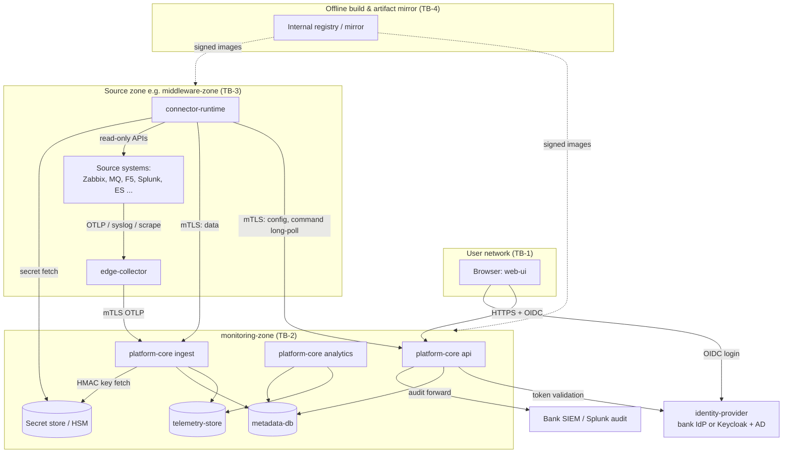

# معماری امنیت و مدل تهدید (Security & Threat Model)

| فیلد | مقدار |
|---|---|
| Document ID | `ARC-SEC-001` |
| Version | `0.2` |
| Status | `Draft – Phase 0 – awaiting approval` |
| Date | `2026-10-11` (`1405/07/19`) |
| Owner | `Architecture` |
| Related documents | [ingestion-and-connectors.md](ingestion-and-connectors.md)، [correlation-and-intelligence.md](correlation-and-intelligence.md)، [ADR-0015](architecture-decision-records/ADR-0015-authentication-authorization-audit.md)، [ADR-0016](architecture-decision-records/ADR-0016-offline-deployment-and-artifacts.md)، [ADR-0017](architecture-decision-records/ADR-0017-ha-dr-architecture.md)، [ADR-0018](architecture-decision-records/ADR-0018-data-retention-privacy-capacity-controls.md)، [ADR-0020](architecture-decision-records/ADR-0020-existing-platform-integration-read-only-pull.md)، [ADR-0022](architecture-decision-records/ADR-0022-commercial-platforms-not-adopted.md)، [ADR-0023](architecture-decision-records/ADR-0023-reuse-zabbix-services-and-sla.md)، [product-benchmark.md](../benchmark/product-benchmark.md)، [docs/requirements/](../requirements/)، [docs/operations/](../operations/)، [docs/testing/](../testing/) |

**راهنمای برچسب‌ها:** [واقعیت] فقط F-01..F-03؛ [فرض A-xx]؛ [فرضیه]؛ [توصیه]؛ [باز Q-xx].

[واقعیت] استقرار فقط on-premises در مرکز دادهٔ بانک و بدون دسترسی مستقیم به اینترنت است (F-02). این سند هیچ الزام قانونی بانک مرکزی (CBI)، PCI DSS یا مقررات دیگر را «تأییدشده» فرض نمی‌کند؛ نگاشت انطباق در [باز Q-10] باقی است (`NFR-CMP-001`).

---

## ۱. دارایی‌ها

| ID | دارایی | چرا ارزشمند است | محل |
|---|---|---|---|
| AS-01 | credentialهای فقط‌خواندنی منابع (Zabbix، SolarWinds، Splunk، ES، MQ، F5، DB، ...) | دسترسی گسترده به اطلاعات عملیاتی بانک؛ هدف پرارزش (R-06) | secret store؛ حافظهٔ `connector-runtime` |
| AS-02 | کلیدهای HMAC توکنیزه‌سازی به ازای محیط | با نشت کلید، توکن PAN با brute-force فضای محدود PAN قابل بازگشت است | secret store/HSM ([باز Q-09]) |
| AS-03 | دادهٔ تلمتری مشتق (متریک، رویداد، خلاصهٔ تراکنش، رویداد توکنیزه) | اطلاعات حجم و الگوی تراکنش بانک | `telemetry-store` (schema `telemetry` در PostgreSQL؛ ClickHouse فقط در صورت trigger [ADR-0008](architecture-decision-records/ADR-0008-telemetry-store-postgresql-first-clickhouse-on-trigger.md)) |
| AS-04 | metadata: catalog، topology، ExternalRef، پیکربندی Connector | نقشهٔ کامل معماری و وابستگی‌ها — برای مهاجم بسیار مفید است | `metadata-db` (PostgreSQL) |
| AS-05 | نتایج federated evidence query | ممکن است گزیده‌ای از log حاوی دادهٔ شخصی باشد | گذرا در `evidence-query` و UI |
| AS-06 | audit log | شواهد پاسخ‌گویی؛ هدف دستکاری | PostgreSQL (append-only) + ارسال به SIEM/Splunk |
| AS-07 | گواهی‌ها و کلیدهای mTLS داخلی | جعل collector/connector | هر نود |
| AS-08 | artifactهای نرم‌افزار و bundle آفلاین | زنجیرهٔ تأمین | مخزن داخلی artifact ([باز Q-09]) |
| AS-09 | دسترس‌پذیری منابع موجود | polling نادرست می‌تواند Zabbix/Splunk/MQ/F5 را تحت فشار بگذارد | سامانه‌های منبع |
| AS-10 | نشست‌ها و توکن‌های کاربر | جعل هویت | مرورگر، `platform-core` api |

## ۲. مرزهای اعتماد

*توضیح:* مرزها: TB-1 کاربر↔UI/API، TB-2 هستهٔ پلتفرم، TB-3 هر zone منبع (یک نمونه برای هر zone)، TB-4 زنجیرهٔ build/استقرار. همهٔ اتصال‌های عبوری از TB-3 به TB-2 از سمت zone آغاز می‌شوند (`NFR-SEC-010`). محل secret store (داخل `monitoring-zone` یا سرویس vault بانک) به [باز Q-09] بستگی دارد؛ اگر `connector-runtime` به آن دسترسی مستقیم ندارد، secret از طریق کانال mTLS با `api` و رمزگذاری per-runtime تحویل می‌شود.

## ۳. مدل تهدید STRIDE

S=Spoofing، T=Tampering، R=Repudiation، I=Information disclosure، D=Denial of service، E=Elevation of privilege.

| # | جزء / جریان | STRIDE | تهدید | کنترل | NFR |
|---|---|---|---|---|---|
| T-01 | Browser → `api` | S | سرقت/بازپخش token، جعل نشست | OIDC با PKCE، token کوتاه‌عمر، refresh در backend یا cookie `HttpOnly; Secure; SameSite=Strict`، MFA از طریق IdP ([باز Q-04]) | `NFR-SEC-009` |
| T-02 | `web-ui` | T/E | XSS (به‌ویژه از محتوای log، نام سرویس، توضیحات) | escape پیش‌فرض React، ممنوعیت `dangerouslySetInnerHTML`، CSP سخت‌گیر (`default-src 'self'`، بدون inline script)، sanitize نمایش متن evidence | `NFR-SEC-008` |
| T-03 | `web-ui` → `api` | T | CSRF | bearer token در header (نه cookie خودکار)؛ اگر cookie: `SameSite=Strict` + توکن ضد CSRF؛ بررسی `Origin` | `NFR-SEC-009` |
| T-04 | `api` | E | دور زدن RBAC / IDOR بین scopeها (محیط، گروه سرویس) | deny-by-default، اعمال scope در لایهٔ query (فیلتر اجباری)، تست‌های مجوز خودکار | `NFR-SEC-005` |
| T-05 | `api` | R | انکار تغییر پیکربندی/حذف | audit تغییرناپذیر با هویت، زمان، قبل/بعد | `NFR-SEC-006` |
| T-06 | `connector-runtime` | I | سرقت credentialهای منابع از دیسک، حافظه، log، dump | `SecretProvider`، بدون secret در فایل پیکربندی، فیلتر log، غیرفعال‌سازی heap dump در PROD یا رمزگذاری آن، دسترسی OS حداقلی | `NFR-SEC-004` |
| T-07 | `connector-runtime` → منابع | E/T | استفاده از credential برای تغییر منبع | حساب فقط‌خواندنی و کم‌دسترسی؛ allowlist عملیات در Connector | `NFR-SEC-003`, `NFR-IMP-002` |
| T-08 | `connector-runtime` → منابع | D | فشار polling یا evidence query روی منبع | query budget، rate limit، circuit breaker، concurrency محدود | `NFR-IMP-001` |
| T-09 | collector/connector → `ingest` | S/T | collector جعلی یا مخدوش دادهٔ جعلی/ممنوعه تزریق می‌کند | mTLS با گواهی per-node، نگاشت گواهی به zone و ConnectorInstanceهای مجاز، اعتبارسنجی schema، سقف نرخ، redaction مجدد | `NFR-SEC-001`, `NFR-PRV-002` |
| T-10 | `ingest` | D | سیل داده یا انفجار cardinality | سقف نرخ per-sender، سقف cardinality، backpressure | `NFR-REL-001` |
| T-11 | `evidence-query` | T/I/E | query injection به SPL/Query DSL؛ استخراج داده‌ی index غیرمجاز | فقط query template مصوب و پارامتری، allowlist index، اعتبارسنجی نوع پارامتر، اجرای query با حساب کم‌دسترسی منبع، redaction نتیجه | `NFR-PRV-005`, `NFR-SEC-003` |
| T-12 | `ingest`/`telemetry-store` | I | ورود PAN/PIN/داده‌ی شخصی از طریق log | allowlist فیلدی، detectorها در لبه و ingest، قرنطینه، audit redaction | `NFR-PRV-001`, `NFR-PRV-002` |
| T-13 | PostgreSQL/ClickHouse | I/T | دسترسی مستقیم DBA یا سرقت دیسک/backup | رمزگذاری در حالت سکون، TLS، حساب‌های DB حداقلی per role، رمزگذاری backup | `NFR-SEC-002` |
| T-14 | audit log | T/R | حذف یا ویرایش رکورد audit | جدول append-only (بدون UPDATE/DELETE برای نقش برنامه)، زنجیرهٔ hash، ارسال فوری به SIEM | `NFR-SEC-006` |
| T-15 | `api` ↔ `connector-runtime` command channel | S/E | ارسال فرمان جعلی به runtime | runtime فقط فرمان‌های امضاشده/احرازشده از `api` روی mTLS را می‌پذیرد؛ نوع فرمان محدود (evidence query template، probe) | `NFR-SEC-001` |
| T-16 | زنجیرهٔ build آفلاین | T | وابستگی مخرب، image دستکاری‌شده | mirror کنترل‌شده، pin نسخه و checksum، SBOM CycloneDX، امضای artifact، اسکن آسیب‌پذیری | `NFR-SEC-007` |
| T-17 (0.2) | حساب نوشتن همگام‌سازی تقویم در Zabbix | T، E | ایجاد maintenance جعلی برای سرکوب هشدار واقعی | پیش‌فرض خاموش، حساب جدا با حداقل گستره، tag مالکیت، dry-run/diff، four-eyes، audit (§۷.۳) | `NFR-SEC-003`, `NFR-SEC-006` |
| T-18 (0.2) | exporter `mq_prometheus` در zone میان‌افزار | I، T | افشای متریک صف از endpoint بدون احراز هویت؛ جایگزینی باینری | endpoint فقط روی interface داخلی با allowlist IP `connector-runtime` و TLS در صورت امکان؛ حساب MQ حداقلی (`+inq +dsp`)؛ باینری امضاشده در bundle آفلاین؛ `RESET QSTATS` خاموش | `NFR-SEC-003`, `NFR-SEC-007` |
| T-17 | نقش `analytics`/UI | I | استنتاج دادهٔ حساس از ترکیب داده‌های توکنیزه (مثلاً توکن PAN + زمان + bucket مبلغ) | دسترسی به رویدادهای توکنیزه فقط با مجوز ویژه، retention کوتاه (30 d)، عدم نمایش توکن در UI عمومی | `NFR-PRV-003`, `NFR-PRV-004` |
| T-18 | synthetic checks | T/D | تراکنش مالی ناخواسته یا بار روی سرویس | guardrailهای §۱۱ | `FR-DX-003` |
| T-19 | `identity-provider` | S/E | ارتقای نقش با دستکاری گروه AD | نگاشت گروه به نقش در `iam` با audit، بازبینی دوره‌ای، تأیید دوگانه برای نقش‌های admin | `NFR-SEC-005` |
| T-20 | تمامی نودها | E | نفوذ به OS نود collector/core | hardening، حداقل سرویس، عدم اجرای container با root، SELinux در حالت enforcing (در صورت سیاست بانک) | `NFR-SEC-008` |

## ۴. سناریوهای حمله

### ۴.۱ سرقت credential از `connector-runtime` (R-06)

- **مسیر:** نفوذ به نود runtime در zone منبع → خواندن فایل پیکربندی، متغیر محیطی، dump حافظه یا log.
- **کنترل‌ها:** (۱) هیچ secret در فایل یا env ذخیره نمی‌شود؛ فقط `secretRef`. (۲) runtime با هویت مخصوص خود (گواهی mTLS) فقط secretهای ConnectorInstanceهای zone خود را دریافت می‌کند — **هر runtime فقط credentialهای zone خود را دارد** و نه همهٔ بانک. (۳) secret فقط در حافظه و با TTL؛ heap dump در PROD غیرفعال. (۴) credentialها فقط‌خواندنی‌اند، پس اثر نشت به افشای اطلاعات محدود می‌شود نه تغییر. (۵) هشدار برای استفاده از credential از IP غیر از runtime (در صورت قابلیت منبع یا SIEM). (۶) چرخش دوره‌ای و فوری پس از رخداد (runbook در [docs/operations/](../operations/)).
- **ریسک باقیمانده:** نفوذگر با دسترسی root در زمان اجرا می‌تواند secretهای در حال استفادهٔ همان zone را از حافظه بخواند.

### ۴.۲ Query injection از طریق federated query

- **مسیر:** کاربر یا ورودی دستکاری‌شده (مثلاً نام host در ExternalRef، یا پارامتر جست‌وجو) شامل عملگرهای SPL مانند `| delete`، `| outputlookup`، `| rest`، subsearch، یا در ES اسکریپت painless/`_source` گسترده.
- **کنترل‌ها:** [توصیه] (۱) فقط query template نسخه‌دار و مصوب (با بازبینی تیم Splunk/ES و امنیت)؛ کاربر فقط پارامترهای typed انتخاب می‌کند (بازهٔ زمانی، entity از catalog). (۲) پارامترها با escape متناسب با زبان query و allowlist کاراکتر؛ هرگز concatenation رشته‌ای آزاد. (۳) حساب منبع بدون قابلیت‌های نوشتن/حذف/rest (در Splunk نقش بدون capabilityهای خطرناک؛ در ES فقط `read`) — نیازمند تأیید در نسخه نصب‌شده بانک. (۴) سقف بازهٔ زمانی، rows و timeout. (۵) نتیجه از redaction عبور می‌کند و فقط فیلدهای مجاز template برگردانده می‌شوند. (۶) هر evidence query با کاربر، template و پارامترها audit می‌شود.

### ۴.۳ نشت دادهٔ حساس از طریق log (R-10)

- **مسیر:** logهای برنامه‌های بانکی در Splunk/ES ممکن است PAN، کد ملی، شماره موبایل یا Sheba داشته باشند؛ این داده از طریق per-minute summary، evidence query یا log خود پلتفرم به `telemetry-store` یا UI برسد.
- **کنترل‌ها:** §۶؛ همچنین logهای خود پلتفرم هرگز payload منبع را log نمی‌کنند (فقط شناسه و شمارش).
- **پایش:** «redaction audit» دوره‌ای: اسکن نمونه‌ای `telemetry-store` با همان detectorها؛ هدف VS-1: صفر یافته.

### ۴.۴ Collector مخرب یا مخدوش

- **مسیر:** نود `edge-collector`/`connector-runtime` به دست مهاجم بیفتد و (الف) دادهٔ جعلی برای پنهان کردن حادثه یا ایجاد هشدار کاذب، (ب) سیل داده، (ج) تلاش برای دریافت secret zoneهای دیگر.
- **کنترل‌ها:** mTLS per-node؛ ingest ادعای منبع/zone را با گواهی تطبیق می‌دهد؛ سقف نرخ و cardinality؛ ابطال گواهی (CRL یا گواهی کوتاه‌عمر)؛ تشخیص ناهنجاری روی رفتار ارسال (حجم، مجموعهٔ entityها)؛ عدم اعتماد کامل به یک منبع منفرد در correlation (شاخص `independence` در [correlation-and-intelligence.md](correlation-and-intelligence.md) §4.5).
- **ریسک باقیمانده:** collector مخدوش می‌تواند دادهٔ معتبر zone خود را به شکل باورپذیر جعل کند؛ این باید در تحلیل حادثه مدنظر باشد.

### ۴.۵ سوءاستفادهٔ کاربر داخلی

- **مسیر:** کاربر مجاز با evidence query داده‌ی شخصی جست‌وجو می‌کند، رویدادهای توکنیزه را برای ردیابی مشتری خاص استفاده می‌کند، یا admin مجوز خود را گسترش می‌دهد و audit را پاک می‌کند.
- **کنترل‌ها:** مجوز `evidence:query` و `txn-events:read` جدا و محدود؛ امکان جست‌وجو با مقدار خام کلید (مثلاً PAN) در UI وجود ندارد — در صورت نیاز عملیاتی، فقط با گردش کار مجاز و audit و محاسبهٔ HMAC در سرور ([توصیه]، [باز Q-10]). تفکیک وظایف: `platform-admin` نمی‌تواند audit را تغییر دهد و نمی‌تواند به خود نقش `auditor` بدهد؛ تغییر نقش‌های admin با تأیید دوم. audit به SIEM خارج از کنترل تیم پلتفرم ارسال می‌شود.

### ۴.۶ زنجیرهٔ تأمین در build آفلاین (R-09)

- **مسیر:** کتابخانهٔ مخرب وارد mirror داخلی شود؛ image پایهٔ دستکاری‌شده؛ تغییر bundle بین build و نصب.
- **کنترل‌ها:** ورود وابستگی به mirror فقط از طریق فرایند کنترل‌شده با checksum و امضا (در صورت ارائهٔ فروشنده)؛ lockfile و pin نسخه؛ ساخت تکرارپذیر در حد امکان؛ SBOM CycloneDX به ازای هر artifact؛ اسکن آسیب‌پذیری آفلاین با پایگاه دادهٔ آسیب‌پذیری‌ای که به صورت دوره‌ای و کنترل‌شده وارد می‌شود؛ امضای image و bundle و بررسی امضا هنگام نصب؛ توزیع OTel Collector با OCB فقط با componentهای لازم ([ADR-0016](architecture-decision-records/ADR-0016-offline-deployment-and-artifacts.md)).

### ۴.۷ XSS و CSRF در UI

- محتوای منابع خارجی (پیام alert، متن log، نام host) **داده‌ی غیرقابل‌اعتماد** است. کنترل‌ها در T-02/T-03. نمودارهای ECharts و Cytoscape.js فقط متن escapeشده دریافت می‌کنند؛ tooltipهای HTML ممنوع یا با sanitizer. لینک‌های بازگشت به منابع (`FR-INT-006`) فقط از قالب URL پیکربندی‌شده با scheme `https` ساخته می‌شوند.

### ۴.۸ ارتقای سطح دسترسی

- **مسیرها:** IDOR در API (دسترسی به سرویس خارج از scope)، تغییر گروه AD، سوءاستفاده از نقش `integration-admin` برای تعریف Connector به مقصد دلخواه (SSRF از runtime) یا خواندن secret.
- **کنترل‌ها:** scope اجباری در لایهٔ query؛ secretها write-only در UI (هیچ نقشی secret را نمی‌خواند)؛ endpoint Connector از allowlist مقصدهای مجاز هر zone (جلوگیری از SSRF)؛ تغییر endpoint یا secretRef نیازمند تأیید دوم؛ تست‌های مجوز خودکار در CI.

### ۴.۹ DoS روی منابع از طریق polling (AS-09)

- **مسیر:** پیکربندی اشتباه (interval کوتاه، wildcard گسترده)، backfill بزرگ پس از قطعی، یا evidence queryهای پیاپی در زمان حادثه.
- **کنترل‌ها:** حداقل interval در schema، query budget مشترک per-source، circuit breaker، محدودیت evidence query per-user و per-source، اولویت‌بندی و تعلیق backfill ([ingestion-and-connectors.md](ingestion-and-connectors.md) §4.7، §13).

## ۵. نگاشت کنترل‌ها به NFR

| NFR | کنترل‌های اصلی | تهدیدها |
|---|---|---|
| `NFR-SEC-001` | TLS 1.2+ (ترجیح 1.3)، mTLS داخلی، PKI داخلی بانک یا CA اختصاصی پلتفرم | T-09, T-15 |
| `NFR-SEC-002` | رمزگذاری دیسک (LUKS یا معادل)، رمزگذاری backup | T-13 |
| `NFR-SEC-003` | حساب فقط‌خواندنی per-source per-environment | T-07, T-11 |
| `NFR-SEC-004` | `SecretProvider`، بدون secret در config/log | T-06, §4.1 |
| `NFR-SEC-005` | RBAC deny-by-default با scope | T-04, T-19, §4.8 |
| `NFR-SEC-006` | audit تغییرناپذیر + SIEM | T-05, T-14 |
| `NFR-SEC-007` | SBOM، امضا، اسکن | T-16, §4.6 |
| `NFR-SEC-008` | hardening | T-02, T-20 |
| `NFR-SEC-009` | امنیت نشست، MFA از IdP | T-01, T-03 |
| `NFR-SEC-010` | تقسیم‌بندی شبکه، outbound-only از zoneها | §۹ |
| `NFR-PRV-001` | عدم ذخیرهٔ دادهٔ ممنوعه | T-12, §4.3 |
| `NFR-PRV-002` | redaction لبه + ingest | T-09, T-12 |
| `NFR-PRV-003` | HMAC و چرخش کلید | T-17, §6.3 |
| `NFR-PRV-004` | اعمال retention | T-17 |
| `NFR-PRV-005` | redaction نتایج federated query | T-11 |
| `NFR-IMP-001` | query budget | T-08, §4.9 |

## ۶. مدیریت دادهٔ حساس (ADR-0018)

### ۶.۱ قواعد

| دسته | قاعده |
|---|---|
| **هرگز ذخیره نمی‌شود** | PAN، CVV، PIN، PIN block، track data، رمز عبور، OTP، token/secret، payload کامل |
| **مجاز با توجیه** | BIN (6 یا 8 رقم اول) فقط جایی که برای تحلیل لازم است |
| **مجاز به صورت توکن** | HMAC-SHA256 از PAN و کلیدهای همبستگی کسب‌وکاری (L2)، با کلید per-environment |
| **مبلغ** | فقط bucket (نه مبلغ دقیق) به صورت پیش‌فرض |
| **سایر داده‌ی شخصی** | کد ملی، Sheba/IBAN، موبایل، شمارهٔ حساب: حذف یا جایگزینی با `[REDACTED:<type>]`؛ در صورت نیاز همبستگی، فقط HMAC |

### ۶.۲ Detectorها

[توصیه] پیش از هر تشخیص، **نرمال‌سازی ارقام** انجام می‌شود: ارقام فارسی (`۰-۹`، U+06F0..U+06F9) و عربی-هندی (`٠-٩`، U+0660..U+0669) به ASCII، و حذف جداکننده‌های رایج (فاصله، فاصلهٔ مجازی/ZWNJ، `-`) برای تطبیق الگو. این قاعده **مالک واحد** نرمال‌سازی ارقام در کل پلتفرم است: در لبه (`connector-runtime`، و `edge-collector` در صورت استقرار)، در ingest، روی نتایج federated query و نتایج saved search کشیده‌شده از Splunk/ES، و پیش از نگاشت `OutcomeMapping` ([correlation-and-intelligence.md](correlation-and-intelligence.md)) اعمال می‌شود. نسخهٔ نرمال‌شده فقط برای تشخیص است؛ مقدار ذخیره‌شده پس از redaction است.

| Detector | الگو و اعتبارسنجی | ملاحظات |
|---|---|---|
| PAN | 13–19 رقم (با جداکنندهٔ اختیاری) + اعتبارسنجی Luhn | برای کاهش FP، BINهای بانکی پیکربندی‌شده می‌توانند اطمینان را بالا ببرند؛ اما detector حتی بدون تطبیق BIN، رشتهٔ معتبر Luhn با طول کارت را redact می‌کند (ترجیح امنیت بر دقت) |
| کد ملی | 10 رقم؛ رقم کنترل: `s = Σ_{i=1..9} d_i·(11−i)`، `r = s mod 11`؛ معتبر اگر (`r < 2` و `d_10 = r`) یا (`r ≥ 2` و `d_10 = 11 − r`)؛ رد ارقام تکراری یکسان | احتمال برخورد با سایر اعداد 10 رقمی؛ در فیلدهای شناخته‌شده (مثلاً `nationalCode`) بدون نیاز به checksum حذف می‌شود |
| Sheba/IBAN | `IR` + 24 رقم (مجموعاً 26 کاراکتر)، اعتبارسنجی mod-97 طبق ISO 13616 | نسخه‌های بدون `IR` (24 رقم خام) در فیلدهای شناخته‌شده |
| موبایل ایران | `09` + 9 رقم، یا `+989`/`00989`/`989` + 9 رقم | |
| شمارهٔ حساب | الگوهای قابل‌پیکربندی به ازای بانک | [باز Q-10] و دادهٔ بانک |
| Secret/credential | الگوهای key=value مانند `password=`، `pin=`، `otp=`، `token=`، `Authorization:` | حذف کل مقدار |
| PIN block / track data | الگوهای hex 16 کاراکتری در فیلدهای شناخته‌شده، الگوهای track (`%B...^`، `;...=`) | |

- **اولویت allowlist:** Connectorها فقط فیلدهای اعلام‌شده در template را استخراج می‌کنند؛ detectorها لایهٔ دفاعی دوم‌اند.
- **مکان اجرا:** `connector-runtime` و `edge-collector` (لبه) + ماژول `ingestion` (ingest) + `evidence-query` (نتایج federated) — `NFR-PRV-002`, `NFR-PRV-005`.
- **آزمون:** مجموعهٔ fixture شامل نمونه‌های مثبت/منفی (با ارقام فارسی و جداکننده‌ها) در CI؛ نرخ FN هدف صفر روی مجموعهٔ آزمون ([docs/testing/](../testing/)).
- **[فرضیه]** detectorهای الگو-محور تمام موارد را نمی‌گیرند (مثلاً PAN شکسته در چند فیلد)؛ از این رو allowlist فیلدی کنترل اصلی است.

### ۶.۳ توکنیزه‌سازی HMAC و چرخش کلید (`NFR-PRV-003`)

- `token = HMAC-SHA256(K_env,v, normalize(value))`، ذخیره به همراه `kid = v`؛ طول خروجی حداقل 128 بیت (truncation فقط تا این حد).
- **چرا hash ساده ممنوع است:** فضای PAN (BIN شناخته‌شده + چند رقم + Luhn) کوچک است و hash بدون کلید با brute-force قابل بازگشت است؛ امنیت توکن کاملاً به محرمانگی `K_env` وابسته است.
- کلید جدا برای هر محیط (PROD، DR در صورت نیاز به همبستگی بین‌سایتی با کلید مشترک PROD، UAT، TEST)؛ کلید PROD هرگز در محیط‌های دیگر.
- **چرخش:** کلید جدید `v+1` برای دادهٔ جدید؛ در دورهٔ هم‌پوشانی (حداکثر برابر retention رویدادهای توکنیزه، 30 d) همبستگی بین دو نسخه با محاسبهٔ دوگانه در ingest انجام می‌شود؛ پس از پایان retention، کلید قدیمی نابود می‌شود (توکن‌های قدیمی عمداً غیرقابل پیوند می‌شوند). دورهٔ چرخش: [باز Q-10].
- محل کلید: secret store یا HSM ([باز Q-09])؛ محاسبهٔ HMAC در لبه نیازمند تحویل کلید به `connector-runtime` است — این ریسک در §۱۳ ثبت شده است.

### ۶.۴ Retention

مقادیر موقت ADR-0018 / spine §6 ([باز Q-16], [باز Q-10]): raw metric 30 d، rollup یک‌دقیقه‌ای 13 ماه، rollup یک‌ساعته 3 سال، رویدادهای نرمال 13 ماه، خلاصهٔ تراکنش 13 ماه، رویداد توکنیزه 30 d، audit ≥ 5 سال. اعمال با حذف partition در PostgreSQL (schema `telemetry`، پیش‌فرض از 0.2) و TTL در ClickHouse در صورت Trigger ([ADR-0008](architecture-decision-records/ADR-0008-telemetry-store-postgresql-first-clickhouse-on-trigger.md))، با گزارش ممیزی retention (`NFR-PRV-004`).

## ۷. مدل کنترل دسترسی (`FR-ADM-001`, `FR-ADM-002`, ADR-0015)

### ۷.۱ نقش‌ها

| نقش | کاربر نمونه | توان‌ها |
|---|---|---|
| `viewer` | مدیریت IT، تیم‌های ذی‌نفع | مشاهدهٔ داشبورد، سلامت، SLO، topology در scope |
| `operator` | NOC/Operations، SRE | `viewer` + تأیید/مدیریت incident، بازخورد، ایجاد maintenance window کوتاه‌مدت (در scope)، اجرای evidence query مصوب |
| `service-owner` | مالک سرویس | `viewer` + ویرایش catalog/topology/SLO/transaction types/calendar سرویس‌های خود، تأیید یال‌های `PROPOSED` |
| `integration-admin` | تیم یکپارچه‌سازی/میان‌افزار | مدیریت ConnectorInstance (بدون دیدن secret)، ExternalRef، query template (با تأیید دوم)، probe |
| `platform-admin` | تیم پلتفرم | پیکربندی پلتفرم، نگاشت نقش‌ها (با تأیید دوم)، مدیریت retention؛ **بدون** تغییر audit |
| `auditor` | امنیت/SOC، ممیزی | فقط‌خواندنی روی audit log و گزارش‌های redaction/دسترسی؛ بدون تغییر |

### ۷.۲ Scopeها و مجوزهای ویژه

- **Scope:** `environment` (PROD, DR, UAT, TEST)، `service-group` (گروه سرویس‌های کسب‌وکاری)، و برای `integration-admin`: `zone`. نقش همیشه در قالب `(role, scope)` اعطا می‌شود؛ deny-by-default (`NFR-SEC-005`).
- **مجوزهای حساس جداگانه** (بخشی از هیچ نقش پیش‌فرض نیستند و جداگانه اعطا می‌شوند):
  - `evidence:query` — اجرای federated query (حتی با redaction)؛
  - `txn-events:read` — دسترسی به رویدادهای توکنیزهٔ L2؛
  - `synthetic:manage` — تعریف و فعال‌سازی synthetic check (§۱۱)؛
  - `audit:export`؛
  - `zabbix-calendar-sync:enable` (0.2) — فعال‌سازی و تغییر قابلیت اختیاری نوشتن پنجره‌های تقویم در Zabbix (§۷.۳).
- **تفکیک وظایف:** هیچ کاربری نمی‌تواند نقش خود را ارتقا دهد؛ تغییرات نقش‌های `platform-admin`/`integration-admin` و تغییر endpoint/secretRef Connector نیازمند تأیید فرد دوم (four-eyes).
- **حساب break-glass:** محلی، با رمز در گاوصندوق، استفاده موجب هشدار فوری و audit.
- **حساب‌های سرویس:** هویت mTLS برای `connector-runtime`/`edge-collector`؛ حساب‌های DB per role (`api`, `ingest`, `analytics`) با حداقل مجوز.
- **هویت:** OIDC از IdP بانک، یا Keycloak با federation به AD/LDAP ([باز Q-04]، [فرض A-07]).

### ۷.۳ نوشتن در Zabbix (همگام‌سازی تقویم) — قابلیت ممتاز، اختیاری و audit‌شده (0.2)

[توصیه] همگام‌سازی تقویم به maintenance/SLA schedule در Zabbix (FR-CAL-008، [ADR-0023](architecture-decision-records/ADR-0023-reuse-zabbix-services-and-sla.md)) تنها مسیر نوشتن پلتفرم در یک سامانهٔ منبع است و برخلاف اصل فقط‌خواندنی ([ADR-0020](architecture-decision-records/ADR-0020-existing-platform-integration-read-only-pull.md)، `NFR-SEC-003`) است؛ بنابراین:
- **پیش‌فرض خاموش**؛ فعال‌سازی فقط با تأیید مکتوب مالک Zabbix و واحد امنیت بانک، و مجوز `zabbix-calendar-sync:enable` با four-eyes.
- **حساب جداگانه** (نه همان حساب فقط‌خواندنی) با حداقل دسترسی نوشتن روی maintenance/host groupهای مشخص؛ secret جدا در SecretProvider؛ فقط در connector جداگانهٔ `zabbix-calendar-sync`.
- فقط اشیای دارای tag مالکیت پلتفرم تغییر می‌کنند؛ حذف/تغییر maintenance ساخته‌شده توسط انسان ممنوع.
- dry-run و نمایش diff پیش از هر اعمال؛ سقف تعداد تغییر در هر اجرا؛ قطع خودکار (circuit breaker) در خطا.
- audit کامل هر نوشتن (before/after، شیء Zabbix، کاربر/تأییدکننده) و ارسال به SIEM.
- تهدید: سوءاستفاده از این حساب می‌تواند با ایجاد maintenance جعلی هشدارهای واقعی Zabbix را سرکوب کند (T-17 زیر) — به همین دلیل گسترهٔ host group آن باید حداقلی باشد.
- PoC-1 هر نوشتن را فقط روی Zabbix غیرتولیدی آزمایش می‌کند (صفر نوشتن در تولید).

## ۸. مدیریت secret (`FR-ADM-004`, `NFR-SEC-004`)

- [توصیه] انتزاع `SecretProvider` با پیاده‌سازی‌های جایگزین: vault موجود بانک، HSM، یا vault محلی رمز‌شده با کلید اصلی جدا ([باز Q-09]).
- secretها در UI فقط قابل نوشتن‌اند (write-only)؛ نمایش فقط metadata (آخرین چرخش، مالک).
- هر دسترسی به secret ثبت می‌شود (چه کسی/کدام runtime، کدام `secretRef`، زمان) — بدون مقدار.
- چرخش: دوره‌ای (دوره در [باز Q-10]) و پس از رخداد؛ پشتیبانی از چرخش بدون توقف (§4.5 در [ingestion-and-connectors.md](ingestion-and-connectors.md)).
- کلیدهای خصوصی mTLS با مجوز فایل محدود یا در HSM/TPM در صورت وجود؛ گواهی‌ها با عمر محدود و فرایند تمدید خودکار در PKI داخلی.

## ۹. Audit (`FR-ADM-003`, `NFR-SEC-006`)

- **رویدادهای ثبت‌شونده:** ورود/خروج و شکست ورود؛ تغییر هر شیء catalog/topology/calendar/SLO/Connector/template/role؛ اجرای evidence query (کاربر، template، پارامترها، تعداد نتایج، تعداد redaction)؛ دسترسی به `txn-events`؛ import فایل؛ probe؛ دسترسی به secret؛ رخدادهای redaction violation؛ تغییرات retention؛ استفادهٔ break-glass؛ اقدامات synthetic.
- **ساختار:** `who`, `on_behalf_of`, `when` (UTC)، `what`, `target`, `before/after` (بدون secret یا دادهٔ حساس)، `source_ip`, `correlation_id`، `prev_hash` (زنجیرهٔ hash برای تشخیص دستکاری).
- **ذخیره:** جدول append-only در PostgreSQL (نقش برنامه فقط INSERT) + ارسال near-real-time به SIEM/Splunk بانک. retention ≥ 5 سال یا الزام قانونی ([باز Q-10]).

## ۱۰. تقسیم‌بندی شبکه (`NFR-SEC-010`)

| جریان | جهت | پروتکل | توضیح |
|---|---|---|---|
| کاربران → `web-ui`/`api` | ورودی به `monitoring-zone` | HTTPS 443 | از طریق reverse proxy یا LB داخلی بانک (در صورت سیاست) |
| `connector-runtime` → منابع | داخل zone منبع | API منبع روی TLS | فقط مقصدهای allowlist |
| `connector-runtime`/`edge-collector` → `monitoring-zone` | zone → monitoring | mTLS (OTLP، REST) | تنها مسیر عبور از مرز zone |
| منابع → `edge-collector` | داخل zone | OTLP، syslog، scrape از collector | — |
| `monitoring-zone` → zoneها | **ممنوع** | — | فرمان‌ها با long-poll |
| پلتفرم → اینترنت | **ممنوع** | — | F-02 |
| `api` → IdP، SIEM، SMTP/SMS/ITSM | خروجی محدود | TLS | فقط مقصدهای تعریف‌شده ([باز Q-14]) |

- [توصیه] DB‌ها فقط از نودهای `platform-core` قابل دسترسی‌اند؛ دسترسی مدیریتی از jump host با MFA.
- [توصیه] پلتفرم در دامنهٔ خرابی مستقل از سامانه‌های پایش‌شده (`NFR-AVL-002`)؛ مثلاً احراز هویت نباید به Elasticsearch بانک وابسته باشد.

## ۱۱. ایمنی synthetic monitoring (`FR-DX-001..003`)

- [توصیه] فقط عملیات **غیرمالی** و مجاز (مثلاً health endpoint، استعلام موجودی حساب تستی، login حساب تستی) — هیچ انتقال وجه، پرداخت یا تغییر وضعیت مالی.
- حساب‌های تستی اختصاصی با فرایند تأیید ([باز Q-20])؛ credential آن‌ها در `SecretProvider`.
- هر check: مالک، تأییدکننده، محیط مجاز، نرخ حداکثر (پیش‌فرض ≤ 1 درخواست در دقیقه به ازای check)، timeout، header شناسایی (مثلاً `X-Synthetic-Check: <id>`) برای فیلتر در KPIهای کسب‌وکاری و SIEM.
- kill switch سراسری و per-check؛ تعلیق خودکار پس از خطاهای پیاپی یا در `MAINTENANCE`.
- نتایج synthetic از KPIهای تراکنش واقعی جدا نگه داشته می‌شود.
- اجرای synthetic از `connector-runtime` یا collector همان zone؛ بدون باز کردن مسیر جدید از `monitoring-zone`.

## ۱۲. Hardening (`NFR-SEC-008`)

- baseline شبیه CIS برای OS (RHEL-compatible، [فرض A-02]، [باز Q-03])، PostgreSQL، ClickHouse (در صورت استقرار) و runtime container.
- containerها بدون root، file system فقط‌خواندنی در حد امکان، حذف ابزارهای غیرضروری از image، محدودیت منابع.
- Spring Boot: غیرفعال‌سازی actuator endpointهای حساس یا محدود به شبکهٔ مدیریتی و احراز هویت؛ بدون stack trace در پاسخ API.
- HTTP security headers: CSP، `X-Content-Type-Options`، `Frame-Options`/`frame-ancestors`، HSTS.
- ClickHouse (فقط در صورت trigger ADR-0008): کاربران per role، غیرفعال‌سازی کاربر `default` بدون رمز، محدودیت‌های query (حداکثر حافظه/زمان) برای نقش‌های خواننده.
- به‌روزرسانی امنیتی از طریق bundle آفلاین ([ADR-0016](architecture-decision-records/ADR-0016-offline-deployment-and-artifacts.md)).
- ارزیابی امنیتی و pentest در فاز ۶ (EP-20)؛ امنیت در همهٔ فازها پیوسته است.

## ۱۳. انطباق (placeholder — `NFR-CMP-001`, [باز Q-10])

| حوزه | وضعیت | اقدام |
|---|---|---|
| مقررات بانک مرکزی (CBI) | نامعلوم؛ **هیچ قاعده‌ای در این سند فرض نشده است** | دریافت فهرست الزامات از واحد امنیت/انطباق بانک |
| PCI DSS | قابلیت اعمال نامعلوم؛ طراحی عمداً PAN ذخیره نمی‌کند تا دامنهٔ PCI کوچک بماند — این **نتیجه‌گیری انطباقی نیست** و نیازمند ارزیابی QSA یا معادل داخلی است | تعیین با واحد انطباق |
| ISO/IEC 27001 (در صورت گواهی بانک) | نامعلوم | نگاشت کنترل‌ها پس از Q-10 |
| اقامت داده | on-prem (F-02)؛ جزئیات دیگر نامعلوم | Q-10 |
| مدت نگهداری audit و داده | موقت (§۶.۴) | Q-10, Q-16 |
| تحریم و تداوم مجوز (0.2) | **ریسک R-16:** ابزارهای تجاری موجود بانک (Splunk، SolarWinds؛ و IBM MQ و اشتراک Elasticsearch در صورت وجود) از فروشندگان آمریکایی‌اند؛ مقررات ITSR/EAR تأمین **و به‌روزرسانی/وصله** را بدون مجوز ممنوع می‌کنند و ارائه از طریق واسطه خود تخلف است (پرونده SAP 2021). نحوهٔ مجوز و به‌روزرسانی فعلی نامعلوم است ([باز Q-25])؛ گزارش‌های انجمن Splunk حاکی از توقف جستجو پس از انقضای مجوز است (Low-Medium). پیامد امنیتی: ماندن نسخه‌های بدون وصلهٔ امنیتی در منابع و قطع ناگهانی منبع شواهد. این **مشاورهٔ حقوقی نیست** ([باز Q-24]) | پلتفرم هر منبع را قابل حذف طراحی می‌کند (منبع `UNKNOWN`، نه شکست)؛ هیچ محصول تجاری جدید اتخاذ نمی‌شود ([ADR-0022](architecture-decision-records/ADR-0022-commercial-platforms-not-adopted.md))؛ معیار تحریم/دسترسی بسته در [ADR-0016](architecture-decision-records/ADR-0016-offline-deployment-and-artifacts.md) بند ۷؛ RR-06 برای منابع بدون وصله |
| تعهدات AGPL (0.2) | **ریسک R-18:** Zabbix 7.0+ و Grafana OSS تحت AGPLv3 هستند. خواندن API یا اجرای بدون تغییر داخلی تعهد افشا ایجاد نمی‌کند؛ **تغییر** و ارائهٔ آن به کاربران از طریق شبکه، یا توزیع (مثلاً داخل bundle محصول برای بانک دیگر — Q-11) تعهد افشای سورس ایجاد می‌کند | پلتفرم Zabbix/Grafana را تغییر نمی‌دهد و درون artifact خود بسته‌بندی نمی‌کند (Grafana اختیاری، استقرار جدا، نسخهٔ بالادستی)؛ بررسی حقوقی [باز Q-21] پیش از استقرار Grafana یا هر plugin تغییر‌یافته |

## ۱۴. ریسک‌های باقیمانده

| ID | ریسک باقیمانده | علت | پیگیری |
|---|---|---|---|
| RR-01 | نفوذ root به `connector-runtime` secretهای در حال استفادهٔ همان zone را افشا می‌کند | secret باید در حافظه برای فراخوانی API باشد | محدودسازی per-zone، فقط‌خواندنی، چرخش، R-06 |
| RR-02 | کلید HMAC در لبه (اگر توکنیزه‌سازی در runtime انجام شود) در معرض نفوذ نود است | defense in depth نیازمند توکنیزه کردن پیش از خروج داده از zone است | گزینهٔ جایگزین: توکنیزه‌سازی فقط در ingest با redaction کامل در لبه — تصمیم در ADR-0018 |
| RR-03 | detectorهای الگو-محور ممکن است دادهٔ حساس با قالب غیرمعمول را از دست بدهند | محدودیت ذاتی تطبیق الگو | allowlist فیلدی، redaction audit دوره‌ای، EXP-01 |
| RR-04 | collector مخدوش می‌تواند داده‌ی zone خود را باورپذیر جعل کند | اعتماد به منبع داده | شاخص independence، همبستگی چندمنبعی |
| RR-05 | حساب‌های فقط‌خواندنی همچنان به اطلاعات حساس عملیاتی دسترسی دارند (مثلاً متن alert یا log) | ماهیت پایش | حداقل‌سازی دامنهٔ index/hostgroup |
| RR-06 | وابستگی به امنیت سامانه‌های منبع (مثلاً ES بدون احراز هویت در نسخه‌های قدیمی) | خارج از کنترل پلتفرم | گزارش به مالک در EXP-02 |
| RR-07 | الزامات قانونی نامعلوم ممکن است طراحی (retention، محل کلید، نوع MFA) را تغییر دهد | Q-10 باز | R-13 |
| RR-08 | بار اضافی روی منابع در زمان حادثه (همان زمانی که evidence لازم است) | تقاضای هم‌زمان | budget و circuit breaker، R-15 |
| RR-09 (0.2) | قطع منبع به‌دلیل انقضا/عدم تمدید مجوز (Splunk، SolarWinds) یا ماندن آن بدون وصلهٔ امنیتی | تحریم و مجوز خارج از کنترل پلتفرم | R-16، Q-25؛ fallback گزینهٔ B در [ADR-0021](architecture-decision-records/ADR-0021-build-buy-reuse-strategy.md) برای همان منبع |
| RR-10 (0.2) | اگر همگام‌سازی تقویم به Zabbix فعال شود، حساب نوشتن سطح حمله را افزایش می‌دهد | ماهیت قابلیت | T-17، §۷.۳ |

## ۱۵. نکته برای بازبینی

- **«نکته برای بازبینی» (محل توکنیزه‌سازی):** spine §6 redaction در لبه و ingest را الزامی کرده است، اما محل محاسبهٔ HMAC (لبه یا ingest) صریحاً تعیین نشده. توکنیزه‌سازی در لبه نشت کلید را به نودهای zone گسترش می‌دهد (RR-02)؛ توکنیزه‌سازی فقط در ingest یعنی مقدار خام کلید (نه PAN، ولی مثلاً RRN/STAN) از zone خارج می‌شود (روی mTLS). پیشنهاد: PAN همیشه در لبه توکنیزه یا حذف شود؛ سایر کلیدهای همبستگی غیرحساس‌تر می‌توانند در ingest توکنیزه شوند — تصمیم در ADR-0018.
- **«نکته برای بازبینی» (ارقام فارسی):** detectorها باید ارقام فارسی و عربی-هندی را نرمال کنند (§۶.۲ اکنون مالک واحد این قاعده است)؛ پیشنهاد افزودن این مورد به معیار پذیرش `NFR-PRV-002`.
- **«نکته برای بازبینی» (0.2):** شناسه‌های T-17/T-18 و RR-09/RR-10 جدیدند؛ R-16 و R-18 باید در ثبت ریسک مرکزی (roadmap) با همین معنا ثبت شوند.
- **«نکته برای بازبینی» (Document ID):** شناسهٔ `ARC-SEC-001` توسط نویسنده انتخاب شده است.

## ۱۶. تاریخچه تغییر

| Version | Date | تغییر |
|---|---|---|
| 0.1 | 2026-10-11 | نسخه اولیه. |
| 0.2 | 2026-10-12 | تغییر پس از Product Benchmark: ریسک تحریم/تداوم مجوز (R-16)، تعهدات AGPL (R-18)، نوشتن اختیاری در Zabbix به‌عنوان قابلیت ممتاز و audit‌شده (§۷.۳، T-17)، exporter MQ (T-18)، مالکیت واحد نرمال‌سازی ارقام فارسی پیش از detectorها. |
