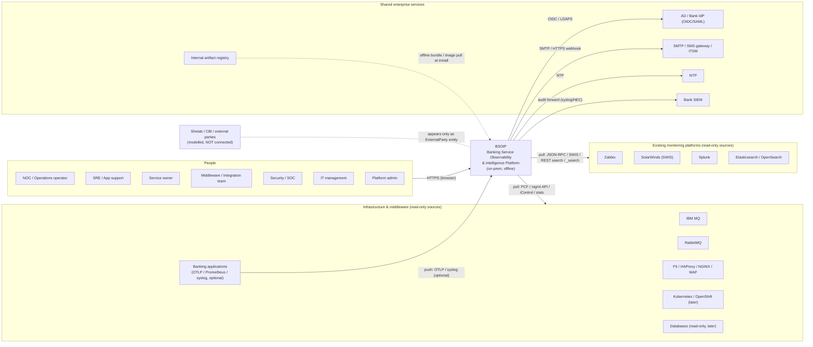
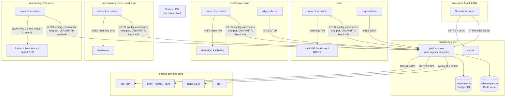

# زمینهٔ سیستم (System Context – C4 Level 1)

| فیلد | مقدار |
|---|---|
| Document ID | `ARC-CTX-001` |
| Version | `0.1` |
| Status | `Draft – Phase 0 – awaiting approval` |
| Date | `2026-10-11` (۱۴۰۵/۰۷/۱۹) |
| Owner | `Architecture` |
| Related documents | [container-architecture.md](container-architecture.md)، [data-architecture.md](data-architecture.md)، [ADR-0002](architecture-decision-records/ADR-0002-modular-monolith-with-edge-collectors.md)، [ADR-0004](architecture-decision-records/ADR-0004-collector-and-connector-architecture.md)، [ADR-0009](architecture-decision-records/ADR-0009-no-own-raw-log-store-federate-existing.md)، [ADR-0015](architecture-decision-records/ADR-0015-authentication-authorization-audit.md)، [ADR-0017](architecture-decision-records/ADR-0017-ha-dr-architecture.md)، [ADR-0018](architecture-decision-records/ADR-0018-data-retention-privacy-capacity-controls.md)، [ADR-0020](architecture-decision-records/ADR-0020-existing-platform-integration-read-only-pull.md)، [functional-requirements.md](../requirements/functional-requirements.md)، [non-functional-requirements.md](../requirements/non-functional-requirements.md)، [open-questions.md](../requirements/open-questions.md) |

> **قرارداد برچسب‌گذاری:** [واقعیت] = واقعیت تأییدشده (فقط F-01..F-03 و نتایج مستقیم آن‌ها)؛ [فرض A-xx] = فرض موقت؛ [فرضیه] = فرضیهٔ نیازمند آزمایش (EXP/BM)؛ [توصیه] = پیشنهاد معماری؛ [باز Q-xx] = وابسته به پرسش باز.

## ۱. هدف سند

این سند مرز سامانهٔ **Banking Service Observability & Intelligence Platform (BSOIP)** را نسبت به کاربران و سامانه‌های پیرامونی مشخص می‌کند: چه کسانی از آن استفاده می‌کنند، با کدام سامانه‌ها و در کدام جهت ارتباط دارد، چه داده‌ای از مرز عبور می‌کند، و چه کارهایی **به‌صراحت** در محدودهٔ آن نیست. جزئیات درونی سامانه در [container-architecture.md](container-architecture.md) و مدل داده در [data-architecture.md](data-architecture.md) آمده است.

اصول حاکم بر مرز سامانه:

- [واقعیت] سامانه کاملاً on-premises، در دیتاسنتر بانک و بدون دسترسی مستقیم به اینترنت است (F-02).
- [واقعیت] نقطهٔ شروع، استفاده از SolarWinds، Zabbix، Splunk و Elasticsearch موجود است؛ instrumentation مستقیم برنامه‌ها به فازهای بعد و بر اساس نیاز واقعی موکول شده است (F-02).
- [توصیه] ابزارهای موجود **منبع شواهد** هستند، نه محصول. BSOIP جایگزین آن‌ها نمی‌شود و آن‌ها را بازپیکربندی نمی‌کند ([ADR-0020](architecture-decision-records/ADR-0020-existing-platform-integration-read-only-pull.md)، NFR-IMP-002).
- [توصیه] همهٔ اتصال‌ها به سامانه‌های منبع فقط از `connector-runtime` یا `edge-collector` مستقر در همان zone آغاز می‌شود و جهت ارتباط بین zoneها همواره «از zone منبع به سمت `monitoring-zone`» است (NFR-SEC-010).

## ۲. نمودار زمینه (C4 Level 1)

نمودار زیر BSOIP را به‌صورت یک جعبهٔ واحد و سامانه‌های پیرامونی را با جهت آغاز ارتباط نشان می‌دهد. پیکان از سمت آغازکنندهٔ اتصال رسم شده است، نه جهت جریان داده.

*توضیح:* خط‌چین‌ها ارتباط غیرزمان‌اجرا (نصب) یا صرفاً مدل‌سازی هستند. ارتباط با `Shetab` و طرف‌های بیرونی فقط در قالب موجودیت `ExternalParty` در کاتالوگ است و هیچ اتصال شبکه‌ای به آن‌ها برقرار نمی‌شود.

## ۳. بازیگران و پرسوناها

| پرسونا | نیاز اصلی | تعامل نمونه با BSOIP | سطح دسترسی پیش‌فرض (RBAC) |
|---|---|---|---|
| NOC / Operations operator | تشخیص سریع اینکه کدام **سرویس بانکی** آسیب دیده و کجا را باید نگاه کرد | داشبورد سلامت سرویس‌ها، فهرست Incident، پنل شواهد، پیوند عمیق به Zabbix/Splunk/ES | خواندن همهٔ سرویس‌ها در محیط‌های مجاز؛ ثبت بازخورد اپراتور |
| SRE / Application support | تحلیل علت محتمل، مقایسهٔ hopها، شواهد لاگ | drill-down به نمودار تراکنش، federated evidence query (فاز ۴) | خواندن + اجرای evidence query در محدودهٔ گروه سرویس |
| Service owner | وضعیت SLO و error budget سرویس خودش، تعریف TransactionType | ویرایش کاتالوگ و نگاشت outcome برای سرویس‌های خود | نوشتن در scope سرویس‌های مالک |
| Middleware / Integration team | backlog صف‌ها، کانال‌ها، ESB | نمای MQ/RabbitMQ، طبقه‌بندی backlog | خواندن + ویرایش ExternalRef میان‌افزار |
| Security / SOC | مصرف audit و اطمینان از نبود نشت داده | دریافت audit در SIEM؛ گزارش redaction | فقط خواندن audit؛ بدون دسترسی به داده‌های عملیاتی مگر با مجوز |
| IT management | گزارش سطح سرویس | گزارش‌های SLO و دسترس‌پذیری دوره‌ای | خواندن گزارش‌ها |
| Platform admin | نصب، پیکربندی connectorها، کاربران، تقویم | تنظیم ConnectorInstance، تقویم کاری، پنجره‌های نگهداری | مدیریتی؛ با جداسازی وظایف از مدیریت secretها [توصیه] |

[باز Q-04] شکل نهایی احراز هویت (AD مستقیم، ADFS یا IdP مبتنی بر OIDC/SAML) و MFA تعیین نشده است. [باز Q-19] تیم بهره‌بردار پلتفرم و پوشش ۲۴×۷ مشخص نیست.

## ۴. سامانه‌های بیرونی

| سامانه | نقش برای BSOIP | فاز ورود | وضعیت شناخت |
|---|---|---|---|
| Zabbix | منبع متریک میزبان، شبکه، و در صورت وجود LB/MQ؛ problemها به‌عنوان Event | P2 (VS-1) | API JSON-RPC — «نیازمند تأیید در نسخهٔ نصب‌شدهٔ بانک» [باز Q-08] |
| SolarWinds | منبع متریک شبکه/گره و هشدار از طریق SWIS/SWQL | P2 (Should) | «نیازمند تأیید در نسخهٔ نصب‌شدهٔ بانک» [باز Q-08] |
| Splunk | منبع لاگ برای استخراج متریک مشتق از لاگ و خلاصهٔ تراکنش؛ evidence query | P2/P3 (VS-1) | REST search API — «نیازمند تأیید در نسخهٔ نصب‌شدهٔ بانک»؛ سهمیهٔ جستجو [باز Q-22] |
| Elasticsearch / OpenSearch | همانند Splunk از طریق `_search` و aggregationها | P2/P3 (VS-1) | «نیازمند تأیید در نسخهٔ نصب‌شدهٔ بانک» [باز Q-08، Q-22] |
| IBM MQ | عمق صف، نرخ enqueue/dequeue، سن قدیمی‌ترین پیام، وضعیت کانال | P2 (VS-1) | دسترسی PCF فقط‌خواندنی — مجوزهای حداقلی با EXP-04 آزموده می‌شود |
| RabbitMQ | متریک صف و consumer از management API یا Prometheus plugin | P2 (Should) | «نیازمند تأیید در نسخهٔ نصب‌شدهٔ بانک» |
| F5 / HAProxy / NGINX / WAF | آمار virtual server، pool، member، کد وضعیت، گواهی TLS، شمار block در WAF | P2 (LB)، P4 (WAF) | از هر منبعی که در دسترس است (Zabbix/SolarWinds/iControl REST/stats page)؛ capability به‌ازای هر نصب اعلام و تأیید می‌شود |
| Kubernetes / OpenShift | متریک و رویداد pod/node برای سرویس‌های کانتینری | P4 (Could) | [باز Q-02] |
| پایگاه‌های داده | سلامت DB (ابتدا SQL Server) با حساب فقط‌خواندنی | P4 | [باز Q-08] |
| Banking applications | منبع اختیاری OTLP/Prometheus/syslog در صورت وجود؛ instrumentation مستقیم فقط فاز ۷ | P2 (اختیاری)، P7 | [فرض A-05] لاگ‌ها اکنون در Splunk/ES هستند |
| AD / Bank IdP | احراز هویت کاربران (OIDC/SAML یا Keycloak با federation به AD) | P1 | [فرض A-07]، [باز Q-04] |
| SMTP / SMS gateway / ITSM | ارسال اعلان و ایجاد ticket | P4 | [باز Q-14] |
| NTP | همگام‌سازی زمان همهٔ گره‌های پلتفرم | P1 | [فرض A-08]، [باز Q-17] |
| Internal artifact registry | منبع image و بستهٔ نصب آفلاین | P1 | [باز Q-09]؛ [ADR-0016](architecture-decision-records/ADR-0016-offline-deployment-and-artifacts.md) |
| Bank SIEM | گیرندهٔ رکوردهای audit پلتفرم | P1 (طراحی)، P2 (اتصال) | [باز Q-10] |
| Shetab / CBI / external parties | فقط موجودیت `ExternalParty` در توپولوژی؛ وضعیت آن‌ها از روی شواهد سمت بانک (مثلاً کانال MQ یا لاگ سوئیچ) استنتاج می‌شود | — | **پایش‌شده ولی متصل‌نشده**؛ هیچ اتصالی برقرار نمی‌شود |

## ۵. ناحیه‌های شبکه و مرزهای اعتماد

[واقعیت] نام zoneها در اینجا نمونه هستند و نام‌گذاری واقعی بانک‌محور است (spine §3). [توصیه] الگوی استقرار: در هر zone منبع، یک «گره جمع‌آوری» شامل `connector-runtime` و `edge-collector` مستقر می‌شود؛ هستهٔ پلتفرم، پایگاه‌های داده و UI در `monitoring-zone` قرار دارند.

*توضیح:* همهٔ پیکان‌های بین‌zone از zone منبع به سمت `monitoring-zone` یا از `monitoring-zone` به سرویس‌های مشترک است. هیچ پیکانی از `platform-core` به داخل zoneهای منبع وجود ندارد؛ evidence queryها از طریق صف فرمان pull-based (long-poll روی `/internal/v1/commands`) به `connector-runtime` می‌رسند.

### ۵.۱ مرزهای اعتماد

| مرز | دو سوی مرز | کنترل‌های لازم [توصیه] |
|---|---|---|
| TB-1 کاربر ↔ پلتفرم | مرورگر کاربر / `web-ui` و `platform-core(api)` | TLS 1.2+ (ترجیحاً 1.3)، OIDC bearer token، RBAC deny-by-default، audit همهٔ عملیات نوشتنی و evidence query (NFR-SEC-001، 005، 006) |
| TB-2 zone منبع ↔ `monitoring-zone` | `connector-runtime`/`edge-collector` و `platform-core(ingest)` | mTLS با گواهی به‌ازای هر نود، allowlist فایروال یک‌طرفه، redaction در لبه پیش از عبور از مرز (NFR-PRV-002) |
| TB-3 جمع‌آورنده ↔ سامانهٔ منبع | `connector-runtime` و Zabbix/Splunk/MQ/... | حساب‌های اختصاصی فقط‌خواندنی، query budget و rate limit، secretها فقط از SecretProvider (NFR-SEC-003، 004؛ NFR-IMP-001) |
| TB-4 پلتفرم ↔ سرویس‌های مشترک | `platform-core` و IdP، SMTP، ITSM، SIEM | TLS، حساب سرویس اختصاصی، محتوای اعلان بدون داده‌های حساس |
| TB-5 بانک ↔ طرف‌های بیرونی | Shetab/CBI | خارج از محدوده؛ پلتفرم از این مرز عبور نمی‌کند |

[توصیه] به‌دلیل تمرکز اعتبارنامه‌ها در پلتفرم (R-06)، اعتبارنامهٔ هر منبع فقط در `connector-runtime` همان zone رمزگشایی می‌شود و `platform-core` در حالت عادی secret منابع را در حافظه نگه نمی‌دارد. [باز Q-09] وجود vault/HSM بانک تعیین‌کنندهٔ پیاده‌سازی SecretProvider است.

## ۶. جدول مسئولیت‌های یکپارچه‌سازی

ستون «Read-only؟» یعنی آیا BSOIP هیچ تغییری در سامانهٔ مقابل ایجاد می‌کند یا نه. نام API و پروتکل‌ها بر اساس مستندات عمومی است و «نیازمند تأیید در نسخهٔ نصب‌شدهٔ بانک» است [باز Q-08].

| سامانه | آغازکننده | پروتکل | جهت داده | اعتبارنامه | ردهٔ داده | Read-only؟ |
|---|---|---|---|---|---|---|
| Zabbix | `connector-runtime` | HTTPS JSON-RPC (`host.get`، `item.get`، `history.get`، `trend.get`، `problem.get` – نیازمند تأیید) | منبع → BSOIP | API token کاربر فقط‌خواندنی با دسترسی به host groupهای لازم | متریک، Event، موجودی hostها | بله |
| SolarWinds | `connector-runtime` | HTTPS SWIS REST / SWQL | منبع → BSOIP | حساب فقط‌خواندنی Orion | متریک، وضعیت گره/رابط، alert | بله |
| Splunk | `connector-runtime` | HTTPS REST search jobs | منبع → BSOIP (نتایج aggregation) | token با role محدود به indexهای مجاز و سهمیهٔ جستجو | متریک مشتق از لاگ، خلاصهٔ تراکنش، evidence (پس از redaction) | بله |
| Elasticsearch / OpenSearch | `connector-runtime` | HTTPS `_search` / aggregations | منبع → BSOIP | API key/کاربر با privilege `read` روی index patternهای مجاز | همانند Splunk | بله |
| IBM MQ | `connector-runtime` | MQ client + PCF inquire | منبع → BSOIP | کاربر MQ با مجوزهای inquire/display حداقلی (EXP-04) | عمق صف، نرخ‌ها، سن پیام، وضعیت کانال؛ **بدون خواندن محتوای پیام** | بله |
| RabbitMQ | `connector-runtime` یا `edge-collector` (Prometheus scrape) | HTTPS management API / Prometheus | منبع → BSOIP | کاربر با tag `monitoring` (نیازمند تأیید) | متریک صف، consumer، node | بله |
| F5 | `connector-runtime` | HTTPS iControl REST (یا از طریق Zabbix/SolarWinds) | منبع → BSOIP | حساب با نقش guest/auditor (نیازمند تأیید) | آمار virtual/pool/member، گواهی | بله |
| HAProxy / NGINX | `connector-runtime` یا `edge-collector` | stats endpoint / Prometheus / syslog | منبع → BSOIP | بسته به endpoint | آمار درخواست، کد وضعیت، سلامت backend | بله |
| WAF | `edge-collector` (syslog) یا `connector-runtime` | syslog / API | منبع → BSOIP | بسته به محصول | شمار block/challenge (P4) | بله |
| Kubernetes | `connector-runtime` / `edge-collector` | K8s API (list/watch)، Prometheus | منبع → BSOIP | ServiceAccount با ClusterRole فقط‌خواندنی | متریک و Event | بله (P4) |
| Databases | `connector-runtime` | JDBC/TLS | منبع → BSOIP | کاربر با مجوز DMV/view فقط‌خواندنی | متریک سلامت DB؛ **بدون جداول کسب‌وکار** | بله (P4) |
| Banking applications | برنامه یا agent آن | OTLP/gRPC یا HTTP، syslog | برنامه → `edge-collector` | mTLS (در صورت امکان) | متریک، لاگ مشتق‌شده، trace (P7) | بله (BSOIP فقط دریافت می‌کند) |
| Inbound webhooks (اختیاری) | سامانهٔ منبع | HTTPS POST | منبع → `edge-collector`/ingest | shared secret یا mTLS | Event | بله؛ فقط اگر بانک پیکربندی کند (FR-INT-005) |
| AD / IdP | `platform-core(api)` | OIDC/SAML؛ LDAPS برای group sync | دوطرفه (درخواست/پاسخ) | client credentials / bind account فقط‌خواندنی | هویت و گروه کاربر | بله |
| SMTP / SMS / ITSM | `platform-core` (ماژول `notification`) | SMTP-TLS، HTTPS webhook/API | BSOIP → مقصد | حساب سرویس | خلاصهٔ Incident بدون PII | نوشتن فقط در صندوق/ticket مقصد |
| NTP | همهٔ گره‌ها | NTP | مقصد → گره | — | زمان | — |
| Internal artifact registry | اپراتور نصب / container runtime | HTTPS (OCI) یا انتقال فایل آفلاین | registry → گره | حساب pull | image و بسته | بله |
| Bank SIEM | `platform-core` (ماژول `audit`) | syslog over TLS یا Splunk HEC (نیازمند تأیید) | BSOIP → SIEM | token/گواهی | رکورد audit | نوشتن فقط در SIEM |
| Shetab / CBI | — | — | — | — | — | اتصال وجود ندارد |

## ۷. آنچه پلتفرم به‌صراحت انجام نمی‌دهد

- [واقعیت] جایگزینی Zabbix، SolarWinds، Splunk یا Elasticsearch نیست (F-02، spine §2).
- [توصیه] لاگ خام را ذخیره نمی‌کند؛ فقط متریک و رویداد مشتق‌شده را نگه می‌دارد ([ADR-0009](architecture-decision-records/ADR-0009-no-own-raw-log-store-federate-existing.md)).
- پیکربندی تجهیزات یا ابزارهای موجود را تغییر نمی‌دهد و پیکربندی جدیدی روی آن‌ها لازم ندارد (NFR-IMP-002)؛ وب‌هوک ورودی فقط در صورت تصمیم بانک.
- اصلاح خودکار (automated remediation) انجام نمی‌دهد؛ restart، failover یا تغییر مسیر اجرا نمی‌کند.
- SIEM نیست و تشخیص تهدید امنیتی انجام نمی‌دهد؛ فقط audit خود را به SIEM می‌فرستد.
- به Shetab، بانک مرکزی یا هیچ طرف بیرونی متصل نمی‌شود.
- PAN، CVV، PIN، PIN block، track data، گذرواژه، OTP، token/secret یا payload کامل را ذخیره نمی‌کند ([ADR-0018](architecture-decision-records/ADR-0018-data-retention-privacy-capacity-controls.md)).
- محتوای پیام‌های صف را نمی‌خواند.
- علیت را ادعا نمی‌کند؛ فقط فرضیهٔ علت محتمل با شواهد، اطمینان و عدم‌قطعیت ارائه می‌دهد (FR-COR-004).
- تراکنش مصنوعی مالی اجرا نمی‌کند؛ synthetic check فقط روی APIهای غیرمالی مجاز (FR-DX-001، FR-DX-003).
- در فازهای اولیه agent یا APM توسعه نمی‌دهد و RUM پیش از فاز ۷ ندارد.
- مدیریت پیکربندی تجهیزات شبکه و SaaS چندمستأجری در محدوده نیست.
- [توصیه] برای عملکرد خود به Elasticsearch یا Splunk بانک وابسته نیست؛ در نبود آن‌ها شواهد مربوط `UNKNOWN` می‌شود ولی پلتفرم کار می‌کند (ADR-0017، R-15).

## ۸. پیامدها برای فازها

| فاز | یکپارچه‌سازی‌های فعال |
|---|---|
| P1 | AD/IdP، NTP، registry آفلاین، طراحی ارسال audit به SIEM |
| P2 | Zabbix، Elasticsearch، Splunk، SolarWinds (Should)، IBM MQ، RabbitMQ، LB از هر منبع موجود، OTLP/Prometheus از طریق `edge-collector` |
| P3 | استخراج خلاصهٔ تراکنش از Splunk/ES (VS-1) |
| P4 | ITSM/SMTP/SMS، webhookها، WAF، K8s، DB، JMX، federated evidence query |
| P7 | instrumentation مستقیم و trace (در صورت نیاز اثبات‌شده) |

## ۹. نکته برای بازبینی

- «نکته برای بازبینی»: نام فایل‌های اسناد requirements (`functional-requirements.md`، `non-functional-requirements.md`، `open-questions.md`) در spine تثبیت نشده است؛ پیوندها باید پس از ادغام بسته بررسی شوند.
- «نکته برای بازبینی»: spine روش ارسال audit به SIEM را «forward to bank SIEM/Splunk» گفته است؛ پروتکل (syslog-TLS در برابر HEC) به ابزار SIEM بانک بستگی دارد و در [باز Q-10] و [باز Q-09] پیگیری شود.
- «نکته برای بازبینی»: zone `monitoring-tools-zone` در نمودار نمونه است و ممکن است Zabbix/Splunk/ES در همان `monitoring-zone` باشند؛ در آن صورت `connector-runtime` مربوط در `monitoring-zone` مستقر می‌شود.
