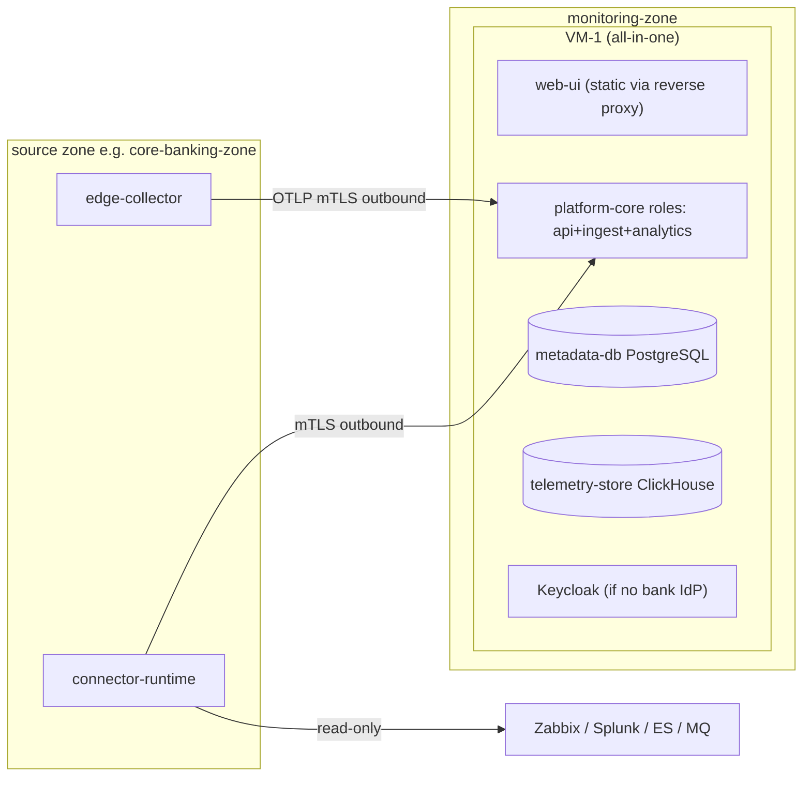
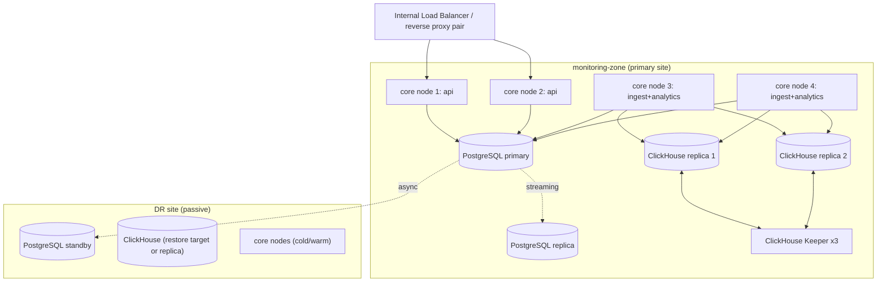
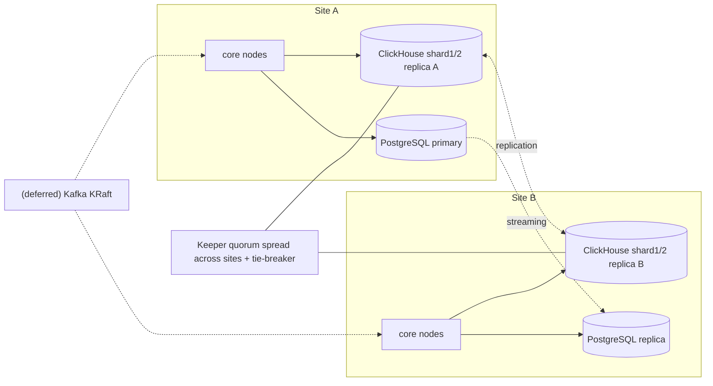

# استقرار و Runbookها — BSOIP

| فیلد | مقدار |
|---|---|
| Document ID | `OPS-001` |
| Version | `0.1` |
| Status | `Draft – Phase 0 – awaiting approval` |
| Date | `2026-10-11` (۱۴۰۵/۰۷/۱۹) |
| Owner | `Architecture` |
| Related documents | [master-plan.md](../roadmap/master-plan.md)، [container-architecture.md](../architecture/container-architecture.md)، [capacity-planning.md](../architecture/capacity-planning.md)، [quality-and-validation-strategy.md](../testing/quality-and-validation-strategy.md)، [open-questions-and-assumptions.md](../architecture/open-questions-and-assumptions.md)، [ADR-0016](../architecture/architecture-decision-records/ADR-0016-offline-deployment-and-artifacts.md)، [ADR-0017](../architecture/architecture-decision-records/ADR-0017-ha-dr-architecture.md)، [ADR-0010](../architecture/architecture-decision-records/ADR-0010-buffering-without-kafka-initially.md)، [ADR-0018](../architecture/architecture-decision-records/ADR-0018-data-retention-privacy-capacity-controls.md) |

> این سند مدل‌ها و رویه‌ها را **توصیف** می‌کند؛ هیچ اسکریپت، فایل Compose، Helm chart یا پیکربندی واقعی در فاز ۰ نوشته نمی‌شود [واقعیت] (F-02).

## ۱. اصول استقرار

1. [واقعیت] on-premises، مرکز داده بانک، بدون Internet مستقیم (F-02).
2. [فرض A-02] VMهای لینوکس سازگار با RHEL؛ Kubernetes برای خود پلتفرم فرض نمی‌شود.
3. [توصیه] **ابتدا containerهای OCI روی VM** (Podman یا Docker Compose)؛ Helm chart فقط اگر بانک Kubernetes/OpenShift داخلی برای این پلتفرم فراهم کند. ADR-0016 تا پاسخ [باز Q-02] و [باز Q-03] Blocked است.
4. پلتفرم نباید در همان دامنه خرابی سیستم‌های تحت پایش باشد (NFR-AVL-002، ADR-0017): مثلاً به Elasticsearch بانک برای کارکرد خود وابسته نیست.
5. همه اتصالات از zoneهای منبع **outbound** به `monitoring-zone` است (NFR-SEC-010).

## ۲. مدل‌های استقرار

سناریوهای ظرفیت Low/Medium/High همگی فرض‌اند [فرض A-11] و با [باز Q-06] و BM-01..03 جایگزین می‌شوند. اندازه نودها در این سند عمداً عددی نیست؛ پس از BM-01/BM-02 تعیین می‌شود [باز Q-18].

### ۲.۱ تک‌نود — Low (UAT، pilot، VS-1)

*توضیح:* همه اجزای مرکزی روی یک VM؛ مناسب UAT و VS-1. بدون HA؛ بکاپ اجباری. در zoneهای منبع، `connector-runtime` و `edge-collector` می‌توانند روی یک VM مشترک باشند.

### ۲.۲ چندنود — Medium (تولید یک سایت + DR)

*توضیح:* نودهای `platform-core` بدون حالت و در سایت active-active؛ roleها با پیکربندی جدا می‌شوند. Patroni برای PostgreSQL در فاز ۶. ClickHouse با ReplicatedMergeTree و Keeper سه‌نودی. مدل DR (warm standby یا restore از backup) به [باز Q-05] بستگی دارد. `analytics` باید یک leader فعال برای هر بخش کار داشته باشد (قفل/lease در PostgreSQL) تا ارزیابی تکراری نشود [توصیه].

### ۲.۳ HA چندسایتی — High

- دو سایت فعال + DR [فرض]؛ مسیر رشد بدون بازمعماری (NFR-SCL-003): ClickHouse shard + replica، افزایش نودهای `ingest`/`analytics`، و **Kafka (KRaft) فقط اگر triggerهای ADR-0010 فعال شوند** (> ~50k events/s پایدار، نیاز replay چندمصرف‌کننده، fan-in چندسایتی، یا تحمل قطعی ingest بیش از بافر collector ≥ 4 h).
- [باز Q-05] آیا metadata باید active-active بین سایت‌ها باشد؟ پیش‌فرض: خیر — یک primary PostgreSQL، سایت دوم read replica.

*توضیح:* quorum Keeper بین دو سایت نیازمند نود سوم در محل سوم یا پذیرش ریسک است [باز Q-05].

### ۲.۴ zoneها و اجزای edge

| جزء | در هر zone منبع | منابع لازم | ملاحظات |
|---|---|---|---|
| `connector-runtime` | ۱ (یا ۲ برای HA در فاز ۶، با تقسیم کار یا lease) | CPU/RAM متوسط، دیسک کم | credentialها فقط اینجا؛ فقط outbound |
| `edge-collector` | ۱ یا بیشتر | دیسک برای صف ≥ 4 h در حجم Medium per-zone (NFR-REL-003) | redaction processor فعال |

قواعد فایروال لازم (به‌ازای هر zone): zone → monitoring-zone روی پورت‌های ingest/API داخلی (mTLS)؛ zone-local → منابع روی پورت‌های API منبع. **هیچ** قاعده‌ای از monitoring-zone به zone لازم نیست.

## ۳. ارتقای مدل استقرار: VM → Helm

| مرحله | زمان | شرط |
|---|---|---|
| Compose/Podman روی VM | فاز ۱ تا ۶ | پیش‌فرض |
| systemd units برای Podman (quadlet یا معادل) | فاز ۶ | سیاست OS بانک [باز Q-03] |
| Helm chart | پس از تصمیم ADR-0016 | Kubernetes/OpenShift داخلی تأییدشده [باز Q-02] |

ساختار image و پیکربندی از ابتدا مستقل از ارکستراتور طراحی می‌شود (env/فایل پیکربندی، health endpointهای readiness/liveness، بدون وابستگی به میزبان).

## ۴. مدیریت پیکربندی

- **Config as code** (NFR-DEP-004): مخزن پیکربندی جدا (`deploy-config`) با شاخه/پوشه per environment (PROD، DR، UAT، TEST).
- لایه‌ها: پیش‌فرض‌های artifact ← پیکربندی مشترک ← override محیط ← override نود. هر تغییر از طریق review و ثبت در audit عملیاتی.
- **داده پیکربندی domain** (کاتالوگ، تقویم، OutcomeMapping، قواعد سلامت) از مسیر API/import پلتفرم با audit مدیریت می‌شود و می‌تواند به‌صورت YAML در Git نگهداری و با `dry-run` اعمال شود (US-03-04).
- **ترفیع (promotion):** TEST → UAT → PROD با همان artifact امضاشده؛ فقط پیکربندی تفاوت دارد.
- **Secretها** (NFR-SEC-004):
  - هرگز در مخزن پیکربندی یا لاگ‌ها.
  - `SecretProvider`: پیاده‌سازی پیش‌فرض فایل رمز‌شده روی دیسک محلی با کلید از مسیر جدا؛ در صورت وجود vault/HSM بانک [باز Q-09] adapter مربوط.
  - دسته‌ها: credentialهای منابع (فقط در `connector-runtime` همان zone)، کلیدهای HMAC per environment (با key id و چرخش)، گواهی‌های mTLS، credential پایگاه داده، client secret OIDC.
  - چرخش: credential منبع و گواهی‌ها با دوره توافقی؛ کلید HMAC با دوره هم‌پوشانی (توکن‌های قدیمی تا پایان retention با key id قدیم قابل تفسیرند) — جزئیات در ADR-0018.
- **گواهی‌ها:** PKI داخلی بانک یا CA داخلی پلتفرم [باز Q-09]؛ هشدار انقضا از self-monitoring.

## ۵. نصب آفلاین

### ۵.۱ محتوای bundle

| بخش | محتوا |
|---|---|
| `images/` | OCI images: `platform-core`، `web-ui` (یا static در reverse proxy)، `connector-runtime`، `edge-collector` (توزیع OCB)، PostgreSQL، ClickHouse، ClickHouse Keeper، Keycloak (اختیاری)، reverse proxy |
| `sbom/` | SBOM CycloneDX هر image و artifact |
| `signatures/` | امضای هر image و manifest (ابزار امضا در ADR-0016) |
| `checksums` | SHA-256 همه فایل‌ها، خود فایل امضاشده |
| `manifest` | نسخه bundle، نسخه هر جزء، نسخه schemaها، حداقل نسخه قابل ارتقا (N-1)، ماتریس سازگاری کانکتور ↔ core |
| `install/` | اسکریپت‌های preflight، install، verify، upgrade، rollback، backup (فقط توصیف در این سند) |
| `config-templates/` | قالب پیکربندی هر محیط بدون secret |
| `docs/` | راهنمای نصب، release notes، runbookها |
| `migrations/` | migrationهای PostgreSQL و ClickHouse نسخه‌دار (درون artifact) |

### ۵.۲ registry داخلی

- [توصیه] imageها در registry داخلی بانک (Harbor/Nexus/Artifactory، [باز Q-09]) بارگذاری شوند؛ در نبود registry، load مستقیم از tarball روی هر VM.
- سیاست registry: فقط imageهای امضاشده؛ اسکن هنگام ورود.

### ۵.۳ مراحل نصب (توصیفی)

1. **انتقال** bundle از مسیر انتقال تأییدشده بانک (رسانه/انتقال فایل امن).
2. **Verify:** بررسی امضای `checksums` با کلید عمومی منتشرشده جداگانه → بررسی SHA-256 همه فایل‌ها → بررسی امضای imageها → اسکن آسیب‌پذیری با پایگاه داده آفلاین (اختیاری، طبق سیاست امنیت).
3. **Preflight:** نسخه OS، کرنل، SELinux، فضای دیسک و نوع دیسک، پورت‌ها، DNS، همگامی NTP (آستانه skew)، گواهی‌ها، دسترسی به IdP، اتصال‌پذیری zoneها.
4. **Load images** به registry یا runtime محلی.
5. **پیکربندی** از مخزن `deploy-config` + secretها از SecretProvider.
6. **پایگاه داده‌ها:** راه‌اندازی، migrations، ایجاد کاربران با حداقل دسترسی (کاربر برنامه بدون UPDATE/DELETE روی audit).
7. **راه‌اندازی** نودهای core، سپس `connector-runtime`/`edge-collector` در zoneها.
8. **Smoke test:** ورود، health endpoint، دریافت داده نمونه از کانکتور file import، صفحه self-health سبز.
9. **ثبت** نسخه نصب‌شده و نتایج verify در audit عملیاتی.

هدف: ≤ 1 روز روی VMهای آماده (NFR-DEP-002).

## ۶. پشتیبان‌گیری و بازیابی

| داده | روش [توصیه] | دوره | نگهداری | آزمون بازیابی |
|---|---|---|---|---|
| PostgreSQL (`metadata-db`) | base backup + WAL archiving (PITR) | پیوسته + روزانه | [باز Q-16] | ماهانه |
| ClickHouse (`telemetry-store`) | `BACKUP` به مقصد دیسک/شیء داخلی؛ جداول rollup اولویت بالاتر از raw | روزانه (افزایشی) | [باز Q-16] | فصلی؛ raw قابل بازسازی نیست → شکاف علامت‌گذاری |
| پیکربندی | مخزن Git `deploy-config` + پشتیبان مخزن | پیوسته | دائم | با هر نصب |
| کلیدها و secretها | پشتیبان رمز‌شده جدا با کنترل دوگانه؛ کلیدهای HMAC با key id | با هر چرخش | تا پایان retention داده وابسته | سالانه |
| داده domain (کاتالوگ، تقویم) | export YAML دوره‌ای علاوه بر backup پایگاه داده | روزانه | — | با هر انتشار |

- RPO metadata ≤ 15 min و RTO ≤ 4 h (NFR-AVL-003، موقت تا [باز Q-05]).
- backupها رمزنگاری‌شده (NFR-SEC-002) و خارج از دامنه خرابی سیستم اصلی.
- **ترتیب بازیابی:** secretها/کلیدها → PostgreSQL (PITR) → ClickHouse → core → connectors. پس از بازیابی، بازه بدون داده در UI به‌صورت شکاف نمایش داده می‌شود (NFR-REL-002).

## ۷. ارتقا و بازگشت (Upgrade & Rollback)

### ۷.۱ قواعد migration schema

- **PostgreSQL:** ابزار migration نسخه‌دار (انتخاب در T-01-01)؛ الگوی **expand → migrate → contract**: نسخه N فقط افزودنی (ستون nullable، جدول جدید)؛ حذف/تغییر نام تنها در N+1 پس از اطمینان از عدم استفاده. migrationهای مخرب در یک انتشار ممنوع.
- **ClickHouse:** افزودن ستون با default؛ تغییر ORDER BY/partition با ایجاد جدول جدید و انتقال پس‌زمینه؛ materialized viewها نسخه‌دار.
- هر migration آزمون upgrade از N-1 در CI دارد (quality strategy §۵).

### ۷.۲ پنجره سازگاری

- `platform-core` نسخه N با `connector-runtime`/`edge-collector` نسخه N-1 سازگار است (ارتقای zoneها می‌تواند با تأخیر انجام شود).
- API داخلی و schema رویدادها طبق ADR-0005 (semver)؛ حذف فیلد فقط در major و پس از یک دوره deprecation.
- UI و API هم‌نسخه منتشر می‌شوند.

### ۷.۳ رویه ارتقا

1. خواندن release notes و ماتریس سازگاری؛ تأیید کمیته تغییر بانک.
2. backup کامل + snapshot VM (در صورت امکان).
3. verify bundle (§۵.۳).
4. ارتقای core نود به نود (rolling) در Medium/High؛ توقف کوتاه در Low.
5. اجرای migrationهای expand.
6. smoke test و بررسی self-health؛ مقایسه lag ingestion.
7. ارتقای `connector-runtime`/`edge-collector` در هر zone.
8. پس از دوره پایداری، migrationهای contract در انتشار بعد.

### ۷.۴ Rollback

- چون migrationهای نسخه N فقط expand هستند، **rollback = بازگرداندن imageهای N-1** بدون بازگرداندن schema (NFR-DEP-003: در پنجره نگهداری).
- اگر migration غیرقابل‌بازگشت لازم باشد، در release notes علامت‌گذاری و rollback از طریق PITR برنامه‌ریزی می‌شود (با پذیرش شکاف داده).
- drill rollback در فاز ۶ اجباری است.

## ۸. Self-monitoring پلتفرم

(NFR-OBS-001, 002؛ EP-21)

| سیگنال | منبع | هشدار نمونه [فرض: آستانه‌ها پس از BM تنظیم شوند] |
|---|---|---|
| ingest lag (`ingested_at - observed_at`) per source | `ingestion` | p95 > poll interval + 60 s (NFR-PRF-002) |
| lag و خطای کانکتور، مصرف budget | `connector-runtime` | آخرین poll موفق قدیمی‌تر از ۳ دوره |
| صف دیسکی collector (درصد پر بودن، سن قدیمی‌ترین آیتم) | `edge-collector` | > 50% یا سن > 1 h |
| خطای نوشتن، parts، merges، فضای دیسک ClickHouse | ClickHouse | دیسک > 75% |
| replication lag PostgreSQL/ClickHouse | DB | > RPO/2 |
| مدت چرخه ارزیابی analytics | `analytics` | > 60 s (NFR-PRF-004) |
| redaction hits per source | `ingestion` | جهش ناگهانی (نشانه تغییر قالب لاگ منبع) |
| انقضای گواهی‌ها | همه | < 30 روز |
| clock skew تخمینی per source | `ingestion` | > تحمل همبستگی |
| در دسترس بودن IdP | `iam` | خطای پیاپی |

- self-telemetry با OTel از خود اجزا به `ingestion` + **مسیر هشدار مستقل** (مثلاً health check خارجی ساده یا ثبت در Zabbix بانک) تا قطعی ingest خودش دیده شود [توصیه]. این وابستگی یک‌طرفه است و کارکرد پلتفرم به Zabbix وابسته نیست.
- Grafana OSS فقط اختیاری برای داشبورد داخلی پلتفرم، مشروط به [باز Q-21] (ADR-0014).

## ۹. Runbookها

قالب هر runbook: علائم → تشخیص → اقدام → تأیید → پیگیری. فرمان‌های دقیق در فاز پیاده‌سازی افزوده می‌شوند.

### RB-01 — کانکتور منبع ناموفق است

- **علائم:** وضعیت ConnectorInstance قرمز؛ اجزای وابسته `UNKNOWN`؛ هشدار lag.
- **تشخیص:** صفحه diagnostics کانکتور: نوع خطا (اتصال، TLS، 401/403، 429، timeout، تغییر schema)؛ زمان آخرین موفقیت؛ تغییرات اخیر منبع (ارتقای نسخه؟ R-12)؛ تست اتصال از VM کانکتور.
- **اقدام:**
  - 401/403 → بررسی انقضا/قفل حساب read-only با مالک منبع؛ چرخش credential از SecretProvider.
  - 429/کندی → کاهش نرخ؛ بررسی budget با مدیر منبع (R-03).
  - خطای schema/پاسخ غیرمنتظره → غیرفعال کردن capability مربوط؛ ضبط نمونه پاسخ redact‌شده برای fixture؛ issue برای تیم integration.
  - منبع واقعاً پایین است → هیچ اقدامی روی پلتفرم؛ اطلاع به مالک منبع؛ UNKNOWN درست است (R-15).
- **تأیید:** poll موفق؛ backfill بازه از دست رفته در حد late-data window.

### RB-02 — تأخیر ingestion

- **علائم:** ingest lag بالا؛ داشبوردها کهنه.
- **تشخیص:** کدام مرحله؟ صف collector (رشد؟) → پاسخ‌های 429 از ingest → زمان batch insert در ClickHouse → CPU/GC نودهای ingest → merges ClickHouse.
- **اقدام:** افزودن نود `ingest` (Medium+)؛ افزایش اندازه batch؛ بررسی query سنگین هم‌زمان؛ در فشار ClickHouse → RB-03؛ اگر پایدار و نزدیک triggerهای ADR-0010 → ثبت برای بازبینی معماری.
- **تأیید:** lag به هدف بازگشت؛ هیچ drop در شمارنده‌ها.

### RB-03 — فشار دیسک ClickHouse

- **علائم:** دیسک > 75%؛ خطای insert؛ merges معوق.
- **تشخیص:** حجم per table/partition؛ اجرای TTL؛ تعداد parts؛ رشد غیرمنتظره (cardinality انفجاری یک منبع؟).
- **اقدام:** اطمینان از اجرای TTL؛ حذف partitionهای منقضی؛ محدود کردن موقت منبع پرحجم در کانکتور/collector؛ افزایش دیسک؛ بازبینی retention (Q-16) فقط با تأیید مالک داده. **هرگز** حذف دستی جداول metadata یا audit.
- **پیشگیری:** پیش‌بینی ظرفیت از روند رشد (self-monitoring).

### RB-04 — بافر collector در حال پر شدن

- **علائم:** صف دیسکی > 50%؛ سن قدیمی‌ترین آیتم در حال رشد.
- **تشخیص:** اتصال collector → core (شبکه، گواهی mTLS منقضی؟، فایروال)؛ ingest پاسخ 429؟
- **اقدام:** رفع اتصال یا گواهی؛ اگر ingest تحت فشار → RB-02؛ اگر قطعی طولانی‌تر از ظرفیت بافر پیش‌بینی می‌شود: اولویت‌بندی (حفظ رویدادها و خلاصه‌های تراکنش، نمونه‌برداری متریک‌های کم‌اهمیت) طبق سیاست پیکربندی؛ ثبت شکاف.
- **تأیید:** تخلیه صف؛ عدم تکرار در داده (dedup).

### RB-05 — قطعی IdP

- **علائم:** ورود ناموفق؛ هشدار `iam`.
- **اثر:** sessionهای فعال تا انقضای token کار می‌کنند؛ ingest و analytics بی‌تأثیرند.
- **اقدام:** اطلاع به تیم IdP؛ در Keycloak محلی: بررسی سرویس و اتصال LDAP به AD. **حساب break-glass** محلی با رمز در گاوصندوق، دسترسی محدود، فعال‌سازی فقط با تأیید دوگانه و audit [توصیه، باز Q-04].
- **تأیید:** ورود موفق؛ غیرفعال‌سازی مجدد break-glass و بازبینی audit.

### RB-06 — اختلاف ساعت (clock skew)

- **علائم:** هشدار skew؛ رویدادها «در آینده»؛ evidence با ترتیب زمانی غیرمنطقی.
- **تشخیص:** مقایسه `observed_at` و `ingested_at` per source؛ وضعیت NTP نودهای پلتفرم و منبع [باز Q-17].
- **اقدام:** اصلاح NTP (مالک منبع)؛ در پلتفرم: تحمل همبستگی برای آن منبع افزایش یابد و confidence کاهش یابد (R-11)؛ **عدم** اصلاح دستی timestampهای ذخیره‌شده.

### RB-07 — طوفان false-positive

- **علائم:** جهش ناگهانی تعداد هشدار/حادثه؛ گزارش اپراتورها.
- **تشخیص:** کدام قاعده/detector؟ تغییر اخیر قاعده یا نسخه؟ تغییر قالب لاگ منبع (redaction hits یا OutcomeMapping ناشناخته)؟ روز تعطیل یا پنجره خاص بدون داده تقویم (R-14)؟ قطعی منبع که UNKNOWN را به CRITICAL تبدیل کرده (باگ)؟
- **اقدام:** silence موقت قاعده با ثبت دلیل و مدت در audit؛ rollback نسخه قاعده؛ اصلاح تقویم/OutcomeMapping؛ ثبت رخداد برای مجموعه ارزیابی (quality strategy §۱۲).
- **پیگیری:** بازبینی پس از رخداد؛ به‌روزرسانی alert budget (R-05).

### RB-08 — failover پایگاه داده (فاز ۶)

- خودکار با Patroni برای PostgreSQL؛ بررسی پس از failover: اتصال نودهای core، replication lag جدید، audit پیوستگی hash chain. ClickHouse: ادامه با replica سالم؛ بازسازی replica.

## ۱۰. نقش‌های عملیاتی و on-call

[باز Q-19] اینکه چه تیمی پلتفرم را اداره می‌کند و آیا پوشش ۲۴×۷ لازم است، باز است. پیش‌فرض پیشنهادی:

| نقش | مسئولیت | پوشش پیشنهادی |
|---|---|---|
| Platform Operator (تیم عملیات بانک) | پایش self-health، اجرای runbookهای RB-01..RB-05، اطلاع به مالکان منبع | ۲۴×۷ هم‌راستا با NOC [باز Q-19] |
| Platform Engineer (تیم تحویل، تا handover) | سطح دوم؛ RB-02، RB-03، RB-08؛ ارتقا | ساعات کاری + on-call تماس [فرض] |
| Source Owner (Zabbix/Splunk/ES/MQ/LB) | حساب‌های read-only، budget، تغییرات نسخه | طبق SLA داخلی |
| Catalog/Service Owner | صحت کاتالوگ، تقویم، OutcomeMapping | ساعات کاری |
| Security/SOC | مصرف audit، پاسخ به رخداد امنیتی پلتفرم، چرخش کلید | طبق فرایند SOC |
| Analytics Owner | قواعد/detectorها، RB-07 | ساعات کاری |

- هشدارهای پلتفرم از مسیر مستقل (§۸) به کانال on-call [باز Q-14].
- handover رسمی در فاز ۶ (M6): آموزش، runbookها، drillها، ماتریس RACI.

## نکته برای بازبینی

- استفاده از Zabbix بانک به‌عنوان مسیر هشدار مستقل برای خود پلتفرم (§۸) یک وابستگی یک‌طرفه است؛ باید با اصل دامنه خرابی مستقل ADR-0017 تطبیق داده شود (پیشنهاد: پلتفرم برای کارکرد به آن وابسته نیست، فقط برای هشدارِ «خودم پایینم» استفاده می‌شود).
- ارقام آستانه‌های self-monitoring (۵۰٪، ۷۵٪، ۳۰ روز) پیش‌فرض پیشنهادی‌اند، نه الزام تأییدشده.
