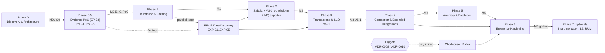
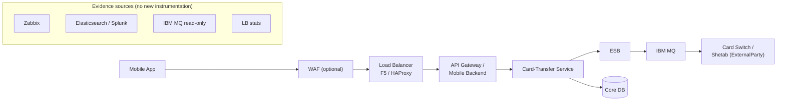

# برنامه جامع تحویل (Master Plan) — BSOIP

| فیلد | مقدار |
|---|---|
| Document ID | `RM-001` |
| Version | `0.2` |
| Status | `Draft – Phase 0 – awaiting approval` |
| Date | `2026-10-12` (۱۴۰۵/۰۷/۲۰) |
| Owner | `Architecture` |
| Related documents | [implementation-backlog.md](implementation-backlog.md)، [quality-and-validation-strategy.md](../testing/quality-and-validation-strategy.md)، [deployment-and-runbooks.md](../operations/deployment-and-runbooks.md)، [open-questions-and-assumptions.md](../architecture/open-questions-and-assumptions.md)، [ADR index](../architecture/architecture-decision-records/README.md)، [functional-requirements.md](../requirements/functional-requirements.md)، [non-functional-requirements.md](../requirements/non-functional-requirements.md)، [product-charter.md](../vision/product-charter.md)، [product-benchmark.md](../benchmark/product-benchmark.md)، [competitive-gap-analysis.md](../benchmark/competitive-gap-analysis.md)، [build-buy-reuse-analysis.md](../benchmark/build-buy-reuse-analysis.md) |
| Change log | `0.1` (2026-10-11) پیش‌نویس اولیه؛ `0.2` (2026-10-12) **تغییر پس از Product Benchmark**: افزودن فاز 0.5 Evidence PoC و گیت G-PoC؛ بازتعریف دامنهٔ فازها (بدون ClickHouse و `edge-collector` در فاز ۱–۲، تمرکز فاز ۲ بر Zabbix + پلتفرم لاگ VS-1 + MQ exporter، اعلان از کانال‌های موجود، ClickHouse/Kafka فقط با trigger)؛ M0.5؛ گیت‌ها با Q-23..Q-28؛ R-16..R-18؛ بخش ۱۱ «آنچه دیگر نمی‌سازیم» |

## ۱. هدف این سند

این سند توالی فازهای ۰، 0.5 و ۱ تا ۷ پلتفرم **Banking Service Observability & Intelligence Platform (BSOIP)**، وابستگی‌ها، نقاط عطف (M0، M0.5، M1..M6)، گیت‌های تصمیم و ریسک‌ها را تعریف می‌کند. جزئیات Epic و User Story در [implementation-backlog.md](implementation-backlog.md) و راهبرد آزمون در [quality-and-validation-strategy.md](../testing/quality-and-validation-strategy.md) آمده است.

قرارداد برچسب‌گذاری: **[واقعیت]** فقط F-01..F-03؛ **[فرض A-xx]**؛ **[فرضیه]**؛ **[توصیه]**؛ **[باز Q-xx]**. فهرست کامل در [open-questions-and-assumptions.md](../architecture/open-questions-and-assumptions.md).

## ۲. چرا توالی فازها بازنگری شد

منشور اولیه محصول (F-03) قابلیت‌ها را به ترتیب دامنه (کاتالوگ، تراکنش، LB، MQ، ...، یکپارچگی با پلتفرم‌های موجود) فهرست کرده بود. توالی تحویل به سه دلیل بازچینی شد:

1. **پلتفرم‌های موجود نخستین منبع داده‌اند.** [واقعیت] مالک محصول تصریح کرده که کار با SolarWinds، Zabbix، Splunk و Elasticsearch موجود آغاز شود و ابزارگذاری مستقیم برنامه‌ها به فازهای بعد و بر اساس نیاز واقعی موکول شود (F-02). بنابراین بدون یکپارچگی با این پلتفرم‌ها هیچ داده‌ای برای سلامت سرویس، تراکنش یا همبستگی وجود ندارد؛ یکپارچگی با پلتفرم‌های موجود از انتهای فهرست به **فاز ۲** منتقل شد و پیش‌نیاز فازهای ۳ تا ۵ است.
2. **همبستگی در یک فاز متمرکز شد (فاز ۴).** رتبه‌بندی علت محتمل به سه چیز وابسته است: مدل رخداد مشترک (فاز ۲)، توپولوژی با provenance (فاز ۱–۲) و شاخص‌های تراکنش در سطح hop (فاز ۳). اجرای پراکنده همبستگی در چند فاز به بازنویسی منجر می‌شد. فاز ۳ فقط نسخه سبک (`COR-003` lite) لازم برای VS-1 را دارد.
3. **فاز ۷ اختیاری است.** ابزارگذاری مستقیم (OTel SDK/agent)، همبستگی سطح L3 و RUM فقط در صورت اثبات نیاز (مثلاً ناکافی بودن L0/L2 در یک سرویس مشخص) و پس از استقرار تولیدی اجرا می‌شود.

[توصیه] سخت‌سازی امنیتی، آزمون خودکار و self-observability در **همه** فازها پیوسته است؛ فاز ۶ اعتبارسنجی در مقیاس است، نه نخستین جایی که امنیت دیده می‌شود.

### ۲.۱ بازنگری پس از Product Benchmark (نسخه 0.2)

Product Benchmark ([product-benchmark.md](../benchmark/product-benchmark.md)، [build-buy-reuse-analysis.md](../benchmark/build-buy-reuse-analysis.md)) گزینهٔ **E — «Reuse-first thin banking intelligence layer»** را به‌عنوان انتخاب **کم‌پشیمانی و مشروط به PoC** پیشنهاد کرد (امتیاز E ۷۸، D ۷۵، B ۷۰، A ۶۶؛ C با ۵۶ در معیار حذفی تحریم مردود — فاصلهٔ E و D در محدودهٔ عدم‌قطعیت است و نتیجهٔ PoC تعیین‌کننده است) ([ADR-0021](../architecture/architecture-decision-records/ADR-0021-build-buy-reuse-strategy.md)): Zabbix/SolarWinds/Splunk/ES سیستم مرجع تله‌متری خام، هشدار و سلامت زیرساخت می‌مانند؛ services/SLA زبیکس در صورت کفایت reuse می‌شود ([ADR-0023](../architecture/architecture-decision-records/ADR-0023-reuse-zabbix-services-and-sla.md))؛ لایهٔ سفارشی کوچک فقط معناشناسی بانکی (کاتالوگ و توپولوژی با provenance، تقویم جلالی و پنجره‌های سرویس، موفقیت فنی در برابر کسب‌وکاری، رتبه‌بندی شواهد با confidence) را می‌افزاید؛ پلتفرم‌های تجاری APM/AIOps به‌دلیل تحریم و شکاف‌ها پذیرفته نشدند ([ADR-0022](../architecture/architecture-decision-records/ADR-0022-commercial-platforms-not-adopted.md)). پیامدهای roadmap:

1. **فاز 0.5 Evidence PoC** پیش از هر ساختی درج شد تا فرضیه‌های کلیدی این راهبرد با دادهٔ واقعی (read-only) آزموده شوند؛ گیت **G-PoC** پیش از T-01-01.
2. شماره‌گذاری فازهای ۱ تا ۷ برای حفظ ردیابی نیازمندی‌ها **ثابت ماند**؛ فقط دامنه‌ها تغییر کرد (بخش ۵ و ۱۱).
3. ClickHouse و Kafka از «برنامه‌ریزی‌شده» به «مشروط به trigger» تغییر کردند ([ADR-0008](../architecture/architecture-decision-records/ADR-0008-telemetry-store-postgresql-first-clickhouse-on-trigger.md)، [ADR-0010](../architecture/architecture-decision-records/ADR-0010-buffering-without-kafka-initially.md)).

## ۳. نمای کلی فازها و وابستگی‌ها

*توضیح:* فاز 0.5 کوتاه، فقط‌خواندنی و دورریختنی است و تنها خروجی ماندگار آن گزارش شواهد و تصمیم‌های ADR است. ClickHouse/Kafka فاز مستقل ندارند و فقط با فعال شدن triggerها (در هر نقطه از فاز ۲ تا ۶) وارد می‌شوند. فاز ۶ از نظر فنی به خروجی فاز ۴ وابسته است و بخشی از کارهای آن (HA پایگاه‌داده، آزمون کارایی) می‌تواند هم‌زمان با فاز ۵ آغاز شود [توصیه]. فاز ۷ پس از M6 و مشروط است.

### ۳.۱ توالی نسبی (بدون تاریخ تقویمی)

مدت‌ها نامعلوم‌اند؛ نمودار زیر فقط ترتیب و هم‌پوشانی را نشان می‌دهد. واحدها «اسپرینت نسبی» هستند و تقویمی نیستند (محور افقی صرفاً شماره واحد نسبی است؛ طول نوارها بیانگر بازه تلاش جدول ۳.۲ نیست و فقط ترتیب و هم‌پوشانی را نشان می‌دهد).

```mermaid
gantt
  title Relative sequencing (no calendar dates)
  dateFormat X
  axisFormat %s
  section Phase 0
  Architecture package & review :p0, 0, 1
  section Phase 0.5
  Evidence PoC PoC-1..5 (time-boxed) :poc, 1, 3
  section Phase 1
  Foundation, IAM, Catalog, Calendar, UI shell :p1, 3, 7
  Data discovery EXP-01..05 (parallel) :d1, 3, 8
  section Phase 2
  connector-runtime, Zabbix, VS-1 logs, MQ, health v1 :p2, 7, 12
  section Phase 3
  Transactions, SLO, VS-1 :p3, 12, 17
  section Phase 4
  Correlation & extended integrations :p4, 17, 23
  section Phase 5
  Anomaly & forecasting :p5, 23, 28
  section Phase 6
  HA/DR, perf, pentest, handover :p6, 23, 31
  section Phase 7
  Optional instrumentation/RUM :p7, 31, 35
```

### ۳.۲ برآورد تلاش (فقط فرض)

[فرض A-03] با تیم ۴ تا ۸ مهندس و [فرض A-12] زیرساخت آفلاین آماده، بازه‌های تقریبی زیر صرفاً برای برنامه‌ریزی ظرفیت ارائه می‌شود و تعهد نیست. ابعاد واقعی پس از G-PoC و بستن Q-01، Q-06، Q-07 و Q-08 بازبرآورد می‌شود. اگر triggerهای ClickHouse/Kafka فعال شوند، تلاش اضافی (برآورد جداگانه) به فاز مربوط افزوده می‌شود.

| فاز | بازه تلاش (نفر-ماه، فرض) | عامل اصلی عدم قطعیت |
|---|---|---|
| 0.5 | 3–6 (time-box ۴–۶ هفته) | تأیید دسترسی read-only (R-02)، دسترسی به دادهٔ حوادث تاریخی |
| 1 | 8–16 | آماده بودن mirror داخلی (Q-09)، IdP (Q-04) |
| 2 | 10–22 (پیش‌تر 14–28؛ کاهش به‌دلیل حذف `edge-collector` و ClickHouse از دامنه [فرض]) | نسخه و دسترسی API منابع (Q-08)، تأییدهای امنیتی (R-02)، نتیجهٔ PoC-1/PoC-3 |
| 3 | 10–20 | کیفیت لاگ‌ها (Q-07, R-01) |
| 4 | 14–26 | تعداد یکپارچگی‌های تکمیلی |
| 5 | 8–16 | وجود تاریخچه برچسب‌خورده رخدادها |
| 6 | 12–24 | معماری DR (Q-05)، دامنه pentest |
| 7 | نامعین | به نیاز اثبات‌شده بستگی دارد |

## ۴. نقاط عطف (Milestones)

| ID | تعریف | شاهد پذیرش | پایان فاز |
|---|---|---|---|
| M0 | بسته معماری فاز ۰ (نسخه 0.2، پس از benchmark) تأیید شد | صورت‌جلسه بازبینی؛ بسته شدن یا پذیرش پیش‌فرض پرسش‌های G0 (Q-13، Q-07، Q-26، Q-28، Q-27، Q-22)؛ تأیید time-box و دسترسی‌های PoC | 0 |
| M0.5 | گزارش Evidence PoC پذیرفته شد (G-PoC) | گزارش PoC-1..PoC-5 با معیارهای بخش ۵.۰.۵؛ تصمیم ADR-0021/0023 و آستانه‌های ADR-0008؛ بسته شدن یا پذیرش پیش‌فرض Q-01، Q-02، Q-04، Q-09، Q-23، Q-24، Q-25 | 0.5 |
| M1 | پایه پلتفرم + کاتالوگ در UAT | نصب آفلاین bundle v1 (`platform-core` + PostgreSQL + `web-ui`) در UAT؛ ورود با AD/OIDC؛ کاتالوگ VS-1 ثبت شده | 1 |
| M2 | منابع موجود ingest شده + health v1 | داده Zabbix، پلتفرم لاگ VS-1 (Splunk یا ES) و MQ (exporter یا Zabbix) برای سرویس VS-1 در داشبورد؛ freshness و UNKNOWN درست؛ وضعیت trigger ClickHouse ارزیابی شده | 2 |
| M3 | دموی VS-1 پذیرفته شد | معیارهای بخش ۷ برقرار | 3 |
| M4 | همبستگی پذیرفته شد | ارزیابی رتبه‌بندی علت محتمل روی replay رخدادها، بازخورد اپراتور فعال | 4 |
| M5 | تشخیص ناهنجاری ارزیابی شد | گزارش precision/recall روی تاریخچه برچسب‌خورده؛ alert budget رعایت شد | 5 |
| M6 | تصمیم استقرار تولیدی | گزارش BM-09، pentest، drillهای upgrade/rollback، تحویل عملیات | 6 |

## ۵. شرح فازها

> هر فاز ساختار یکسان دارد: هدف کسب‌وکاری، دامنه و استثناها، قابلیت‌ها و اجزای فنی، تحویل‌دادنی‌ها، پیش‌نیازها، Epicها، معیار پذیرش، الزامات آزمون خودکار، ملاحظات امنیتی، ریسک‌های عملیاتی، DoD، معیار خروج.

### ۵.۰ فاز ۰ — Discovery & Architecture

- **هدف کسب‌وکاری:** توافق بر هویت محصول (سرویس‌محور و تراکنش‌محور، نه پایش زیرساخت)، معماری، توالی و پرسش‌های باز پیش از هرگونه پیاده‌سازی. [واقعیت] پیاده‌سازی تا تأیید صریح ممنوع است (F-02).
- **دامنه:** بسته مستندات (vision، requirements، architecture، ADR-0001..0024، benchmark، roadmap، testing، operations).
- **استثناها:** هیچ کد، migration، فایل زیرساخت یا نصب نرم‌افزار؛ هیچ اتصال به منابع بانک.
- **تحویل‌دادنی‌ها:** همین بسته؛ Product Benchmark؛ فهرست Q-01..Q-28 گروه‌بندی‌شده برای جلسه بازبینی.
- **پیش‌نیازها:** منشور محصول (F-03).
- **Epicها:** — (فقط مستندات)
- **معیار پذیرش:** تأیید مالک محصول و معماری؛ هیچ تناقض بین اسناد در شناسه‌ها؛ پاسخ یا پذیرش پیش‌فرض برای پرسش‌های مسدودکننده دسته A (بخش ۹).
- **آزمون خودکار:** — (بررسی پیوندهای Markdown و lint مستندات در فاز ۱ خودکار می‌شود).
- **امنیت:** هیچ داده واقعی بانک در مستندات.
- **ریسک‌ها:** R-07 (گسترش دامنه)، R-13، R-16.
- **DoD:** همه اسناد با جدول metadata و برچسب‌گذاری؛ ADRها با وضعیت و Confidence.
- **معیار خروج:** M0 (گیت G0)؛ تأیید آغاز فاز 0.5. تصمیم ADR-0003 (Q-01) تا G-PoC لازم است تا T-01-01 آغاز شود.

### ۵.۰.۵ فاز 0.5 — Evidence PoC (EP-23)

- **هدف کسب‌وکاری:** پیش از سرمایه‌گذاری در ساخت، با دادهٔ واقعی بانک (فقط‌خواندنی) نشان داده شود که راهبرد reuse-first (گزینهٔ E) عملی است و هستهٔ سفارشی ارزش افزوده دارد.
- **مسیر آزمون:** LB/WAF → API/app service → IBM MQ/RabbitMQ → وابستگی downstream (زیرمجموعهٔ زنجیرهٔ VS-1). ابتدا دادهٔ موجود Zabbix/Splunk/ES؛ در غیر این صورت دادهٔ مصنوعی با برچسب صریح و contract fixtureها؛ بدون Internet.
- **ویژگی‌ها:** کوچک، **فقط‌خواندنی**، **محدود در زمان** (time-box پیشنهادی ۴–۶ هفته [فرض])، **کد دورریختنی** (هیچ بخشی بدون بازنویسی وارد `platform-core` نمی‌شود)، **آفلاین**، **بدون نوشتن در تولید**. الزامات PR-01..PR-08 در [open-questions-and-assumptions.md](../architecture/open-questions-and-assumptions.md) §۶.۲.

| آزمایش | پرسش | تصمیمی که حل می‌کند |
|---|---|---|
| PoC-1 | آیا Zabbix services/SLA (tagها، درخت سرویس، زمان‌بندی SLA) برش VS-1 و پنجره‌های expected-inactive را نمایش می‌دهد؟ | ADR-0023: reuse یا سلامت/SLA سفارشی؛ دامنهٔ FR-INT-008 و FR-CAL-008 |
| PoC-2 | آیا saved search/aggregation در Splunk/ES شمارش دقیقه‌ای outcome (فنی/کسب‌وکاری) و صدک latency می‌دهد؟ (= EXP-01 توسعه‌یافته) | تأیید ارزش هستهٔ سفارشی و دامنهٔ FR-TXN؛ انتخاب پلتفرم لاگ VS-1 برای فاز ۲ |
| PoC-3 | معیارهای MQ read-only (`mq_prometheus` یا itemهای موجود Zabbix) با حداقل مجوز؛ آیا فعال‌سازی آمار MQI تأیید می‌شود؟ | منبع دادهٔ FR-MQ-002/004؛ استثنای NFR-IMP-002 (Q-27) |
| PoC-4 | رتبه‌بندی شواهد روی ۳ حادثهٔ تاریخی (یا مصنوعی): افت throughput/افزایش latency همبسته با رشد صف یا خرابی downstream؛ سرویس متأثر؛ تفکیک واقعیت/استنباط/confidence | اعتبار رویکرد ADR-0012 و مفید بودن برای اپراتور |
| PoC-5 | ذخیره و query KPIهای مشتق در PostgreSQL در حجم مصنوعی Low/Medium | آستانه‌های trigger ClickHouse در ADR-0008 |

- **پیش‌نیازها:** M0؛ پرسش‌های G0 (بخش ۹)؛ **نمونهٔ غیرتولیدی Zabbix (هم‌نسخه با تولید) برای PoC-1** تا صفر نوشتن در تولید تضمین شود؛ حساب‌های read-only موقت با تأیید امنیت (R-02)؛ تعریف saved searchهای PoC-2 توسط پلتفرم تولید و توسط مدیران Splunk/ES نصب می‌شود (حساب پلتفرم فقط‌خواندنی، Q-28)؛ VM آزمون آفلاین؛ فهرست ≥ ۳ حادثهٔ تاریخی با عملیات.
- **Epicها:** EP-23 (اصلی)، EP-22 (EXP-01، EXP-04 به‌عنوان ورودی).
- **معیار پذیرش (G-PoC):**
  - افت throughput یا افزایش latency تزریقی/واقعی در ≤ ۲ بازهٔ polling تشخیص داده شود.
  - با رشد صف یا خرابی downstream همبسته و سرویس کسب‌وکاری متأثر نام برده شود.
  - برای ≥ ۲ از ۳ حادثه، hop خراب واقعی در top-3 فرضیه‌ها باشد.
  - هر خروجی واقعیت مشاهده‌شده را از علت استنباطی با confidence جدا کند.
  - اجرای کاملاً آفلاین؛ صفر نوشتن در سیستم‌های منبع؛ بار منبع در budget توافق‌شده؛ صفر دادهٔ حساس در ذخیره‌گاه PoC (ممیزی redaction).
- **آزمون:** طبق [quality-and-validation-strategy.md](../testing/quality-and-validation-strategy.md) (بخش اعتبارسنجی PoC).
- **امنیت:** حساب‌ها فقط‌خواندنی و موقت؛ دادهٔ PoC پس از پایان حذف و حذف گواهی می‌شود؛ هیچ داده‌ای از شبکهٔ بانک خارج نمی‌شود.
- **ریسک‌ها:** R-01، R-02، R-03، R-17، R-05.
- **DoD:** گزارش PoC با نتیجهٔ هر آزمایش (موفق/ناموفق/نامعلوم)، شواهد، اندازه‌گیری بار منبع و پیشنهاد تصمیم برای ADR-0008/0021/0023 و FR-MQ-002.
- **معیار خروج:** M0.5 (G-PoC). **اگر معیارها برقرار نشوند:** بازبینی گزینه‌ها در [build-buy-reuse-analysis.md](../benchmark/build-buy-reuse-analysis.md) — مثلاً گزینهٔ B (OSS stack + لایهٔ بانکی) در صورت ناکارآمدی ابزارهای موجود، یا کاهش دامنهٔ VS-1 به L0 و شاخص‌های فنی؛ T-01-01 فقط پس از تصمیم صریح آغاز می‌شود.

### ۵.۱ فاز ۱ — Platform Foundation & Service Catalog

- **هدف کسب‌وکاری:** ثبت سرویس‌های بانکی، مالکیت و وابستگی‌ها در یک منبع واحد، و ایجاد پایه امن و قابل نصب آفلاین که فازهای بعد روی آن ساخته شوند.
- **دامنه:**
  - مخزن، ساخت و CI آفلاین، استانداردها، ArchUnit (EP-01).
  - IAM با AD/OIDC، RBAC با scope، audit تغییرناپذیر (EP-02).
  - کاتالوگ: BusinessService، TechnicalService، Component، ServiceType قابل گسترش، Environment/Site، وابستگی دستی، import/export YAML/CSV، تاریخچه تغییر (EP-03).
  - تقویم کسب‌وکار جلالی، بارگذاری تعطیلات به‌صورت داده، ServiceWindow، MaintenanceWindow (EP-04).
  - پوسته UI فارسی RTL با تاریخ جلالی (`FR-UI-001`).
  - Offline install bundle v1 (EP-05).
  - مسیر موازی: تکمیل کشف داده EXP-01..EXP-04 (EP-22) بر اساس یافته‌های PoC.
- **استثناها:** هیچ ingestion تله‌متری؛ نمایش گراف توپولوژی تعاملی (`FR-CAT-008`) در فاز ۲؛ هیچ HA؛ **بدون ClickHouse و بدون `edge-collector`** (پس از benchmark)؛ هیچ کدی از PoC بدون بازنویسی.
- **قابلیت‌ها و اجزا:** `platform-core` (ماژول‌های `catalog`, `topology`, `calendar`, `iam`, `audit`, `query-api`)، `metadata-db` (PostgreSQL)، `web-ui`، `identity-provider`.
- **FR مرتبط:** FR-CAT-001..006, 011, 012؛ FR-CAL-001..003؛ FR-UI-001؛ FR-ADM-001..003.
- **تحویل‌دادنی‌ها:** artifact امضاشده `platform-core` و `web-ui`، SBOM، bundle v1، OpenAPI 3.1 کاتالوگ، مستند نصب.
- **پیش‌نیازها:** M0.5 (G-PoC)؛ تصمیم ADR-0003 [باز Q-01]؛ دامنهٔ UI طبق ADR-0024 [باز Q-23]؛ ADR-0015 [باز Q-04] (پیش‌فرض: Keycloak + AD federation)؛ mirror داخلی artifact [باز Q-09]؛ VM برای UAT [فرض A-02].
- **Epicها:** EP-01، EP-02، EP-03 (بخش دستی)، EP-04، EP-05 (v1)، EP-22.
- **معیار پذیرش:**
  - کاربر با حساب AD وارد می‌شود و فقط سرویس‌های scope خود را می‌بیند.
  - سرویس VS-1 با زنجیره کامل (بخش ۷) از طریق YAML import ثبت و در UI به فارسی نمایش داده می‌شود.
  - هر تغییر کاتالوگ در audit با کاربر، زمان (UTC ذخیره، نمایش Asia/Tehran) و diff ثبت می‌شود.
  - تقویم سال جاری با فایل تعطیلات import می‌شود؛ هیچ تعطیلی قمری در کد محاسبه نمی‌شود.
  - نصب bundle روی VMهای آماده در UAT بدون Internet انجام می‌شود.
- **آزمون خودکار:** unit (domain ≥ 80% خط، NFR-MNT-002)، ArchUnit مرزهای ماژول، integration با PostgreSQL (Testcontainers، image آفلاین)، contract OpenAPI، آزمون UI RTL/جلالی، SAST و اسکن وابستگی در CI.
- **امنیت:** deny-by-default (NFR-SEC-005)، TLS (NFR-SEC-001)، عدم نگهداری secret در پیکربندی (NFR-SEC-004)، امضا و SBOM (NFR-SEC-007)، audit (NFR-SEC-006).
- **ریسک‌ها:** R-04، R-09، R-02 (برای EP-22)، R-14، R-08، R-16.
- **DoD:** کد بازبینی‌شده، آزمون‌ها سبز در CI آفلاین، SBOM بدون آسیب‌پذیری Critical حل‌نشده، مستند به‌روز، ADRهای تحت تأثیر به‌روز.
- **معیار خروج و آمادگی برای فاز ۲:** M1؛ نتایج EXP-01 و EXP-02 حداقل برای یک منبع لاگ و Zabbix؛ حساب‌های read-only برای Zabbix و یک منبع لاگ در مسیر تأیید [فرض A-09]؛ Q-08 برای منابع VS-1 پاسخ داده شده.

### ۵.۲ فاز ۲ — Ingestion Core & Existing-Platform Connectors

- **هدف کسب‌وکاری:** نمایش سلامت سرویس‌های ثبت‌شده با استفاده از داده‌ای که بانک *همین حالا* در Zabbix، SolarWinds، Splunk و Elasticsearch دارد، بدون هیچ ابزارگذاری جدید و بدون کپی کردن تله‌متری خام.
- **دامنه:**
  - Connector SDK و `connector-runtime` (per zone، فقط اتصال outbound) (EP-07).
  - ماژول `ingestion` از مسیر batch API داخلی `connector-runtime`: normalize، UTC، redact، dedup، late data، backpressure (EP-06)؛ ذخیرهٔ KPIهای مشتق و سری‌های مرتبط با KPI در PostgreSQL (جداول partitioned و time-bucketed، [ADR-0008](../architecture/architecture-decision-records/ADR-0008-telemetry-store-postgresql-first-clickhouse-on-trigger.md)). متریک خام wholesale ingest نمی‌شود؛ drill-down شواهد به‌صورت on-demand از تاریخچهٔ Zabbix خوانده می‌شود.
  - **کانکتورهای اولویت‌دار (EP-08):** Zabbix (شامل وارد کردن وضعیت services/SLA به‌عنوان شاهد، `FR-INT-008`) و **یک پلتفرم لاگ — هر کدام که لاگ‌های VS-1 را دارد** (Splunk یا ES، بر اساس PoC-2/Q-07). کانکتور پلتفرم لاگ دوم در صورت نیاز در انتهای فاز ۲ یا پس از آن؛ SolarWinds (Should).
  - **IBM MQ از exporter استاندارد IBM `mq_prometheus`** (scrape توسط `connector-runtime`) یا itemهای موجود Zabbix، بر اساس PoC-3 (EP-09)؛ RabbitMQ و LB (F5/HAProxy/NGINX) ترجیحاً از templateهای Zabbix نصب‌شده و فقط در صورت شکاف از API مستقیم read-only.
  - همگام‌سازی تقویم/پنجره‌های نگهداری به Zabbix (`FR-CAL-008`، Should؛ پیش‌فرض فایل خروجی [باز Q-26]).
  - مدل سلامت v1 با `HealthState` و توضیح، UNKNOWN برای داده کهنه، propagation به‌عنوان impact (EP-10).
  - قواعد آستانه ایستا (`FR-ANO-001`)، مدل رخداد مشترک (`FR-COR-001`، EP-13 بخش مدل).
  - داشبورد سرویس و نقشه توپولوژی؛ ExternalRef؛ deep link به منابع.
  - self-observability پایه (EP-21) و benchmarkهای BM-04، BM-05، BM-06 و تکرار PoC-5 روی سخت‌افزار UAT (EP-19)؛ BM-01/BM-07 فقط در صورت trigger.
- **استثناها:** همبستگی و رتبه‌بندی علت؛ ذخیره لاگ خام (ADR-0009)؛ Kafka (ADR-0010)؛ **ClickHouse (مگر trigger ADR-0008 فعال شود)**؛ **`edge-collector` و دریافت OTLP (`FR-ING-002` به P4 منتقل شد)**؛ SNMP/syslog (فاز ۴)؛ تغییر پیکربندی دستگاه‌های موجود (NFR-IMP-002، مگر استثنای تأییدشده)؛ کانال اعلان جدید.
- **اجزا:** `connector-runtime` (+ exporter `mq_prometheus` در zone MQ)، PostgreSQL (`metadata-db` + جداول KPI مشتق)، ماژول‌های `ingestion`, `connectors-control`, `health`, `events`.
- **FR مرتبط:** FR-ING-001, 003, 005..011؛ FR-INT-001..004, 006, 008؛ FR-CAL-008؛ FR-LB-001, 002, 004؛ FR-MQ-001..003, 005؛ FR-RUN-004؛ FR-HLT-001..003؛ FR-CAT-007 (آغاز)، 008، 009؛ FR-TXN-010؛ FR-COR-001؛ FR-ANO-001؛ FR-UI-002, 003؛ FR-ADM-004, 006.
- **تحویل‌دادنی‌ها:** Connector SDK v1 با مستند و harness شبیه‌سازی؛ کانکتورهای بالا با capability declaration؛ bundle v2 شامل `connector-runtime` و exporter `mq_prometheus` (بدون collector و ClickHouse)؛ گزارش BM-04/05/06 و ارزیابی trigger ClickHouse.
- **پیش‌نیازها:** M1؛ حساب‌های read-only و قوانین فایروال zone → monitoring-zone (R-02)؛ query budget توافق‌شده با مدیران Splunk/ES [باز Q-22، Q-28]؛ نسخه‌ها و templateهای Zabbix [باز Q-08]؛ منبع دادهٔ MQ [باز Q-27]؛ آستانه‌های ADR-0008 از PoC-5.
- **Epicها:** EP-03 (توپولوژی و ExternalRef)، EP-05، EP-06، EP-07، EP-08، EP-09، EP-10، EP-13 (مدل)، EP-19، EP-21، EP-22.
- **معیار پذیرش:**
  - داده سرویس VS-1 از حداقل Zabbix، پلتفرم لاگ VS-1 (ES یا Splunk) و MQ در داشبورد دیده می‌شود؛ تأخیر pull ≤ poll interval + 60 s در P95 (NFR-PRF-002).
  - قطع یک منبع ← اجزای وابسته `UNKNOWN` با دلیل «داده کهنه/منبع در دسترس نیست» و نه `CRITICAL` (NFR-REL-004).
  - قطع ۱ ساعته ارتباط `connector-runtime` با core بدون از دست رفتن داده (watermark/checkpoint و بازخوانی از منبع)؛ پس از اتصال مجدد، داده با `observed_at` درست ثبت و تکراری حذف می‌شود.
  - redaction روی corpus مصنوعی PAN/کد ملی/شبا: صفر نشت.
  - هر کانکتور بار خود را در قالب rate limit پیکربندی‌شده نگه می‌دارد و مصرف واقعی را گزارش می‌کند (NFR-IMP-001).
- **آزمون خودکار:** contract tests کانکتور با fixtureهای ضبط‌شده برای هر نسخه API؛ شبیه‌ساز منابع؛ integration با PostgreSQL؛ آزمون‌های همگام‌سازی Zabbix (FR-CAL-008، FR-INT-008)؛ failure injection (source down، slow source، قطع core)؛ load test مسیر batch API.
- **امنیت:** نگهداری credentialهای منابع فقط از طریق SecretProvider (NFR-SEC-004, FR-ADM-004)؛ mTLS بین `connector-runtime` و core؛ هیچ اتصال از core به zoneها (NFR-SEC-010)؛ redaction دولایه (NFR-PRV-002).
- **ریسک‌ها:** R-02، R-03، R-06، R-10، R-12، R-15، R-11، R-16، R-17.
- **DoD:** مانند فاز ۱ + هر کانکتور: fixture ضبط‌شده، صفحه diagnostics، سند capability «نیازمند تأیید در نسخه نصب‌شده بانک»، runbook خرابی.
- **معیار خروج:** M2؛ وضعیت triggerهای ClickHouse/Kafka ارزیابی و ثبت شده؛ نتیجه EXP-01/PoC-2 برای سرویس VS-1 مشخص کرده که کدام سطح L0/L2 قابل دستیابی است؛ OutcomeMapping اولیه با تیم عملیات بازبینی شده.

### ۵.۳ فاز ۳ — Transaction Observability & SLOs (VS-1)

- **هدف کسب‌وکاری:** پاسخ به پرسش «آیا تراکنش‌های این سرویس از نظر کسب‌وکاری موفق‌اند؟» و تفکیک موفقیت فنی از موفقیت کسب‌وکاری، با آگاهی از تقویم بانکی.
- **دامنه:** TransactionType، OutcomeMapping (داده، نه کد)، خلاصه‌های دقیقه‌ای از لاگ (L0) و L2 در جایی که کلید وجود دارد، throughput/success/P50/P95/P99 در صورت وجود latency، مقایسه upstream/downstream، طبقه‌بندی backlog صف، SLO تقویم‌محور و error budget، تشخیص expected-inactive، پنل evidence ساده، سرکوب اعلان در maintenance (`FR-NTF-002`)، grouping سبک توپولوژی (`FR-COR-003` lite)، baseline پایه time-of-week.
- **استثناها:** رتبه‌بندی علت کامل؛ ML؛ L3 trace؛ کانال‌های اعلان (فاز ۴).
- **اجزا:** ماژول‌های `transactions`, `slo`, `calendar` (ارزیابی), `health`, `correlation` (lite)، Splunk/ES saved-search-style extraction در کانکتورها.
- **FR مرتبط:** FR-TXN-001..008, 011؛ FR-MQ-004؛ FR-CAL-004..007؛ FR-CAT-010؛ FR-RUN-006؛ FR-DX-004؛ FR-ANO-002 (basic)، FR-ANO-004 (یک قاعده)؛ FR-COR-003 (lite)؛ FR-NTF-002؛ FR-UI-004.
- **تحویل‌دادنی‌ها:** VS-1 کامل (بخش ۷)؛ گزارش BM-04 (و BM-03 فقط در صورت trigger L2)؛ کتابچه OutcomeMapping سرویس VS-1.
- **پیش‌نیازها:** M2؛ [باز Q-07] و [باز Q-13] بسته؛ [باز Q-15] برای داده تقویم؛ ≥ ۳ رخداد تاریخی توافق‌شده با عملیات و دسترسی به داده تاریخی آن بازه در منابع.
- **Epicها:** EP-11، EP-12، EP-10 (توسعه)، EP-13 (lite)، EP-19، EP-21.
- **معیار پذیرش:** معیارهای VS-1 (بخش ۷.۲).
- **آزمون خودکار:** تست سناریوی end-to-end با replay رخداد (بازاستفاده از سناریوهای PoC-4 به‌عنوان golden data)؛ آزمون‌های property-based برای OutcomeMapping و تقویم (مرز روز، DST-free بودن Asia/Tehran از طریق tzdata، سال کبیسه جلالی)؛ آزمون حجم خلاصه‌های تراکنش روی PostgreSQL.
- **امنیت:** HMAC tokenization کلیدها (NFR-PRV-003)؛ ممیزی redaction روی خروجی واقعی VS-1 در UAT؛ عدم ذخیره مبلغ دقیق.
- **ریسک‌ها:** R-01 (اصلی)، R-05، R-11، R-14، R-03.
- **DoD:** هر شاخص تراکنش tier خود را ثبت و UI آن را نشان می‌دهد؛ هر وضعیت محاسبه‌شده توضیح دارد (NFR-USA-002).
- **معیار خروج:** M3 (پذیرش دموی VS-1)؛ تصمیم صریح go/no-go برای فاز ۴ بر اساس ارزش اثبات‌شده.

### ۵.۴ فاز ۴ — Correlation & Extended Integrations

- **هدف کسب‌وکاری:** کاهش زمان تشخیص هنگام حادثه با گروه‌بندی سیگنال‌ها و رتبه‌بندی قابل توضیح علت‌های محتمل؛ گسترش پوشش به runtime، DB، K8s، WAF و آزمون‌های synthetic.
- **دامنه:** مدل رخداد کامل، dedup و پنجره زمانی، grouping توپولوژیک، رتبه‌بندی CauseHypothesis با evidence/confidence/counter-evidence و disclaimer «همبستگی ≠ علیت»، Change awareness، OperatorFeedback، timeline حادثه، federated evidence query با redaction، webhook ورودی، **اعلان سطح Incident از طریق کانال‌های موجود** (Zabbix actions/ITSM/email؛ حداکثر یک اعلان به ازای Incident سرویس؛ پلتفرم منبع هشدار جدید نیست)، JMX، SQL Server، K8s، WAF، synthetic API checks با guardrail، کشف وابستگی (`FR-CAT-007`) با تأیید، **دریافت OTLP و `edge-collector` اختیاری** (`FR-ING-002`، Should) فقط در zoneهایی که `connector-runtime` به آن دسترسی ندارد یا برای SNMP/syslog، قواعد failure-domain LB.
- **استثناها:** ML؛ remediation خودکار؛ SIEM.
- **FR مرتبط:** FR-COR-002..007؛ FR-INT-005, 007؛ FR-NTF-001؛ FR-RUN-001, 003, 005؛ FR-LB-003, 005..007؛ FR-DX-001..003؛ FR-ING-002, 004؛ FR-CAT-007.
- **Epicها:** EP-13، EP-14، EP-15، EP-17، EP-03 (کشف)، EP-19 (BM-08, BM-10)، EP-21.
- **پیش‌نیازها:** M3؛ [باز Q-14] کانال‌های اعلان موجود و ITSM؛ [باز Q-20] حساب‌های آزمون synthetic؛ [باز Q-17] وضعیت NTP (برای پنجره‌های همبستگی).
- **معیار پذیرش:** روی مجموعه replay (≥ ۱۰ رخداد برچسب‌خورده، [توصیه]) علت واقعی در top-3 در ≥ 70% موارد [فرضیه، هدف پیشنهادی برای توافق با عملیات]؛ چرخه ارزیابی ≤ 60 s (NFR-PRF-004)؛ هر hypothesis توضیح و counter-evidence دارد؛ synthetic هرگز تراکنش مالی ایجاد نمی‌کند.
- **آزمون خودکار:** golden tests همبستگی با سناریوهای ثابت؛ clock-skew injection؛ BM-08؛ آزمون guardrail synthetic؛ contract webhook.
- **امنیت:** نتایج federated query پیش از UI redact می‌شوند (NFR-PRV-005)؛ webhook با احراز هویت و محدودیت نرخ؛ حساب synthetic با کمترین دسترسی.
- **ریسک‌ها:** R-05، R-11، R-15، R-12، R-08، R-03.
- **DoD:** هر قاعده همبستگی golden test و مستند توضیح دارد.
- **معیار خروج:** M4.

### ۵.۵ فاز ۵ — Anomaly Detection & Prediction

- **هدف کسب‌وکاری:** تشخیص زودتر انحراف‌ها با baselineهای فصلی و پیش‌بینی (time-to-full صف، SLO burn) با نرخ هشدار کاذب قابل‌قبول.
- **دامنه:** طبق ADR-0013 و فقط روی KPIهای مشتق (نه متریک خام؛ تشخیص ناهنجاری زیرساختی در اختیار ابزارهای موجود است): baseline فصلی → robust z/MAD، EWMA، STL residual → الگوهای چندمتغیره وابستگی‌محور → پیش‌بینی → ML فقط با گیت ارزیابی. harness ارزیابی، drift، توضیح برای هر ناهنجاری.
- **استثناها:** مدل‌های black-box بدون توضیح؛ هر detector بدون اندازه‌گیری precision/recall.
- **FR مرتبط:** FR-ANO-002..008؛ FR-CAL-007؛ FR-TXN-011 (پیشرفته)؛ FR-MQ-006.
- **Epicها:** EP-16، EP-19.
- **پیش‌نیازها:** M4؛ تاریخچه ≥ چند هفته KPI مشتق در ذخیره‌گاه تله‌متری (PostgreSQL، یا ClickHouse در صورت trigger) شامل حداقل یک چرخه ماهانه [فرض]؛ برچسب‌گذاری رخدادها از OperatorFeedback فاز ۴.
- **معیار پذیرش:** precision/recall اندازه‌گیری‌شده روی تاریخچه برچسب‌خورده و توافق‌شده با عملیات؛ alert budget به‌ازای هر سرویس رعایت شود؛ هیچ detector بدون گزارش ارزیابی فعال نشود.
- **آزمون خودکار:** harness ارزیابی در CI روی dataset برچسب‌خورده مصنوعی + تاریخی؛ آزمون regression برای جلوگیری از کاهش precision.
- **امنیت:** داده آموزشی فقط از داده مشتق‌شده و tokenized.
- **ریسک‌ها:** R-05 (اصلی)، R-01.
- **DoD:** هر detector: کارت مدل (ورودی، فرض، معیار، محدودیت)، توضیح در UI.
- **معیار خروج:** M5.

### ۵.۶ فاز ۶ — Enterprise Hardening & Production Readiness

- **هدف کسب‌وکاری:** آمادگی استقرار تولیدی مطابق الزامات دسترس‌پذیری، امنیت و عملیات بانک.
- **دامنه:** HA درون سایت و DR (ADR-0017)، Patroni برای PostgreSQL، **فقط در صورت فعال شدن trigger:** ClickHouse ReplicatedMergeTree + Keeper (۳ گره) و/یا Kafka (KRaft)، اعتبارسنجی کارایی در سناریوی توافق‌شده (NFR-SCL-001)، pentest و ارزیابی امنیتی، drill upgrade/rollback، drill DR (BM-09)، runbookها، تحویل عملیات.
- **استثناها:** multi-tenancy (`FR-ADM-005` فقط در صورت پاسخ مثبت Q-11).
- **Epicها:** EP-05 (نهایی)، EP-18، EP-19، EP-20، EP-21.
- **پیش‌نیازها:** [باز Q-05] RPO/RTO و توپولوژی DR؛ [باز Q-18] بودجه سخت‌افزار؛ [باز Q-19] اپراتور پلتفرم؛ [باز Q-10] الزامات انطباق.
- **معیار پذیرش:** RPO ≤ 15 min برای metadata و RTO ≤ 4 h در drill (NFR-AVL-003، موقت)؛ سناریوی Medium روی سخت‌افزار مرجع (NFR-SCL-001)؛ صفر یافته Critical/High باز در pentest؛ rollback در پنجره نگهداری (NFR-DEP-003)؛ نصب روی VMهای آماده ≤ 1 روز (NFR-DEP-002).
- **آزمون خودکار:** load و soak، chaos/failure injection (DB failover)، DAST، drill خودکار backup/restore.
- **ریسک‌ها:** R-06، R-09، R-13، R-15، R-16، R-18.
- **معیار خروج:** M6 — تصمیم go-live توسط کمیته تغییر بانک.

### ۵.۷ فاز ۷ (اختیاری) — Direct Instrumentation, L3, RUM

- **هدف:** فقط برای سرویس‌هایی که در فازهای ۳–۴ نشان داده شده L0/L2 برای تشخیص کافی نیست.
- **دامنه:** OTel SDK/agent برای برنامه‌های منتخب، دریافت trace (`FR-TXN-009`)، همبستگی L3، `.NET` runtime (`FR-RUN-002`)، RUM برای وب/PWA/Android (`FR-DX-005`).
- **Epic:** EP-24 (در نسخه 0.1 «EP-23» پیشنهاد شده بود).
- **پیش‌نیازها:** M6؛ تحلیل هزینه/فایده به‌ازای هر برنامه؛ تأیید تیم‌های توسعه برنامه؛ ارزیابی ریسک داده در RUM.
- **معیار ورود (گیت):** مورد کسب‌وکاری مستند که نشان دهد کدام پرسش عملیاتی با داده موجود پاسخ‌پذیر نیست.

## ۶. ساختار قابلیت در فازها (خلاصه)

| حوزه | P1 | P2 | P3 | P4 | P5 | P6 | P7 |
|---|---|---|---|---|---|---|---|
| Catalog/Topology | دستی، import | ExternalRef، نقشه | change records | کشف با تأیید | | | |
| Ingestion | | SDK، `connector-runtime`، Zabbix + لاگ VS-1 + MQ exporter | استخراج تراکنش | OTLP/`edge-collector` اختیاری، SNMP/syslog، webhook | | Kafka/ClickHouse فقط اگر trigger | OTLP traces |
| Health/SLO | | Health v1؛ شاهد services/SLA زبیکس؛ همگام‌سازی تقویم | SLO، error budget | اعلان از کانال‌های موجود | | | |
| Correlation | | مدل رخداد | lite | کامل | | | L3 |
| Analytics | | آستانه ایستا | baseline پایه، ۱ قاعده | | baseline، forecast | | |
| Security/Ops | IAM، audit، bundle v1 | secrets، mTLS، self-obs | | | | HA/DR، pentest | |

فاز 0.5 در این جدول نیست چون خروجی ماندگار آن فقط شواهد و تصمیم است.

## ۷. Vertical Slice VS-1

### ۷.۱ تعریف

- **سرویس پیش‌فرض:** کارت به کارت از طریق Mobile Banking [باز Q-13].
- **زنجیره مدل‌شده:** Mobile app → (WAF) → Load Balancer (F5 یا HAProxy) → API gateway/mobile backend → card-transfer service → ESB → IBM MQ → card switch / اتصال شتاب (ExternalParty)، به‌علاوه core DB.

- **داده بدون ابزارگذاری جدید:** Zabbix (میزبان‌ها و itemهای LB/MQ در صورت وجود)؛ ES یا Splunk (شمارش دقیقه‌ای بر اساس outcome و latency در صورت لاگ شدن) [فرض A-05]؛ IBM MQ از طریق exporter `mq_prometheus` یا Zabbix (depth، نرخ‌ها، وضعیت channel؛ سن قدیمی‌ترین پیام فقط اگر بدون تغییر پیکربندی تأییدنشده در دسترس باشد [باز Q-27])؛ آمار LB از Zabbix/SolarWinds/HAProxy stats/F5 iControl (هر کدام موجود باشد) — همه «نیازمند تأیید در نسخه نصب‌شده بانک» [باز Q-08].

### ۷.۲ آنچه VS-1 نشان می‌دهد

1. کاتالوگ و توپولوژی با provenance.
2. سلامت سرویس با توضیح.
3. نرخ موفقیت فنی در برابر موفقیت کسب‌وکاری (`BUSINESS_DECLINE` جدا از `TECHNICAL_FAILURE`).
4. قاعده «افت نرخ موفقیت در حالی که ترافیک ورودی پایدار است» با baseline time-of-week.
5. طبقه‌بندی backlog صف MQ (گذرا/پایدار).
6. مدیریت `EXPECTED_INACTIVE` با تقویم.
7. پنل evidence با سیگنال‌های همبسته در hopها با confidence و disclaimer «همبستگی ≠ علیت».
8. deep link به Zabbix/Splunk/ES.

### ۷.۳ معیارهای موفقیت (پیش‌نویس)

| # | معیار | روش سنجش |
|---|---|---|
| S1 | replay حداقل ۳ رخداد تاریخی توافق‌شده با عملیات؛ سرویس متأثر نشان داده شود و hop خراب واقعی در top-3 evidence برای حداقل ۲ از ۳ رخداد باشد | آزمون سناریو E2E (quality strategy §۱۱) |
| S2 | وضعیت سلامت با قضاوت اپراتور در ≥ 90% پنجره‌های ۵ دقیقه‌ای نمونه‌گیری‌شده مطابق باشد | نمونه‌گیری کور توسط اپراتور |
| S3 | صفر داده حساس در ممیزی redaction | اسکن PostgreSQL (و ClickHouse در صورت وجود)/لاگ‌های پلتفرم با detectorها (با نرمال‌سازی ارقام فارسی/عربی-هندی) |
| S4 | اثر روی منابع در محدوده query budget توافق‌شده | متریک‌های مصرف کانکتور + تأیید مدیر منبع |

اگر EXP-01 نشان دهد لاگ‌ها کد outcome ندارند (R-01)، S1 و S2 با L0 و شاخص‌های فنی سنجیده می‌شوند و نمایش موفقیت کسب‌وکاری به‌عنوان «ناموجود – داده کافی نیست» علامت می‌خورد؛ این تصمیم در جلسه گیت فاز ۳ ثبت می‌شود.

## ۸. خلاصه ثبت ریسک

احتمال/اثر: L=کم، M=متوسط، H=زیاد (ارزیابی اولیه، [فرض]).

| ID | ریسک | احتمال | اثر | کاهش | نقش مالک |
|---|---|---|---|---|---|
| R-01 | لاگ‌ها فاقد کد outcome/latency/کلید | M | H | EXP-01 زودهنگام؛ طراحی L0 کامل؛ OutcomeMapping داده‌محور | Product Owner + Data Engineer |
| R-02 | تأخیر تأیید حساب‌های read-only | H | H | آغاز درخواست در فاز ۱ (EP-22)؛ بسته درخواست استاندارد با مجوزهای حداقلی | Delivery Lead |
| R-03 | بار/لایسنس اضافی روی Splunk/ES | M | H | query budget، rate limit، تجمیع دقیقه‌ای، BM-04 با مدیران | Integration Lead |
| R-04 | عدم تطابق مهارت تیم با stack | M | H | Q-01 پیش از T-01-01؛ ADR-0003 Blocked | Engineering Manager |
| R-05 | هشدار کاذب و از بین رفتن اعتماد | H | H | آستانه محافظه‌کارانه، alert budget، feedback، گیت ارزیابی | Analytics Lead |
| R-06 | پلتفرم مخزن credentialهای متعدد | M | H | SecretProvider، read-only، تفکیک per-zone، audit، pentest | Security Architect |
| R-07 | گسترش دامنه به همه حوزه‌های بانکی | H | M | VS-1 محور، گیت فاز، non-goals | Product Owner |
| R-08 | کهنه شدن توپولوژی دستی | H | M | lastSeen/confidence، کشف با تأیید (فاز ۴)، گزارش drift | Service Owner role |
| R-09 | مدیریت وابستگی آفلاین و زنجیره تأمین | M | H | mirror داخلی، SBOM، امضا، checksum | Platform Engineer |
| R-10 | نشت داده حساس از لاگ/query | M | H | redaction دولایه، corpus آزمون، ممیزی دوره‌ای | Security Architect |
| R-11 | clock skew و شکست همبستگی | M | M | EXP-05، تخمین skew، پنجره تحمل | Platform Engineer |
| R-12 | تفاوت نسخه/API فروشندگان | H | M | capability per installation، fixture per version | Integration Lead |
| R-13 | الزامات مقرراتی نامعلوم | M | H | Q-10؛ placeholder انطباق NFR-CMP-001 | Compliance liaison |
| R-14 | بار نگهداری داده تقویم | M | M | import سالانه، مالک داده تعیین‌شده، هشدار پیش از پایان سال | Operations |
| R-15 | وابستگی به در دسترس بودن پلتفرم‌های موجود هنگام حادثه (با راهبرد reuse شدیدتر شده) | M | H | UNKNOWN صریح، داده مشتق ذخیره‌شده محلی، دامنه خرابی مستقل (NFR-AVL-002) | Architect |
| R-16 | تداوم لایسنس/تحریم ابزارهای تجاری موجود (Splunk، SolarWinds): انقضا یا عدم امکان به‌روزرسانی مسیر reuse را قطع می‌کند | M | H | Q-24، Q-25؛ ترجیح ES برای لاگ VS-1 در صورت هم‌ارزی؛ قرارداد کانکتور مستقل از منبع؛ تخریب تدریجی (NFR-REL-004)؛ گزینهٔ B به‌عنوان fallback (ADR-0021) | Product Owner + Compliance liaison |
| R-17 | وابستگی به قابلیت‌ها و نقشهٔ راه Zabbix (تغییرات 8.0، API services/SLA) | M | M | PoC-1؛ capability per version؛ fixture per version؛ استفاده از services/SLA فقط به‌عنوان شاهد (FR-INT-008) تا ADR-0023 | Integration Lead |
| R-18 | تعهدات AGPL در صورت تغییر یا توزیع Zabbix/Grafana | L | H | عدم تغییر و عدم توزیع؛ Grafana اختیاری و بدون تغییر (ADR-0024)؛ Q-21 بازبینی حقوقی | Architect + Legal |

## ۹. گیت‌های تصمیم

| گیت | پیش از | پرسش‌هایی که باید بسته شوند (یا پیش‌فرض پذیرفته شود) |
|---|---|---|
| G0 | آغاز فاز 0.5 (PoC) | Q-13، Q-07 (پاسخ اولیه)، Q-26 (و تأمین نمونهٔ غیرتولیدی Zabbix برای PoC-1)، Q-28، Q-27 (وضعیت فعلی آمار MQ)، Q-22 (budget موقت PoC)؛ تأیید دسترسی‌های read-only موقت و time-box |
| G-PoC | آغاز فاز ۱ (T-01-01) | معیارهای پذیرش PoC (بخش ۵.۰.۵) با PoC-1 اجراشده روی Zabbix غیرتولیدی و صفر نوشتن در تولید؛ Q-01 (ADR-0003)، Q-02، Q-04 (ADR-0015)، Q-09، Q-23 (ADR-0024)، Q-24 (ADR-0022)، Q-25 (R-16)، Q-12 (نام محصول و Repository)؛ تصمیم ADR-0021 و ADR-0023 و آستانه‌های ADR-0008 |
| G1 | آغاز فاز ۲ | Q-08 (منابع VS-1 و templateهای Zabbix)، Q-22، Q-03 (ADR-0016 و فهرست DBMS مجاز)، Q-21، Q-27 (منبع دادهٔ MQ)، Q-26 (مجوز نوشتن FR-CAL-008)، تأیید EXP-02، Q-11 (تک‌بانکی یا چندبانکی؛ اثر بر tenancy) |
| G2 | آغاز فاز ۳ | Q-15، Q-16، Q-17 (نتیجه EXP-05)، Q-06 (حداقل برآورد Medium/High) |
| G3 | آغاز فاز ۴ | Q-14، Q-20، پذیرش M3 |
| G4 | آغاز فاز ۶ | Q-05 (ADR-0017)، Q-10، Q-18، Q-19 |
| G5 | آغاز فاز ۷ | مورد کسب‌وکاری مستند به‌ازای هر برنامه |
| T-CH / T-KF | ورود ClickHouse / Kafka (هر زمان از فاز ۲ تا ۶) | triggerهای [ADR-0008](../architecture/architecture-decision-records/ADR-0008-telemetry-store-postgresql-first-clickhouse-on-trigger.md) (L2 > ~۱۰۰ رویداد/ثانیه، KPI مشتق > ~۵۰ ردیف/ثانیه پایدار یا > ~۱ TB برای ۱۳ ماه، یا شکست p95 در BM-02/PoC-5) و [ADR-0010](../architecture/architecture-decision-records/ADR-0010-buffering-without-kafka-initially.md)؛ Q-06، Q-16؛ در پایان هر فاز ارزیابی و ثبت می‌شود |

جزئیات هر پرسش، پیش‌فرض و پاسخ‌دهنده در [open-questions-and-assumptions.md](../architecture/open-questions-and-assumptions.md).

## ۱۰. نخستین کار پس از تأیید

1. جلسه بازبینی تصمیم برای بستن پرسش‌های G0 (Q-13، Q-07، Q-26، Q-28، Q-27، Q-22) و آغاز پیگیری پرسش‌های G-PoC (Q-01، Q-02، Q-04، Q-09، Q-23، Q-24، Q-25).
2. **نخستین کار پس از تأیید: Evidence PoC (EP-23)** — با **T-23-01** (پروتکل PoC، time-box، دسترسی‌ها و budget) آغاز می‌شود؛ PoC-1..PoC-5 طبق بخش ۵.۰.۵. به‌طور موازی EP-22 (EXP-01، EXP-04).
3. پس از G-PoC: **T-01-01** — **نخستین Task ساخت**: ایجاد اسکلت مخزن `platform-core` (modular monolith، Gradle multi-module یا Maven، مرزهای ماژول + آزمون ArchUnit، ساخت آفلاین با mirror داخلی، CI شامل lint/test/SBOM) **بدون هیچ قابلیت کسب‌وکاری** — فقط پس از رفع انسداد ADR-0003. هیچ کدی از PoC در آن استفاده نمی‌شود.

## ۱۱. آنچه دیگر نمی‌سازیم (نسبت به پیش‌نویس پیش از benchmark)

| مورد در نسخه 0.1 | وضعیت در نسخه 0.2 | جایگزین / شرط بازگشت |
|---|---|---|
| ذخیره‌گاه تله‌متری ClickHouse از فاز ۲ (`telemetry-store`) | حذف از دامنهٔ پیش‌فرض | PostgreSQL برای KPI مشتق؛ ClickHouse فقط با trigger ADR-0008 |
| ingest wholesale متریک خام (۱۵۰k–۱M سری) | حذف | فقط سری‌های مرتبط با KPI؛ drill-down on-demand از تاریخچهٔ Zabbix |
| توزیع `edge-collector` (OTel Collector با OCB) در فاز ۲ | اختیاری، حداکثر فاز ۴ | `connector-runtime` + scrape exporter؛ collector فقط برای zone غیرقابل‌دسترس یا ابزارگذاری آینده |
| دریافت OTLP (`FR-ING-002`) Must در فاز ۲ | Should در فاز ۴ | batch API داخلی `connector-runtime` |
| کانکتورهای هم‌زمان Splunk و ES به‌عنوان Must اولیهٔ فاز ۲ | ابتدا فقط پلتفرم لاگ VS-1 | پلتفرم دوم در صورت نیاز سرویس‌های بعدی |
| کانکتور PCF اختصاصی IBM MQ به‌عنوان مسیر اول | مسیر جایگزین | exporter استاندارد `mq_prometheus` یا itemهای Zabbix (PoC-3) |
| درخت سلامت/SLA زیرساختی سفارشی | مشروط به PoC-1 | Zabbix services/SLA (ADR-0023) + لایهٔ سلامت کسب‌وکاری سفارشی |
| منطق suppression مستقل از Zabbix | حذف تکرار | همگام‌سازی تقویم به Zabbix (FR-CAL-008) |
| کانال‌های اعلان مستقل پلتفرم (منبع هشدار جدید) | حذف | کانال‌های موجود؛ یک اعلان به ازای Incident سرویس (FR-NTF-001) |
| داشبوردهای مهندسی در UI سفارشی | حذف از UI سفارشی | Grafana OSS اختیاری یا deep link (ADR-0024، Q-21، Q-23) |
| Kafka به‌عنوان مسیر رشد پیش‌فرض | رد فعلی | فقط با trigger ADR-0010 |
| BM-01/BM-03/BM-07 به‌عنوان benchmark اجباری فاز ۲ | مشروط | PoC-5 و BM-04/05/06 |
| تشخیص ناهنجاری روی متریک خام | حذف | فقط روی KPIهای مشتق (فاز ۵)؛ ناهنجاری زیرساختی در ابزارهای موجود |
| خرید/ارزیابی APM تجاری | پذیرفته نشد | ADR-0022؛ بازبینی فقط با مجوز حقوقی Q-24 و PoC برتر |

## نکته برای بازبینی

- فاز ۲ در spine-benchmark «Zabbix + یک پلتفرم لاگ» را در اولویت قرار داده، در حالی که FR-INT-002 و FR-INT-003 هر دو Must/P2 مانده‌اند؛ این سند ترتیب را «ابتدا پلتفرم لاگ VS-1» گذاشته و اولویت FR دیگر را تغییر نداده است. اگر بانک بخواهد، پلتفرم دوم می‌تواند به Should تغییر کند.
- time-box و برآورد تلاش فاز 0.5 و کاهش برآورد فاز ۲ فرض این سند است.
- گیت G0 دیگر T-01-01 را آزاد نمی‌کند؛ پرسش‌های پیشین G0 (Q-01، Q-02، Q-04، Q-09) به G-PoC منتقل شدند.

- هدف «top-3 در ≥ 70%» برای M4 در spine تعریف نشده و صرفاً پیشنهاد این سند است؛ باید با عملیات توافق شود.
- گیت G-PoC (پیش‌تر G0) علاوه بر پرسش‌های مسدودکننده spine (§18)، Q-09 را هم شامل کرده است، زیرا ساخت آفلاین T-01-01 بدون mirror داخلی ممکن نیست؛ در صورت نبود mirror، پیش‌فرض «ساخت mirror موقت داخل تیم» پذیرفته می‌شود.
