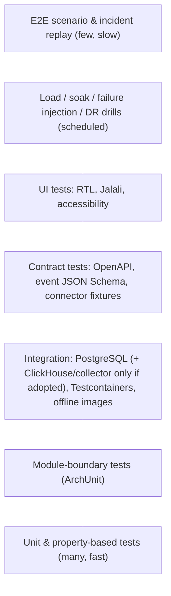

# راهبرد کیفیت و اعتبارسنجی — BSOIP

| فیلد | مقدار |
|---|---|
| Document ID | `TST-001` |
| Version | `0.2` |
| Status | `Draft – Phase 0 – awaiting approval` |
| Date | `2026-10-11` (۱۴۰۵/۰۷/۱۹) |
| Owner | `Architecture` |
| Related documents | [master-plan.md](../roadmap/master-plan.md)، [security-and-threat-model.md](../architecture/security-and-threat-model.md)، [non-functional-requirements.md](../requirements/non-functional-requirements.md)، [implementation-backlog.md](../roadmap/implementation-backlog.md)، [deployment-and-runbooks.md](../operations/deployment-and-runbooks.md)، [open-questions-and-assumptions.md](../architecture/open-questions-and-assumptions.md)، [ADR-0005](../architecture/architecture-decision-records/ADR-0005-api-and-event-contracts.md)، [ADR-0018](../architecture/architecture-decision-records/ADR-0018-data-retention-privacy-capacity-controls.md)، [ADR-0008](../architecture/architecture-decision-records/ADR-0008-telemetry-store-postgresql-first-clickhouse-on-trigger.md)، [ADR-0023](../architecture/architecture-decision-records/ADR-0023-reuse-zabbix-services-and-sla.md)، [product-benchmark.md](../benchmark/product-benchmark.md) |
| Change log | `0.1` (2026-10-11) پیش‌نویس اولیه؛ `0.2` (2026-10-12) **تغییر پس از Product Benchmark**: بخش ۱۷ اعتبارسنجی Evidence PoC؛ بخش ۱۸ آزمون‌های همگام‌سازی Zabbix؛ integration پیش‌فرض با PostgreSQL (ClickHouse/collector مشروط)؛ نرمال‌سازی ارقام در corpus redaction؛ گیت‌های فاز 0.5 و ۲ |

## ۱. اصول

1. **[توصیه]** هر ادعای کیفی (کارایی، دقت، امنیت) باید با آزمون خودکار یا benchmark شناسه‌دار (BM-xx) پشتیبانی شود؛ هیچ عدد کارایی بدون اجرای واقعی گزارش نمی‌شود.
2. **[واقعیت]** محیط بانک بدون Internet است (F-02)؛ بنابراین کل زنجیره آزمون (images، پایگاه داده آسیب‌پذیری، ابزارها) باید آفلاین اجرا شود.
3. **هیچ داده تولیدی حساس** در آزمون استفاده نمی‌شود (بخش ۱۶).
4. آزمون‌ها بخشی از DoD هر Story هستند؛ گیت‌های کیفیت هر فاز در بخش ۱۴.
5. پلتفرمی که اعتماد اپراتور را از دست بدهد شکست خورده است (R-05)؛ بنابراین دقت تحلیل (بخش ۱۲) به اندازه صحت کد اهمیت دارد.

## ۲. هرم آزمون

*توضیح:* پایه هرم آزمون‌های سریع و فراوان است؛ لایه‌های بالا کندتر و کمترند و در pipeline شبانه یا پیش از انتشار اجرا می‌شوند.

| لایه | محل اجرا | زمان هدف [توصیه] | مالک |
|---|---|---|---|
| Unit + ArchUnit | هر commit | < 10 min | توسعه‌دهنده |
| Integration + Contract | هر merge request | < 30 min | توسعه‌دهنده |
| UI component + e2e UI | هر merge request (smoke)، شبانه (کامل) | — | frontend |
| Security (SAST/SCA/secret scan) | هر merge request | — | CI |
| DAST، load، failure injection | شبانه / پیش از انتشار | — | QA/Platform |
| Incident replay و ارزیابی analytics | شبانه + گیت فاز | — | Analytics |
| DR drill | هر انتشار اصلی (فاز ۶ به بعد) | — | Operations |

## ۳. آزمون واحد (Unit)

- چارچوب مطابق ADR-0003 [باز Q-01] (پیش‌فرض: JUnit 5 + AssertJ؛ برای UI: Vitest/Jest + Testing Library).
- پوشش: domain ≥ 80% خط (NFR-MNT-002)؛ معیار کیفیت، نه هدف کور — mutation testing برای ماژول‌های حساس (`ingestion` redaction، `calendar`، `slo`، `correlation`) [توصیه].
- **property-based** برای:
  - تبدیل جلالی↔میلادی (round-trip برای همه روزهای بازه ۱۳۰۰–۱۵۰۰؛ مقایسه با جدول مرجع سال‌های کبیسه).
  - ارزیابی ServiceWindow در مرز نیمه‌شب و روزهای تعطیل.
  - OutcomeMapping: هر کد ورودی دقیقاً به یک `TxnOutcome` نگاشت شود؛ کد ناشناخته → `UNKNOWN`.
  - محاسبه error budget (یکنوایی، عدم منفی شدن).
  - detectorهای redaction (هیچ PAN معتبر Luhn از خروجی عبور نکند).

## ۴. آزمون مرز ماژول (ArchUnit)

- فقط package `..api..` هر ماژول از بیرون قابل دسترسی است.
- ممنوعیت چرخه بین ماژول‌ها.
- `web` و `persistence` فقط از طریق لایه‌های مجاز.
- هیچ ماژولی جز `ingestion` و `evidence-query` به کتابخانه redaction دسترسی نوشتنی/پیکربندی ندارد؛ هیچ ماژولی جز `iam` به کلاس‌های OIDC.
- هیچ کلاسی در `platform-core` کلاینت HTTP به آدرس‌های zone نمی‌سازد (پشتیبان NFR-SEC-010) — قاعده: کتابخانه‌های کلاینت منابع (Zabbix، Splunk، ...) فقط در `connector-runtime`.
- اجرا در CI؛ شکست = توقف merge (NFR-MNT-001).

## ۵. آزمون یکپارچگی (Integration)

- Testcontainers-style با **images آفلاین از registry داخلی** (T-01-08): PostgreSQL 16+، Keycloak (در صورت انتخاب)؛ ClickHouse (همان نسخه LTS تولید) و OTel Collector distribution خودمان **فقط اگر** به‌ترتیب trigger ADR-0008 فعال شود یا `edge-collector` مستقر شود؛ exporter `mq_prometheus` (یا شبیه‌ساز endpoint آن) برای آزمون scrape.
- [توصیه] تنظیم Testcontainers برای استفاده از registry داخلی (`image name substitutor`) و غیرفعال کردن pull از Docker Hub؛ Ryuk image نیز mirror شود.
- موارد کلیدی:
  - migrationهای PostgreSQL از نسخه خالی و از نسخه قبلی (upgrade path).
  - جداول partitioned PostgreSQL برای KPI مشتق: حذف partition منقضی، rollup با بازمحاسبه، dedup (درج دوباره batch → بدون تکرار)؛ همین آزمون‌ها برای ClickHouse در صورت trigger.
  - recursive CTE توپولوژی با گراف‌های ۵۰۰ و ۲۰۰۰ گره.
  - outbox: پیام domain پس از commit تحویل می‌شود و پس از crash گم نمی‌شود.
  - `connector-runtime` → ingest با mTLS، checkpoint/watermark و بازخوانی پس از قطع؛ (در صورت استقرار) collector → ingest با صف دیسکی.

## ۶. آزمون قرارداد (Contract)

| قرارداد | روش | منبع حقیقت |
|---|---|---|
| REST API | OpenAPI 3.1 به‌عنوان منبع؛ بررسی تطابق پیاده‌سازی (schema validation پاسخ‌ها در integration tests)؛ تشخیص breaking change با diff بین نسخه‌ها در CI | ADR-0005 |
| رویدادها | JSON Schema نسخه‌دار؛ تولیدکننده و مصرف‌کننده هر دو در برابر schema آزموده؛ قواعد سازگاری (افزودن فیلد اختیاری = minor؛ حذف/تغییر نوع = major) | ADR-0005، ADR-0006 |
| OTLP | آزمون دریافت با payloadهای نمونه و attributeهای `bank.*` | ADR-0006 |
| کانکتورها | **fixtureهای ضبط‌شده per vendor API version** (Zabbix، SolarWinds، Splunk، ES/OpenSearch، IBM MQ PCF، RabbitMQ، F5، HAProxy، NGINX) | ADR-0020 |

**fixtureهای کانکتور:**
- ضبط در EXP-02 (sandbox) و پس از هر ارتقای نسخه منبع در بانک؛ هر fixture دارای metadata: محصول، نسخه دقیق، تاریخ ضبط، endpoint، و «redacted: true».
- پیش از commit، fixture از redaction و اسکن داده حساس عبور می‌کند (بخش ۷.۵)؛ شناسه‌های میزبان واقعی با نام مستعار جایگزین می‌شوند.
- ماتریس نسخه: هر کانکتور در برابر همه نسخه‌های ثبت‌شده در inventory (US-22-01) آزموده می‌شود. تا زمان ضبط از نسخه بانک، fixtureها از مستندات عمومی ساخته و با برچسب «نیازمند تأیید در نسخه نصب‌شده بانک» علامت می‌خورند.

## ۷. شبیه‌سازها و آزمون امنیت

### ۷.۱ شبیه‌سازهای کانکتور

- برای هر منبع یک شبیه‌ساز HTTP/PCF سبک که fixtureها را replay می‌کند و حالت‌های خطا را تزریق می‌کند: کندی، 5xx، timeout، صفحه‌بندی ناقص، احراز هویت منقضی، rate limit منبع، تغییر schema.
- شبیه‌ساز «سناریو»: تولید داده زمانی هماهنگ برای چند منبع جهت آزمون E2E (مثلاً افزایش depth MQ هم‌زمان با افت موفقیت در لاگ‌ها).
- harness در SDK (US-07-01) امکان اجرای هر کانکتور در برابر شبیه‌ساز را در CI فراهم می‌کند (FR-ING-011).

### ۷.۲ SAST و کیفیت کد

- تحلیل ایستا (مثلاً SpotBugs/Find Security Bugs، Semgrep با قواعد آفلاین، ESLint security) — انتخاب ابزار نهایی با سیاست لایسنس [باز Q-21].
- secret scanning در هر commit (الگوهای کلید، رمز، گواهی).

### ۷.۳ وابستگی و SBOM

- SBOM CycloneDX برای هر artifact و image (NFR-SEC-007).
- اسکن آسیب‌پذیری با **پایگاه داده آسیب‌پذیری mirror‌شده آفلاین** که به‌طور دوره‌ای از مسیر انتقال تأییدشده بانک به‌روز می‌شود؛ عمر پایگاه داده در گزارش ذکر می‌شود (اسکن با پایگاه داده قدیمی‌تر از X روز = هشدار).
- بررسی لایسنس وابستگی‌ها (AGPL و غیره، [باز Q-21]).

### ۷.۴ DAST

- اسکن پویا روی محیط آزمون (UAT-like) برای `web-ui` و `query-api`؛ آزمون‌های احراز هویت/مجوز: دسترسی بدون token، IDOR بین scopeها، بالا بردن نقش، CSRF/CORS، header‌های امنیتی، تزریق در فیلترهای جستجو و query federated.

### ۷.۵ آزمون redaction با corpus مصنوعی

- **corpus تولیدی** (نه داده واقعی): PAN معتبر Luhn با BINهای نمونه آزمون (از جمله نوشته‌شده با ارقام فارسی، عربی-هندی و ترکیبی، با فاصله/خط تیره/ZWNJ)، کد ملی ۱۰ رقمی با رقم کنترل معتبر و نامعتبر (با ارقام لاتین و فارسی)، شبا `IR` + ۲۴ رقم با mod-97 معتبر، شماره موبایل ایرانی در قالب‌های مختلف (با/بدون پیش‌شماره، ارقام فارسی و عربی، فاصله و خط تیره)، شماره حساب طبق الگوهای پیکربندی‌شده.
- جاسازی در قالب‌های واقعی: JSON، XML، ISO 8583 dump متنی، URL query، پیام خطای Java stack trace، فیلد لاگ Splunk/ES.
- **معیار:** recall = 100% روی corpus برای PAN/کد ملی/شبا (هر عبور = شکست build)؛ نرخ false-positive اندازه‌گیری و گزارش (مثلاً شناسه‌های فنی ۱۶ رقمی) [فرضیه: قابل نگهداری زیر حد توافقی].
- آزمون نرمال‌سازی ارقام پیش از detectorها (NFR-PRV-002): هر مورد corpus در نسخهٔ ارقام فارسی/عربی-هندی همان نتیجهٔ نسخهٔ ASCII را دارد.
- آزمون در هر دو لایه: کتابخانه در `connector-runtime` و `ingestion` (و processor در `edge-collector` در صورت استقرار)، و مسیر federated query (NFR-PRV-005).
- **ممیزی پس از اجرا:** اسکن جداول PostgreSQL (و ClickHouse در صورت وجود) و لاگ‌های خود پلتفرم با همان detectorها پس از هر آزمون E2E و در UAT (معیار VS-1 S3).

## ۸. آزمون بار و benchmark

| BM | هدف | سناریو / معیار | Epic |
|---|---|---|---|
| PoC-5 / BM-PG | ذخیره و query KPI مشتق در PostgreSQL | سناریوی reuse Low/Medium؛ ردیف/ثانیه، اندازه/روز، p95 query 24 h/30 d؛ تعیین آستانه‌های trigger | EP-23، EP-19 |
| BM-01 | ingest و فشرده‌سازی ClickHouse — **فقط در صورت trigger ADR-0008** | Low/Medium/High (spine §10)؛ بایت/نمونه، rows/s پایدار | EP-19، EP-06 |
| BM-02 | latency query داشبورد | NFR-PRF-003: p95 ≤ 3 s (24 h)، ≤ 10 s (30 d) | EP-19 |
| BM-03 | ingest و تجمیع خلاصه/رویداد تراکنش — رویداد L2 فقط در صورت trigger | نرخ Medium/High | EP-11 |
| BM-04 | بار query استخراج روی Splunk/ES | با مدیران منابع؛ در محدوده budget | EP-08 |
| BM-05 | هزینه polling API Zabbix | اثر روی Zabbix server/DB | EP-08 |
| BM-06 | اثر polling IBM MQ / scrape `mq_prometheus` | CPU qmgr، تداخل با برنامه | EP-09، PoC-3 |
| BM-07 | throughput و backpressure gateway OTLP — **فقط در صورت استقرار OTLP/`edge-collector`** (P4)؛ در P2 آزمون بار batch API | NFR-PRF-001 p95 ≤ 30 s؛ رفتار 429 | EP-06، EP-14 |
| BM-08 | latency موتور همبستگی | NFR-PRF-004 ≤ 60 s در برابر events/min و اندازه توپولوژی | EP-13 |
| BM-09 | failover/RTO/RPO | NFR-AVL-003 | EP-18 |
| BM-10 | رندر توپولوژی UI | NFR-PRF-005: ۵۰۰ گره ≤ 2 s؛ ۲۰۰۰ گره گزارش | EP-03 |

- بار مصنوعی با مولد T-19-01؛ peak-to-average مطابق سناریو (3×/4×/5×).
- هر گزارش BM: سخت‌افزار، نسخه‌ها، پیکربندی، داده، روش، نتایج خام، محدودیت‌ها. نتایج ADR مربوط را تأیید یا بازنگری می‌کند (ADR-0008، ADR-0010).
- BM-04/05/06 روی منابع واقعی بانک فقط با تأیید مالک منبع و در پنجره توافقی اجرا می‌شود.

## ۹. تزریق خرابی (Failure injection)

| سناریو | روش | رفتار مورد انتظار | NFR |
|---|---|---|---|
| منبع در دسترس نیست | شبیه‌ساز/فایروال آزمون | اجزای وابسته `UNKNOWN` با دلیل؛ هشدار connector؛ بدون retry storm | NFR-REL-004 |
| منبع کند | تأخیر مصنوعی | circuit breaker، کاهش نرخ، budget رعایت؛ freshness نمایش | NFR-IMP-001 |
| (در صورت استقرار) دیسک collector پر | محدود کردن volume | backpressure، رها کردن طبق سیاست اولویت، شمارش drop، هشدار؛ بدون crash | NFR-REL-002 |
| قطع ارتباط `connector-runtime` ↔ core (۱ h و ۴ h) | قطع شبکه | checkpoint/watermark و بازخوانی از منبع؛ بدون تکرار؛ شکاف صریح اگر retention منبع کافی نباشد | NFR-REL-002/003 |
| clock skew | جابه‌جایی ساعت شبیه‌ساز ±5 s، ±60 s، ±10 min | تخمین skew ثبت؛ همبستگی در تحمل پیکربندی‌شده؛ هشدار برای skew بزرگ | R-11 |
| failover پایگاه داده | قطع primary PostgreSQL (Patroni) / یک replica ClickHouse (در صورت وجود) | ادامه خدمت پس از failover؛ ingest با retry؛ RPO در هدف | NFR-AVL-003 |
| خرابی API services/SLA زبیکس یا تغییر نسخه | پاسخ خطا/schema متفاوت در شبیه‌ساز | Capability «unavailable»؛ بقیهٔ کانکتور Zabbix سالم؛ سلامت سرویس کسب‌وکاری بدون آن محاسبه می‌شود | R-17 |
| از دست رفتن IdP | توقف Keycloak/IdP | ورود جدید ممکن نیست؛ sessionها معتبر؛ ingest بی‌تأثیر | — |
| فشار دیسک ذخیره‌گاه تله‌متری (PostgreSQL؛ ClickHouse در صورت وجود) | پر کردن مصنوعی | هشدار پیش از آستانه؛ سیاست TTL؛ عدم خرابی metadata | — |

## ۱۰. بازیابی و DR drill

- **Backup/restore:** بازیابی خودکار PostgreSQL (base backup + WAL) و ClickHouse (backup جداول، در صورت وجود) در محیط آزمون، اعتبارسنجی با checksum ردیف‌ها و آزمون smoke؛ حداقل ماهانه از فاز ۲ [توصیه].
- **DR drill (فاز ۶):** failover به سایت DR طبق runbook؛ اندازه‌گیری RTO/RPO (BM-09)؛ بازگشت؛ گزارش شکاف داده تله‌متری و علامت‌گذاری آن در UI (NFR-AVL-003).
- **Upgrade/rollback drill:** ارتقا از N-1 به N و rollback در پنجره نگهداری (NFR-DEP-003) — جزئیات در [deployment-and-runbooks.md](../operations/deployment-and-runbooks.md).

## ۱۱. آزمون سناریوی end-to-end و replay رخداد (VS-1)

- **ورودی:** حداقل ۳ رخداد تاریخی توافق‌شده با عملیات (master plan §۷.۳) — ترجیحاً همان حوادث PoC-4 که به fixture نسخه‌دار تبدیل شده‌اند؛ برای هر رخداد: بازه زمانی، hop خراب واقعی (برچسب کارشناس)، شدت، سرویس‌های متأثر.
- **روش replay:** [توصیه] دو حالت:
  1. **replay از منابع:** کانکتورها با بازه زمانی تاریخی روی منابع واقعی (فقط اگر retention منابع اجازه دهد و budget تأیید شود).
  2. **replay از fixture:** داده تجمیعی (نه خام) آن بازه یک‌بار استخراج، redact و به‌صورت fixture نسخه‌دار ذخیره می‌شود؛ در CI قابل اجراست.
- **ارزیابی:** سرویس متأثر شناسایی شده؛ رتبه hop واقعی در evidence (top-3)؛ زمان تشخیص پس از شروع؛ تطابق وضعیت سلامت با قضاوت اپراتور در پنجره‌های ۵ دقیقه‌ای نمونه‌گیری‌شده.
- **سناریوهای مصنوعی تکمیلی:** صف MQ پایدار در حال رشد؛ افت موفقیت با ورودی پایدار؛ سرویس خارج از پنجره (`EXPECTED_INACTIVE`)؛ پنجره نگهداری؛ قطع منبع لاگ هم‌زمان با حادثه (R-15).

## ۱۲. ارزیابی تحلیل (Analytics evaluation)

- **مجموعه برچسب‌خورده:** رخدادهای replay + OperatorFeedback (فاز ۴) + سناریوهای مصنوعی؛ نسخه‌دار، با تعریف برچسب (پنجره زمانی، جزء، نوع).
- **معیارها:**
  - detector ناهنجاری: precision، recall، F1 در سطح رخداد (نه نقطه)، زمان تا تشخیص، تعداد هشدار به‌ازای سرویس در روز (alert budget).
  - رتبه‌بندی علت: top-k accuracy، MRR.
  - سلامت: توافق با برچسب اپراتور (درصد پنجره‌های منطبق).
- **گیت:** هیچ detector یا قاعده همبستگی جدید بدون گزارش ارزیابی و مقایسه با نسخه قبل فعال نمی‌شود (ADR-0013)؛ کاهش precision بیش از آستانه توافقی = شکست regression.
- **ریسک:** حجم کم رخداد برچسب‌خورده؛ نتایج با بازه اطمینان گزارش می‌شوند و از ادعای دقت بیش از حد پرهیز می‌شود.

## ۱۳. آزمون UI (RTL و جلالی)

- آزمون component و e2e (مثلاً Playwright با مرورگرهای bundle‌شده آفلاین [فرض]):
  - جهت `rtl`، ترتیب ستون جدول، آیکون‌های جهت‌دار، نمودارهای ECharts با محور زمان جلالی.
  - رشته‌های mixed (نام فارسی + شناسه انگلیسی + عدد) با bidi isolation درست.
  - ارقام: نمایش ارقام فارسی قابل پیکربندی؛ ورودی ارقام فارسی/عربی/لاتین پذیرفته شود.
  - تاریخ: جلالی پیش‌فرض، Asia/Tehran از tzdata، مرز روز و سال کبیسه.
  - visual regression برای صفحات اصلی.
  - accessibility پایه (NFR-USA-003): کنتراست، ناوبری صفحه‌کلید، label فرم.
  - BM-10 برای توپولوژی.

## ۱۴. گیت‌های کیفیت به‌ازای فاز

| فاز | گیت |
|---|---|
| 0.5 | معیارهای پذیرش PoC (بخش ۱۷)؛ ممیزی redaction ذخیره‌گاه PoC؛ گواهی صفر نوشتن در منابع تولید؛ گزارش بار منبع؛ حذف داده/حساب‌ها |
| 1 | Unit+ArchUnit+Integration+Contract سبز؛ پوشش domain ≥ 80%؛ SAST/SCA بدون Critical؛ SBOM و امضا؛ آزمون‌های RBAC/IDOR؛ UI RTL/جلالی؛ نصب آفلاین UAT موفق |
| 2 | + fixtureهای کانکتور برای نسخه‌های inventory؛ شبیه‌سازها؛ failure injection (source down/slow/قطع ۴ h)؛ corpus redaction صفر نشت (با ارقام فارسی/عربی-هندی)؛ آزمون‌های همگام‌سازی Zabbix (بخش ۱۸)؛ BM-04، BM-05، BM-06 و تکرار PoC-5 گزارش‌شده (BM-01/07 فقط در صورت trigger)؛ backup/restore drill |
| 3 | + replay VS-1 با معیارهای S1–S4؛ BM-04 (BM-03 در صورت trigger L2)؛ property tests تقویم/SLO؛ ممیزی redaction در UAT |
| 4 | + golden tests همبستگی؛ top-k روی مجموعه برچسب‌خورده؛ clock-skew injection؛ BM-08، BM-10؛ آزمون guardrail synthetic؛ DAST |
| 5 | + harness ارزیابی، alert budget، regression precision |
| 6 | + BM-02/BM-09 در سناریوی توافقی؛ soak؛ DB failover؛ DR drill؛ upgrade/rollback drill؛ pentest مستقل بدون Critical/High باز |

## ۱۵. ملاحظات CI آفلاین

- runnerهای CI داخل شبکه بانک یا شبکه توسعه ایزوله؛ دسترسی فقط به mirror داخلی [باز Q-09].
- mirror: Maven/Gradle، npm، OCI images (شامل images آزمون)، پایگاه داده آسیب‌پذیری، مرورگرهای Playwright، توزیع OTel Collector و OCB.
- ساخت قابل تکرار (reproducible) تا حد ممکن؛ نسخه pin‌شده؛ verification metadata وابستگی‌ها.
- کش artifactها و تفکیک pipeline سریع (هر commit) و شبانه.
- فرایند ورود وابستگی جدید: درخواست → بررسی لایسنس و آسیب‌پذیری → انتقال از مسیر تأییدشده → ثبت در SBOM (R-09).

## ۱۶. سیاست داده آزمون

- **ممنوع:** هر داده تولیدی حاوی PAN، CVV، PIN، track، کد ملی، شبا، شماره حساب، موبایل مشتری، مبلغ دقیق تراکنش، رمز یا token (ADR-0018).
- **مجاز:** داده مصنوعی؛ fixtureهای redact‌شده و بازبینی‌شده؛ داده تجمیعی (شمارش دقیقه‌ای) بازه‌های رخداد پس از تأیید امنیت؛ نام میزبان‌های مستعار.
- نمونه لاگ برای EXP-01 فقط پس از ناشناس‌سازی توسط بانک و در محیط تأییدشده بررسی می‌شود و وارد مخزن نمی‌شود.
- کلیدهای HMAC محیط آزمون با کلیدهای تولید متفاوت‌اند.
- مالک داده آزمون: Analytics Lead + Security Architect.

## ۱۷. اعتبارسنجی Evidence PoC (فاز 0.5)

هدف: آزمودن فرضیه‌های H-09..H-13 ([open-questions-and-assumptions.md](../architecture/open-questions-and-assumptions.md) §۵ و §۶.۲) پیش از ساخت. کد PoC دورریختنی است و تحت گیت‌های کیفیت فاز ۱ قرار نمی‌گیرد، ولی **قیود ایمنی و صحت سنجش** زیر اجباری‌اند.

| آزمایش | روش اعتبارسنجی | معیار موفقیت | داده |
|---|---|---|---|
| PoC-1 | مدل‌سازی برش VS-1 در **Zabbix غیرتولیدی** (tag، service tree، SLA schedule، excluded downtime)؛ خواندن `service.get`/`sla.getsli` با حساب فقط‌خواندنی؛ مقایسه با قضاوت اپراتور در چند پنجرهٔ زمانی | وضعیت سرویس و SLI در پنجره‌های نمونه با قضاوت اپراتور منطبق؛ فهرست مستند آنچه قابل نمایش نیست (تعطیلات جلالی، DayType، expected-inactive) | داده موجود Zabbix یا مصنوعی برچسب‌دار |
| PoC-2 | اجرای جست‌وجوی تعریف‌شده توسط پلتفرم (نصب/اجرا توسط مدیر منبع)؛ مقایسهٔ شمارش‌ها با شمارش مستقل یک بازهٔ کنترلی | شمارش دقیقه‌ای outcome (فنی/کسب‌وکاری) و صدک latency قابل تولید؛ اختلاف با بازهٔ کنترلی در حد توافق؛ مصرف ≤ budget | لاگ موجود VS-1 |
| PoC-3 | خواندن MQ از `mq_prometheus` یا itemهای Zabbix با حساب حداقل؛ آزمون منفی put/get/browse و `RESET QSTATS` | depth و نرخ (مستقیم یا مشتق) با دورهٔ 10–60 s؛ فهرست معیارهای ناموجود؛ صفر تغییر پیکربندی | qmgr غیرتولیدی یا تولید با تأیید |
| PoC-4 | replay سه حادثهٔ تاریخی (یا مصنوعی برچسب‌دار) با برچسب کارشناس پیش از اجرا (blind)؛ تزریق افت throughput/افزایش latency در دادهٔ مصنوعی | تشخیص ≤ ۲ بازهٔ polling؛ همبستگی با رشد صف/خرابی downstream و نام سرویس متأثر؛ top-3 برای ≥ ۲ از ۳؛ برچسب واقعیت/استنباط/confidence در ۱۰۰٪ خروجی‌ها | خروجی PoC-1..3 |
| PoC-5 | مولد بار مصنوعی سناریوی reuse Low/Medium روی PostgreSQL | نرخ نوشتن پایدار، اندازه/روز و p95 query 24 h/30 d در برابر NFR-PRF-003؛ تعیین آستانه‌های trigger | مصنوعی |

**قیود اجباری (همهٔ آزمایش‌ها):** اجرای کاملاً آفلاین؛ **صفر نوشتن در منابع تولید** (اثبات با لاگ audit منبع یا مجوزهای حساب)؛ بار منبع در budget توافق‌شده (اندازه‌گیری و گزارش)؛ صفر دادهٔ حساس در ذخیره‌گاه PoC (ممیزی redaction با corpus بخش ۷.۵ و نرمال‌سازی ارقام)؛ دادهٔ مصنوعی با برچسب صریح `synthetic`؛ برچسب‌گذاری کور حوادث پیش از اجرای رتبه‌بندی برای جلوگیری از سوگیری؛ گزارش نتیجه برای هر آزمایش به‌صورت موفق/ناموفق/نامعلوم با محدودیت‌ها و بازهٔ عدم‌قطعیت (حجم ۳ حادثه برای ادعای دقت آماری کافی نیست).

**خروجی پایدار:** فقط گزارش، fixtureهای redact‌شده و تجمیعی (برای استفادهٔ مجدد در replay بخش ۱۱) و پیشنهاد تصمیم ADR؛ کد PoC وارد مخزن محصول نمی‌شود.

## ۱۸. آزمون‌های همگام‌سازی Zabbix (FR-CAL-008، FR-INT-008)

| # | آزمون | روش | رفتار مورد انتظار |
|---|---|---|---|
| ZS-01 | تبدیل تقویم به maintenance/SLA schedule | unit/property: روزهای تعطیل جلالی، نیمه‌روز، پنجره‌های عبوری از نیمه‌شب Asia/Tehran، سال کبیسه جلالی | بازه‌های UTC صحیح؛ بدون offset ثابت در کد |
| ZS-02 | idempotency | اجرای دوبارهٔ sync روی شبیه‌ساز/fixture Zabbix | هیچ ورودی تکراری؛ شناسهٔ مرجع پلتفرم پایدار |
| ZS-03 | عدم تداخل با ورودی‌های دیگران | ورودی maintenance دستی در شبیه‌ساز | ورودی‌های غیرپلتفرمی تغییر یا حذف نمی‌شوند |
| ZS-04 | تشخیص drift | تغییر دستی ورودی پلتفرم در شبیه‌ساز | drift گزارش و audit می‌شود؛ بازنویسی فقط در حالت مجاز |
| ZS-05 | حالت پیش‌فرض dry-run/export | اجرا بدون مجوز نوشتن | فقط فایل خروجی تولید؛ صفر فراخوانی نوشتنی API (بررسی با شبیه‌ساز) |
| ZS-06 | قرارداد API per version | fixtureهای ضبط‌شدهٔ `maintenance.*`، `service.get`، `sla.getsli` برای نسخه‌های inventory (Q-26) | پاسخ‌ها با capability صحیح؛ نسخهٔ پشتیبانی‌نشده → «unavailable» |
| ZS-07 | وارد کردن وضعیت services/SLA به‌عنوان شاهد | fixture با وضعیت‌های مختلف و نگاشت ExternalRef | شاهد با برچسب `zabbix-service` و `observed_at`؛ بدون تعیین مستقیم `HealthState` کسب‌وکاری |
| ZS-08 | مجوز حداقل | حساب نوشتن (در صورت تأیید E-02) فقط روی maintenance/SLA | هر فراخوانی خارج از دامنه رد می‌شود (آزمون منفی) |

همهٔ آزمون‌ها در CI روی شبیه‌ساز/fixture اجرا می‌شوند؛ هیچ آزمونی به Zabbix تولید نمی‌نویسد.

## نکته برای بازبینی

- انتخاب ابزارهای مشخص (Playwright، Semgrep و ...) به ADR-0003/ADR-0014 و سیاست لایسنس Q-21 وابسته است و در این سند فقط نمونه‌اند.
- معیار recall = 100% برای corpus redaction یک معیار build روی داده مصنوعی است، نه تضمین برای همه قالب‌های واقعی؛ ممیزی دوره‌ای UAT/PROD همچنان لازم است.
