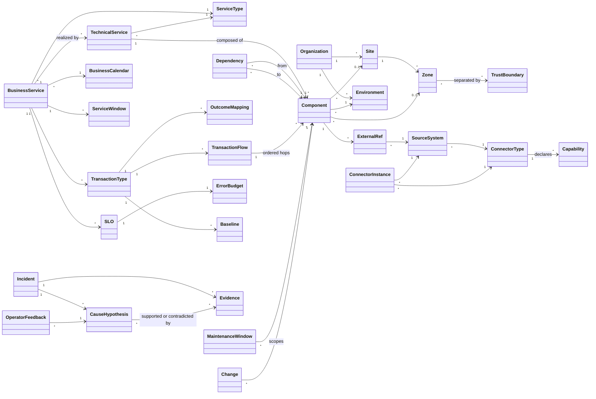
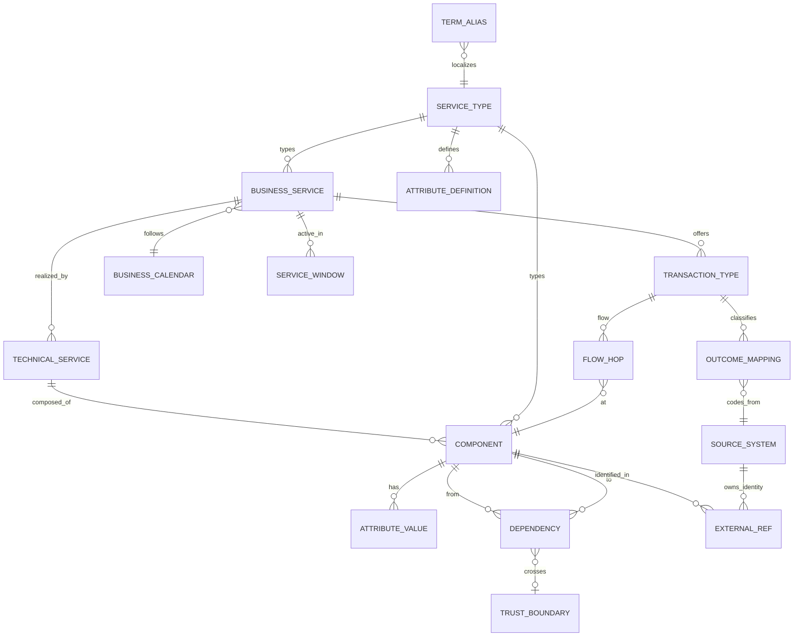
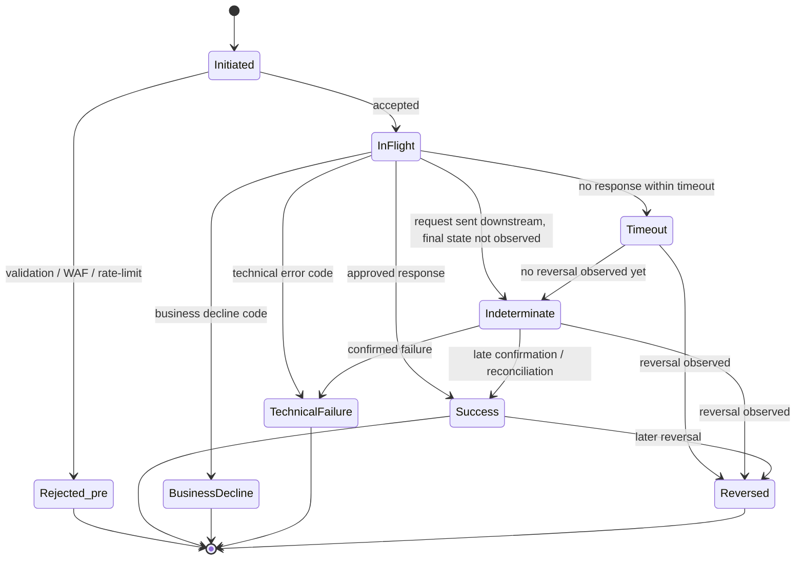
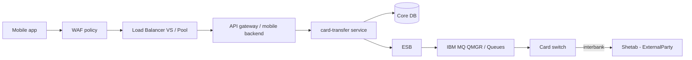

# مدل دامنهٔ بانکی (Domain Model)

| فیلد | مقدار |
|---|---|
| Document ID | `DOC-VIS-002` |
| Version | `0.1` |
| Status | `Draft – Phase 0 – awaiting approval` |
| Date | `2026-10-11` (۱۴۰۵/۰۷/۱۹ – `1405/07/19`) |
| Owner | `Architecture` |
| Related documents | [product-charter.md](product-charter.md)، [functional-requirements.md](../requirements/functional-requirements.md)، [non-functional-requirements.md](../requirements/non-functional-requirements.md)، [ADR-0006](../architecture/architecture-decision-records/ADR-0006-canonical-schemas-otel-plus-bank-namespace.md)، [ADR-0007](../architecture/architecture-decision-records/ADR-0007-metadata-store-postgresql.md)، [ADR-0011](../architecture/architecture-decision-records/ADR-0011-topology-model-and-dependency-discovery.md)، [ADR-0018](../architecture/architecture-decision-records/ADR-0018-data-retention-privacy-capacity-controls.md)، [ADR-0019](../architecture/architecture-decision-records/ADR-0019-transaction-correlation-tiers.md) |

> **قرارداد برچسب‌گذاری:** **[واقعیت]**، **[فرض A-xx]**، **[فرضیه]**، **[توصیه]**، **[باز Q-xx]** — مطابق [منشور محصول](product-charter.md).

---

## ۱. هدف و اصل بنیادین

این سند مفاهیم مشترک دامنه را تعریف می‌کند که همهٔ ماژول‌های `platform-core` (به‌ویژه `catalog`، `topology`، `calendar`، `slo`، `transactions`، `events`، `correlation`، `health`) بر آن تکیه دارند. نام‌های انگلیسی موجودیت‌ها **ثابت‌اند** و در کد، API و schemaها همین‌گونه به کار می‌روند.

**اصل بنیادین — بانک‌ها متفاوت پیاده‌سازی می‌کنند.** دو بانک ممکن است سرویس «کارت به کارت» را با زنجیره‌های کاملاً متفاوت (با یا بدون ESB، با IBM MQ یا REST مستقیم، سوئیچ داخلی یا برون‌سپاری‌شده) و با کدهای پاسخ، اصطلاحات و پنجره‌های کاری متفاوت پیاده کنند. بنابراین **[توصیه]**:

- مدل، **هستهٔ ثابت کوچک** (موجودیت‌ها و enumهای canonical) + **لایهٔ قابل‌پیکربندی بزرگ** (انواع سرویس، ویژگی‌های سفارشی، اصطلاحات، نگاشت‌های نتیجه، تقویم‌ها) است.
- هیچ قاعدهٔ خاص بانک (کد پاسخ، زمان چرخهٔ پایا، نام سرویس) در کد ثابت نمی‌شود؛ همه **داده** هستند و نسخه‌بندی و audit می‌شوند ([FR-CAT-012](../requirements/functional-requirements.md)، [FR-ADM-003](../requirements/functional-requirements.md)).

## ۲. نمای کلی موجودیت‌ها



*توضیح شکل:* هستهٔ کاتالوگ (سازمان، سایت، محیط، zone، سرویس و مؤلفه)، لایهٔ تراکنش (TransactionType/Flow/OutcomeMapping)، لایهٔ زمان (تقویم، پنجره‌ها، SLO)، لایهٔ منبع داده (SourceSystem/Connector/Capability) و لایهٔ حادثه (Incident/Evidence/CauseHypothesis) در یک نما.

## ۳. تعاریف موجودیت‌ها

### ۳.۱ سازمان، مکان و محیط

| موجودیت | تعریف | نکات |
|---|---|---|
| `Organization` | بانک (مستأجر منطقی). | **[فرض A-01]** تک‌بانک؛ چندبانکی فقط Could در Phase 6+ ([FR-ADM-005](../requirements/functional-requirements.md))؛ **[باز Q-11]**. |
| `Site` | مکان فیزیکی/منطقی (مرکز دادهٔ اصلی، سایت DR). | **[فرض A-01]** دو سایت. |
| `Environment` | محیط اجرایی: `PROD`، `DR`، `UAT`، `TEST` — **قابل پیکربندی**. | هر مؤلفه دقیقاً به یک Environment تعلق دارد؛ نگاشت PROD↔DR صریح است ([FR-CAT-005](../requirements/functional-requirements.md)). |
| `Zone` | ناحیهٔ شبکه/اعتماد (مثلاً `dmz`، `card-zone`، `core-banking-zone`، `middleware-zone` — **نمونه‌اند و خاص هر بانک**). | محل استقرار `connector-runtime` و `edge-collector` (هر zone یک نمونه). |
| `TrustBoundary` | مرز اعتماد بین دو zone یا بین بانک و طرف بیرونی؛ نوع: `internal` \| `external` \| `trusted-partner` \| `interbank`. | روی `Dependency` ثبت می‌شود؛ برای طبقه‌بندی failure domain و قواعد امنیتی مهم است. |

### ۳.۲ سرویس‌ها و مؤلفه‌ها

| موجودیت | تعریف |
|---|---|
| `BusinessService` | خدمتی که مشتری یا کسب‌وکار آن را می‌شناسد (مثلاً «کارت به کارت همراه‌بانک»، «حوالهٔ ساتنا»). دارای owner، criticality، Environment، وضعیت چرخهٔ عمر، تقویم و پنجره‌های سرویس. |
| `TechnicalService` | سرویس فنی که یک یا چند BusinessService را محقق می‌کند (مثلاً «card-transfer-service»، «ESB card routes»). |
| `ServiceType` | نوع سرویس/مؤلفه از **رجیستری قابل‌گسترش** (بخش ۶) با schema ویژگی‌های سفارشی. |
| `Component` | واحد قابل‌پایش. زیرنوع‌ها: `Application`، `ApplicationInstance`، `Host`، `Container`، `Pod`، `Cluster`، `Endpoint` (API)، `Database`، `Cache`، `MessageBroker` (QueueManager / RabbitMQ node)، `Queue`، `Channel`، `LoadBalancer`، `VirtualServer`، `Pool`، `PoolMember`، `WafPolicy`، `IdentityProvider`، `ExternalParty` (مثلاً سوئیچ شتاب، سامانه‌های بانک مرکزی — «مرتبط با شتاب در صورت کاربرد»). |
| `Dependency` | یال جهت‌دار بین دو مؤلفه/سرویس با ویژگی‌های: `from`، `to`، `direction`، `protocol`، `criticality`، `provenance` (`MANUAL` \| `DISCOVERED` \| `IMPORTED`)، `source` (کدام سیستم/روش)، `confidence` (۰..۱)، `firstSeen`، `lastSeen`، وضعیت تأیید (`PROPOSED` \| `APPROVED` \| `REJECTED`)، و در صورت عبور از مرز، `TrustBoundary`. |
| `ExternalRef` | نگاشت یک موجودیت کاتالوگ به هویت آن در منبع: Zabbix `hostid`/`itemid`، SolarWinds `NodeID`، Splunk `host`/`source`/`sourcetype`، Elasticsearch `index` + فیلتر فیلد، MQ `qmgr` + `queue`، F5 virtual/pool. یک مؤلفه می‌تواند چند ExternalRef داشته باشد. |

قواعد کلیدی **[توصیه]**:

- **سلسله‌مراتب ترکیب** (`BusinessService → TechnicalService → Component`، و `LoadBalancer → VirtualServer → Pool → PoolMember`، `MessageBroker → Queue/Channel`، `Cluster → Pod → Container`) با **وابستگی زمان اجرا** (`Dependency`) متفاوت است و جداگانه ذخیره می‌شود.
- یال‌های `DISCOVERED` تا تأیید (`APPROVED`) در محاسبهٔ سلامت فقط با وزن `confidence` اثر دارند و در UI متمایز نمایش داده می‌شوند ([ADR-0011](../architecture/architecture-decision-records/ADR-0011-topology-model-and-dependency-discovery.md)).
- توپولوژی در PostgreSQL به‌صورت جداول adjacency و پیمایش با recursive CTE ذخیره می‌شود؛ پایگاه‌دادهٔ گراف استفاده نمی‌شود ([ADR-0007](../architecture/architecture-decision-records/ADR-0007-metadata-store-postgresql.md)).

### ۳.۳ تراکنش

| موجودیت | تعریف |
|---|---|
| `TransactionType` | نوع تراکنش قابل‌پیکربندی توسط بانک، به ازای هر سرویس (مثلاً `card_transfer`، `balance_inquiry`، `satna_transfer`). |
| `TransactionFlow` | ترتیب hopهای یک نوع تراکنش روی مؤلفه‌ها (مثلاً mobile backend → card-transfer service → ESB → MQ → switch). مبنای مقایسهٔ upstream/downstream ([FR-TXN-006](../requirements/functional-requirements.md)). |
| `OutcomeMapping` | جدول نگاشت «کد منبع → `TxnOutcome`» به ازای (TransactionType، منبع، hop). **داده است، نه کد** — مثلاً جدول کدهای پاسخ ISO 8583. |
| `TransactionSummary` | سیگنال تجمیعی دقیقه‌ای: تعداد به تفکیک outcome، latency (P50/P95/P99 در صورت وجود)، به ازای (TransactionType، hop، دقیقه)، همراه با `correlation_tier`. |
| `TransactionEvent` | رویداد سطح تراکنش (فقط L2/L3) با کلیدهای **توکن‌شده با HMAC-SHA256**؛ بدون PAN/مبلغ دقیق ([ADR-0018](../architecture/architecture-decision-records/ADR-0018-data-retention-privacy-capacity-controls.md)). |

### ۳.۴ زمان، تقویم و سطح سرویس

| موجودیت | تعریف |
|---|---|
| `BusinessCalendar` | تقویم کاری با ماهیت جلالی (میلادی هم پشتیبانی می‌شود). تعطیلات **هر سال به‌صورت داده بارگذاری می‌شود**؛ تعطیلات قمری هجری **محاسبه نمی‌شوند** **[باز Q-15]**. |
| `DayType` | `WORKDAY`، `HALF_DAY`، `HOLIDAY`، `SPECIAL`. |
| `ServiceWindow` | پنجرهٔ فعالیت/پردازش مورد انتظار یک سرویس (مثلاً چرخه‌های ساتنا/پایا) — **کاملاً قابل‌پیکربندی**، به ازای DayType. |
| `MaintenanceWindow` | پنجرهٔ نگهداری برنامه‌ریزی‌شده یا اضطراری با دامنهٔ مؤلفه/سرویس و معنای suppression ([FR-CAL-003](../requirements/functional-requirements.md)). |
| `SLO` / `ErrorBudget` | هدف سطح سرویس تقویم‌آگاه (فقط در پنجرهٔ فعال شمرده می‌شود) و بودجهٔ خطا/نرخ سوختن. |
| `Baseline` | الگوی حجم/latency مورد انتظار به ازای زمان هفته و DayType. |

زمان **[توصیه]**: ذخیره به UTC با دقت میلی‌ثانیه؛ نمایش به `Asia/Tehran` از طریق tzdata (بدون offset ثابت)؛ ثبت `observed_at`، `ingested_at` و `source_clock_skew_estimate` (**[فرض A-08]**، **[باز Q-17]**).

### ۳.۵ منبع داده و سیگنال

| موجودیت | تعریف |
|---|---|
| `SourceSystem` | نمونهٔ یک سیستم منبع (مثلاً «Zabbix PROD»، «Splunk Cluster A»). |
| `ConnectorType` | نوع connector (Zabbix، SolarWinds، Splunk، Elasticsearch/OpenSearch، IBM MQ، RabbitMQ، F5، HAProxy، NGINX، DB read-only). |
| `ConnectorInstance` | نمونهٔ پیکربندی‌شدهٔ یک connector در یک zone با زمان‌بندی و بودجهٔ پرس‌وجو. |
| `Capability` | قابلیتی که connector **اعلام** می‌کند و برای هر نصب **تأیید** می‌شود (مثلاً «IBM MQ oldest message age در دسترس است»). داشبوردها و قواعد بر اساس Capability تأییدشده فعال می‌شوند. |

انواع سیگنال: `Metric`، `LogDerivedMetric`، `Event` (alert/problem/change)، `TransactionSummary`، `TransactionEvent` (توکن‌شده)، `TraceSummary` (بعدها). نام‌گذاری ویژگی‌ها مطابق OTel semantic conventions + فضای نام `bank.*` (مثلاً `bank.service.id`، `bank.txn.type`، `bank.txn.outcome`، `bank.txn.correlation_tier`) — [ADR-0006](../architecture/architecture-decision-records/ADR-0006-canonical-schemas-otel-plus-bank-namespace.md).

### ۳.۶ سلامت و حادثه

| موجودیت | تعریف |
|---|---|
| `HealthState` | `OK`، `DEGRADED`، `CRITICAL`، `UNKNOWN` (دادهٔ ناکافی یا کهنه)، `EXPECTED_INACTIVE` (خارج از پنجرهٔ سرویس)، `MAINTENANCE`. |
| `Incident` | گروهی از رویدادها/ناهنجاری‌های مرتبط در زمان و توپولوژی. |
| `Evidence` | سیگنال/رویداد پیوست‌شده به حادثه با hop، زمان، و پیوند به منبع. |
| `CauseHypothesis` | فرضیهٔ علت محتمل با `rank`، `score`، `confidence`، `explanation` و `counter-evidence`. **ادعای علیت نیست.** |
| `Change` | تغییر (`Deployment`، `ConfigChange`) مرتبط با مؤلفه. |
| `OperatorFeedback` | تأیید/رد/اصلاح فرضیه توسط اپراتور؛ ورودی ارزیابی ([FR-COR-006](../requirements/functional-requirements.md)). |

## ۴. نمودار ER منطقی (هستهٔ کاتالوگ و تراکنش)



*توضیح:* `ATTRIBUTE_DEFINITION`/`ATTRIBUTE_VALUE` مکانیزم ویژگی‌های سفارشی و `TERM_ALIAS` مکانیزم اصطلاحات بانک است (بخش ۶). این نمودار منطقی است؛ طراحی فیزیکی جداول در مستندات `metadata-db` می‌آید.

## ۵. چرخهٔ عمر تراکنش و نتایج

### ۵.۱ نتیجهٔ canonical — `TxnOutcome`

| مقدار | معنا | مثال |
|---|---|---|
| `SUCCESS` | موفقیت فنی و کسب‌وکاری | تراکنش انجام شد |
| `BUSINESS_DECLINE` | موفقیت فنی، شکست کسب‌وکاری | موجودی ناکافی، رمز نادرست، کارت مسدود |
| `TECHNICAL_FAILURE` | خطای سیستم/زیرساخت | خطای پایگاه‌داده، صادرکننده در دسترس نیست |
| `TIMEOUT` | پاسخ در مهلت دریافت نشد | timeout در انتظار پاسخ سوئیچ |
| `REJECTED` | رد پیش از پردازش (اعتبارسنجی/امنیت/WAF/rate-limit) | 4xx اعتبارسنجی، بلاک WAF، 429 |
| `REVERSED` | تراکنش برگشت داده شد | reversal پس از timeout |
| `INDETERMINATE` | وضعیت نهایی در زمان مشاهده معلوم نیست | درخواست به سوئیچ رفت، پاسخ نیامد، reversal هنوز مشاهده نشده |
| `UNKNOWN` | داده برای طبقه‌بندی کافی نیست | لاگ فاقد کد پاسخ (R-01) |

> **تفاوت `INDETERMINATE` و `UNKNOWN`** **[توصیه]**: `INDETERMINATE` یعنی «می‌دانیم به وضعیت میانی گیر کرده» (ریسک مالی/تطبیق دارد)؛ `UNKNOWN` یعنی «نمی‌توانیم طبقه‌بندی کنیم» (مشکل کیفیت داده است). این دو در KPIها جدا شمرده می‌شوند و هیچ‌کدام در مخرج «موفقیت» به‌عنوان موفق حساب نمی‌شوند؛ قاعدهٔ دقیق شمارش در SLO قابل‌پیکربندی است ([FR-CAL-005](../requirements/functional-requirements.md)).

### ۵.۲ نمودار حالت (دید مشاهده‌ای)



*توضیح:* حالت‌های `Initiated` و `InFlight` **مراحل مشاهده‌ای** هستند و در `TxnOutcome` ذخیره نمی‌شوند؛ نتیجه‌های پایانی به مقادیر `TxnOutcome` نگاشت می‌شوند (`Rejected_pre` → `REJECTED`). در سطح L0 (تجمیعی) این گذارها فقط به‌صورت شمارش‌های دقیقه‌ای نتیجه دیده می‌شوند؛ ردگیری گذار یک تراکنش منفرد (مثلاً `TIMEOUT` → `REVERSED`) فقط با L2/L3 ممکن است ([ADR-0019](../architecture/architecture-decision-records/ADR-0019-transaction-correlation-tiers.md)). وقتی گذار تأخیری رخ می‌دهد، خلاصهٔ دقیقهٔ اصلی بازنویسی نمی‌شود؛ رویداد اصلاحی با زمان خود ثبت می‌شود و KPI «نرخ برگشت» جداگانه محاسبه می‌شود **[توصیه]**.

### ۵.۳ سطوح همبستگی تراکنش (خلاصه از ADR-0019)

| سطح | روش | دقت |
|---|---|---|
| L3 Trace | W3C `traceparent` / OTel trace id | دقیق |
| L2 Business key | join قطعی روی کلیدهای پیکربندی‌شدهٔ بانک (مثلاً ISO 8583 STAN+RRN+terminal+date، شمارهٔ پیگیری ساتنا/پایا) — توکن‌شده با HMAC-SHA256 | دقیق در حد کیفیت کلید |
| L1 Heuristic | کلید جزئی + پنجرهٔ زمانی + bucket مبلغ | احتمالاتی با confidence |
| L0 Aggregate | مقایسهٔ شمارش‌های دقیقه‌ای hop به hop | پیش‌فرض؛ باید به‌تنهایی مفید باشد |

هر معیار تراکنشی سطح استخراج خود را ثبت می‌کند و UI آن را نشان می‌دهد.

### ۵.۴ نگاشت نتیجه به‌عنوان داده (OutcomeMapping)

نمونهٔ **صرفاً توضیحی** (کدهای واقعی باید از مستندات سوئیچ/سامانهٔ بانک و EXP-01 استخراج شوند؛ **نیازمند تأیید در نسخه نصب‌شده بانک**):

```yaml
outcomeMapping:
  id: om-card-transfer-switch-v1
  transactionType: card_transfer
  source: { system: splunk-prod, field: resp_code }
  hop: card-switch
  defaultOutcome: UNKNOWN
  rules:
    - match: { equals: "00" }          # approved (ISO 8583 convention)
      outcome: SUCCESS
    - match: { in: ["51", "55", "61"] } # illustrative business declines
      outcome: BUSINESS_DECLINE
    - match: { in: ["91", "96"] }       # illustrative issuer/system errors
      outcome: TECHNICAL_FAILURE
    - match: { equals: "68" }           # illustrative late response
      outcome: TIMEOUT
  version: 3
  approvedBy: service-owner
```

قواعد **[توصیه]**: نسخه‌بندی‌شده، audit‌شده، قابل‌آزمون با نمونه‌لاگ پیش از فعال‌سازی، و `defaultOutcome = UNKNOWN` (هرگز `SUCCESS` پیش‌فرض نیست).

## ۶. رجیستری انواع سرویس و قواعد توسعه‌پذیری

### ۶.۱ ServiceType Registry

انواع پایه‌ای که همراه محصول ارائه می‌شوند (**[توصیه]**؛ فهرست اولیه و قابل‌تغییر):

| `ServiceType` key | دسته | ویژگی‌های پایه (نمونه) |
|---|---|---|
| `business.card-transfer` | BusinessService | channel، limit profile |
| `business.account-transfer` | BusinessService | channel |
| `business.satna` / `business.paya` / `business.pol` | BusinessService | calendarRef، cycle schedule ref |
| `business.card-issuing` / `business.card-acquiring` | BusinessService | – |
| `business.open-banking-api` | BusinessService | API product، consumer type |
| `tech.mobile-backend` / `tech.internet-banking` | TechnicalService | – |
| `tech.api-gateway` | TechnicalService | gateway product |
| `tech.esb` | TechnicalService | ESB product |
| `tech.card-switch` | TechnicalService | switch product، ISO 8583 variant |
| `comp.ibm-mq-qmgr` / `comp.rabbitmq-node` | Component/MessageBroker | version |
| `comp.f5-virtual` / `comp.haproxy-frontend` / `comp.nginx-upstream` | Component/LB | – |
| `comp.waf-policy` | Component/WafPolicy | – |
| `comp.sqlserver` / `comp.oracle` / `comp.postgresql` | Component/Database | – |
| `ext.shetab` / `ext.cbi-system` | Component/ExternalParty | trustBoundary = `interbank` |

### ۶.۲ قواعد توسعه‌پذیری

1. **انواع سفارشی**: بانک می‌تواند `ServiceType` جدید با `key` در فضای نام `custom.*` تعریف کند و آن را به یکی از دسته‌های پایه (BusinessService/TechnicalService/زیرنوع Component) متصل کند. نوع سفارشی رفتار پایه (سلامت، توپولوژی) را از دستهٔ خود به ارث می‌برد.
2. **ویژگی‌های سفارشی (custom attributes)**: هر `ServiceType` یک schema (JSON Schema نسخه‌بندی‌شده) دارد: نام، نوع (`string`، `number`، `boolean`، `enum`، `date`، `ref`)، الزامی/اختیاری، اعتبارسنجی، برچسب فارسی/انگلیسی، و پرچم `sensitive` (ویژگی حساس در خروجی‌ها mask می‌شود). تغییر ناسازگار schema نسخهٔ جدید می‌سازد و مهاجرت مقادیر قبلی را الزام می‌کند.
3. **اصطلاحات و نام‌های مستعار بانک (TermAlias)**: هر مفهوم canonical (نوع سرویس، نوع تراکنش، وضعیت، نام hop) می‌تواند برچسب فارسی/انگلیسی خاص بانک و مترادف داشته باشد (مثلاً «انتقال وجه کارتی» به جای «کارت به کارت»). جست‌وجو روی alias کار می‌کند؛ شناسهٔ canonical در API تغییر نمی‌کند.
4. **نگاشت نتیجه به‌عنوان داده**: `OutcomeMapping` (بخش ۵.۴).
5. **تقویم و پنجره به‌عنوان داده**: `BusinessCalendar`، `ServiceWindow`، `MaintenanceWindow`.
6. **کلیدهای همبستگی به‌عنوان داده**: تعریف کلیدهای L2 به ازای TransactionType و hop (نام فیلد در منبع، قاعدهٔ نرمال‌سازی، توکن‌سازی).
7. **حدود**: enumهای canonical (`TxnOutcome`، `HealthState`، `DayType`، `provenance`، `TrustBoundary`) **توسط بانک قابل‌گسترش نیستند**؛ بانک فقط به آن‌ها نگاشت می‌کند. این قاعده تحلیل‌ها، SLO و همبستگی را قابل‌اتکا نگه می‌دارد.
8. **قابلیت حمل**: همهٔ این داده‌ها از طریق import/export YAML/CSV قابل‌انتقال بین محیط‌اند ([FR-CAT-011](../requirements/functional-requirements.md)، [NFR-DEP-004](../requirements/non-functional-requirements.md)).

نمونهٔ تعریف نوع سفارشی:

```yaml
serviceType:
  key: custom.bill-payment-gateway
  category: TechnicalService
  labels: { fa: "درگاه پرداخت قبض", en: "Bill payment gateway" }
  aliases: { fa: ["پرداخت قبوض"] }
  attributeSchemaVersion: 1
  attributes:
    - name: billerCount
      type: number
      required: false
    - name: providerContract
      type: string
      sensitive: true
```

## ۷. واژه‌نامه (فارسی ↔ English identifier)

| اصطلاح فارسی | English / identifier | توضیح |
|---|---|---|
| کارت به کارت | Card-to-card transfer / `business.card-transfer` | انتقال وجه بین کارت‌ها؛ در بین‌بانکی از شتاب عبور می‌کند. سرویس پیش‌فرض VS-1 **[باز Q-13]** |
| انتقال حساب به حساب | Account-to-account (A2A) | انتقال درون‌بانکی یا بین‌بانکی (از طریق پایا/ساتنا/پل) |
| ساتنا | SATNA (RTGS) / `business.satna` | سامانهٔ تسویهٔ ناخالص آنی بانک مرکزی؛ چرخه‌ها/ساعات کاری قابل‌پیکربندی **[باز Q-15]** |
| پایا | PAYA (ACH) / `business.paya` | سامانهٔ پایاپای الکترونیکی با چرخه‌های دسته‌ای؛ زمان‌بندی قابل‌پیکربندی **[باز Q-15]** |
| پل | POL / `business.pol` | سامانهٔ انتقال آنی بین‌بانکی بانک مرکزی؛ پنجره‌ها و محدودیت‌ها قابل‌پیکربندی **[باز Q-15]** |
| شتاب | Shetab / `ext.shetab` | شبکهٔ تبادل اطلاعات بین‌بانکی (سوئیچ کارت)؛ `ExternalParty` با مرز `interbank` |
| شاپرک | Shaparak | شبکهٔ الکترونیکی پرداخت کارت برای پذیرندگی (PSPها)؛ در دامنهٔ acquiring به‌عنوان `ExternalParty` در صورت کاربرد |
| شبا | Sheba / IBAN (IR + 24 digits) | شناسهٔ حساب؛ **دادهٔ حساس برای redaction** |
| کد ملی | National ID | **دادهٔ حساس برای redaction** |
| سوئیچ کارت | Card switch / `tech.card-switch` | مسیریاب پیام‌های ISO 8583 |
| صدور کارت | Card issuing | سمت صادرکننده |
| پذیرندگی | Card acquiring | سمت پذیرنده (POS، IPG) |
| همراه‌بانک | Mobile banking | کانال Android/iOS/PWA |
| اینترنت‌بانک | Internet banking | کانال وب |
| بانکداری باز | Open Banking | APIهای ارائه‌شده به اشخاص ثالث |
| درگاه API | API gateway / `tech.api-gateway` | – |
| گذرگاه سرویس سازمانی | ESB / `tech.esb` | – |
| صف پیام | Message queue / `Queue` | IBM MQ queue، RabbitMQ queue |
| مدیر صف | Queue manager / `MessageBroker` | IBM MQ QMGR |
| کانال (MQ) | Channel / `Channel` | کانال ارتباطی بین QMGRها |
| توازن‌گر بار | Load Balancer / `LoadBalancer` | F5، HAProxy، NGINX |
| دیوارهٔ آتش برنامهٔ وب | WAF / `WafPolicy` | – |
| مرز اعتماد | Trust boundary / `TrustBoundary` | – |
| ناحیهٔ شبکه | Zone / `Zone` | – |
| برگشت تراکنش | Reversal / `REVERSED` | – |
| ردِ کسب‌وکاری | Business decline / `BUSINESS_DECLINE` | – |
| وضعیت نامعین | Indeterminate / `INDETERMINATE` | – |
| غیرفعال مورد انتظار | Expected inactive / `EXPECTED_INACTIVE` | – |
| پنجرهٔ نگهداری | Maintenance window / `MaintenanceWindow` | – |
| روز کاری / نیمه‌تعطیل / تعطیل | `WORKDAY` / `HALF_DAY` / `HOLIDAY` | `DayType` |
| هدف سطح سرویس | SLO | – |
| بودجهٔ خطا | Error budget | – |
| شمارهٔ پیگیری | Tracking/reference number | کلید L2؛ توکن‌شده |
| شمارهٔ مرجع بازیابی | RRN (ISO 8583 field 37) | کلید L2؛ توکن‌شده |
| شمارهٔ ردیابی سیستم | STAN (ISO 8583 field 11) | کلید L2؛ توکن‌شده |
| شمارهٔ کارت | PAN | **هرگز ذخیره نمی‌شود**؛ فقط توکن HMAC یا BIN در صورت توجیه |

> «نکته برای بازبینی»: توصیف ساتنا/پایا/پل/شتاب/شاپرک در این جدول دانش عمومی است و باید با واحدهای کسب‌وکار بانک تأیید شود؛ هیچ ساعت/چرخه‌ای در این سند ثبت نشده است و ثبت نخواهد شد مگر به‌عنوان دادهٔ پیکربندی (Q-15).

## ۸. نگاشت دامنه‌های بانکی به مدل

در همهٔ موارد زیر: **بانک‌ها متفاوت پیاده‌سازی می‌کنند**؛ زنجیره‌ها نمونه‌اند و در کاتالوگ هر بانک به‌صورت داده مدل می‌شوند. منبع داده در فازهای اولیه همیشه ابزارهای موجود است ([ADR-0020](../architecture/architecture-decision-records/ADR-0020-existing-platform-integration-read-only-pull.md)).

| دامنه | نگاشت به مدل | سیگنال‌های قابل‌انتظار (بدون instrumentation جدید) | ملاحظات |
|---|---|---|---|
| **صدور/پذیرش کارت** | BusinessService (`business.card-issuing`/`-acquiring`) → TechnicalService (CMS، سوئیچ، HSM-facing service) → Component؛ ExternalParty (شتاب، شاپرک) | لاگ سوئیچ (کد پاسخ ISO 8583)، Zabbix میزبان‌ها | OutcomeMapping بر اساس کدهای ISO 8583 خاص سوئیچ؛ PAN/track/PIN block هرگز ذخیره نمی‌شود |
| **سوئیچ پرداخت / شتاب** | `tech.card-switch` + `ext.shetab` با Dependency از نوع `interbank` | نرخ پاسخ به تفکیک کد، timeout، وضعیت اتصال (در صورت لاگ‌شدن) | سلامت شتاب فقط از دید بانک قابل‌مشاهده است؛ شواهد بیرونی با confidence پایین‌تر |
| **کارت به کارت و A2A** | `business.card-transfer` / `business.account-transfer`؛ TransactionFlow چند hop؛ L0 پیش‌فرض، L2 با STAN/RRN | خلاصه‌های دقیقه‌ای از ES/Splunk، عمق صف MQ | VS-1؛ تفکیک `BUSINESS_DECLINE` از `TECHNICAL_FAILURE` حیاتی است |
| **همراه‌بانک / اینترنت‌بانک** | BusinessService کانالی → `tech.mobile-backend`/`tech.internet-banking` → Endpointها | لاگ دسترسی LB/gateway، لاگ برنامه، ورود موفق/ناموفق ([FR-DX-004](../requirements/functional-requirements.md)) | latency سمت کاربر تا Phase 7 در دسترس نیست |
| **Android / PWA** | کانال به‌عنوان ویژگی TransactionType یا BusinessService جداگانه (تصمیم بانک) | فقط از سمت سرور تا Phase 7 (RUM، [FR-DX-005](../requirements/functional-requirements.md)) | نسخهٔ app در صورت وجود در لاگ، ویژگی سیگنال است |
| **Open Banking / مدیریت API** | `business.open-banking-api` → `tech.api-gateway` → Endpoint؛ TrustBoundary `trusted-partner`/`external` | نرخ درخواست، 4xx/5xx، rate-limit (`REJECTED`) از gateway/LB | شناسهٔ مصرف‌کنندهٔ API ممکن است حساس باشد؛ سیاست redaction قابل‌پیکربندی |
| **ساتنا / پایا / پل** | BusinessServiceهای جدا با `BusinessCalendar` و `ServiceWindow` (چرخه‌ها)؛ ExternalParty سامانه‌های بانک مرکزی | حجم/نتیجه در پنجره؛ سکوت خارج از پنجره → `EXPECTED_INACTIVE` | پنجره‌ها هرگز hardcode نمی‌شوند ([FR-CAL-002](../requirements/functional-requirements.md)، [FR-CAL-004](../requirements/functional-requirements.md)) **[باز Q-15]** |
| **ESB** | `tech.esb` با Componentهای route/flow؛ Dependencyهای ورودی/خروجی | لاگ ESB، معیارهای Zabbix، صف‌های MQ مرتبط | ESB معمولاً گرهٔ مشترک چند سرویس است؛ اثر انتشار ([FR-HLT-002](../requirements/functional-requirements.md)) مهم است |
| **مرزهای اعتماد** | `Zone` + `TrustBoundary` روی Dependency | – | تعیین محل استقرار connector و قواعد failure-domain ([FR-LB-007](../requirements/functional-requirements.md)) |
| **IBM MQ / RabbitMQ** | `MessageBroker` → `Queue`/`Channel` | عمق، max depth، نرخ enq/deq، oldest message age، وضعیت کانال (IBM MQ)؛ management API/Prometheus plugin (RabbitMQ) — **نیازمند تأیید در نسخه نصب‌شده بانک** | دسترسی فقط‌خواندنی کمینه (EXP-04)؛ طبقه‌بندی backlog ([FR-MQ-004](../requirements/functional-requirements.md)) |
| **LB / Proxy / WAF** | `LoadBalancer` → `VirtualServer` → `Pool` → `PoolMember`؛ `WafPolicy` | از Zabbix/SolarWinds یا API فقط‌خواندنی (F5 iControl REST، HAProxy stats، NGINX status) — **نیازمند تأیید در نسخه نصب‌شده بانک** | اعلام Capability به ازای منبع ([FR-LB-002](../requirements/functional-requirements.md)) |
| **Docker / Kubernetes** | `Cluster` → `Pod` → `Container`؛ ApplicationInstance روی Pod | Prometheus scrape از طریق `edge-collector` یا connector (Phase 4، [FR-RUN-005](../requirements/functional-requirements.md)) | شناسه‌های گذرا؛ ExternalRef بر اساس labelها نه نام Pod |
| **Application Server** | `Application` / `ApplicationInstance` | JVM از طریق JMX (Phase 4)؛ .NET (Phase 7) | – |
| **پایگاه‌داده** | `Database` | Zabbix؛ SQL Server ابتدا (Phase 4، [FR-RUN-003](../requirements/functional-requirements.md)) | فقط حساب فقط‌خواندنی |
| **Cache** | `Cache` | Zabbix/Prometheus در صورت وجود | – |
| **احراز هویت (auth)** | `IdentityProvider` + Endpointهای ورود | نرخ ورود موفق/ناموفق و latency احراز هویت از لاگ ([FR-DX-004](../requirements/functional-requirements.md)) | OTP و توکن‌ها هرگز ذخیره نمی‌شوند |

### ۸.۱ نمونه: زنجیرهٔ VS-1



*توضیح:* زنجیرهٔ پیش‌فرض VS-1 (کارت به کارت از طریق همراه‌بانک) **[باز Q-13]**. هر گره یک `Component` با ExternalRef به Zabbix/ES/Splunk/MQ است و هر یال یک `Dependency` با provenance=`MANUAL` در Phase 1.

## ۹. نکات برای بازبینی

- «نکته برای بازبینی»: spine مراحل میانی (`Initiated`، `InFlight`) را تعریف نکرده است؛ در این سند فقط به‌عنوان مراحل مشاهده‌ای در نمودار آمده‌اند و enum جدیدی پیشنهاد نشده است. اگر L2 در Phase 3 نیاز به ذخیرهٔ وضعیت میانی داشته باشد، باید در ADR-0019 تصمیم‌گیری شود.
- «نکته برای بازبینی»: مفاهیم `TermAlias` و `AttributeDefinition` در spine §4 نام‌گذاری نشده‌اند ولی برای FR-CAT-003 لازم‌اند؛ پیشنهاد می‌شود به‌عنوان بخشی از ماژول `catalog` پذیرفته شوند.
